# 使用 Thonny 建立 Python 環境與安裝 OpenCV

本指南包含先前 Bookworm 與既有 Trixie 的不同環境紀錄。學生使用 Thonny 編寫與執行 Python，基本系統安裝與設定仍使用作業系統提供的工具。其他課程的相機、AI 模型與特殊模組尚須各自測試。

## 選擇今天的學習環境

如果這是你第一次準備 Python，先讀[學習前先讀我](./學習前先讀我.md)，再從[第 14 課的綠色圓形](./第%2014%20課｜在%20Raspberry%20Pi%205%20安裝%20OpenCV.md)開始。下面的表格像課前的工具箱索引：找到今天要做的事情，只準備那一組，不需要一次安裝全部工具。

| 今天想做什麼？ | 從哪裡一起準備？ |
| --- | --- |
| 一般圖片、畫圖、灰階 | [第 14 課](./第%2014%20課｜在%20Raspberry%20Pi%205%20安裝%20OpenCV.md)帶你建立 Trixie／Python 3.13 的環境。 |
| 相機取像，或 CSRT、LBPH、MOG 等擴充功能 | 看本頁「既有 Trixie：同時使用 Picamera2 與 OpenCV 擴充功能」。相機練習先完成第 07 課；只處理圖片或影片則不用接相機。建立後不必再混裝另一種 OpenCV。 |
| YOLO 圖片與影片 | [第 39 課](./第%2039%20課｜YOLOv8%20與%20COCO%20資料集完整教學.md)有 Trixie 的 CPU 環境建立步驟；這個隔離環境尚未整合 Picamera2，不能直接當成第 42、43 課的相機環境。 |
| LiteRT 單圖與相機分類 | [補充 3](./補充%203｜🧠%20TensorFlow%20Lite%20%28TFLite%29%20教學入門指南.md)與[補充 8](./補充%208｜PiCamera2%20%2B%20TensorFlow%20Lite%20%28MobileNetV1%29%20%2B%20即時影像分類%20%2B%20顯示分類文字%20的%20完整教學.md)各有 Trixie 步驟；先選自己的系統版本，再讀範例。 |
| MediaPipe／CVZone 或 YOLO 相機 | 目前部分課程沿用老師的舊環境，Trixie 從零準備仍有缺口；請由老師先確認模組與相機能一起使用，再帶班實作。 |
| Ollama 或 OCR | Ollama 是本機服務、Tesseract 是系統程式，單靠在 Python 安裝套件還不夠。請先由老師確認服務或程式已準備，再按課文練習。 |

如果不知道自己是哪一種系統，可以在 RP5 終端機依第 02 課查詢，或先在 Thonny 執行[環境觀察小程式](./範例程式/看看目前的Python環境.py)，拿結果與老師一起看。遇到紅字時，從[排錯故事](./程式卡住時怎麼辦.md)開始；本頁更細的版本與歷史紀錄供需要時查閱。

## 安裝出錯時，先從這裡處理（2026-11-11 補寫）

目前教材的 OpenCV 安裝在[第 14 課](./第%2014%20課｜在%20Raspberry%20Pi%205%20安裝%20OpenCV.md)，第 11 課是 vi／nano。**既有 Trixie／Python 3.13 請先依第 14 課操作**；本頁下一節的 NumPy 1.26.4／OpenCV 4.10.0 範例是 Bookworm／Python 3.11 歷史紀錄，不能直接套用到 Trixie。

| 看到的錯誤 | 判讀與下一步 |
| --- | --- |
| `No matching distribution found for install` | pip 把 `install` 當成要找的套件名稱；這不是 OpenCV 不支援。關閉套件管理器，依下方「修復流程」直接在 Thonny 執行對應版本的安裝程式。 |
| `ModuleNotFoundError: No module named 'pkg_resources'` | 既有 Thonny 的套件管理功能依賴舊介面，但所用環境無法匯入。不要在套件搜尋欄找 `pkg_resources`；Trixie 使用第 14 課固定版本的安裝程式，安裝包含該介面的 setuptools 80.9.0。 |
| `No module named cv2` | 套件未安裝成功或 Thonny 選到另一個 Python。比對安裝程式印出的 `Python:` 與右下角路徑，先修正直譯器再測。 |
| `No matching distribution found for numpy…` 或 `opencv-python…` | 記錄完整套件名稱、Python 版本和平台，確認選用該系統的教材版本；不要把上表的 `install` 錯誤與套件版本不相容混為一談。 |

### 修復流程：關閉錯誤視窗後可以繼續做什麼

1. 關閉 **Tools → Manage packages** 錯誤視窗；回到 **Tools → Options → Interpreter**，確認 Python executable 是自己新建環境的 `bin/python3`。回主畫面後，右下角應顯示相同路徑。
2. 按紅色 **Stop/Restart backend**。在 Thonny 開新檔，選擇對應的安裝程式並按綠色 **Run**：Trixie／Python 3.13 使用[第14課-Trixie-Thonny安裝.py](./範例程式/第14課-Trixie-Thonny安裝.py)；先前 Bookworm／Python 3.11 的版本參考[第14課-Thonny安裝套件.py](./範例程式/第14課-Thonny安裝套件.py)。執行前閱讀程式，確認它印出的 `Python:` 指向自己的虛擬環境。
3. 等待安裝程式的 `Installation completed`。若出現 traceback、`CalledProcessError` 或其他 `ERROR`，這次安裝尚未成功；保存完整錯誤，不要只看到下載進度就跳到後續課程。
4. 再按一次 **Stop/Restart backend**，於同一環境執行以下檢查。Trixie 本課紀錄應為 Python 3.13.5、setuptools 80.9.0、NumPy 2.2.6、OpenCV 4.12.0，且 `pkg_resources available` 為 `True`；使用者名稱和環境目錄可不同。

   ```python
   import sys
   import importlib.util
   from importlib.metadata import version
   import cv2
   import numpy as np

   print('Python executable:', sys.executable)
   print('Python version:', sys.version.split()[0])
   print('Virtual environment:', sys.prefix != sys.base_prefix)
   print('setuptools:', version('setuptools'))
   print('pkg_resources available:', importlib.util.find_spec('pkg_resources') is not None)
   print('NumPy:', np.__version__)
   print('OpenCV:', cv2.__version__)
   ```

5. `Virtual environment` 應為 `True`。若路徑不對，回第 1 步；若版本查詢或匯入仍失敗，在確認路徑後重新執行對應安裝程式。接著依[第 14 課步驟 3](./第%2014%20課｜在%20Raspberry%20Pi%205%20安裝%20OpenCV.md#步驟-3畫圖存檔開啟視窗)驗證繪圖、PNG 存檔與視窗關閉。成功匯入、圖形管理器可用和圖像視窗可用是不同驗收項目；本機先前證據是安裝程式成功及圖像範例成功，未另記錄套件管理器修復後的重新操作驗收。

`install` 錯誤表示安裝引數被當成套件名稱，現有截圖不足以斷定是哪個輸入欄位或檔案造成。如果使用 requirements 檔，每行應是 `numpy==版本` 等套件規格；不要放整行 `pip install …` 或單獨的 `install`。格式可查 [pip 官方說明](https://pip.pypa.io/en/stable/reference/requirements-file-format/)。

固定 setuptools 80.9.0 是這份舊 Thonny 流程的相容處理。[setuptools 官方紀錄](https://setuptools.pypa.io/en/stable/history.html#v82-0-0)說明 82.0.0 移除了 `pkg_resources`；因此不能把「升級到最新版 setuptools」當作此錯誤的通用修法。現有紀錄也不足以判斷原失敗環境是未安裝 setuptools，還是版本已移除此介面。

以上修復方式依既有安裝程式及各課原始截圖整理；2026-11-11 補寫排錯與檢查流程，當日 SSH 連線逾時，未宣稱新一輪 RP5 或全新系統驗證。下方保留不同日期的歷史操作。

## Bookworm 歷史操作（2026-10-29，Python 3.11）

## 先認識虛擬環境

Python 解譯器執行程式，套件提供額外功能。虛擬環境是一個獨立的 Python 套件空間：Thonny 使用哪個解譯器，就會從那個環境尋找套件。把套件裝到別的 Python，並不代表 Thonny 找得到。

## 在 Thonny 建立環境

1. 打開 Thonny，選擇 **Tools → Options → Interpreter**。選擇 Local Python 3，再點 **New virtual environment**。
2. 選一個不存在的新資料夾。本機示範使用 `/home/pi/ba5077-thonny-20261029`；學生可選自己的新資料夾，勿選既有的作業或環境。
3. 建立完成後，確認 Python executable 指向該環境的 `bin/python3`，按 **OK**。Thonny 右下角會顯示目前解譯器。

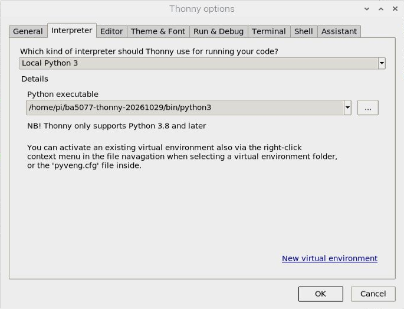

此環境預設隔離系統 Python 套件，建立成功不表示 Picamera2 已可使用。相機與特殊擴充模組需依後續各課選用並驗證相容環境。

## 從 Thonny 安裝套件：本機實測

本機在 **Tools → Manage packages** 嘗試搜尋 NumPy，搜尋畫面未顯示結果；選取 requirements 檔的安裝則出現下列錯誤，因此不能把這次圖形管理器操作說成安裝成功。

```text
ERROR: Could not find a version that satisfies the requirement install
ERROR: No matching distribution found for install
Process returned with code 1
```

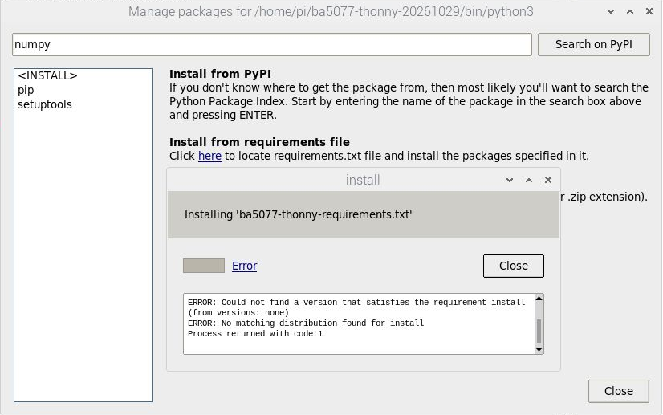

本機改以 Thonny 開啟並執行[安裝程式](./範例程式/第14課-Thonny安裝套件.py)。它使用 `sys.executable` 指向 Thonny 當前選用的 Python，安裝指定版本的 NumPy 和 OpenCV；請先確認右下角是你要安裝的**獨立環境**，並確定有網路和足夠空間。不要對系統 Python 使用此步驟。檔案由課程儲存庫提供，開啟後可先閱讀程式再按綠色執行鈕。

```python
import subprocess
import sys

print('Python:', sys.executable, flush=True)
subprocess.run([sys.executable, '-m', 'pip', 'install', 'numpy==1.26.4', 'opencv-python==4.10.0.84'], check=True)
print('Installation completed. Restart Thonny interpreter before testing.', flush=True)
```

本機實際輸出節錄：

```text
Installing collected packages: numpy, opencv-python
Successfully installed numpy-1.26.4 opencv-python-4.10.0.84
Installation completed. Restart Thonny interpreter before testing.
```

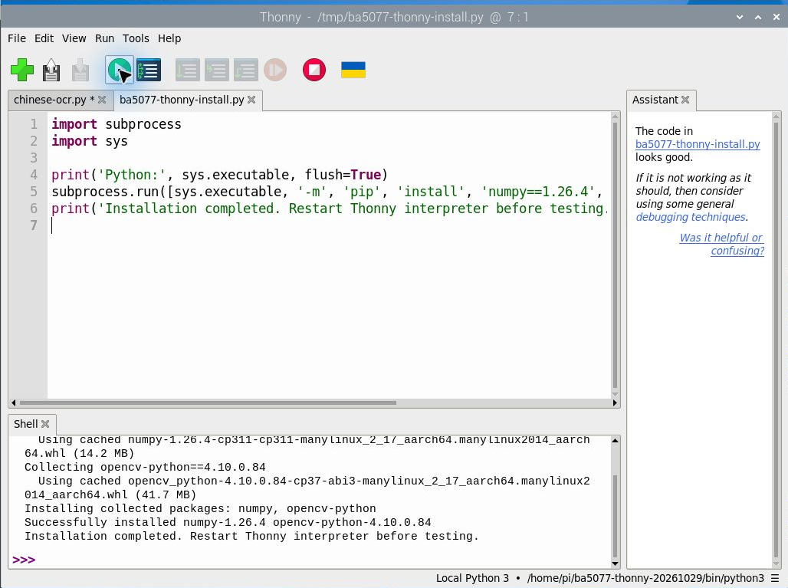

這次使用快取，首次安裝可能顯示下載進度。安裝完選擇 **Run → Stop/Restart backend**（或紅色停止鈕），再在 Thonny 開啟[測試程式](./範例程式/第12課-Thonny測試.py)並按執行。實際輸出：

```text
OpenCV version: 4.10.0
Image shape: (120, 160, 3)
Center BGR: [0, 255, 0]
```

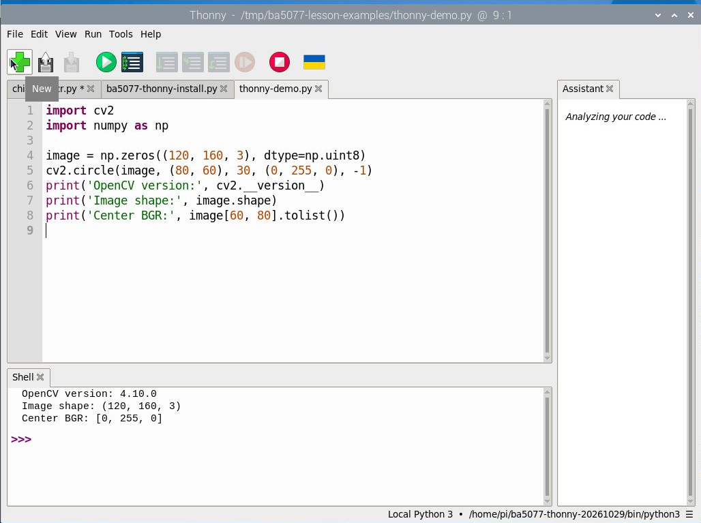

使用[視窗範例](./範例程式/第14課-Thonny視窗測試.py)也實際顯示綠色圓形；此例只證明這個版本在此桌面環境可開啟視窗。不要在同一環境混裝多種提供 `cv2` 的 OpenCV 套件。

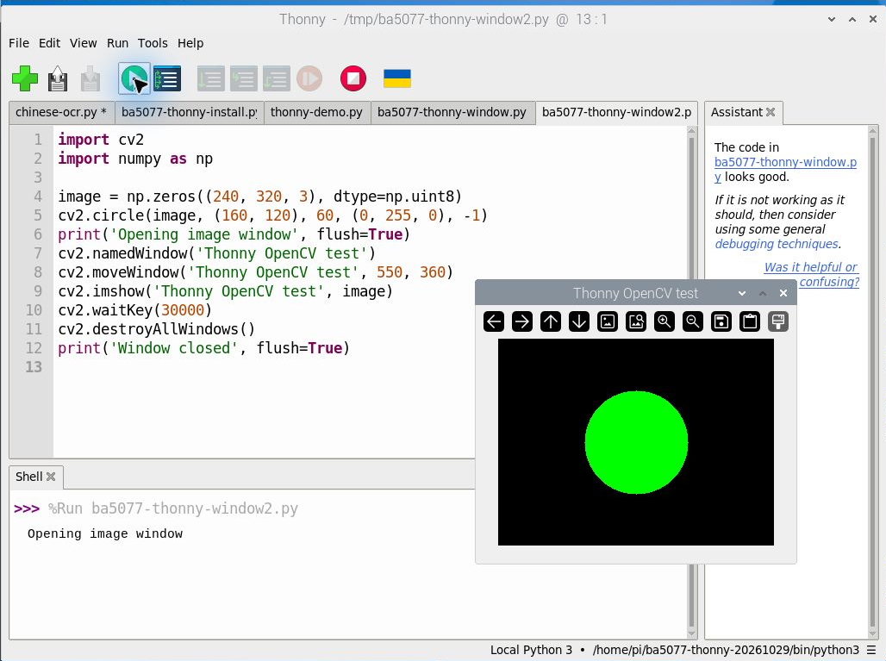

若看到 `ModuleNotFoundError`，先核對右下角解譯器與安裝程式顯示的 Python 路徑，再確認安裝是否成功。不同課程的套件版本不一定能放在同一環境；不要自行將所有套件無差別混裝。進一步閱讀：[Thonny 官方套件安裝說明](https://github.com/thonny/thonny/wiki/InstallingPackages)。

## 相機課：在 Thonny 建立可讀取系統套件的環境

上面的獨立環境不會自動看到 Raspberry Pi OS 安裝的 Picamera2。這台 RP5 的系統已具備 Picamera2 與 OpenCV；本次在 Thonny 開啟[建立相機環境的程式](./範例程式/Thonny建立相機環境.py)，按綠色執行鈕，建立一個允許讀取系統套件的新環境。建立前請確認 `target` 指向不存在的新目錄；若目錄已存在，程式會停止，請修改名稱後再執行。

本次 Thonny Shell 的實際輸出：

```text
建立環境： /home/pi/ba5077-camera-20261029
執行環境： /home/pi/myenv/bin/python3
完成。請在 Thonny 選擇： /home/pi/ba5077-camera-20261029/bin/python3
```

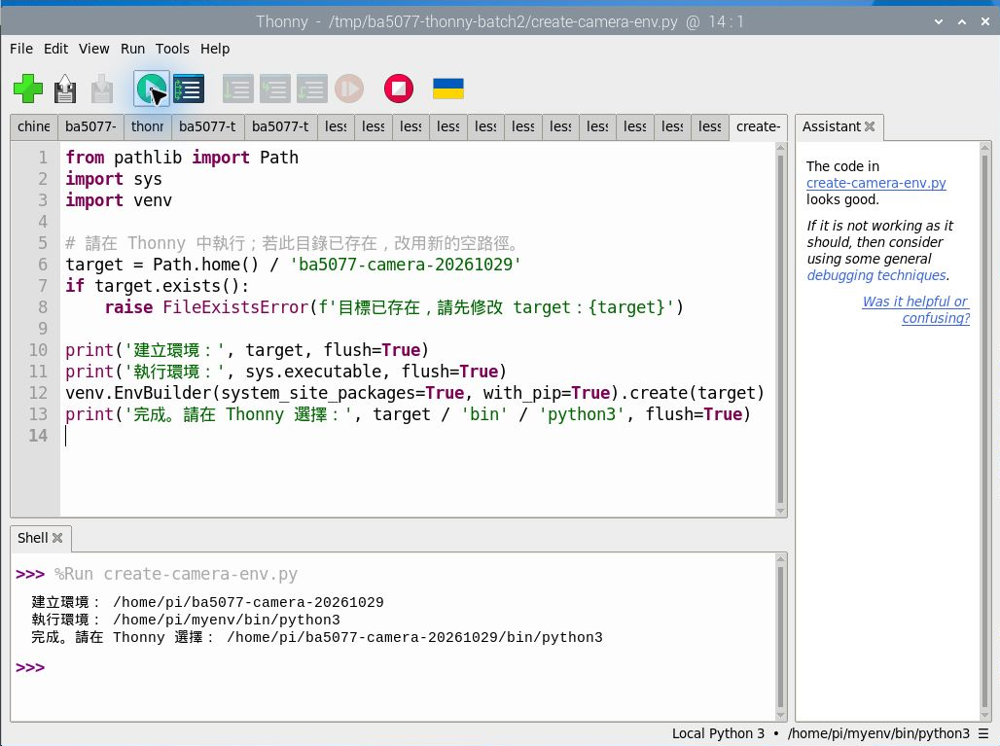

接著選 **Tools → Options → Interpreter → Local Python 3**，按 Python executable 旁的 `…`，依序進入自己建立的環境、`bin`，選擇 `python3`，按 **OK**。選取後再檢查右下角的路徑。這個環境會讀取系統套件，系統更新可能改變其中可見的版本；它不是完全隔離的環境。建立環境本身也不會替尚未安裝的系統安裝 Picamera2。

選用該新環境後，本機實際從 Thonny 執行[第 15 課範例](./範例程式/第15課.py)，取得彩色與灰階陣列的尺寸。圖中的紅字是相機輸出訊息；最下方有程式的 `frame` 與 `gray` 結果。

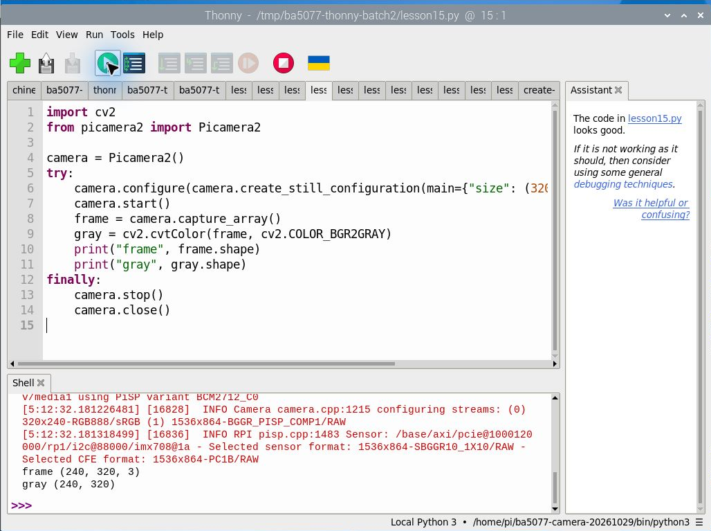

本機新環境看到系統 Picamera2、NumPy 1.24.2 與 OpenCV 4.10.0-dev；其他機器的版本可能不同。系統先決條件缺少時，先依教師提供的 Raspberry Pi OS 基本設定完成，再回到 Thonny 檢查與執行。已安裝的套件或其他虛擬環境不要任意覆寫。

## 既有 Trixie：同時使用 Picamera2 與 OpenCV 擴充功能（2026-11-10）

第 25 課 CSRT 等相機範例需要兩者在同一解譯器。本次在既有 Trixie／Python 3.13.5 以 Thonny 建立新的獨立目錄，繼承系統已安裝的 Picamera2，再安裝 OpenCV 擴充套件；這不是全新系統的安裝驗證。繼承系統套件表示這個環境並非完全隔離，系統更新仍可能影響它。

1. 確認系統已可使用 Picamera2，並有 `venv`、網路及足夠空間；下載並開啟 [建立環境程式](./範例程式/Thonny建立Trixie相機OpenCV擴充環境.py)。其中 `target` 應改成自己帳號主目錄下**不存在**的新資料夾；若已存在程式會停止，不要刪除舊資料。
2. 在 Thonny 按 F5：程式執行系統 Python 建立帶 `--system-site-packages` 的環境，安裝 `numpy==2.2.4` 與 `opencv-contrib-python==4.12.0.88`。不要另外在此環境混裝其他提供 `cv2` 的 OpenCV 套件。下圖是本機安裝成功的 Thonny 截圖；本機從快取取得套件，其他設備可能需下載。
3. 選 **Run → Configure interpreter**，以瀏覽選取新目錄的 `bin/python3`。先在 Shell 檢查 `import cv2` 與 `from picamera2 import Picamera2`；`hasattr(cv2, 'TrackerCSRT_create')` 為 `True` 才表示 CSRT 介面可用。

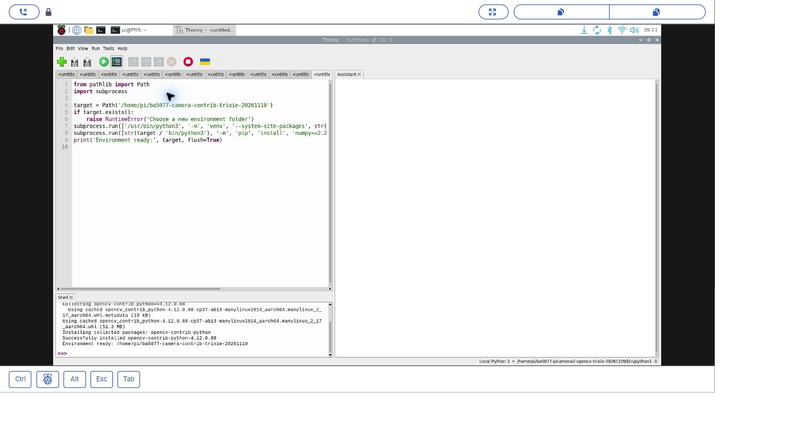

本機新增路徑為 `/home/pi/ba5077-camera-contrib-trixie-20261110/bin/python3`。安裝後另以此解譯器檢查：OpenCV `4.12.0`、NumPy `2.2.4`，Picamera2 可匯入，CSRT 和 `bgsegm` 屬性均存在；這些匯入與屬性檢查由終端機執行，**不等於相機追蹤已驗收**。若系統沒有 Picamera2 或版本不相容，請先依系統官方文件準備，再重建新環境；遇到失敗不要將未完成的環境視為可用。

## 第 25～27 課：在 Thonny 建立 OpenCV 擴充環境

第 25 課的 CSRT 追蹤器與第 27 課的 `bgsegm` MOG 需要包含擴充功能的 OpenCV。本次於 RP5、Python 3.11 使用新建的**隔離環境**實測，不影響原有環境。它不會自動包含 Picamera2，因此相機即時程式仍需相機環境。

1. 從 [建立擴充環境程式](./範例程式/Thonny建立OpenCV擴充環境.py)下載 `.py`，在 Thonny 用 **File → Open** 開啟。下載方法見[素材指南](./練習素材/素材下載與使用.md)。程式的 `target` 是本次 RP5 的 `/home/pi/ba5077-contrib-20261029`；學生如果帳號不是 `pi`，或該目錄已存在，先改成自己主目錄中**尚不存在**的新資料夾。若目錄存在程式會停止，請勿刪除既有環境。需要網路、足夠儲存空間及能使用 Python `venv` 的基本系統。
2. 先閱讀程式，按綠色執行鈕。程式使用 `venv` 建立新環境，再安裝 `numpy==1.26.4`、`opencv-contrib-python==4.11.0.86`。不要在同一環境另外混裝 `opencv-python` 等提供 `cv2` 的套件。
3. 等 Shell 顯示 `Installation completed` 並回到 `>>>`。本機這次使用快取；不同電腦可能顯示下載進度，且可能受網路或平台支援影響。安裝中斷時不要把半成品當成完成；改用另一個新資料夾重試。
4. 選 **Tools → Options → Interpreter → Local Python 3**，點 `…` 進入剛建立的資料夾，再開啟 `bin` 並選 `python3`，按 **OK**。確認右下角顯示自己新環境的路徑，再開啟各課程式並按綠色執行鈕。

本機 Thonny 實際輸出節錄：

```text
Installing collected packages: numpy, opencv-contrib-python
Successfully installed numpy-1.26.4 opencv-contrib-python-4.11.0.86
Installation completed: /home/pi/ba5077-contrib-20261029/bin/python3
Select this interpreter in Thonny and restart the backend.
```

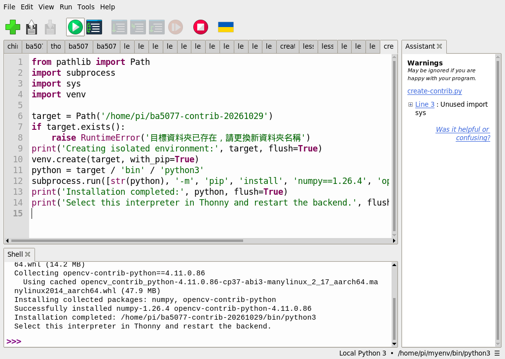

本次另在選取的新環境中實測第 25 課 CSRT 與第 26、27 課短影片處理；各課截圖右下角可核對解譯器。先前的 `/home/pi/myenv` 同時含兩種 OpenCV 套件，雖然也能執行測試，**不建議當成學生建立環境的範例**。

## 補充 3、8：Thonny 建立獨立 TFLite 單圖環境

這次在 RP5 Bookworm 64 位元、Python 3.11.2，從 Thonny 執行[環境建立程式](./範例程式/Thonny建立TFLite環境.py)。它在家目錄建立新的獨立環境，安裝 NumPy 1.26.4、opencv-python 4.10.0.84 與 tflite-runtime 2.14.0；執行前確認程式中的 `target` 指向不存在的新資料夾。已有資料夾時程式停止，不會覆蓋。這次使用套件快取，其他機器首次安裝可能需要網路。

在 Thonny 開啟程式並按綠色執行鈕，本機 Shell 實際輸出節錄：

```text
Successfully installed numpy-1.26.4 opencv-python-4.10.0.84 tflite-runtime-2.14.0
Installation completed: /home/pi/ba5077-tflite-clean-20261029/bin/python3
Choose this interpreter in Thonny and restart the backend.
```

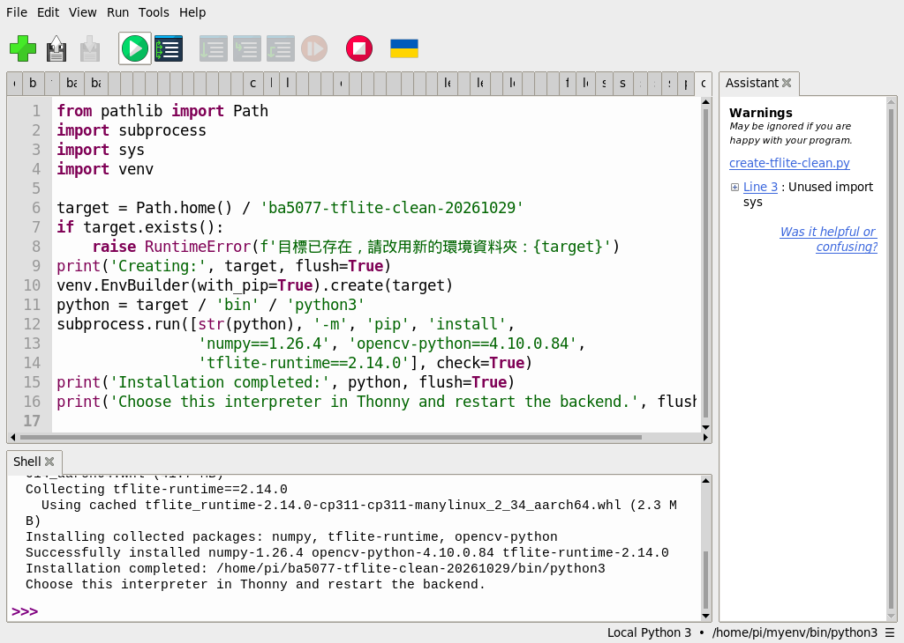

選擇「Tools → Options → Interpreter → Local Python 3」，點 Python executable 旁的 `...`，進入自己建立的資料夾、`bin`、選擇 `python3`，按 OK 並確認右下角路徑。依[補充 3](./補充%203｜🧠%20TensorFlow%20Lite%20%28TFLite%29%20教學入門指南.md)下載模型、標籤與圖片，在 Thonny 開啟分類範例執行。本次已在該新環境測出分類結果：

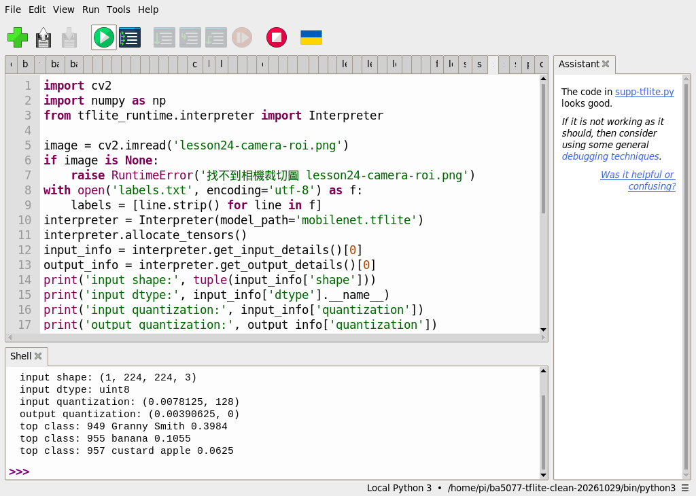

新環境只驗證這個單張圖片範例；其預設不包含系統 Picamera2，即時相機分類需要另行整合和測試。套件版本與來源會變動，遇到安裝失敗應記錄實際錯誤。


## 補充 8：在 Thonny 建立可使用相機的 TFLite 環境

### 這是什麼環境？

2026-10-29 在現有 RP5 上新建一個 Python 虛擬環境，使用 `system_site_packages=True` 讀取系統的 Picamera2 與 OpenCV，再於環境內安裝 NumPy 1.26.4 和 TFLite Runtime 2.14.0。這是**新建環境、沿用現有系統套件**，並不是從全新刷寫的作業系統完成全新安裝；系統套件升級後結果也可能改變。

執行當下測得的來源如下：

| 模組 | 本機版本 | 匯入位置 |
| --- | --- | --- |
| Picamera2 | 0.3.31 | `/usr/lib/python3/dist-packages` |
| OpenCV | 4.10.0-dev | `/usr/lib/python3/dist-packages/cv2` |
| NumPy | 1.26.4 | 新環境的 `site-packages` |
| TFLite Runtime | 2.14.0 | 新環境的 `site-packages` |

特別注意：本機套件管理器登記的 `python3-opencv` 版本是 `4.6.0+dfsg-12`，但 Python 實際匯入的是上述 `4.10.0-dev`，而 `dpkg -S` 找不到該 `cv2/__init__.py` 的套件歸屬。不要以此推斷全新 Raspberry Pi OS 也會有相同的 OpenCV 版本；全新系統重測仍待備用 microSD。

### 用 Thonny 建立和選擇

1. 確認系統已具備 Python 3 的 venv 支援及能正常使用的 Picamera2、OpenCV，並有網路與足夠空間。這些是系統層前提，本次沿用現有安裝；其他學生的系統前提若不同，應先完成基本系統設定。
2. 下載[環境建立程式](./範例程式/Thonny建立TFLite相機環境.py)，在 Thonny 開啟並按綠色執行鈕。程式在目前使用者家目錄建立 `ba5077-tflite-camera-20261029`；名稱已存在時會停止，請在程式裡改成新的名稱，勿覆蓋其他環境。
3. 等 Shell 顯示 `Environment created:`。選擇「工具 → 選項 → 直譯器」，設定為新環境 `bin/python3`。若學生的帳號不是 `pi`，路徑會以自己的家目錄為準。
4. 在同一練習目錄準備模型、標籤及[補充 8 相機程式](./範例程式/補充8-Thonny相機TFLite.py)，在此直譯器按執行。模型下載與使用方式見補充 8。

完整建立程式：

```python
from pathlib import Path
import subprocess
import venv

folder = Path.home() / 'ba5077-tflite-camera-20261029'
if folder.exists():
    raise FileExistsError(f'{folder} 已存在，請更改資料夾名稱後重新執行')
print('creating:', folder, flush=True)
print('Inherit Raspberry Pi OS system packages for Picamera2 and OpenCV', flush=True)
venv.EnvBuilder(with_pip=True, system_site_packages=True).create(folder)
python = folder / 'bin' / 'python'
subprocess.run([str(python), '-m', 'pip', 'install',
                'numpy==1.26.4', 'tflite-runtime==2.14.0'], check=True)
print('Environment created:', python, flush=True)
```

本次 Thonny 的安裝輸出摘錄：

```text
Found existing installation: numpy 1.24.2
Not uninstalling numpy at /usr/lib/python3/dist-packages, outside environment /home/pi/ba5077-tflite-camera-20261029
Can't uninstall 'numpy'. No files were found to uninstall.
Successfully installed numpy-1.26.4 tflite-runtime-2.14.0
Environment created: /home/pi/ba5077-tflite-camera-20261029/bin/python
```

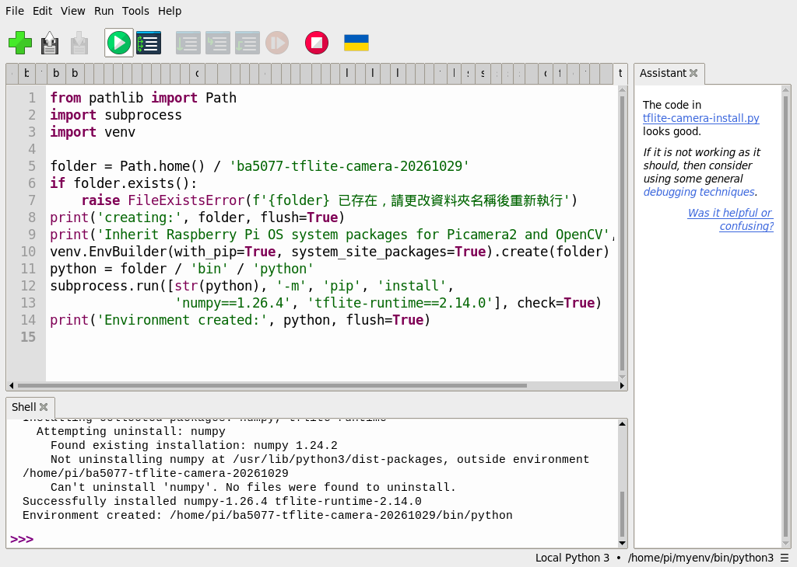

這段 pip 訊息表示它沒有移除虛擬環境外的系統 NumPy，而是在新環境中安裝自己的版本。上圖右下角仍顯示執行安裝程式時原本使用的 `myenv`；環境建立後必須另行選擇新直譯器，才能使用新安裝的套件。安裝過程可能使用本機 pip 快取，不能宣稱所有套件均在本次從網路重新下載。

選取新直譯器後，實際執行補充 8 的相機分類，Shell 摘錄如下：

```text
frame 10: desktop computer 0.6680
frame 25: desktop computer 0.6641
frame 50: desktop computer 0.5977
frames: 50
elapsed seconds: 2.62
average FPS: 19.12
camera released
```

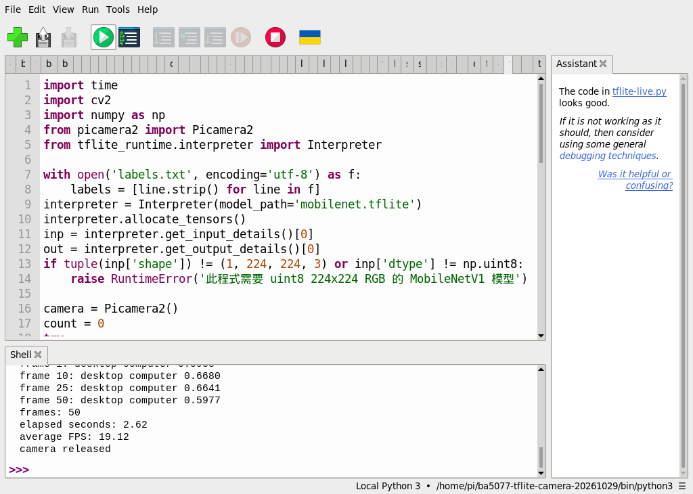

這次處理約 2.62 秒，並非長時間穩定性或準確率測試。因為模型是封閉類別分類器，即使沒有想要的目標也會給出最高分標籤；程式產生的黑白空白負例見補充 8；後續兩分鐘版本已測提前按 Q、連續分類與重開相機，見補充 8；相機拍攝空白背景及全新作業系統安裝仍待測。

## 既有 Trixie 的 YOLO CPU 環境（2026-11-10）

第 39 課以 Thonny 建立獨立 Python 3.13 CPU 環境，完成 COCO8 單回合訓練與權重重新載入；環境程式、版本、下載及限制見[第 39 課](./第%2039%20課｜YOLOv8%20與%20COCO%20資料集完整教學.md)。該環境的 PyTorch 為 CPU 版本，與相機／OpenCV 擴充環境分開；不代表全新重灌系統已驗證。

## 既有 Trixie 的 LiteRT 單圖環境（2026-11-10）

依[補充 3 的步驟](./補充%203｜🧠%20TensorFlow%20Lite%20%28TFLite%29%20教學入門指南.md)在 Thonny 執行 [建立環境程式](./範例程式/Thonny建立Trixie-LiteRT環境.py)，選擇尚不存在的新目錄；安裝後切換到新目錄的 `bin/python`。在既有 Trixie Python 3.13.5，NumPy 2.2.4、OpenCV 4.12.0.88 和 ai-edge-litert 2.3.0 的安裝及分類已測；安裝使用既有快取，不等於全新系統驗證。此環境不繼承系統套件，尚未整合 Picamera2。

## 既有 Trixie 的 LiteRT 相機環境（2026-11-10）

[補充 8](./補充%208｜PiCamera2%20%2B%20TensorFlow%20Lite%20%28MobileNetV1%29%20%2B%20即時影像分類%20%2B%20顯示分類文字%20的%20完整教學.md) 使用 [建立環境程式](./範例程式/Thonny建立Trixie-LiteRT相機環境.py) 建立繼承系統套件的環境；依賴系統原有 Picamera2，並使用套件快取。Thonny 已測相機關閉預覽的 50 影格、釋放及重開；後續預覽、Q 鍵及重開已測；全新系統待測。
