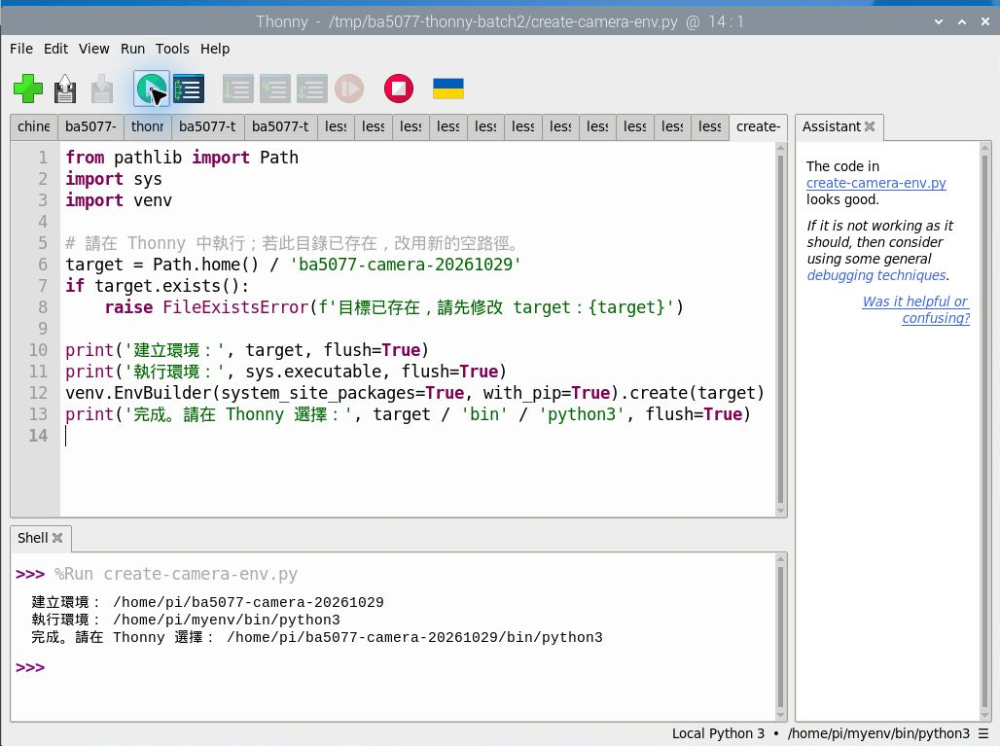
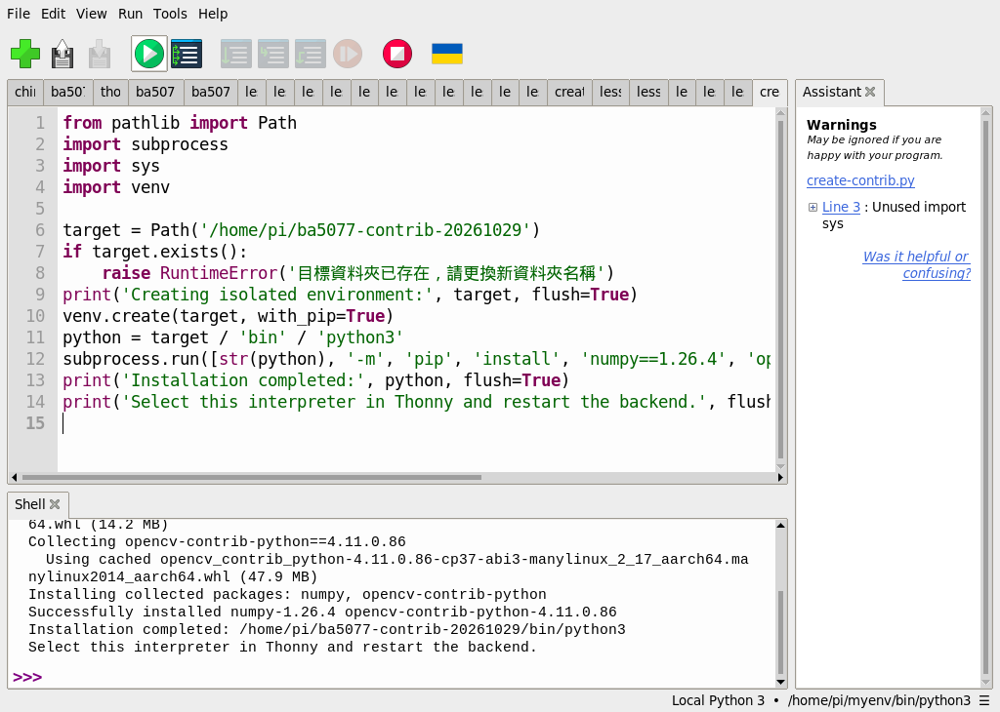
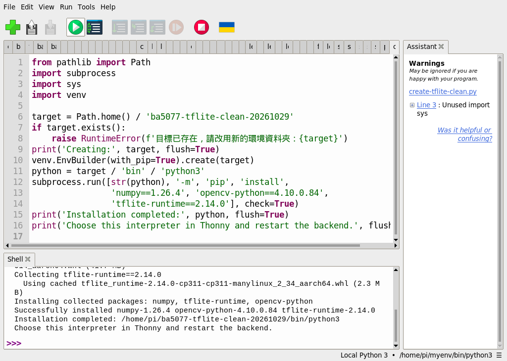

# 使用 Thonny 建立 Python 環境與安裝 OpenCV

本指南記錄 2026-10-29 在 Raspberry Pi 5、Bookworm 64 位元、Python 3.11 的操作。學生使用 Thonny 編寫與執行 Python，基本系統安裝與設定仍使用作業系統提供的工具。其他課程的相機、AI 模型與特殊模組尚須各自測試。

## 先認識虛擬環境

Python 解譯器執行程式，套件提供額外功能。虛擬環境是一個獨立的 Python 套件空間：Thonny 使用哪個解譯器，就會從那個環境尋找套件。把套件裝到別的 Python，並不代表 Thonny 找得到。

## 在 Thonny 建立環境

1. 打開 Thonny，選擇 **Tools → Options → Interpreter**。選擇 Local Python 3，再點 **New virtual environment**。
2. 選一個不存在的新資料夾。本機示範使用 `/home/pi/ba5077-thonny-20261029`；學生可選自己的新資料夾，勿選既有的作業或環境。
3. 建立完成後，確認 Python executable 指向該環境的 `bin/python3`，按 **OK**。Thonny 右下角會顯示目前解譯器。


此環境預設隔離系統 Python 套件，建立成功不表示 Picamera2 已可使用。相機與特殊擴充模組需依後續各課選用並驗證相容環境。

## 從 Thonny 安裝套件：本機實測

本機在 **Tools → Manage packages** 嘗試搜尋 NumPy，搜尋畫面未顯示結果；選取 requirements 檔的安裝則出現下列錯誤，因此不能把這次圖形管理器操作說成安裝成功。

```text
ERROR: Could not find a version that satisfies the requirement install
ERROR: No matching distribution found for install
Process returned with code 1
```


本機改以 Thonny 開啟並執行[安裝程式](./範例程式/第14課-Thonny安裝套件.py)。它使用 `sys.executable` 指向 Thonny 當前選用的 Python，安裝指定版本的 NumPy 和 OpenCV；請先確認右下角是你要安裝的**獨立環境**，並確定有網路和足夠空間。不要對系統 Python 使用此步驟。檔案由課程儲存庫提供，開啟後可先閱讀程式再按綠色執行鈕。

```python
import subprocess
import sys

print('Python:', sys.executable, flush=True)
subprocess.run([sys.executable, '-m', 'pip', 'install', 'numpy==1.26.4', 'opencv-python==4.10.0.84'], check=True)
print('Installation completed. Restart Thonny interpreter before testing.', flush=True)
```

本機實際輸出節錄：

```text
Installing collected packages: numpy, opencv-python
Successfully installed numpy-1.26.4 opencv-python-4.10.0.84
Installation completed. Restart Thonny interpreter before testing.
```


這次使用快取，首次安裝可能顯示下載進度。安裝完選擇 **Run → Stop/Restart backend**（或紅色停止鈕），再在 Thonny 開啟[測試程式](./範例程式/第12課-Thonny測試.py)並按執行。實際輸出：

```text
OpenCV version: 4.10.0
Image shape: (120, 160, 3)
Center BGR: [0, 255, 0]
```


使用[視窗範例](./範例程式/第14課-Thonny視窗測試.py)也實際顯示綠色圓形；此例只證明這個版本在此桌面環境可開啟視窗。不要在同一環境混裝多種提供 `cv2` 的 OpenCV 套件。


若看到 `ModuleNotFoundError`，先核對右下角解譯器與安裝程式顯示的 Python 路徑，再確認安裝是否成功。不同課程的套件版本不一定能放在同一環境；不要自行將所有套件無差別混裝。進一步閱讀：[Thonny 官方套件安裝說明](https://github.com/thonny/thonny/wiki/InstallingPackages)。

## 相機課：在 Thonny 建立可讀取系統套件的環境

上面的獨立環境不會自動看到 Raspberry Pi OS 安裝的 Picamera2。這台 RP5 的系統已具備 Picamera2 與 OpenCV；本次在 Thonny 開啟[建立相機環境的程式](./範例程式/Thonny建立相機環境.py)，按綠色執行鈕，建立一個允許讀取系統套件的新環境。建立前請確認 `target` 指向不存在的新目錄；若目錄已存在，程式會停止，請修改名稱後再執行。

本次 Thonny Shell 的實際輸出：

```text
建立環境： /home/pi/ba5077-camera-20261029
執行環境： /home/pi/myenv/bin/python3
完成。請在 Thonny 選擇： /home/pi/ba5077-camera-20261029/bin/python3
```



接著選 **Tools → Options → Interpreter → Local Python 3**，按 Python executable 旁的 `…`，依序進入自己建立的環境、`bin`，選擇 `python3`，按 **OK**。選取後再檢查右下角的路徑。這個環境會讀取系統套件，系統更新可能改變其中可見的版本；它不是完全隔離的環境。建立環境本身也不會替尚未安裝的系統安裝 Picamera2。

選用該新環境後，本機實際從 Thonny 執行[第 15 課範例](./範例程式/第15課.py)，取得彩色與灰階陣列的尺寸。圖中的紅字是相機輸出訊息；最下方有程式的 `frame` 與 `gray` 結果。


本機新環境看到系統 Picamera2、NumPy 1.24.2 與 OpenCV 4.10.0-dev；其他機器的版本可能不同。系統先決條件缺少時，先依教師提供的 Raspberry Pi OS 基本設定完成，再回到 Thonny 檢查與執行。已安裝的套件或其他虛擬環境不要任意覆寫。

## 第 25～27 課：在 Thonny 建立 OpenCV 擴充環境

第 25 課的 CSRT 追蹤器與第 27 課的 `bgsegm` MOG 需要包含擴充功能的 OpenCV。本次於 RP5、Python 3.11 使用新建的**隔離環境**實測，不影響原有環境。它不會自動包含 Picamera2，因此相機即時程式仍需相機環境。

1. 從 [建立擴充環境程式](./範例程式/Thonny建立OpenCV擴充環境.py)下載 `.py`，在 Thonny 用 **File → Open** 開啟。下載方法見[素材指南](./練習素材/素材下載與使用.md)。程式的 `target` 是本次 RP5 的 `/home/pi/ba5077-contrib-20261029`；學生如果帳號不是 `pi`，或該目錄已存在，先改成自己主目錄中**尚不存在**的新資料夾。若目錄存在程式會停止，請勿刪除既有環境。需要網路、足夠儲存空間及能使用 Python `venv` 的基本系統。
2. 先閱讀程式，按綠色執行鈕。程式使用 `venv` 建立新環境，再安裝 `numpy==1.26.4`、`opencv-contrib-python==4.11.0.86`。不要在同一環境另外混裝 `opencv-python` 等提供 `cv2` 的套件。
3. 等 Shell 顯示 `Installation completed` 並回到 `>>>`。本機這次使用快取；不同電腦可能顯示下載進度，且可能受網路或平台支援影響。安裝中斷時不要把半成品當成完成；改用另一個新資料夾重試。
4. 選 **Tools → Options → Interpreter → Local Python 3**，點 `…` 進入剛建立的資料夾，再開啟 `bin` 並選 `python3`，按 **OK**。確認右下角顯示自己新環境的路徑，再開啟各課程式並按綠色執行鈕。

本機 Thonny 實際輸出節錄：

```text
Installing collected packages: numpy, opencv-contrib-python
Successfully installed numpy-1.26.4 opencv-contrib-python-4.11.0.86
Installation completed: /home/pi/ba5077-contrib-20261029/bin/python3
Select this interpreter in Thonny and restart the backend.
```



本次另在選取的新環境中實測第 25 課 CSRT 與第 26、27 課短影片處理；各課截圖右下角可核對解譯器。先前的 `/home/pi/myenv` 同時含兩種 OpenCV 套件，雖然也能執行測試，**不建議當成學生建立環境的範例**。

## 補充 3、8：Thonny 建立獨立 TFLite 單圖環境

這次在 RP5 Bookworm 64 位元、Python 3.11.2，從 Thonny 執行[環境建立程式](./範例程式/Thonny建立TFLite環境.py)。它在家目錄建立新的獨立環境，安裝 NumPy 1.26.4、opencv-python 4.10.0.84 與 tflite-runtime 2.14.0；執行前確認程式中的 `target` 指向不存在的新資料夾。已有資料夾時程式停止，不會覆蓋。這次使用套件快取，其他機器首次安裝可能需要網路。

在 Thonny 開啟程式並按綠色執行鈕，本機 Shell 實際輸出節錄：

```text
Successfully installed numpy-1.26.4 opencv-python-4.10.0.84 tflite-runtime-2.14.0
Installation completed: /home/pi/ba5077-tflite-clean-20261029/bin/python3
Choose this interpreter in Thonny and restart the backend.
```



選擇「Tools → Options → Interpreter → Local Python 3」，點 Python executable 旁的 `...`，進入自己建立的資料夾、`bin`、選擇 `python3`，按 OK 並確認右下角路徑。依[補充 3](./補充%203｜🧠%20TensorFlow%20Lite%20%28TFLite%29%20教學入門指南.md)下載模型、標籤與圖片，在 Thonny 開啟分類範例執行。本次已在該新環境測出分類結果：


新環境只驗證這個單張圖片範例；其預設不包含系統 Picamera2，即時相機分類需要另行整合和測試。套件版本與來源會變動，遇到安裝失敗應記錄實際錯誤。
