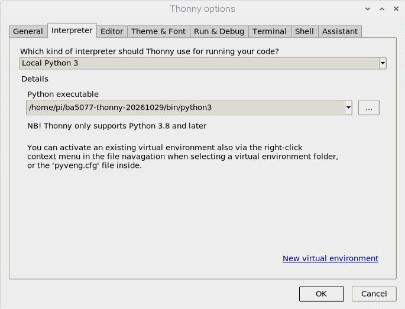
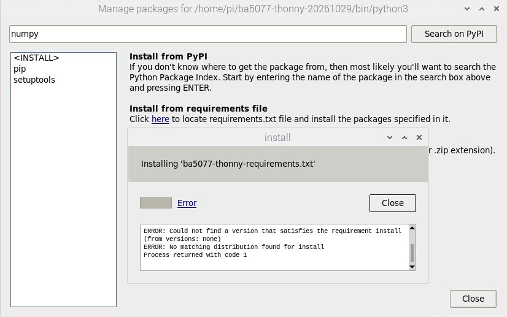

# 使用 Thonny 建立 Python 環境與安裝 OpenCV

本指南記錄 2026-10-29 在 Raspberry Pi 5、Bookworm 64 位元、Python 3.11 的操作。學生使用 Thonny 編寫與執行 Python，基本系統安裝與設定仍使用作業系統提供的工具。其他課程的相機、AI 模型與特殊模組尚須各自測試。

## 先認識虛擬環境

Python 解譯器執行程式，套件提供額外功能。虛擬環境是一個獨立的 Python 套件空間：Thonny 使用哪個解譯器，就會從那個環境尋找套件。把套件裝到別的 Python，並不代表 Thonny 找得到。

## 在 Thonny 建立環境

1. 打開 Thonny，選擇 **Tools → Options → Interpreter**。選擇 Local Python 3，再點 **New virtual environment**。
2. 選一個不存在的新資料夾。本機示範使用 `/home/pi/ba5077-thonny-20261029`；學生可選自己的新資料夾，勿選既有的作業或環境。
3. 建立完成後，確認 Python executable 指向該環境的 `bin/python3`，按 **OK**。Thonny 右下角會顯示目前解譯器。



此環境預設隔離系統 Python 套件，建立成功不表示 Picamera2 已可使用。相機與特殊擴充模組需依後續各課選用並驗證相容環境。

## 從 Thonny 安裝套件：本機實測

本機在 **Tools → Manage packages** 嘗試搜尋 NumPy，搜尋畫面未顯示結果；選取 requirements 檔的安裝則出現下列錯誤，因此不能把這次圖形管理器操作說成安裝成功。

```text
ERROR: Could not find a version that satisfies the requirement install
ERROR: No matching distribution found for install
Process returned with code 1
```



本機改以 Thonny 開啟並執行[安裝程式](./範例程式/第14課-Thonny安裝套件.py)。它使用 `sys.executable` 指向 Thonny 當前選用的 Python，安裝指定版本的 NumPy 和 OpenCV；請先確認右下角是你要安裝的**獨立環境**，並確定有網路和足夠空間。不要對系統 Python 使用此步驟。檔案由課程儲存庫提供，開啟後可先閱讀程式再按綠色執行鈕。

```python
import subprocess
import sys

print('Python:', sys.executable, flush=True)
subprocess.run([sys.executable, '-m', 'pip', 'install', 'numpy==1.26.4', 'opencv-python==4.10.0.84'], check=True)
print('Installation completed. Restart Thonny interpreter before testing.', flush=True)
```

本機實際輸出節錄：

```text
Installing collected packages: numpy, opencv-python
Successfully installed numpy-1.26.4 opencv-python-4.10.0.84
Installation completed. Restart Thonny interpreter before testing.
```


這次使用快取，首次安裝可能顯示下載進度。安裝完選擇 **Run → Stop/Restart backend**（或紅色停止鈕），再在 Thonny 開啟[測試程式](./範例程式/第12課-Thonny測試.py)並按執行。實際輸出：

```text
OpenCV version: 4.10.0
Image shape: (120, 160, 3)
Center BGR: [0, 255, 0]
```


使用[視窗範例](./範例程式/第14課-Thonny視窗測試.py)也實際顯示綠色圓形；此例只證明這個版本在此桌面環境可開啟視窗。不要在同一環境混裝多種提供 `cv2` 的 OpenCV 套件。


若看到 `ModuleNotFoundError`，先核對右下角解譯器與安裝程式顯示的 Python 路徑，再確認安裝是否成功。不同課程的套件版本不一定能放在同一環境；不要自行將所有套件無差別混裝。進一步閱讀：[Thonny 官方套件安裝說明](https://github.com/thonny/thonny/wiki/InstallingPackages)。
