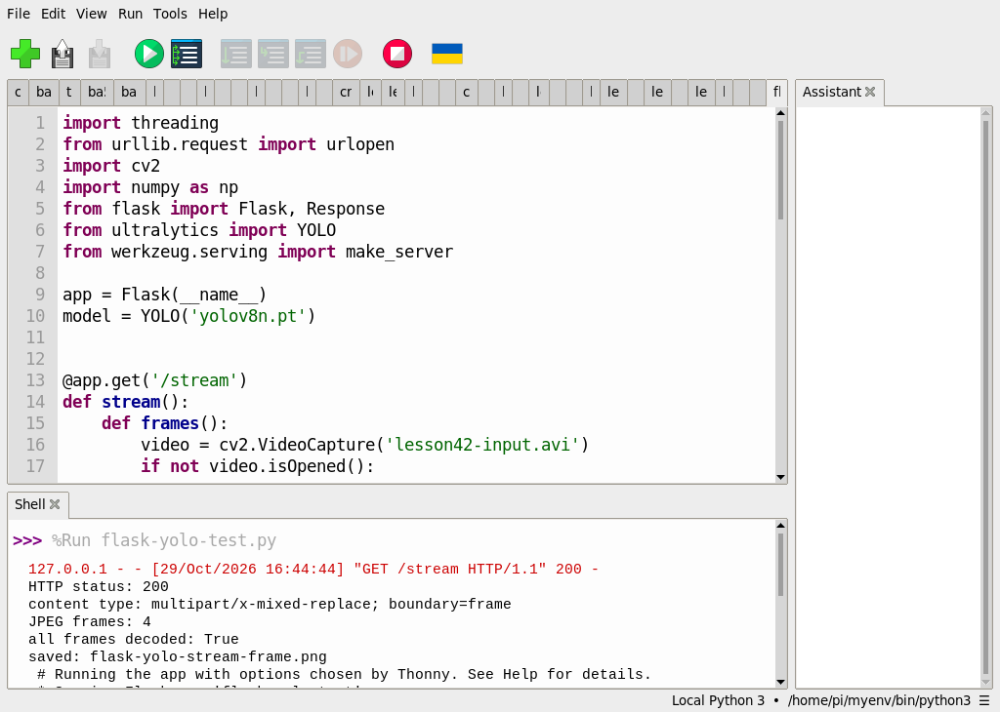

# 使用 Flask 和 YOLO 打造即時物件偵測網頁介面

[原始文章](https://liusming.pixnet.net/blog/posts/14222901408) · 更新日期：2026-10-29

> **部分實測**：已在 Thonny 測試本機 HTTP 四張 JPEG 回應；直接相機即時串流、長時間運作與乾淨環境安裝待驗證。[逐篇進度](./Thonny逐篇實測狀態.md)

## 學習目標與背景

瀏覽器是 HTTP 用戶端，Flask 接收請求並依路由回應。`multipart/x-mixed-replace` 可在同一個回應內以 boundary 分隔多張 JPEG，形成逐張更新的影像。本課先使用有限的四影格影片，理解資料如何從模型經 HTTP 傳送；四張影格會結束，並不是持續直播。

## 準備

本次在這台 RP5 的既有 `/home/pi/myenv/bin/python3` 環境執行，含 Python 3.11.2、Ultralytics 8.3.50、PyTorch 2.5.1，以及 OpenCV。第 42、43 課另使用 Picamera2。這是本機既有混合環境；在全新虛擬環境透過 Thonny 安裝全部 YOLO 套件仍待實測，不能當成已驗證的乾淨安裝教學。

在瀏覽器下載並解壓本倉庫，依[素材下載與使用說明](./練習素材/素材下載與使用.md)建立新的練習資料夾；模型由[第 39 課](./第%2039%20課｜YOLOv8%20與%20COCO%20資料集完整教學.md)的 Thonny 下載程式取得，並放入同一資料夾。

將[四影格影片](./練習素材/lesson42-input.avi)和[本機 HTTP 測試程式](./範例程式/Flask-YOLO-短影片串流.py)複製到同一練習資料夾，並放入 `yolov8n.pt`。影片是 RP5 拍攝螢幕上的 AI 生成圖後經校正得到。確認選擇的 Python 也能匯入 Flask；這次 Flask 從系統套件匯入，全新安裝步驟尚待測試。

## 在 Thonny 實驗

1. 選擇已有 Flask、YOLO 和 OpenCV 的直譯器；開啟程式，按綠色執行鈕。
2. 程式建立只供 RP5 本機使用的暫時 HTTP 服務，讀取影片、對各影格推論，再用本機請求讀回並解碼。它會存出 `flask-yolo-stream-frame.png`，請先確認練習目錄沒有需要保留的同名檔案。
3. **本次 Thonny 在測試完成後又自動辨識 Flask 應用並啟動本機開發伺服器**，Shell 出現 `Running the app with options chosen by Thonny`。測試輸出出現後，按 Thonny 紅色停止鈕，關閉額外啟動的服務並重啟執行環境。這項行為可能隨 Thonny 設定改變。

完整程式：

```python
import threading
from urllib.request import urlopen
import cv2
import numpy as np
from flask import Flask, Response
from ultralytics import YOLO
from werkzeug.serving import make_server

app = Flask(__name__)
model = YOLO('yolov8n.pt')


@app.get('/stream')
def stream():
    def frames():
        video = cv2.VideoCapture('lesson42-input.avi')
        if not video.isOpened():
            raise RuntimeError('無法開啟影片')
        try:
            while True:
                ok, frame = video.read()
                if not ok:
                    break
                result = model.predict(frame, imgsz=320, device='cpu', verbose=False)[0].plot()
                ok, jpeg = cv2.imencode('.jpg', result)
                if not ok:
                    raise RuntimeError('JPEG 編碼失敗')
                yield b'--frame\r\nContent-Type: image/jpeg\r\n\r\n' + jpeg.tobytes() + b'\r\n'
            yield b'--frame--\r\n'
        finally:
            video.release()
    return Response(frames(), mimetype='multipart/x-mixed-replace; boundary=frame')


if __name__ == '__main__':
    # 只供本機測試；0 讓系統挑選空閒連接埠，測試完後關閉。
    server = make_server('127.0.0.1', 0, app)
    thread = threading.Thread(target=server.serve_forever, daemon=True)
    thread.start()
    try:
        with urlopen(f'http://127.0.0.1:{server.server_port}/stream', timeout=60) as response:
            payload = response.read()
            print('HTTP status:', response.status)
            print('content type:', response.headers['Content-Type'])
        parts = payload.split(b'--frame\r\nContent-Type: image/jpeg\r\n\r\n')[1:]
        images = []
        for part in parts:
            jpeg_bytes = part.split(b'\r\n--frame--\r\n')[0].rstrip(b'\r\n')
            images.append(cv2.imdecode(np.frombuffer(jpeg_bytes, dtype=np.uint8), cv2.IMREAD_COLOR))
        print('JPEG frames:', len(images))
        print('all frames decoded:', all(image is not None for image in images))
        if images and images[0] is not None:
            if not cv2.imwrite('flask-yolo-stream-frame.png', images[0]):
                raise RuntimeError('結果圖儲存失敗')
            print('saved: flask-yolo-stream-frame.png')
    finally:
        server.shutdown()
        thread.join()
```

## 本次 Thonny 實際輸出

```text
HTTP status: 200
content type: multipart/x-mixed-replace; boundary=frame
JPEG frames: 4
all frames decoded: True
saved: flask-yolo-stream-frame.png
```




HTTP 200 表示本次請求獲得成功回應；四張 JPEG 解碼成功，不表示攝影機直播或長時間網頁服務已驗證。此前曾在 RP5 瀏覽器顯示四影格錄影的結果：


瀏覽器截圖屬先前測試，不是這次 Thonny 測試的畫面。[先前的網頁程式](./範例程式/Flask-YOLO-影片網頁.py)在本次尚未透過 Thonny 重測。

## 練習與後續應用

解釋 HTTP 請求、路由、回應內容類型和 JPEG 影格各自的工作。如果收到 200 但無法解碼圖片，應先檢查哪些資料？進一步設計頁面時，可考慮服務停止方式及影格傳輸延遲。

## 與原文章的差異

- 本版先測本機有限影片的 HTTP 傳送，原文直接相機即時串流尚未重新完成。
- 新增 Thonny 實測、實際輸出及其 Flask 自動啟動行為；瀏覽器畫面沿用先前測試並清楚標示。
- 使用本機既有套件環境，乾淨安裝、跨裝置及長時間穩定性待驗證。
