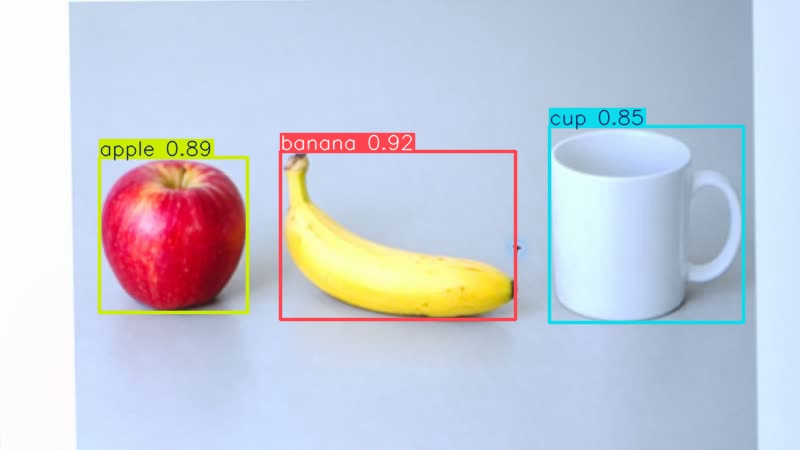
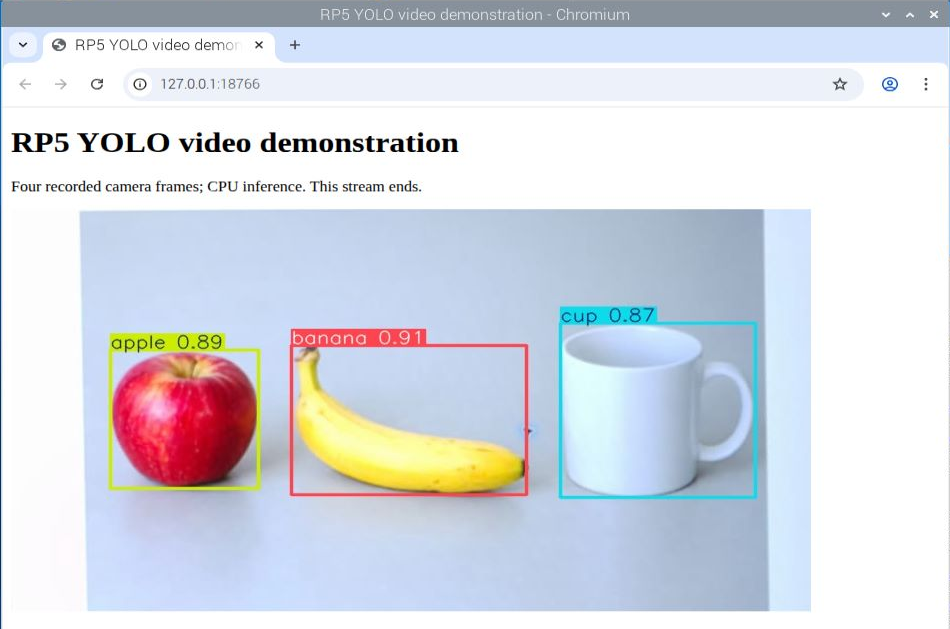

# 使用 Flask 和 YOLO 打造即時物件偵測網頁介面

[原始文章](https://liusming.pixnet.net/blog/posts/14222901408) · 更新日期：2026-10-29

> **Thonny 轉換待完成。** 本篇既有程式、安裝步驟與輸出仍須逐項改寫並在 Thonny 重新操作；現有終端機紀錄不代表已用 Thonny 測試。[逐篇進度](./Thonny逐篇實測狀態.md) · [圖片與程式下載方式](./練習素材/素材下載與使用.md)

## 學習目標

以 Flask 測試客戶端驗證首頁與一次相機 JPEG 推論回應。

## 事前準備

需要 Pi 相機、Flask、Picamera2、YOLO CPU 虛擬環境與模型檔。本次 Flask 2.2.2 來自系統套件，透過含系統套件的虛擬環境匯入；若沒有 Flask，可在啟用的虛擬環境中安裝，然後重新確認相依套件。

依[安裝操作與實測紀錄](../安裝操作與實測紀錄.md#7-yolo-與-pytorch)建立並啟用 YOLO CPU 環境，再於練習目錄下載模型：

```bash
curl -fL https://github.com/ultralytics/assets/releases/download/v8.3.0/yolov8n.pt -o yolov8n.pt
```

不要使用原文的 CUDA 11.8 索引。

## 程式與執行

將下列已在 RP5 執行的程式存為 `Flask與YOLO.py`，或使用[範例程式](./範例程式/Flask與YOLO.py)。先確認目前目錄及檔案，避免覆蓋已有資料。

```python
import cv2
from flask import Flask, Response
from picamera2 import Picamera2
from ultralytics import YOLO

app = Flask(__name__)
model = YOLO('yolov8n.pt')

@app.get('/')
def index():
    return '<h1>RP5 YOLO</h1>'

@app.get('/frame')
def frame():
    camera = Picamera2()
    try:
        camera.configure(camera.create_still_configuration(main={'size': (320, 240), 'format': 'RGB888'}))
        camera.start()
        image = camera.capture_array()
    finally:
        camera.stop()
        camera.close()
    result = model.predict(image, imgsz=320, device='cpu', verbose=False)[0].plot()
    ok, jpeg = cv2.imencode('.jpg', result)
    if not ok:
        return Response('JPEG encoding failed', status=500)
    return Response(jpeg.tobytes(), mimetype='image/jpeg')

if __name__ == '__main__':
    with app.test_client() as client:
        home = client.get('/')
        result = client.get('/frame')
        print('home status', home.status_code)
        print('frame status', result.status_code)
        print('frame type', result.mimetype)
```

執行 `python3 Flask與YOLO.py`。

## 本機實際輸出

```text
home status 200
frame status 200
frame type image/jpeg
```

這是程序內 Flask 測試客戶端，不會啟動公開伺服器；它提供單張 JPEG，並非已驗證的即時串流網頁。

## 背景與核心概念

### 從影像推論到網頁介面

Flask 可以接收 HTTP 請求並回傳內容；模型推論可將輸入影像轉成辨識結果。單張 JPEG 回應與持續即時串流是不同機制，測試客戶端也不等同公開網路服務。

### 思考、練習與後續應用

說明 HTTP 測試回應碼 200 能證明什麼；若要完成即時串流還需處理哪些事情？

網頁介面方便呈現結果；部署要考量存取範圍、個資、效能與服務中斷。

進一步閱讀：[相關官方文件](https://flask.palletsprojects.com/en/stable/)。請以下方實測狀態為準；尚未實作或測試的情境不能視為已通過。

## 概念流程圖


此圖用於說明文章的概念或完整目標流程，**不是操作截圖，也不代表每個步驟都已實測**；本機實測範圍請看文章中的標示。

## 進一步實驗：實際的本機 HTTP 多影格回應

### 理論：一個回應如何包含多張圖片？

HTTP 回應可標示 `multipart/x-mixed-replace`，並用固定的 boundary 分隔每張 JPEG。讀取端看到標頭後可逐段解碼；本實驗使用有結尾的四影格影片，所以回應會結束，和無限期直播不同。每次請求會重新讀影片及推論，速度不保證符合播放時間。

### 準備與操作

1. 使用前述已測試的 YOLO CPU 虛擬環境，並確認同一環境可匯入 Flask、OpenCV、NumPy、Ultralytics；在練習目錄準備上述 `yolov8n.pt`。
2. 下載[相機拍攝的四影格影片](./練習素材/lesson42-input.avi)與[本實驗程式](./範例程式/Flask-YOLO-短影片串流.py)到同一目錄。影片的來源是 RP5 相機拍攝螢幕上 AI 生成的物件圖片。
3. 執行 `python Flask-YOLO-短影片串流.py`。程式在 RP5 本機的暫時連接埠啟動服務、送出 HTTP 請求、讀完四張 JPEG，然後關閉服務，不會對外開放。

```python
import threading
from urllib.request import urlopen
import cv2
import numpy as np
from flask import Flask, Response
from ultralytics import YOLO
from werkzeug.serving import make_server

app = Flask(__name__)
model = YOLO('yolov8n.pt')


@app.get('/stream')
def stream():
    def frames():
        video = cv2.VideoCapture('lesson42-input.avi')
        if not video.isOpened():
            raise RuntimeError('無法開啟影片')
        try:
            while True:
                ok, frame = video.read()
                if not ok:
                    break
                result = model.predict(frame, imgsz=320, device='cpu', verbose=False)[0].plot()
                ok, jpeg = cv2.imencode('.jpg', result)
                if not ok:
                    raise RuntimeError('JPEG 編碼失敗')
                yield b'--frame\r\nContent-Type: image/jpeg\r\n\r\n' + jpeg.tobytes() + b'\r\n'
            yield b'--frame--\r\n'
        finally:
            video.release()
    return Response(frames(), mimetype='multipart/x-mixed-replace; boundary=frame')


if __name__ == '__main__':
    # 只供本機測試；0 讓系統挑選空閒連接埠，測試完後關閉。
    server = make_server('127.0.0.1', 0, app)
    thread = threading.Thread(target=server.serve_forever, daemon=True)
    thread.start()
    try:
        with urlopen(f'http://127.0.0.1:{server.server_port}/stream', timeout=60) as response:
            payload = response.read()
            print('HTTP status:', response.status)
            print('content type:', response.headers['Content-Type'])
        parts = payload.split(b'--frame\r\nContent-Type: image/jpeg\r\n\r\n')[1:]
        images = []
        for part in parts:
            jpeg_bytes = part.split(b'\r\n--frame--\r\n')[0].rstrip(b'\r\n')
            images.append(cv2.imdecode(np.frombuffer(jpeg_bytes, dtype=np.uint8), cv2.IMREAD_COLOR))
        print('JPEG frames:', len(images))
        print('all frames decoded:', all(image is not None for image in images))
        if images and images[0] is not None:
            if not cv2.imwrite('flask-yolo-stream-frame.png', images[0]):
                raise RuntimeError('結果圖儲存失敗')
            print('saved: flask-yolo-stream-frame.png')
    finally:
        server.shutdown()
        thread.join()
```

RP5 本次實際輸出（略去伺服器請求紀錄的時間）：

```text
HTTP status: 200
content type: multipart/x-mixed-replace; boundary=frame
JPEG frames: 4
all frames decoded: True
saved: flask-yolo-stream-frame.png
```



圖是從 HTTP 回應解碼後儲存的第一張影格，不是瀏覽器操作截圖。實驗涵蓋本機 HTTP、多影格 JPEG 和影片推論；尚未驗證瀏覽器播放、跨裝置連線、即時直接相機串流、多人同時連線或長時間穩定性。框與信心分數僅代表這張生成測試圖的結果。

練習：比較單張 `/frame` 與多張 `/stream` 的內容類型；為何 HTTP 200 和四張影格可解碼仍不足以證明直播穩定？

## 進一步實驗：在 RP5 瀏覽器顯示 YOLO 結果

1. 依前文準備 YOLO CPU 環境、`yolov8n.pt` 和 [lesson42-input.avi](./練習素材/lesson42-input.avi)，並將[網頁程式](./範例程式/Flask-YOLO-影片網頁.py)放入相同練習目錄。
2. 在已啟用的 YOLO 環境執行 `python Flask-YOLO-影片網頁.py`，保持終端機開啟；接著在 **RP5 本機** Chromium 開啟 `http://127.0.0.1:18766/`。影片只有四影格，傳送結束後畫面停在最後一張；重整會再跑一次。
3. 結束測試時回到執行程式的終端機，按 `Ctrl+C` 停止。服務僅監聽 RP5 的本機位址，其他電腦不能直接用這個位址連入；這是開發伺服器，不是正式部署方式。

```python
import cv2
from flask import Flask, Response
from ultralytics import YOLO

app = Flask(__name__)
model = YOLO('yolov8n.pt')


@app.get('/')
def home():
    return '''<!doctype html><html lang="en"><head><meta charset="utf-8">
    <title>RP5 YOLO video demonstration</title></head><body>
    <h1>RP5 YOLO video demonstration</h1>
    <p>Four recorded camera frames; CPU inference. This stream ends.</p>
    
    </body></html>'''


@app.get('/stream')
def stream():
    def frames():
        video = cv2.VideoCapture('lesson42-input.avi')
        if not video.isOpened():
            raise RuntimeError('無法開啟 lesson42-input.avi')
        try:
            while True:
                ok, frame = video.read()
                if not ok:
                    break
                annotated = model.predict(frame, imgsz=320, device='cpu', verbose=False)[0].plot()
                ok, jpeg = cv2.imencode('.jpg', annotated)
                if not ok:
                    raise RuntimeError('無法編碼 JPEG')
                yield b'--frame\r\nContent-Type: image/jpeg\r\n\r\n' + jpeg.tobytes() + b'\r\n'
            yield b'--frame--\r\n'
        finally:
            video.release()
    return Response(frames(), content_type='multipart/x-mixed-replace; boundary=frame')


if __name__ == '__main__':
    # 只在 RP5 本機測試，不開放給區域網路。
    app.run(host='127.0.0.1', port=18766, debug=False, threaded=False)
```

本次伺服器日誌節錄（時間會不同）：

```text
Running on http://127.0.0.1:18766
"GET / HTTP/1.1" 200 -
"GET /stream HTTP/1.1" 200 -
"GET /favicon.ico HTTP/1.1" 404 -
```



這是 RP5 上 Chromium 的操作截圖，裁切後保留瀏覽器與頁面。`/` 回傳 HTML，`/stream` 在單一回應中逐張回傳 JPEG；瀏覽器請求不存在的網站圖示得到 404，不影響本次頁面與影像顯示。畫面內容來自先前相機拍攝的 AI 生成圖片影片，**不是直接連接相機的即時直播**。本次僅驗證 RP5 本機單一瀏覽器；跨裝置、多人、長時間運作與真實物件仍需另測。

練習：查看標題、影像及網址，解釋瀏覽器與 Flask 各負責什麼；如果 `/` 成功但 `/stream` 失敗，應先檢查哪個路由和哪個影片檔？

## 與原文章的差異

- 原文提供即時物件偵測網頁；本版已在 RP5 瀏覽器顯示四影格錄影的推論結果，直接相機即時串流仍未完成。
- 真實場景的準確率、速度和操作畫面尚未完整驗證。
- 已新增 RP5 瀏覽器實際顯示的操作截圖。
- 新增初學者背景、概念、思考練習及後續應用，實測範圍仍以本文標示為準。
- 加入教學流程示意；圖中的完整目標流程不代表已逐步實測。
