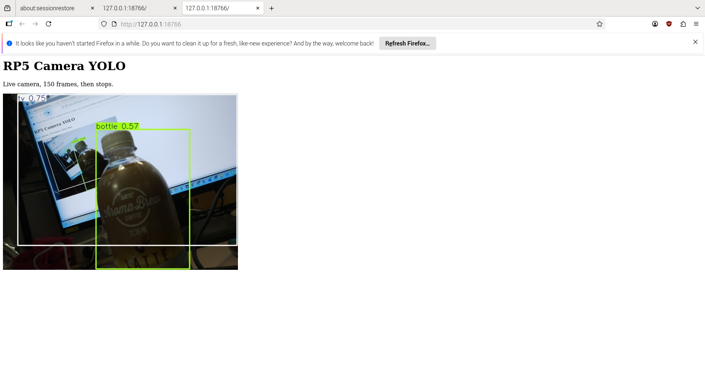
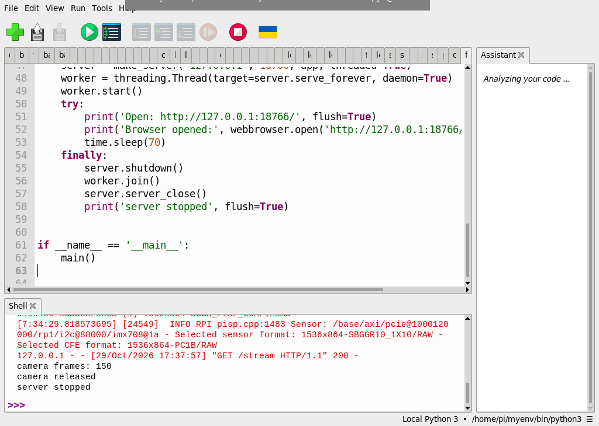
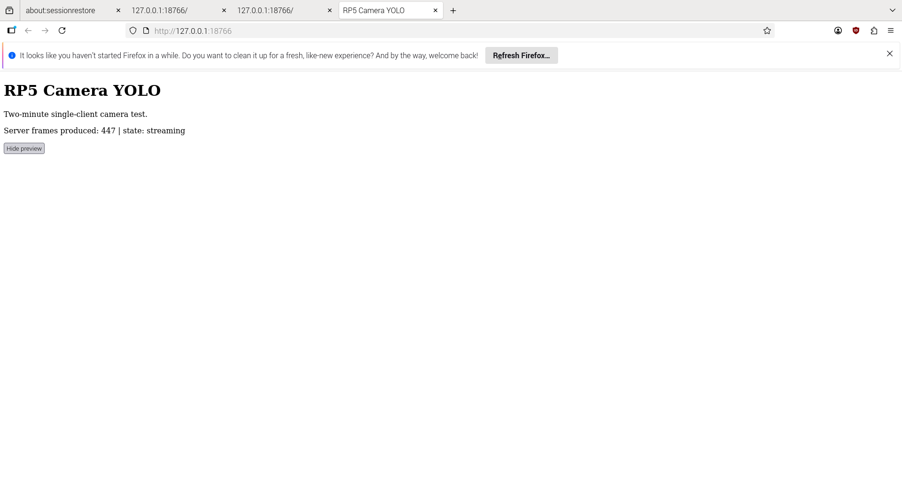
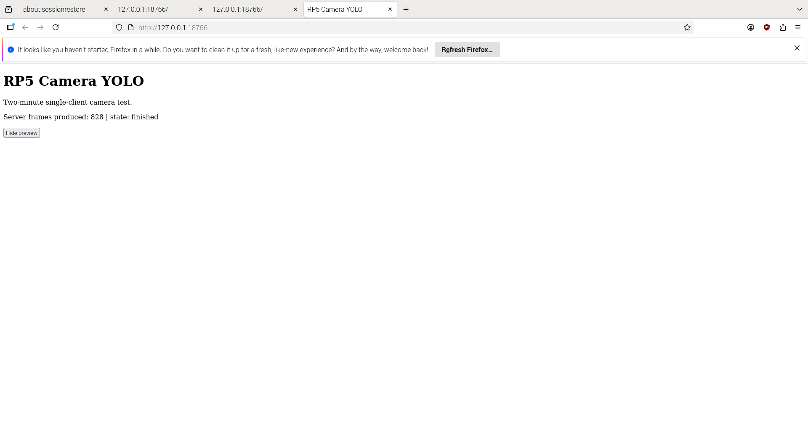
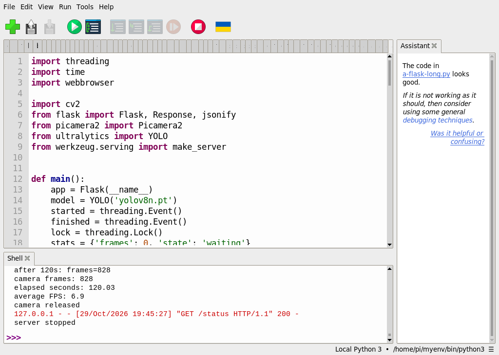

# 使用 Flask 和 YOLO 打造即時物件偵測網頁介面

[原始文章](https://liusming.pixnet.net/blog/posts/14222901408) · 更新日期：2026-10-29

> **部分實測**：已在 Thonny 測試本機 HTTP 四張 JPEG，以及相機經 YOLO 送至 RP5 瀏覽器的 150 張影格及兩分鐘串流；數小時運作與乾淨環境安裝待驗證。[逐篇進度](./Thonny逐篇實測狀態.md)

## 學習目標與背景

瀏覽器是 HTTP 用戶端，Flask 接收請求並依路由回應。`multipart/x-mixed-replace` 可在同一個回應內以 boundary 分隔多張 JPEG，形成逐張更新的影像。本課先使用有限的四影格影片，理解資料如何從模型經 HTTP 傳送；四張影格會結束，並不是持續直播。

## 準備

本次在這台 RP5 的既有 `/home/pi/myenv/bin/python3` 環境執行，含 Python 3.11.2、Ultralytics 8.3.50、PyTorch 2.5.1，以及 OpenCV。第 42、43 課另使用 Picamera2。這是本機既有混合環境；在全新虛擬環境透過 Thonny 安裝全部 YOLO 套件仍待實測，不能當成已驗證的乾淨安裝教學。

在瀏覽器下載並解壓本倉庫，依[素材下載與使用說明](./練習素材/素材下載與使用.md)建立新的練習資料夾；模型由[第 39 課](./第%2039%20課｜YOLOv8%20與%20COCO%20資料集完整教學.md)的 Thonny 下載程式取得，並放入同一資料夾。

將[四影格影片](./練習素材/lesson42-input.avi)和[本機 HTTP 測試程式](./範例程式/Flask-YOLO-短影片串流.py)複製到同一練習資料夾，並放入 `yolov8n.pt`。影片是 RP5 拍攝螢幕上的 AI 生成圖後經校正得到。確認選擇的 Python 也能匯入 Flask；這次 Flask 從系統套件匯入，全新安裝步驟尚待測試。

## 在 Thonny 實驗

1. 選擇已有 Flask、YOLO 和 OpenCV 的直譯器；開啟程式，按綠色執行鈕。
2. 程式建立只供 RP5 本機使用的暫時 HTTP 服務，讀取影片、對各影格推論，再用本機請求讀回並解碼。它會存出 `flask-yolo-stream-frame.png`，請先確認練習目錄沒有需要保留的同名檔案。
3. **本次 Thonny 在測試完成後又自動辨識 Flask 應用並啟動本機開發伺服器**，Shell 出現 `Running the app with options chosen by Thonny`。測試輸出出現後，按 Thonny 紅色停止鈕，關閉額外啟動的服務並重啟執行環境。這項行為可能隨 Thonny 設定改變。

完整程式：

```python
import threading
from urllib.request import urlopen
import cv2
import numpy as np
from flask import Flask, Response
from ultralytics import YOLO
from werkzeug.serving import make_server

app = Flask(__name__)
model = YOLO('yolov8n.pt')


@app.get('/stream')
def stream():
    def frames():
        video = cv2.VideoCapture('lesson42-input.avi')
        if not video.isOpened():
            raise RuntimeError('無法開啟影片')
        try:
            while True:
                ok, frame = video.read()
                if not ok:
                    break
                result = model.predict(frame, imgsz=320, device='cpu', verbose=False)[0].plot()
                ok, jpeg = cv2.imencode('.jpg', result)
                if not ok:
                    raise RuntimeError('JPEG 編碼失敗')
                yield b'--frame\r\nContent-Type: image/jpeg\r\n\r\n' + jpeg.tobytes() + b'\r\n'
            yield b'--frame--\r\n'
        finally:
            video.release()
    return Response(frames(), mimetype='multipart/x-mixed-replace; boundary=frame')


if __name__ == '__main__':
    # 只供本機測試；0 讓系統挑選空閒連接埠，測試完後關閉。
    server = make_server('127.0.0.1', 0, app)
    thread = threading.Thread(target=server.serve_forever, daemon=True)
    thread.start()
    try:
        with urlopen(f'http://127.0.0.1:{server.server_port}/stream', timeout=60) as response:
            payload = response.read()
            print('HTTP status:', response.status)
            print('content type:', response.headers['Content-Type'])
        parts = payload.split(b'--frame\r\nContent-Type: image/jpeg\r\n\r\n')[1:]
        images = []
        for part in parts:
            jpeg_bytes = part.split(b'\r\n--frame--\r\n')[0].rstrip(b'\r\n')
            images.append(cv2.imdecode(np.frombuffer(jpeg_bytes, dtype=np.uint8), cv2.IMREAD_COLOR))
        print('JPEG frames:', len(images))
        print('all frames decoded:', all(image is not None for image in images))
        if images and images[0] is not None:
            if not cv2.imwrite('flask-yolo-stream-frame.png', images[0]):
                raise RuntimeError('結果圖儲存失敗')
            print('saved: flask-yolo-stream-frame.png')
    finally:
        server.shutdown()
        thread.join()
```

## 本次 Thonny 實際輸出

```text
HTTP status: 200
content type: multipart/x-mixed-replace; boundary=frame
JPEG frames: 4
all frames decoded: True
saved: flask-yolo-stream-frame.png
```


HTTP 200 表示本次請求獲得成功回應；四張 JPEG 解碼成功本身不代表攝影機直播或長時間服務。此前曾在 RP5 瀏覽器顯示四影格錄影的結果：


瀏覽器截圖屬先前測試，不是這次 Thonny 測試的畫面。[先前的網頁程式](./範例程式/Flask-YOLO-影片網頁.py)在本次尚未透過 Thonny 重測。

## 實驗二：相機即時畫面進入瀏覽器（2026-10-29 實測）

### 目標與觀念

這次不讀取影片：Picamera2 擷取真實相機畫面，YOLO 在 CPU 上對每張影格畫框，再由 Flask 把 JPEG 串流送到 RP5 自己的瀏覽器。網頁與相機程式同在這台電腦，`127.0.0.1` 表示只有本機可連，無法從另一台電腦直接瀏覽。偵測框旁數字是模型分數，不是整體準確率。本實驗限定一個瀏覽器與 150 張影格，並讓服務約 70 秒後結束；不代表無限直播或多人連線已驗證。

### 準備和操作

1. 按[素材下載與使用說明](./練習素材/素材下載與使用.md)下載 repo，在 RP5 建立練習資料夾。將[相機網頁程式](./範例程式/Flask-YOLO-Thonny即時相機.py)下載到該資料夾；依[第 39 課](./第%2039%20課｜YOLOv8%20與%20COCO%20資料集完整教學.md)下載 `yolov8n.pt`，放在同一個資料夾。
2. 接好相機並確認沒有其他程式占用。Thonny 右下角選擇可匯入 `picamera2`、`cv2`、`ultralytics`、`flask` 和 `werkzeug` 的 Python；本次是既有 `/home/pi/myenv/bin/python3`，不是已驗證的全新 YOLO 環境。
3. 在 Thonny 開啟程式，按綠色執行按鈕；等待模型載入與瀏覽器開啟。如果沒有自動開啟，在 **RP5 的瀏覽器**輸入 `http://127.0.0.1:18766/`。畫面顯示後觀察方框及數值變化。
4. 一次只開啟一個網頁分頁，等待 150 張影格結束並繼續等待服務自動停止；Shell 顯示 `camera released` 和 `server stopped`。然後可以再次執行[第 42、43 課相機偵測程式](./範例程式/第42-43課-Thonny相機偵測.py)，確認相機可重新使用。測試期間不必反覆重新整理，避免其他請求同時爭用相機。

完整程式（與上方下載檔相同）：

```python
import time
import threading
import webbrowser
import cv2
from flask import Flask, Response
from picamera2 import Picamera2
from ultralytics import YOLO
from werkzeug.serving import make_server


def main():
    app = Flask(__name__)
    model = YOLO('yolov8n.pt')

    @app.get('/')
    def home():
        return ('<h1>RP5 Camera YOLO</h1>'
                '<p>Live camera, 150 frames, then stops.</p>'
                '')

    @app.get('/stream')
    def stream():
        def frames():
            camera = Picamera2()
            count = 0
            try:
                camera.configure(camera.create_preview_configuration(
                    main={'size': (640, 480), 'format': 'RGB888'}))
                camera.start()
                time.sleep(1)
                while count < 150:
                    frame = camera.capture_array()
                    result = model.predict(frame, imgsz=320, device='cpu', verbose=False)[0]
                    ok, jpeg = cv2.imencode('.jpg', result.plot())
                    if not ok:
                        raise RuntimeError('JPEG 編碼失敗')
                    count += 1
                    yield b'--frame\r\nContent-Type: image/jpeg\r\n\r\n' + jpeg.tobytes() + b'\r\n'
                yield b'--frame--\r\n'
            finally:
                camera.stop()
                camera.close()
                print('camera frames:', count, flush=True)
                print('camera released', flush=True)
        return Response(frames(), content_type='multipart/x-mixed-replace; boundary=frame')

    server = make_server('127.0.0.1', 18766, app, threaded=True)
    worker = threading.Thread(target=server.serve_forever, daemon=True)
    worker.start()
    try:
        print('Open: http://127.0.0.1:18766/', flush=True)
        print('Browser opened:', webbrowser.open('http://127.0.0.1:18766/'), flush=True)
        time.sleep(70)
    finally:
        server.shutdown()
        worker.join()
        server.server_close()
        print('server stopped', flush=True)


if __name__ == '__main__':
    main()
```

### 實際輸出與圖片

以下摘錄同一次 150 影格 Thonny 測試，時間依執行而不同：

```text
127.0.0.1 - - [29/Oct/2026 17:37:57] "GET /stream HTTP/1.1" 200 -
camera frames: 150
camera released
server stopped
```



上圖是 RP5 **瀏覽器操作截圖**，內部畫面來自**相機實拍**，拍到桌上瓶子及顯示器，因此有畫面回饋的效果。標籤 `bottle 0.57` 為當時該影格的偵測分數；不同影格、場景和設備會改變。測試時先後觀察到 `bottle 0.62` 與 `bottle 0.55`，顯示瀏覽器影格有更新。



服務停止後，另在 Thonny 執行第 42、43 課四影格相機程式，確實重新開啟相機；輸出包括 `processed: 4`、`elapsed seconds: 1.38`、`average FPS: 2.89`。這個數字只是短測量，並非網頁串流的速度或準確率。

### 排錯與思考

- 頁面空白或停止更新：先確認程式仍在運行、網址正確，這個示範到達 150 張影格本來就會結束；啟動後亦會在約 70 秒停止服務。
- 相機無法開啟：關閉其他相機或舊的瀏覽器串流，再重跑；有多個分頁可能同時爭用相機。
- 模型找不到：確認 `yolov8n.pt` 與程式同一工作資料夾。缺少 Python 模組時檢查 Thonny 右下角的直譯器，乾淨安裝流程仍待驗證。
- 練習：依序畫出「相機 → 模型 → JPEG → Flask → 瀏覽器」，並比較更改偵測尺寸對速度與細節的可能影響。延伸可研究斷線重連及單一相機如何服務多位使用者；本例尚未驗證這些功能。

## Thonny 實測：兩分鐘 Flask 相機串流

前述範例以影格數結束，這次改以時間觀察串流。相機拍攝 → YOLO CPU 推論 → JPEG 編碼 → Flask `/stream` → RP5 本機瀏覽器；`/status` 回傳的是**伺服器產生的影格數**，不是瀏覽器實際解碼或顯示的影格數。

1. 使用前節相同的既有 Thonny Python 環境、相機和 `yolov8n.pt`；下載[兩分鐘範例](./範例程式/Flask-YOLO-Thonny兩分鐘相機.py)與模型放到同一練習資料夾。相機只供一個網頁分頁使用。
2. 在 Thonny 開啟程式並執行，若瀏覽器沒有自動開啟，請在 RP5 瀏覽器輸入 `http://127.0.0.1:18766/`；程式等待串流連線最多 30 秒。連線後約 120 秒停止，觀察 Shell 中的結果。
3. 示範頁面的 Hide preview 只隱藏影像元素，並不停止串流；狀態仍會更新。下方瀏覽器截圖為保護現場隱私而隱藏預覽；前節 150 影格截圖可看到實際相機畫面。結束後已另用 Thonny 相機程式成功擷取一張影像，證實本次正常結束後可重開相機。

完整程式（與下載檔相同）：

```python
import threading
import time
import webbrowser

import cv2
from flask import Flask, Response, jsonify
from picamera2 import Picamera2
from ultralytics import YOLO
from werkzeug.serving import make_server


def main():
    app = Flask(__name__)
    model = YOLO('yolov8n.pt')
    started = threading.Event()
    finished = threading.Event()
    lock = threading.Lock()
    stats = {'frames': 0, 'state': 'waiting'}

    @app.get('/')
    def home():
        return '''<!doctype html><html><head><meta charset="utf-8">
        <title>RP5 Camera YOLO</title></head><body>
        <h1>RP5 Camera YOLO</h1>
        <p>Two-minute single-client camera test.</p>
        <p id="status">Waiting for camera...</p>
        <button onclick="document.getElementById('feed').style.visibility='hidden'">
          Hide preview</button>
        <p></p>
        <script>
        async function update() {
          try {
            const response = await fetch('/status', {cache: 'no-store'});
            const data = await response.json();
            document.getElementById('status').textContent =
              'Server frames produced: ' + data.frames + ' | state: ' + data.state;
            if (data.state !== 'finished') setTimeout(update, 1000);
          } catch (error) {
            document.getElementById('status').textContent = 'Status unavailable';
          }
        }
        update();
        </script></body></html>'''

    @app.get('/status')
    def status():
        with lock:
            return jsonify(stats.copy())

    @app.get('/stream')
    def stream():
        with lock:
            if started.is_set():
                return 'This example supports one camera stream.', 409
            started.set()

        def frames():
            camera = Picamera2()
            count = 0
            begin = None
            next_report = 30
            try:
                camera.configure(camera.create_preview_configuration(
                    main={'size': (640, 480), 'format': 'RGB888'}))
                camera.start()
                time.sleep(1)
                begin = time.perf_counter()
                with lock:
                    stats['state'] = 'streaming'
                while time.perf_counter() - begin < 120:
                    frame = camera.capture_array()
                    result = model.predict(frame, imgsz=320, device='cpu', verbose=False)[0]
                    ok, jpeg = cv2.imencode('.jpg', result.plot())
                    if not ok:
                        raise RuntimeError('JPEG 編碼失敗')
                    count += 1
                    elapsed = time.perf_counter() - begin
                    with lock:
                        stats['frames'] = count
                    if elapsed >= next_report:
                        print(f'after {next_report}s: frames={count}', flush=True)
                        next_report += 30
                    yield b'--frame\r\nContent-Type: image/jpeg\r\n\r\n' + jpeg.tobytes() + b'\r\n'
                yield b'--frame--\r\n'
            finally:
                elapsed = time.perf_counter() - begin if begin is not None else 0
                camera.stop()
                camera.close()
                with lock:
                    stats['state'] = 'finished'
                print('camera frames:', count, flush=True)
                print('elapsed seconds:', round(elapsed, 2), flush=True)
                print('average FPS:', round(count / elapsed, 2) if elapsed else 0, flush=True)
                print('camera released', flush=True)
                finished.set()
        return Response(frames(), content_type='multipart/x-mixed-replace; boundary=frame')

    server = make_server('127.0.0.1', 18766, app, threaded=True)
    worker = threading.Thread(target=server.serve_forever, daemon=True)
    worker.start()
    try:
        print('Open: http://127.0.0.1:18766/', flush=True)
        print('Browser opened:', webbrowser.open('http://127.0.0.1:18766/'), flush=True)
        if not started.wait(30):
            print('No browser stream in 30 seconds', flush=True)
        elif not finished.wait(150):
            print('Camera stream did not finish in time', flush=True)
        else:
            time.sleep(5)  # 讓頁面有機會讀取完成狀態。
    finally:
        server.shutdown()
        worker.join()
        server.server_close()
        print('server stopped', flush=True)


if __name__ == '__main__':
    main()
```

2026-10-29 同一次 Thonny 測試摘錄：

```text
after 120s: frames=828
camera frames: 828
elapsed seconds: 120.03
average FPS: 6.9
camera released
127.0.0.1 - - [29/Oct/2026 19:45:27] "GET /status HTTP/1.1" 200 -
server stopped
```







平均 6.9 FPS 為此場景服務端產生影格數除以實測時間；不同模型、環境、影格內容和負載會影響結果，也不能視為客戶端播放速度或偵測準確率。這是單一瀏覽器和兩分鐘測試；跨裝置、多客戶端、數小時穩定性、所有異常停止情境與乾淨環境安裝仍待驗證。

## 練習與後續應用

解釋 HTTP 請求、路由、回應內容類型和 JPEG 影格各自的工作。如果收到 200 但無法解碼圖片，應先檢查哪些資料？進一步設計頁面時，可考慮服務停止方式及影格傳輸延遲。

## 與原文章的差異

- 本版先測有限影片，再以 Thonny 測本機瀏覽器的相機即時串流；示範限定 150 張影格及約 70 秒服務，不等同原文持續直播。
- 新增 Thonny 實測、實際輸出及兩次不同實驗的瀏覽器畫面；有限影片程式曾出現 Thonny 自動啟動行為，相機範例改在函式內建立應用。
- 使用本機既有套件環境，已另測兩分鐘單用戶串流；乾淨安裝、跨裝置及數小時穩定性待驗證。
