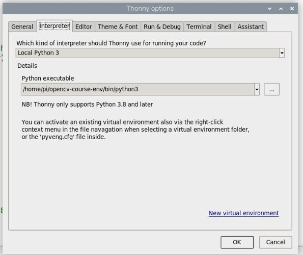
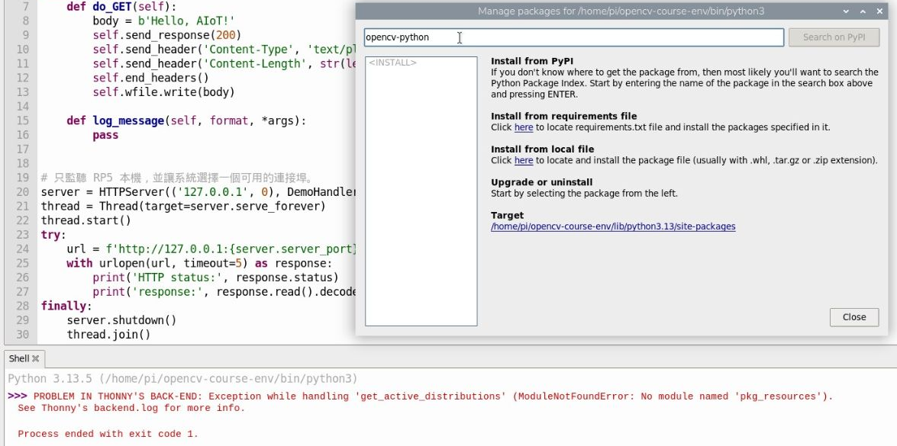
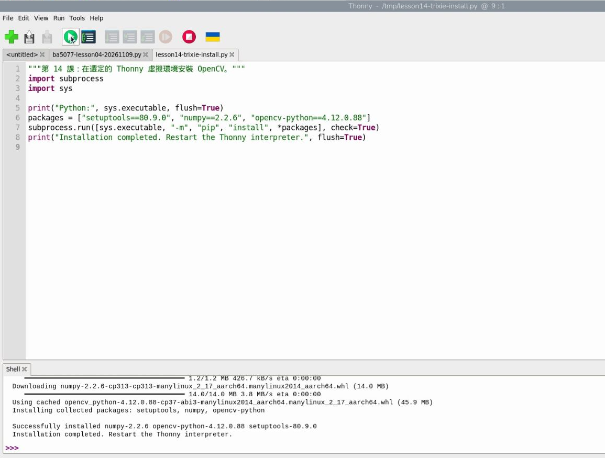
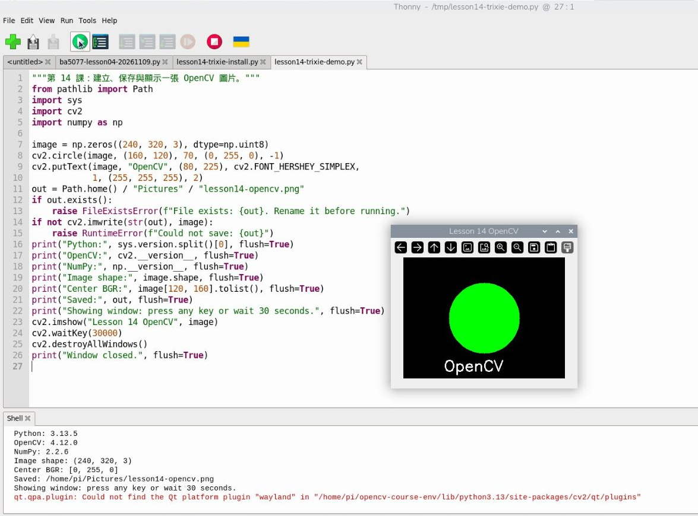

# 第 14 課｜在 Raspberry Pi 5 安裝 OpenCV

[原始文章](https://liusming.pixnet.net/blog/posts/14222877021) · 本次實測：2026-11-09 · 排錯指引補寫：2026-11-11 · [教材目錄](../README.md)

> 實測環境：Raspberry Pi 5、8 GB RAM、現有 Debian GNU/Linux 13（Trixie）、64 位元、Python 3.13.5。已在 Thonny 新建虛擬環境，完成安裝、繪圖、存檔及顯示視窗。這是已有使用資料的系統，並非全新重灌驗證。

## 學習目標與背景

完成後，你能在 Thonny 建立並選用獨立環境、安裝 OpenCV，並畫出、保存及顯示一張圖片。

OpenCV 是影像處理工具：圖片可以表示為許多像素的陣列，程式可以改變像素顏色、尋找形狀，或處理相機畫面。OpenCV 的 Python 模組叫 `cv2`；NumPy 則用陣列保存圖片資料。

不同課可能需要不同版本的套件。**虛擬環境**是各自獨立的 Python 套件資料夾；在 Thonny 選哪個環境，就在該環境安裝及執行。本課環境先用於繪圖，尚未驗證能直接用於相機或所有其他課程。


*上圖為觀念說明，不是操作截圖。*

## 準備

- Raspberry Pi 5 桌面、可使用的滑鼠與鍵盤或 Raspberry Pi Connect 桌面分享、網路連線與 Thonny。
- 本練習自行產生圖片，不需要下載圖片或相機。下載下方程式時，在 GitHub 點連結，再使用 **Raw → 另存新檔**，存到 RP5 容易找到的位置；也可以直接複製文中程式到 Thonny。詳見[素材下載與使用](../練習素材/素材下載與使用.md)。
- 請使用自己的新空資料夾，避免覆蓋既有環境。本例環境叫 `opencv-course-env`，可使用其他名稱。

## 步驟 1：用 Thonny 建立獨立環境

1. 在 RP5 桌面開啟 **Thonny**。上方選單選 **Tools → Options → Interpreter**。
2. 點選右下方 **New virtual environment**，閱讀提示後按 **OK**。
3. 在個人資料夾（Home）建立一個新的空資料夾，例如 `opencv-course-env`。進入空資料夾後按 **OK**，等待建立完成。
4. 確認 **Python executable** 指向新環境中的 `bin/python3`，按 **OK**。回到主畫面後，右下角也應顯示新環境路徑。



*圖：RP5 上實際建立的環境設定畫面，已裁切。本例路徑為 `/home/pi/opencv-course-env/bin/python3`；你的使用者名稱與路徑可不同。*

## 步驟 2：安裝 OpenCV

**若已看到安裝錯誤，請接著完成本節的 1～4 步，不必重新安裝系統。** `pkg_resources` 錯誤發生在套件管理功能；下列安裝程式從 Thonny 編輯區執行，可以接續安裝。若你的錯誤是 `No matching distribution found for install`，請先看[依錯誤訊息分流的修復流程](../Thonny環境與套件安裝.md#安裝出錯時先從這裡處理2026-11-11-補寫)，不要把 `install` 輸入成套件名稱。

本次新環境在 **Tools → Manage packages** 出現 `ModuleNotFoundError: No module named 'pkg_resources'`，套件管理器未能完成操作。下圖是本次實際畫面，不是所有版本都會發生。



本課在 Thonny 以以下安裝程式完成安裝。程式透過目前選用的 Python 執行 pip；它會從套件來源取得指定版本，也會安裝供此版 Thonny 使用的 `setuptools`。

1. 下載[第 14 課 Trixie 安裝程式](../範例程式/第14課-Trixie-Thonny安裝.py)，或將下方程式複製到新的 Thonny 編輯視窗並存檔。
2. 確認 Thonny 右下角仍是剛建的虛擬環境。若剛才看到紅色錯誤，先關閉套件管理器，再按工具列的紅色 **Stop/Restart backend** 重啟解譯器。
3. 在 Thonny 開啟安裝程式，按綠色 **Run**。等待 Shell 出現完成訊息；安裝需要網路，初次下載時間依網路而異。

```python
"""第 14 課：在選定的 Thonny 虛擬環境安裝 OpenCV。"""
import subprocess
import sys

print("Python:", sys.executable, flush=True)
packages = ["setuptools==80.9.0", "numpy==2.2.6", "opencv-python==4.12.0.88"]
subprocess.run([sys.executable, "-m", "pip", "install", *packages], check=True)
print("Installation completed. Restart the Thonny interpreter.", flush=True)
```

本次 Shell 輸出節錄：

```text
Python: /home/pi/opencv-course-env/bin/python3
Successfully installed numpy-2.2.6 opencv-python-4.12.0.88 setuptools-80.9.0
Installation completed. Restart the Thonny interpreter.
```



*圖：本次 RP5 的 Thonny 操作截圖，已裁切。NumPy 為下載；OpenCV 顯示 `Using cached`，表示使用了本機快取。套件來源未來可能變動。*

4. 完成後按紅色 **Stop/Restart backend** 重新啟動解譯器。先依[版本與路徑檢查程式](../Thonny環境與套件安裝.md#修復流程關閉錯誤視窗後可以繼續做什麼)核對安裝的確在所選虛擬環境，再進行下一步。原有實測已完成安裝程式與繪圖範例；套件管理器是否恢復搜尋／安裝功能未另行驗收。

**為什麼指定 `setuptools==80.9.0`？** 舊版 Thonny 的套件管理流程可能使用 `pkg_resources`。這個介面由較舊的 setuptools 提供；[官方紀錄](https://setuptools.pypa.io/en/stable/history.html#v82-0-0)指出 82.0.0 已移除它，所以任意升級 setuptools 不一定能解決。此固定版本是已保存的本機相容安裝方式，不代表所有 Thonny 版本都需要它。

## 步驟 3：畫圖、存檔、開啟視窗

1. 下載[繪圖測試程式](../範例程式/第14課-Trixie-OpenCV測試.py)，或複製下面完整程式到 Thonny 並存檔。
2. 確認右下角仍選用步驟 1 的環境，按綠色 **Run**。
3. 應出現黑底、綠色圓形的視窗。點選圖片視窗後按任意鍵，或等 30 秒，視窗就會關閉。
4. 在 RP5 的檔案管理員打開 **Pictures**，找到 `lesson14-opencv.png`。程式避免覆蓋同名檔案；若想再執行一次，先將原圖片改名，或修改程式中的輸出檔名。

```python
"""第 14 課：建立、保存與顯示一張 OpenCV 圖片。"""
from pathlib import Path
import sys
import cv2
import numpy as np

image = np.zeros((240, 320, 3), dtype=np.uint8)
cv2.circle(image, (160, 120), 70, (0, 255, 0), -1)
cv2.putText(image, "OpenCV", (80, 225), cv2.FONT_HERSHEY_SIMPLEX,
            1, (255, 255, 255), 2)
out = Path.home() / "Pictures" / "lesson14-opencv.png"
if out.exists():
    raise FileExistsError(f"File exists: {out}. Rename it before running.")
if not cv2.imwrite(str(out), image):
    raise RuntimeError(f"Could not save: {out}")
print("Python:", sys.version.split()[0], flush=True)
print("OpenCV:", cv2.__version__, flush=True)
print("NumPy:", np.__version__, flush=True)
print("Image shape:", image.shape, flush=True)
print("Center BGR:", image[120, 160].tolist(), flush=True)
print("Saved:", out, flush=True)
print("Showing window: press any key or wait 30 seconds.", flush=True)
cv2.imshow("Lesson 14 OpenCV", image)
cv2.waitKey(30000)
cv2.destroyAllWindows()
print("Window closed.", flush=True)
```

本次 Thonny Shell 的實際輸出如下；`Saved` 路徑依使用者名稱不同：

```text
Python: 3.13.5
OpenCV: 4.12.0
NumPy: 2.2.6
Image shape: (240, 320, 3)
Center BGR: [0, 255, 0]
Saved: /home/pi/Pictures/lesson14-opencv.png
Showing window: press any key or wait 30 seconds.
qt.qpa.plugin: Could not find the Qt platform plugin "wayland" in "/home/pi/opencv-course-env/lib/python3.13/site-packages/cv2/qt/plugins"
Window closed.
```



*圖：本次 RP5 上 Thonny、程式輸出及 OpenCV 視窗的實際截圖，已裁切。本次雖顯示 Wayland 相關訊息，視窗仍正常開啟及關閉；其他桌面設定不保證有相同結果。*


*圖：本次程式在 RP5 產生的 PNG 成果圖。*

## 讀懂結果

- `Image shape: (240, 320, 3)` 表示高 240、寬 320，每個像素有 3 個顏色數值。
- OpenCV 一般以 **BGR（藍、綠、紅）**順序表示彩色像素；`[0, 255, 0]` 因此是綠色。
- `cv2.imwrite` 存檔；`cv2.imshow` 顯示圖片；`destroyAllWindows` 關閉視窗。成功匯入並不代表所有擴充或相機功能都已驗證。

## 常見問題

- **`No module named cv2`：**檢查右下角選用的是否為剛安裝套件的環境，重新啟動解譯器後再執行。
- **`No module named pkg_resources`：**依步驟 2 關閉管理器、重啟解譯器，在 Thonny 編輯區執行本課安裝程式；成功後重啟並核對路徑、setuptools 版本及模組是否存在。不要直接安裝名為 `pkg_resources` 的套件，也不要以任意升級 setuptools 取代本課相容版本。完整步驟見[共用排錯指南](../Thonny環境與套件安裝.md#修復流程關閉錯誤視窗後可以繼續做什麼)。
- **`No matching distribution found for install`：**pip 正在找名為 `install` 的套件，與找不到 OpenCV 是不同錯誤。關閉套件管理器並執行本節完整安裝程式；requirements 檔只放套件規格，不能放整行 `pip install …`。
- **`FileExistsError`：**程式不覆蓋同名圖片。將原圖改名或修改輸出檔名後再執行。
- **有 Wayland 訊息但視窗已出現：**本次有此訊息且視窗可用。若視窗未出現或程式中止，保留完整錯誤並檢查桌面與 OpenCV 套件；不能只憑本次結果保證其他系統也可顯示。
- **相機套件找不到：**本環境尚未驗證 Picamera2，不要把本課繪圖結果視為相機已完成。

## 練習與應用

1. 將 `(0, 255, 0)` 改成 `(255, 0, 0)`，觀察顏色變化；改用新檔名保存。
2. 調整圓心與半徑，思考座標從圖片哪個角落開始。
3. 後續可將相機照片轉成陣列，用類似方法畫出偵測框或標示結果。

## Bookworm 和 Trixie 的差別

| 項目 | 先前 Bookworm 紀錄 | 本次 Trixie 實測 |
|---|---|---|
| Python 與套件 | 曾在獨立環境測試 Python 3.11、OpenCV 4.10.0、NumPy 1.26.4 | Python 3.13.5、OpenCV 4.12.0、NumPy 2.2.6 |
| 安裝與 GUI | 曾在 Thonny 測試獨立環境及視窗 | 在新建 Thonny 環境以安裝程式安裝，畫圖、存檔、開窗成功 |
| 限制 | 歷史紀錄；不代表目前系統 | 非重灌系統；相機及全部擴充未測 |

系統發行版的 APT `python3-opencv` 與虛擬環境 pip 的 `opencv-python` 是不同安裝路徑，版本和能否互相看見取決於環境。Debian 官方套件清單列有 [Bookworm 與 Trixie 的版本](https://packages.debian.org/search?keywords=python3-opencv)，但本課**沒有在 Trixie 從 APT 重新安裝並驗證**。

## 與原文章的差異

- 原文介紹 APT、命令列虛擬環境與原始碼編譯；本課聚焦初學者在 Thonny 建立環境、安裝並驗證，沒有重做原始碼編譯。
- 原文的虛擬環境範例同時列出 `opencv-python` 與 `opencv-python-headless`；本課只裝桌面版。兩者使用同一個 `cv2` 名稱，[套件官方說明](https://pypi.org/project/opencv-python/4.12.0.88/)要求同一環境只選一種變體。
- 新增 Trixie／Python 3.13 的實測版本、Thonny 套件管理器錯誤與安裝替代方式、真實截圖、實際輸出及圖片成果。
- [先前 Bookworm 完整紀錄](../歷史紀錄/第14課-Bookworm-20261029.md)保留為版本對照，不視為 Trixie 或全新系統測試。相機和其他 OpenCV 擴充功能仍需依各課另行驗證。

延伸閱讀：[OpenCV Python 教學](https://docs.opencv.org/4.x/d6/d00/tutorial_py_root.html) · [Python 虛擬環境](https://docs.python.org/3/library/venv.html)。
