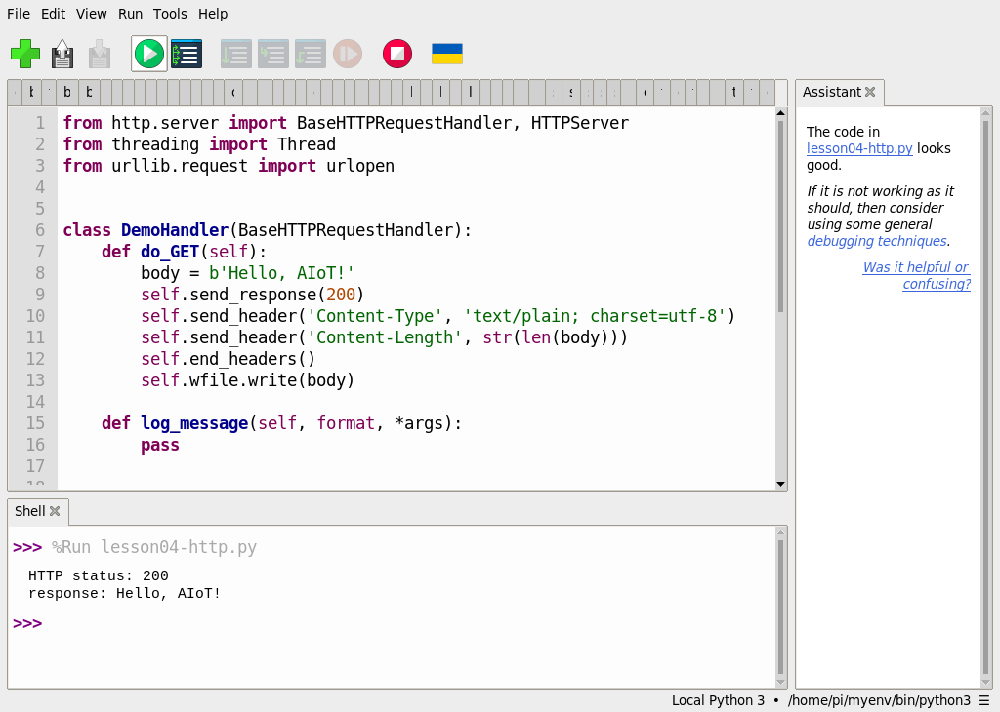
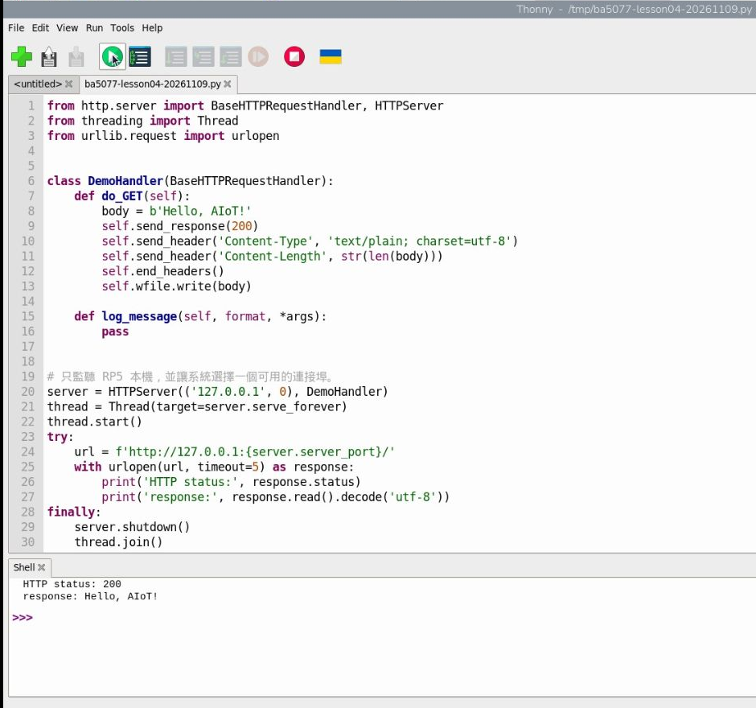
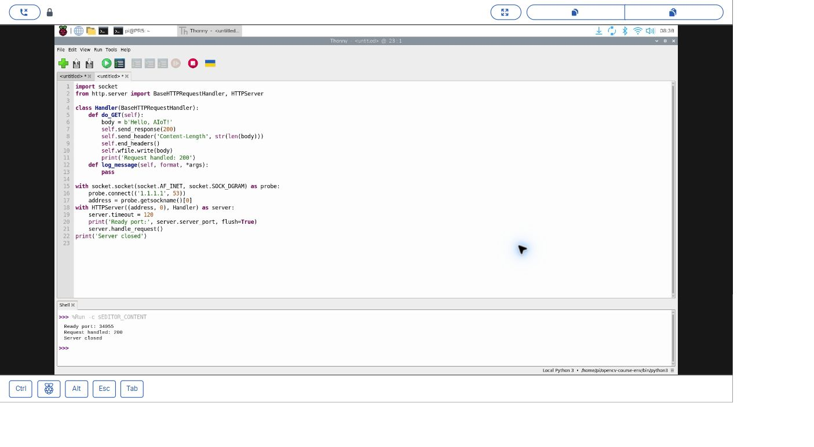

# 第 04 課｜網路基礎與作業系統：應用於 Raspberry Pi（下）

[原始文章](https://liusming.pixnet.net/blog/posts/14222880483) · 更新日期：2026-10-29

> 本篇為基礎系統或獨立工具教學；Python 課程改用 Thonny 的整體進度請見[逐篇狀態](./Thonny逐篇實測狀態.md) · [圖片與程式下載方式](./練習素材/素材下載與使用.md)。

## 學習目標

認識 Linux、套件管理器與 SSH，並能確認系統是否具備相關工具。套件管理器安裝系統程式；Python 專案則可用獨立虛擬環境管理額外套件。

## 背景：遠端操作與軟體從哪裡來？

當 RP5 沒有接螢幕時，另一台電腦仍可經網路使用 SSH 遠端登入。SSH 提供加密的連線，讓你在 RP5 的終端機執行命令；輸入命令的位置仍是 RP5，不是本機的 Windows。登入前需確認設備、帳號與網路連線正確。

作業系統中的套件管理器協助下載與管理軟體。APT 管理 Debian 系列的系統套件；Python 專案也可能使用虛擬環境管理程式庫。這是兩個不同層次：系統有 `apt`，不代表某個 Python 套件一定已安裝。


上圖是教學流程圖；它不顯示或證明真實的網路連線狀態。

## 實作：確認作業系統與架構

```bash
python3 -c "import platform; print(platform.system()); print(platform.machine())"
command -v apt
```

本機實際輸出：

```text
Linux
aarch64
/usr/bin/apt
```

第一行是核心所屬系統，第二行是處理器架構；`/usr/bin/apt` 表示目前系統找得到 APT。這不代表每個需要的套件均已安裝。

## 實作：確認 SSH

```bash
systemctl is-active ssh
```

本機實際輸出：

```text
active
```

`active` 表示此時 SSH 服務正在執行；遠端登入仍需網路可達、帳號以及適當的認證方式。完成操作後應妥善保護密碼與私鑰。

## 套件與系統更新

APT 的套件來源、版本和網路狀況都會影響安裝結果。先確認要安裝的套件及儲存空間，再依該篇教材操作；不需要為了每一篇文章都全面升級系統。開放 Apache 等服務之前，應確認是否真的需要提供網路存取。

## 練習與後續應用

1. 解釋 `systemctl is-active ssh` 回傳 `active` 所表示的事，以及它不能保證什麼。
2. 說明 `command -v apt` 找得到程式，和某個套件已安裝，為什麼不是同一件事。
3. 設計一個本地網頁顯示感測資料的情境，寫出可能需要的輸入、處理方式與使用者；本次已測本機 Python HTTP 範例，原文 Apache 情境尚未完成。

遠端操作適用於沒有螢幕的感測節點，也讓維護人員能檢查狀態。正式部署還要考量帳號認證、連線範圍、軟體更新與裝置失聯時的處置。[Raspberry Pi 遠端存取文件](https://www.raspberrypi.com/documentation/computers/remote-access.html)可供後續學習。

## 綜合實作：讓 RP5 回應一次本機網頁請求

原文包含架設網頁伺服器的情境。這裡先用 Python 內建工具理解「請求與回應」，不需要另安裝 Apache，也不對區域網路開放服務。這個練習會啟動一個暫時的本機服務、送出一次請求，再自行關閉。

### 事前準備

需要能在 RP5 執行 Python 3。下方程式沒有額外第三方套件；把它存為 `第04課-本機網頁.py`，也可使用[範例程式](./範例程式/第04課-本機網頁.py)。

```python
from http.server import BaseHTTPRequestHandler, HTTPServer
from threading import Thread
from urllib.request import urlopen


class DemoHandler(BaseHTTPRequestHandler):
    def do_GET(self):
        body = b'Hello, AIoT!'
        self.send_response(200)
        self.send_header('Content-Type', 'text/plain; charset=utf-8')
        self.send_header('Content-Length', str(len(body)))
        self.end_headers()
        self.wfile.write(body)

    def log_message(self, format, *args):
        pass


# 只監聽 RP5 本機，並讓系統選擇一個可用的連接埠。
server = HTTPServer(('127.0.0.1', 0), DemoHandler)
thread = Thread(target=server.serve_forever)
thread.start()
try:
    url = f'http://127.0.0.1:{server.server_port}/'
    with urlopen(url, timeout=5) as response:
        print('HTTP status:', response.status)
        print('response:', response.read().decode('utf-8'))
finally:
    server.shutdown()
    thread.join()
    server.server_close()
```

在 RP5 的 Thonny 選「檔案 → 開啟」開啟上方範例，按綠色執行按鈕。2026-10-29 在先前 Bookworm 環境的 Thonny 實際輸出：

```text
HTTP status: 200
response: Hello, AIoT!
```



### 在現有 Trixie 系統操作（2026-11-09）

這次使用 Raspberry Pi 5 現有的 Debian 13 Trixie 環境、Thonny 與系統 Python 3.13.5；並非全新安裝的系統。這個範例使用 Python 標準函式庫，不需要另外安裝套件。

1. 在 RP5 取得[本課 Python 範例](./範例程式/第04課-本機網頁.py)，下載與放置方式請見[素材下載與使用](./練習素材/素材下載與使用.md)。
2. 開啟 Thonny，選「File → Open」找到並開啟此範例。確認右下角選用 RP5 的系統 Python 3。
3. 點選綠色執行鈕，觀察下方 Shell。執行完成後會回到 `>>>` 提示符號。

本次在 Thonny 實際得到：

```text
HTTP status: 200
response: Hello, AIoT!
```



*圖：RP5 上 Thonny 實際執行畫面，為方便閱讀而裁切。路徑與檔名可依個人存放位置不同；輸出結果的兩行文字應相同。*

### 讀懂結果

`127.0.0.1` 指向執行程式的 RP5 本身；連接埠設為 `0` 時，由系統選一個目前可用的連接埠。程式以 `urlopen` 對自己的服務提出請求，`200` 表示這次請求收到成功回應，後面一行是回應內容。最後的 `shutdown` 與 `server_close` 負責關閉服務。

這個測試證明 RP5 本機內的 HTTP 請求和回應可運作，**不證明其他電腦能連到 RP5，也不代表 Apache 已安裝或對外提供服務**。

### 練習與問題排除

1. 修改 `body` 裡的英文訊息，再執行一次；記下輸出如何改變。若要使用中文字，需先用 UTF-8 編碼成 bytes，並注意 `Content-Length` 使用的是位元組數。
2. 試著解釋服務、連接埠、請求與回應各自扮演什麼角色。
3. 若看到 `ModuleNotFoundError`，確認是在 RP5 的 Python 3 執行；若埠綁定失敗，檢查環境是否限制本機網路。

延伸到感測器時，回應內容可以由固定文字改為溫度或其他數值。但在讓其他裝置連入之前，還需考慮誰能存取、資料是否敏感以及服務失敗時的處理方式。
## 現有 Trixie 實測：Windows 跨裝置 HTTP（2026-11-10）

這次在既有 Trixie、Thonny 的 `/home/pi/opencv-course-env/bin/python3` 執行下列不需額外套件的範例，再從同一網路的 Windows 電腦提出一次請求。這不是 Apache，也不是全新系統測試。只在可信任的練習網路使用；服務沒有驗證，只傳固定字串，處理一次請求，或在沒有連線時等候 120 秒後關閉。

1. 在 RP5 確認自己的 IPv4 位址；不要把實際私人位址貼到公開教材。
2. 在 Thonny 建立新檔，貼入下列程式，或下載[完整範例](./範例程式/第04課-跨裝置HTTP.py)後開啟。執行後記下 Shell 顯示的連接埠。

```python
import socket
from http.server import BaseHTTPRequestHandler, HTTPServer

class Handler(BaseHTTPRequestHandler):
    def do_GET(self):
        body = b'Hello, AIoT!'
        self.send_response(200)
        self.send_header('Content-Length', str(len(body)))
        self.end_headers()
        self.wfile.write(body)
        print('Request handled: 200')
    def log_message(self, format, *args):
        pass

with socket.socket(socket.AF_INET, socket.SOCK_DGRAM) as probe:
    probe.connect(('1.1.1.1', 53))
    address = probe.getsockname()[0]
with HTTPServer((address, 0), Handler) as server:
    server.timeout = 120
    print('Ready port:', server.server_port, flush=True)
    server.handle_request()
print('Server closed')
```

程式透過 UDP socket 選出系統到 `1.1.1.1` 的 IPv4 路由介面，僅查詢本機路由而未送出應用資料；若沒有可用路由，會在啟動服務前失敗。它只綁定所選介面，連接埠 `0` 由系統分配；若有多張網卡，所選介面可能不是電腦所連的網路，應先核對。連接埠每次可能不同。

3. 在本次使用的 Windows PowerShell 7 將 `<RP5位址>` 與 `<連接埠>` 換成當次值，執行以下兩行：

```powershell
$response = Invoke-WebRequest -Uri 'http://<RP5位址>:<連接埠>/' -TimeoutSec 8 -UseBasicParsing
$response.StatusCode
[System.Text.Encoding]::UTF8.GetString($response.Content)
```

本次 Windows 實際收到狀態 `200`；回應內容以位元組顯示為 `72 101 108 108 111 44 32 65 73 111 84 33`，將這些位元組以 UTF-8 解碼得到 `Hello, AIoT!`。RP5 的 Thonny Shell 當次輸出：

```text
Ready port: 34055
Request handled: 200
Server closed
```



*圖：RP5 桌面分享中 Thonny 的實際程式與輸出；埠號為當次動態值。* `Server closed` 也可能在等候逾時後出現；必須同時看到 `Request handled: 200`，並在另一台電腦確認回應，才能證明本次跨裝置請求成功。第一次因誤讀埠號連線遭拒，核對 Thonny 顯示及監聽狀態後，使用正確埠成功。

若連線遭拒或逾時，先確認程式仍在等候、位址及埠號正確、兩台裝置可互通；網路隔離或防火牆可能限制連線。不要為了練習停用安全防護。此範例只提供暫時且未驗證的 HTTP，不能作為對外正式服務。

## 與原文章的差異

- 新增本機實測的 Linux、ARM64、APT 與 SSH 服務檢查。
- 不將全面升級或啟動網頁伺服器視為閱讀文章的必要步驟。
- 新增既有 Trixie 系統的 Thonny 本機 HTTP 實測及操作截圖；SSH 與 Apache 設定步驟未補拍，乾淨系統尚未驗證。
- 補充 SSH、套件管理、連線流程圖及學生練習；原文網頁伺服器情境仍未在本篇完整實測。
- 新增本機回送 HTTP 的實作及真實輸出；原文的 Apache 仍未完成實測；另已用一次性 Python 服務實測區域網路跨裝置請求。
