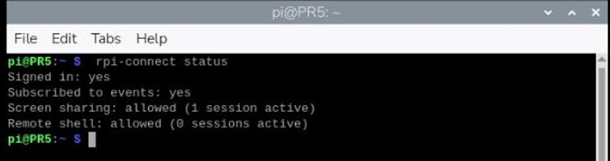
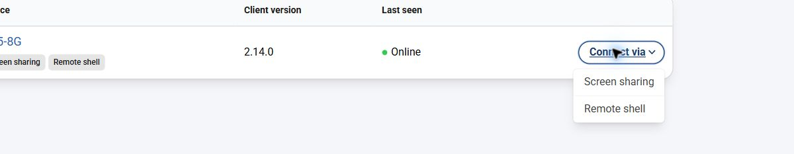
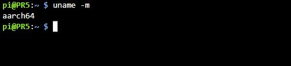
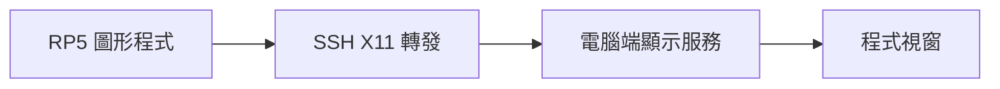

# 第 06 課｜使用 MobaXterm 對 Raspberry Pi 啟用 X11 轉發

[原始文章](https://liusming.pixnet.net/blog/posts/14222855718) · 更新日期：2026-10-29

> 本篇為基礎系統或獨立工具教學；Python 課程改用 Thonny 的整體進度請見[逐篇狀態](./Thonny逐篇實測狀態.md) · [圖片與程式下載方式](./練習素材/素材下載與使用.md)。

## 學習目標

了解如何透過 SSH 讓 RP5 上的 X11 程式在電腦顯示。MobaXterm 安裝在 Windows 端；RP5 端則需要 SSH 與 X11 轉發支援。X11 轉發與遠端桌面分享整個畫面是不同功能。

## 事前檢查

本次在 RP5 終端機執行：

```bash
command -v xauth
systemctl is-active ssh
```

實際輸出：

```text
/usr/bin/xauth
active
```

這只確認 `xauth` 存在與 SSH 服務啟動，**不代表 X11 圖形轉發已測試成功**。

## 現有 Trixie：Raspberry Pi Connect 狀態紀錄

2026-11-09 使用 Raspberry Pi Connect 的**桌面分享**操作這台 RP5，並在桌面終端機執行 `rpi-connect status`，畫面顯示：

```text
Signed in: yes
Subscribed to events: yes
Screen sharing: allowed (1 session active)
Remote shell: allowed (0 sessions active)
```



*圖：RP5 桌面終端機的實際截圖，已裁切。數字代表截圖當時的連線狀態。Remote shell 顯示 allowed 僅表示允許，不代表本次已完成遠端終端機操作驗證。*

上圖是 2026-11-09 的紀錄；下方另記 2026-11-10 的遠端終端機操作。MobaXterm X11 視窗轉發仍待實測。

## 現有 Trixie 實測：Connect 遠端終端機

2026-11-10 使用既有系統（Debian 13 Trixie、64 位元，Python 3.13.5；Connect 客戶端 2.14.0），在 Windows 的 Chrome 操作已登入且已連結裝置的 Connect。這不是新重灌系統。先確認裝置已開機、連網，且裝置清單顯示 Online 與 Remote shell；首次登入或連結裝置請參考[官方文件](https://www.raspberrypi.com/documentation/services/connect.html)，登入和授權由帳號持有人完成。

1. 在 Connect 的 Devices 頁找到自己的 RP5，按右側 **Connect via → Remote shell**。不要選成 Screen sharing；後者是完整桌面分享。

   

   *圖：實際瀏覽器操作畫面，已裁切；截圖時裝置名稱左側被裁去。*

2. 等待新頁面連線並出現提示字元，輸入 `uname -m` 後按 Enter。這個命令查詢架構，不會修改檔案。本次輸出為 `aarch64`；提示字元中的使用者和主機名稱可能不同。

   ```text
   $ uname -m
   aarch64
   ```

   

   *圖：遠端終端機實際輸出，已裁切。*

3. 輸入 `exit` 並按 Enter；本次頁面顯示 **Connection closed** 和 Reconnect。這會結束該終端機工作階段；重新連線會建立新的工作階段。

若長時間停在等待畫面，確認裝置上線、Connect 已登入且允許 Remote shell，並檢查網路；不要只憑 `allowed` 判定連線成功。這次也以 `rpi-connect status` 看到 Remote shell 在操作時為 1 個工作階段，但操作後才確認關閉畫面。這次沒有測試重新開機後連線或 MobaXterm X11。

遠端終端機傳送文字指令，不提供整個桌面；X11 轉發讓支援的單一圖形程式視窗在另一台電腦顯示；Connect Screen sharing 分享整個遠端桌面。官方文件指出 Connect 桌面分享需要 Wayland，而遠端終端機是另一種連線方式。

## 操作方式

1. 在 Windows 開啟 MobaXterm，建立指向 RP5 的 SSH 連線。
2. 在連線設定中啟用 X11 forwarding，確認 Windows 端的 X server 正在運行。
3. 登入後，使用支援 X11 的測試程式確認視窗是否出現在 Windows。若不能顯示，先確認 RP5 的 SSH 伺服器設定及兩端防火牆，再確認程式是否支援 X11 或 XWayland。
4. 不需要圖形介面時，可以直接使用 SSH 終端機；若需要整個桌面，參考第 10 課的遠端桌面。

## 背景與核心概念

### 遠端執行程式時，視窗要顯示在哪裡？

SSH 主要建立遠端登入通道；X11 轉發則讓遠端程式的圖形視窗透過連線交給本機顯示。圖形程式、遠端 SSH 設定和本機顯示服務都需配合，能登入不代表圖形轉發成功。

### 思考、練習與後續應用

列出 SSH 終端機、X11 單一程式視窗與 VNC 完整桌面的差別；若程式執行卻沒有出現視窗，你會先檢查哪一端？

遠端 GUI 可用於開發和教學，但延遲與系統的圖形環境會影響體驗。

進一步閱讀：[相關官方文件](https://www.raspberrypi.com/documentation/computers/remote-access.html)。下方的程式與輸出以標明的本機實測範圍為準；沒有測過的部分不代表已完成。

## 概念流程圖



此圖用於說明文章的概念或完整目標流程，**不是操作截圖，也不代表每個步驟都已實測**；本機實測範圍請看文章中的標示。

## 用一個例子理解 X11 轉發

假設你坐在 Windows 電腦前，程式實際在 RP5 執行。開啟轉發後，RP5 程式繪製視窗的要求透過 SSH 連線傳到電腦端的 X server；如果其中任何一項不支援或未啟動，就可能只看到文字終端機。VNC 則是觀看一個遠端桌面，因此操作模式不同。

### 檢查順序

1. 先確認網路和 SSH 可以登入，再查 `systemctl is-active ssh`；不要看到服務 `active` 就跳過連線測試。
2. 查 `command -v xauth`，並確認 SSH 伺服器允許 X11 轉發、用戶端已啟用轉發，以及電腦端 X server 可用。不同系統配置需要依官方或軟體文件確認。
3. 登入後，以可用的簡單 X11 程式測試顯示。若沒有 `DISPLAY` 或視窗無法開啟，記錄錯誤並檢查環境；本機目前只實測服務與 `xauth`，**尚未完成 MobaXterm 圖形轉發測試**。

### 學生任務

畫出「Windows、SSH、RP5、X server、遠端程式」的關係，並標出程式實際在哪台機器執行。思考：SSH 能登入時，為什麼還可能看不到圖形視窗？

## 與原文章的差異

- 區分 SSH 連線成功與 X11 轉發成功；先前僅驗證 SSH 與 `xauth`，本次另測 Connect 遠端終端機。
- 不將安裝整套桌面元件列為所有使用者的必備步驟。
- 補上現有 Trixie 的 Connect 狀態及遠端終端機連線、命令和結束紀錄；MobaXterm X11 轉發仍未實測。
- 新增初學者背景、概念、思考練習及後續應用，實測範圍仍以本文標示為準。
- 加入教學流程示意；圖中的完整目標流程不代表已逐步實測。
- 新增轉發原理和排查順序；仍未把本機工具存在誤認為端到端成功。
