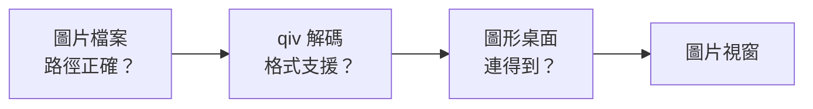
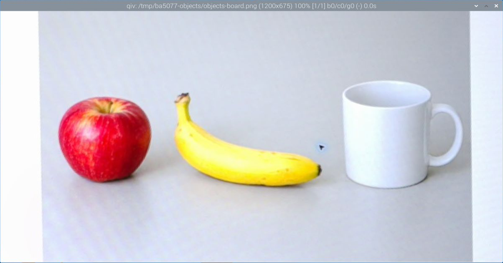

# 第 08 課｜Raspberry Pi 5 安裝與使用 qiv 圖片檢視器

[原始文章](https://liusming.pixnet.net/blog/posts/14222855730) · 教學編排修訂：2026-11-11（編修前版本存於[歷史紀錄](./歷史紀錄/第08課-qiv安裝補測前-20261111.md)）

拍完照片、跑完影像程式後，我們常常想「親眼看一下那張圖」。這一課在 RP5 上安裝一個輕巧的看圖程式 qiv，從終端機一行指令就能打開圖片，順便認識「圖片檔」和「圖片視窗」是兩件不同的事。

第一次準備環境的同學，可以先讀[課前學習說明](./學習前先讀我.md)；操作遇到紅字時，我們用[排錯故事](./程式卡住時怎麼辦.md)一起找原因。

## 這一課要完成什麼

1. 用套件管理器 APT 從零安裝 qiv，並看懂安裝訊息。
2. 用 `command -v`、`dpkg -l`、`qiv --version` 三種方法確認它真的裝好了。
3. 在 RP5 桌面的終端機用 `qiv 圖片檔名` 打開一張圖片，再把視窗關掉。

## 先想一想：看一張圖需要哪些條件？

圖片檔只是一堆存在記憶卡裡的數字。要看到它，需要三個條件同時成立：

- **檔案找得到**：路徑和檔名要對。
- **程式看得懂**：檢視器能解碼這種格式（JPG、PNG……）。
- **有地方顯示**：程式要連得到一個圖形桌面。純文字的 SSH 登入通常沒有桌面，同一行指令在 RP5 桌面能開，在 SSH 卻可能失敗。



這張流程圖是教學示意，不是操作截圖。

幾個名詞：

- **APT**：Raspberry Pi OS 的套件管理器，負責從官方套件庫下載、安裝系統程式。Python 套件才用 Thonny 或 pip；qiv 這種系統程式用 APT。
- **sudo**：用管理員身分執行下一個指令。安裝系統程式需要它，第一次使用會問**你自己帳號的密碼**。

## 第一步：檢查是不是已經裝過（在 RP5 的終端機）

**為什麼：**先確認現況，避免重複安裝，也讓你知道之後的結果是誰造成的。

在 RP5 桌面打開終端機，輸入：

```bash
command -v qiv
```

如果**什麼都沒印出來**，代表系統找不到 qiv，需要安裝。本次的 RP5（既有 Trixie）就是這樣：`command -v qiv` 沒有輸出，`apt-cache policy qiv` 顯示 `Installed: (none)`、`Candidate: 3.0.1-2+deb13u1`。如果印出 `/usr/bin/qiv`，表示已經裝過，可以直接跳到第三步。

## 第二步：用 APT 安裝 qiv

```bash
sudo apt update
sudo apt install -y qiv
```

輸入後出現 `[sudo] password for pi:` 時，輸入密碼（畫面不會顯示字元）再按 Enter。`apt update` 先更新套件清單，`-y` 表示安裝時的確認都回答「是」。本次實際輸出：

```text
Installing:
  qiv

Summary:
  Upgrading: 0, Installing: 1, Removing: 0, Not Upgrading: 55
  Download size: 102 kB
  Space needed: 244 kB / 108 GB available

Get:1 http://deb.debian.org/debian trixie/main arm64 qiv arm64 3.0.1-2+deb13u1 [102 kB]
Fetched 102 kB in 1s (71.0 kB/s)
Selecting previously unselected package qiv.
Preparing to unpack .../qiv_3.0.1-2+deb13u1_arm64.deb ...
Unpacking qiv (3.0.1-2+deb13u1) ...
Setting up qiv (3.0.1-2+deb13u1) ...
Processing triggers for desktop-file-utils (0.28-1) ...
Processing triggers for man-db (2.13.1-1) ...
Processing triggers for mailcap (3.74) ...
```

**這代表什麼：**qiv 很小，只要下載 102 kB；`Selecting previously unselected package` 表示這是第一次安裝；`Setting up qiv` 出現且沒有 `E:` 開頭的錯誤，就是安裝成功。最後的 `Processing triggers` 是系統順便更新選單、說明文件和檔案類型對應，不是錯誤。安裝過程中也可能看到 `WARNING: apt does not have a stable CLI interface` 或「有些套件不再需要，可用 autoremove 移除」的提示，都可以先不理會。

## 第三步：確認真的裝好了

```bash
command -v qiv
dpkg -l qiv | tail -1
qiv --version
```

本次輸出：

```text
/usr/bin/qiv
ii  qiv            3.0.1-2+deb13u1 arm64        Quick image viewer for X
qiv (Quick Image Viewer) v3.0.1
```

三行分別回答三個問題：系統**找得到**程式（`/usr/bin/qiv`）、套件管理器記錄為**已安裝**（開頭的 `ii`）、程式**能執行**並報出版本 3.0.1。只看第一行是不夠的：找得到程式，不代表它能在你的環境開出視窗。

## 第四步：用 qiv 打開一張圖片

先準備一張圖片放到練習資料夾，例如第 18 課拍的照片，或第 36 課拼好的 `lesson36-boat-123.jpg`。在 **RP5 桌面的終端機**（不是純文字 SSH）進入那個資料夾後執行：

```bash
qiv lesson36-boat-123.jpg
```

會跳出一個視窗，標題列寫著檔名、圖片尺寸與縮放比例：


*圖：本次安裝後在 RP5 桌面開啟圖片的操作截圖（2026-11-11），只裁切 qiv 視窗。標題列 `(1269x531) 100%` 是圖片的寬 × 高與目前縮放。圖片是第 36 課拼接的輸出圖，原始照片來自 OpenCV 官方測試資料。*

常用按鍵：`+`／`-` 放大縮小、空白鍵或方向鍵切換下一張（同時開多張時）、**`q` 關閉視窗**。也可以按視窗右上角的 ×。（這些按鍵依 qiv 說明列出，本次截圖時未逐一實測。）

## 遇到問題時

| 你看到的情況 | 可能原因 | 先試試看 |
| --- | --- | --- |
| `E: Unable to locate package qiv` | 套件清單太舊或沒有網路 | 先 `sudo apt update`，確認 RP5 能上網。 |
| `Could not get lock /var/lib/dpkg/lock-frontend` | 另一個 APT 或自動更新正在執行 | 等它結束再試，不要刪除鎖定檔。 |
| `qiv: command not found` | 還沒安裝或安裝失敗 | 回第二步，看輸出裡有沒有 `E:` 開頭的錯誤。 |
| `Unable to open display` 或 `cannot open display` | 在純文字 SSH 執行，沒有圖形桌面 | 改在 RP5 桌面（或 Raspberry Pi Connect 桌面分享）的終端機執行。 |
| 視窗沒出現，訊息說找不到檔案 | 檔名或目前資料夾不對 | 先 `pwd` 看自己在哪、`ls` 看檔名，大小寫要一樣。 |

## 練習：一次只改一個地方

1. 同時打開兩張圖：`qiv a.jpg b.jpg`，用空白鍵切換，觀察標題列 `[1/2]` 的變化。
2. 故意打錯檔名執行一次，記下錯誤訊息；再從純文字 SSH 執行一次正確檔名，比較兩種錯誤分別缺了哪個條件。
3. 想一想：為什麼 `command -v qiv` 有結果，仍不能保證視窗一定開得出來？

人工檢視輸入和輸出，是判斷 AI 視覺程式哪裡出錯的好方法。但看圖時也要留意：不要把含有他人臉孔或私人環境的照片直接公開。

## 補充：較早的 qiv 2.3.3 紀錄

較早曾在另一個已裝好 qiv 2.3.3 的 RP5 桌面開啟 RP5 相機拍攝的[測試圖片 objects-board.png](./圖檔/objects-board.png)（圖片本身是螢幕上的 AI 生成物件），標題列顯示 `1200x675`。當時沒有重新安裝，也沒有記錄是哪一套系統；目前這台既有 Trixie 在本次安裝前並沒有 qiv。



## 與原文章的差異

- 2026-11-11 全文重編，新增從零安裝主線：既有 Trixie 原本未安裝 qiv，以 `sudo apt install -y qiv` 安裝 3.0.1-2+deb13u1（102 kB），以三種方法確認，並在 RP5 桌面開圖截圖。原有 qiv 2.3.3 紀錄改列補充。
- 補充圖形顯示條件、APT 與 sudo 的說明、排錯表與練習。
- 未測試 MobaXterm X11 轉發開啟 qiv（見第 06 課），也未逐一測試所有圖片格式。

<details>
<summary>給教師：實測範圍與版本備註</summary>

> - 2026-11-11：RP5 主機 PR5、IP `192.168.1.78`、既有 Trixie。帳號持有人在 Windows 端終端機經 SSH 執行預先寫好的腳本並自行輸入 sudo 密碼；完整輸出存於 RP5 `~/ba5077-validation-20261111/sudo-installs/install-20261111-193047.log`。安裝前以 SSH 查得 `command -v qiv` 無輸出、`dpkg -l qiv` 無紀錄。
> - 開圖截圖：由 SSH 以 `DISPLAY=:0` 在 RP5 桌面啟動 qiv 開啟 `/tmp` 下的圖片副本，再以 `grim` 擷取並只裁切 qiv 視窗；**不是學生在桌面終端機手動輸入**，按鍵操作未測。截圖後已關閉 qiv 並刪除副本。
> - Python 課程改用 Thonny 的整體進度請見[逐篇狀態](./Thonny逐篇實測狀態.md) · [圖片與程式下載方式](./練習素材/素材下載與使用.md)。

</details>
