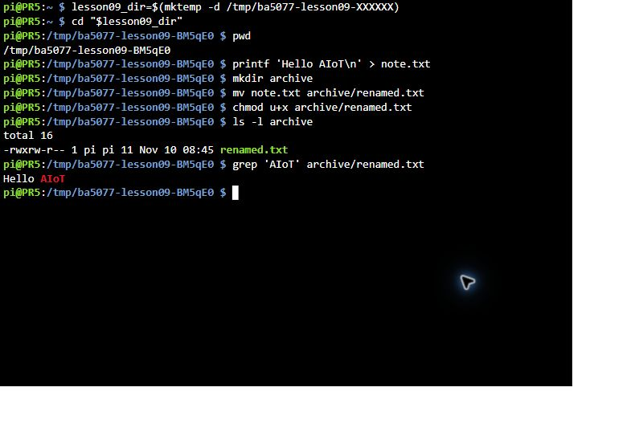
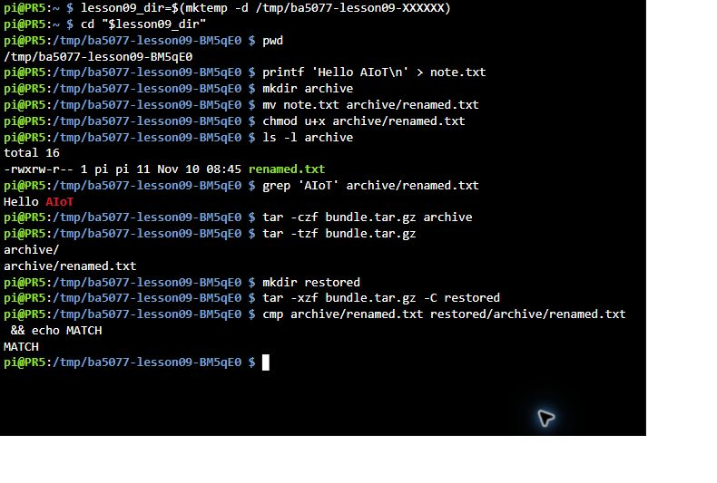
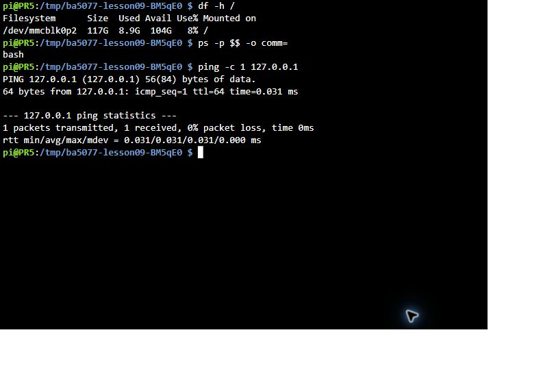

# 第 09 課｜Raspberry Pi 的 UNIX 指令教學

[原始文章](https://liusming.pixnet.net/blog/posts/14222855934) · 更新日期：2026-10-29

在桌面上複製檔案很熟悉了，換成文字命令會發生什麼？我們先在自己的練習資料夾試做，每次都讀回結果看看。

如果你使用 Trixie，我們先從[這一套系統的練習](#2026-11-10現有-trixie-終端機實測)開始；前後的舊版例子可留到比較時閱讀。

## 學習目標

了解如何在 RP5 終端機查詢系統、工具與網路狀態。讀取資訊的命令通常可以先練習；涉及寫入、覆蓋、移動或刪除檔案的命令，應先確認目標。

## 本次實測的查詢

```bash
uname -m
python3 --version
command -v apt
```

先前 Bookworm 系統的實際輸出（目前 Trixie 的 `python3 --version` 為 `Python 3.13.5`）：

```text
aarch64
Python 3.11.2
/usr/bin/apt
```

`uname -m` 查詢架構；`python3 --version` 顯示 Python 版本；`command -v apt` 查找程式位置。若 `command -v` 沒有輸出，代表目前搜尋路徑沒有找到該名稱。

## 建議練習

依序觀察目前目錄、列出檔案、切換目錄與閱讀文字檔，再學習建立自己的練習目錄。不要把尚未確認的刪除指令套用到正式資料。

## 背景與核心概念

### 終端機為什麼有用？

終端機提供文字介面，shell 接收命令並啟動程式。提示符號不是命令的一部分；檔案路徑有絕對路徑與相對於目前目錄的路徑。命令的執行位置與目前目錄會影響結果。

### 思考、練習與後續應用

解釋 `uname -m`、`python3 --version` 與 `command -v apt` 各回答什麼問題；比較在電腦與 RP5 執行查詢的差異。

文字操作適合遠端維護和重現實驗；涉及寫入、覆寫、移動或刪除時需先辨識路徑。

延伸閱讀：[官方文件](https://www.raspberrypi.com/documentation/computers/configuration.html)。

## 概念流程圖


## 實作：建立、閱讀並複製自己的練習檔

本例使用獨立的暫存目錄，讓你練習建立檔案、讀取內容和核對複製結果。程式不會自動刪除目錄；系統日後可能清理暫存空間，重要作業請保存在自己的家目錄。

把下列程式存為 `第09課-檔案練習.sh`，或下載[範例程式](./範例程式/第09課-檔案練習.sh)；在 RP5 的終端機執行。

```bash
#!/bin/sh
set -eu

# 在系統暫存目錄建立獨立資料夾，不使用既有的練習資料。
practice_dir=$(mktemp -d "${TMPDIR:-/tmp}/ba5077-lesson09.XXXXXX")
cd "$practice_dir"
printf 'Hello, AIoT!\n' > welcome.txt
mkdir samples
cp welcome.txt samples/copy.txt

printf '原始內容: '
cat welcome.txt
printf '檔案大小（bytes）: '
wc -c < welcome.txt
if cmp -s welcome.txt samples/copy.txt; then
    printf '複製結果: 內容一致\n'
else
    printf '複製結果: 內容不同\n'
    exit 1
fi
printf '練習檔案:\n'
find . -type f -print | LC_ALL=C sort
printf '練習目錄: %s\n' "$practice_dir"
```

```bash
sh 第09課-檔案練習.sh
```

本次 RP5 的實際輸出：

```text
原始內容: Hello, AIoT!
檔案大小（bytes）: 13
複製結果: 內容一致
練習檔案:
./samples/copy.txt
./welcome.txt
練習目錄: /tmp/ba5077-lesson09.bNRFTx
```

最後一行的隨機目錄名稱每次不同。這次是用 `sh` 執行相同內容的腳本；所列目錄與文字均來自 RP5 實際輸出。

### 逐行理解

1. `mktemp -d` 建立一個名稱唯一的練習資料夾，`cd` 切換進去；變數 `practice_dir` 保存路徑。
2. `printf ... > welcome.txt` 將文字寫入檔案。`>` 會覆寫同名檔案，因此要先確認位置；此例在新建資料夾內執行。
3. `mkdir` 建立子資料夾，`cp` 複製檔案；`cat` 讀取內容，`wc -c` 計算位元組數。13 包含行尾的換行字元。
4. `cmp -s` 比較兩份檔案的內容；`find` 和 `sort` 顯示練習檔案。路徑開頭的 `./` 代表目前目錄。

### 學生練習

1. 找出輸出中哪兩個檔案的內容相同。若修改其中一份後再比較，預期會如何？請在自己的練習目錄實際試驗。
2. 說明相對路徑 `./welcome.txt` 和完整路徑的差別。
3. 若要保留檔案過夜或繳交作業，為何不應只依賴暫存目錄？

原文還涵蓋系統管理與其他指令，本次未逐條重測。請勿把不理解的刪除或系統設定命令直接用在正式資料上。
## 2026-11-10：現有 Trixie 終端機實測

這次透過 Raspberry Pi Connect 遠端終端機操作既有 Debian 13 Trixie 的 RP5；不是新重灌系統。原文也包含重新命名、權限、封存、系統及網路指令。本次建立新的暫存目錄練習，沒有操作既有使用者檔案。

### 建立、移動與查詢

逐行輸入；提示符號 `$` 不需輸入。`mktemp` 每次產生不同名稱，後續都在該新目錄操作。

```bash
lesson09_dir=$(mktemp -d /tmp/ba5077-lesson09-XXXXXX)
cd "$lesson09_dir"
pwd
printf 'Hello AIoT\n' > note.txt
mkdir archive
mv note.txt archive/renamed.txt
chmod u+x archive/renamed.txt
ls -l archive
grep 'AIoT' archive/renamed.txt
```

本次 `pwd` 顯示 `/tmp/ba5077-lesson09-BM5qE0`，`grep` 顯示 `Hello AIoT`；`ls -l` 中該檔的權限欄為 `-rwxrw-r--`。檔名隨機部分、權限、擁有者和時間會依環境不同。`mv` 目的地已有同名檔時可能覆寫；這次目的地在剛建立的空目錄。`chmod u+x` 只是示範增加擁有者的執行權限，不表示這個文字檔是可執行程式。



*圖：Connect 遠端終端機實際操作畫面。*

### 封存、檢視、解壓及比較

在同一個練習目錄繼續執行。解壓前先檢查來源與檔名，並使用空的目標目錄，避免覆寫檔案。

```bash
tar -czf bundle.tar.gz archive
tar -tzf bundle.tar.gz
mkdir restored
tar -xzf bundle.tar.gz -C restored
cmp archive/renamed.txt restored/archive/renamed.txt && echo MATCH
```

本次封存清單為 `archive/`、`archive/renamed.txt`，最後輸出 `MATCH`。`cmp` 相同時以成功狀態結束，因此 `&&` 後的訊息才會執行。



*圖：Connect 遠端終端機實際操作畫面；長命令在終端機換行顯示。*

### 查詢儲存空間與本機連線

```bash
df -h /
ps -p $$ -o comm=
ping -c 1 127.0.0.1
```

當次根目錄所在檔案系統顯示容量 `117G`、已用 `8.9G`、可用 `104G`、使用率 `8%`；目前 shell 名稱顯示 `bash`。回送測試顯示 `1 packets transmitted, 1 received, 0% packet loss`；實際容量、速度與輸出會變動。`127.0.0.1` 只測 RP5 自己的網路堆疊，不能證明對外網路可用。



*圖：Connect 遠端終端機實際輸出。* 此次未測原文的 `rm`、`chown`、`sudo apt update`、`top`、`htop`、`kill` 或 `pkill`；不要對不明檔案或程序照搬範例。暫存目錄及本次練習檔保留，系統日後可能清理 `/tmp`。

## 與原文章的差異

- 優先列出已在本機執行且不會修改檔案的基本指令。
- 不把需要額外安裝的工具視為所有 RP5 均已具備。
- 現有 Trixie 新增部分檔案、權限、封存、系統與回送指令及終端機截圖；其他原文管理指令仍待測。
- 新增初學者背景、概念、思考練習及後續應用，實測範圍仍以本文標示為準。
- 加入教學流程示意；圖中的完整目標流程不代表已逐步實測。
- 新增獨立暫存目錄的檔案建立、複製、比較與 RP5 實際輸出；原文其他管理命令尚未逐條測試。

<details>
<summary>給教師：原有實測範圍與版本備註</summary>

> 本篇為基礎系統或獨立工具教學；Python 課程改用 Thonny 的整體進度請見[逐篇狀態](./Thonny逐篇實測狀態.md) · [圖片與程式下載方式](./練習素材/素材下載與使用.md)。

</details>
