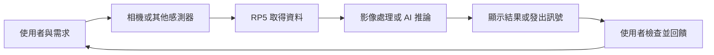

# 第 1 課｜BA5077 AIoT 產品發展實作課程介紹

[原始文章](https://liusming.pixnet.net/blog/posts/14222855412) · 更新日期：2026-10-29

## 給第一次接觸程式的你

這門課從生活問題出發，學習用 Raspberry Pi、感測器、程式與人工智慧，設計能展示、測試並改進的產品原型。你不需要在第一天就懂電子電路或機器學習；我們先認識電腦與網路，再逐步學習 Python、相機、電腦視覺和模型。

例如，想協助整理實驗室零件，可以先問：「使用者如何辨識和清點零件？」再讓相機拍下零件、嘗試辨識顏色或形狀，最後顯示數量。這是需要反覆測試的原型，還不是已驗證的商用品。

## 背景：什麼是 AIoT？

物聯網（IoT）讓裝置透過感測器或其他輸入取得資料，並依需要將資料傳給其他裝置或服務。溫度感測器回報數值、相機拍到影像，都是資料來源。

人工智慧（AI）在本課主要指利用模型處理資料，例如判斷影像中是否可能有某種物件。模型輸出有不確定性，不保證每次都正確。AIoT 結合資料取得與分析；部分運算可在 RP5 上完成，稱為邊緣運算。是否連雲端、如何保存資料，則由需求和限制決定。

這是概念示意圖，不是實際執行畫面。不是每個產品都需要相機、AI 模型或網際網路，應由問題決定。

## 這門課要做什麼

本課以 Raspberry Pi 為邊緣運算裝置，結合 Python、相機、電腦視覺與 AI 模型，逐步完成能解決實際問題的 AIoT 產品原型。課程也包含團隊合作、使用者需求、商業模式與成果展示；模型和程式只是產品的一部分。

## 學習路線

1. 認識 Raspberry Pi、作業系統與網路，建立能操作的環境。
2. 練習 Linux 指令與 Python，確認相機和 OpenCV 可以使用。
3. 使用 Picamera2 擷取影像，練習影像處理、特徵檢測與物件偵測。
4. 依需求選擇分類、手勢辨識、OCR 或 YOLO 模型，評估速度和結果。
5. 設計、測試並展示小組原型，說明使用者、價值、成本及限制。

## 本次實作設備

這次教材以 Raspberry Pi 5、8 GB 記憶體、64 位元 Raspberry Pi OS Bookworm 與已連接的相機為基準。實際已檢查的內容與版本見[安裝操作與實測紀錄](../安裝操作與實測紀錄.md)。不同機器或新版系統的輸出可能不同。

## 完成這一課

選一個你想解決的生活問題，寫下使用者是誰、相機或感測器要取得什麼資料，以及產品預期產生什麼結果。先不必安裝全部 AI 套件；後續課程會分別建立環境。

### 範例：把想法變成可驗證的問題

| 提問 | 範例回答 |
| --- | --- |
| 誰會使用？ | 整理零件的學生 |
| 想解決什麼問題？ | 紅色與藍色零件混在一起，不易快速清點 |
| 需要什麼輸入？ | 相機影像，並確認照明與拍攝位置 |
| 希望得到什麼輸出？ | 紅色、藍色區域的數量或提示 |
| 怎麼檢查效果？ | 在不同光線下比較人工清點和程式結果，記錄錯誤 |

換成你自己的題目：寫下使用者和需求，請同學評估問題是否值得解決。若相機看錯或網路中斷，使用者還能怎麼辦？

## 後續發展與學習資料

相同流程可用於教室環境監測、設備狀態提示或輔助辨識。原型走向實際使用時，還要考量資料品質、隱私、維護成本、誤判影響，以及使用者是否真正需要。

- [Raspberry Pi 官方入門指南](https://www.raspberrypi.com/documentation/computers/getting-started.html)：認識設備和啟動方式。
- [OpenCV 官方教學](https://docs.opencv.org/4.x/d9/df8/tutorial_root.html)：認識影像處理與電腦視覺。
- 延伸閱讀：第 2 課認識 RP5，第 28–30 課觀察顏色與圖形處理。

## 小組實作：從問題到產品構想

原課程也重視商業思考與團隊合作。請以三至五人為一組，先選擇一個可以觀察的情境，再訪談或詢問可能的使用者。第一週不需要先決定使用哪個 AI 模型：如果需求本身不清楚，即使程式能執行，也不一定對使用者有幫助。

1. **觀察與描述**：寫下使用者目前怎麼完成工作、遇到什麼困難，以及問題發生的情境。
2. **提出假設**：例如「若能顯示不同顏色零件的數量，整理時間可能縮短」。這是待驗證的假設，不是已證實的成果。
3. **定義最小成果**：先限定一種光線、固定位置與兩種顏色，只要求在螢幕顯示一次結果。
4. **規劃測試**：準備有目標、沒有目標及容易混淆的情況，由人工記錄預期結果，與程式輸出比較。
5. **整理價值與成本**：估計裝置、時間和維護需要；討論錯誤提示、使用者是否願意使用，以及拍攝資料如何處理。

### 一張產品規劃表

| 問題 | 本組應填寫的內容 |
| --- | --- |
| 目標使用者 | 誰會使用？目前如何解決？ |
| 問題與使用情境 | 問題在哪裡、何時發生？ |
| 輸入與輸出 | 相機或感測器看到什麼？使用者收到什麼？ |
| 最小可行測試 | 哪些輸入和預期結果能證明基本流程可行？ |
| 成本與限制 | 硬體、維護、隱私及誤判會帶來什麼影響？ |

可以用 AI 助理幫忙解釋程式或產生練習構想，但應自行閱讀、執行與檢查輸出。若助理建議下載套件或更改系統，先確認來源及命令的作用。小組報告請區分事實、測試結果和還沒有驗證的推測。

## 課後自我檢查

- 用兩句話說明 AIoT 的資料如何從感測器到使用者。
- 舉出一個不需要人工智慧、只需簡單規則也能解決的問題。
- 說明「系統成功執行一次」與「在真實環境可靠使用」的差別。
- 下次上課前完成產品規劃表；本課不要求下載模型或公開使用者資料。
## 與原文章的差異

- 重新整理學習順序與各階段的成果，保留原文的 AIoT、視覺、團隊合作及產品設計主題。
- 補上本次 RP5 硬體與系統基準；本課為課程介紹，不宣稱完成任何軟體安裝。
- 尚未補拍本課畫面。
- 新增初學者背景、AIoT 資料流程圖、產品構想練習與後續應用；流程圖是教學示意，並非截圖。
- 補充團隊需求訪談、產品規劃表、驗證假設及 AI 輔助學習的方法；本課未聲稱完成商業產品。
