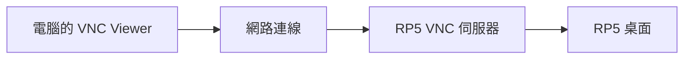

# 第 10 課｜Raspberry Pi 5 安裝與設定 VNC Viewer

[原始文章](https://liusming.pixnet.net/blog/posts/14222855754) · 更新日期：2026-10-29

> 本篇為基礎系統或獨立工具教學；Python 課程改用 Thonny 的整體進度請見[逐篇狀態](./Thonny逐篇實測狀態.md) · [圖片與程式下載方式](./練習素材/素材下載與使用.md)。

## 學習目標

使用電腦上的 VNC Viewer 連接 RP5 的圖形桌面。Viewer 是觀看端，RP5 必須有相容的 VNC 伺服器；連線方式與系統使用 X11 或 Wayland 有關。

## 確認伺服器

本次 RP5 使用 X11，並檢查現有 VNC 服務：

```bash
systemctl is-active vncserver-x11-serviced
```

本機實際輸出：

```text
active
```

這表示本機使用的服務已啟動；其他 Raspberry Pi OS 版本或 Wayland 桌面可能使用不同伺服器。

## 連線流程

1. 確保電腦可以連到 RP5，並查明 RP5 的位址。
2. 在電腦開啟 VNC Viewer，輸入 RP5 的位址。
3. 首次連線若要求確認伺服器身分，先核對指紋；輸入認證資料時由使用者自行操作，不要把密碼放進教材或聊天。
4. 連線後確認視窗顯示的是 RP5 桌面。本次已由使用者完成登入並看到桌面。

## 背景與核心概念

### 遠端桌面與終端機有何不同？

VNC 讓用戶端觀看並操作遠端的圖形桌面；SSH 則常用於文字終端機。Viewer 是觀看端，伺服器執行在遠端設備；不同系統版本使用的桌面協定與服務名稱可能不同。

### 思考、練習與後續應用

若 SSH 能登入但 VNC 沒有畫面，哪些條件可能還沒有滿足？首次連線時為何要確認伺服器身分？

遠端桌面方便教學和檢查 GUI，實際部署仍須處理認證、連線範圍與資料保護。

進一步閱讀：[相關官方文件](https://www.raspberrypi.com/documentation/computers/remote-access.html)。下方的程式與輸出以標明的本機實測範圍為準；沒有測過的部分不代表已完成。

## 概念流程圖



此圖用於說明文章的概念或完整目標流程，**不是操作截圖，也不代表每個步驟都已實測**；本機實測範圍請看文章中的標示。

## 連線前先分清用戶端和伺服器

觀看 RP5 的電腦執行 VNC Viewer，RP5 則執行相容的遠端桌面服務。操作之前，先確認兩台設備可以互相連到，以及你知道要連的是哪台 RP5。若要求確認伺服器指紋，應依可信方式核對；不要把密碼和私鑰放到教材或公開儲存庫。

### 本次觀察與限制

這次在電腦上的 VNC Viewer 已能顯示 RP5 桌面，並由使用者自行完成認證；RP5 的服務查詢結果見上方。這不代表不同 Raspberry Pi OS 版本、Wayland 桌面或其他網路環境使用同一組服務名稱。本篇尚未保存適合公開的登入及設定畫面。

### 練習

1. 用自己的話說明 Viewer 和伺服器分別在哪台電腦執行。
2. SSH 服務正常，為何仍無法保證 VNC 服務與圖形桌面正常？
3. 若要分享螢幕截圖，先檢查有沒有帳號、位址、視窗內容或其他不應公開的資訊。

## 實機遠端桌面畫面

本次重新登入 RP5 的遠端桌面後，實際在桌面開啟 qiv；[第 8 課的視窗截圖](./圖檔/lesson08-qiv-screenshot.png)由該遠端桌面擷取並裁切。截圖可展示遠端桌面上顯示程式的結果，但裁切後不含 VNC 連線介面，不能作為登入步驟或安裝設定畫面的替代；這些步驟尚未補拍。

## 與原文章的差異

- 補充 X11、Wayland 與 VNC 伺服器的差異，並保留本機服務的實測輸出。
- 加入首次連線的身分確認；本次沒有把帳號密碼放入教材。
- 已實際連上桌面，但尚未保存可公開的操作截圖。

參考：[Raspberry Pi 官方遠端存取文件](https://www.raspberrypi.com/documentation/computers/remote-access.html)。
- 新增初學者背景、概念、思考練習及後續應用，實測範圍仍以本文標示為準。
- 加入教學流程示意；圖中的完整目標流程不代表已逐步實測。
- 補充連線前檢查與學生練習；本次已看見遠端桌面，但未新增登入操作截圖。
