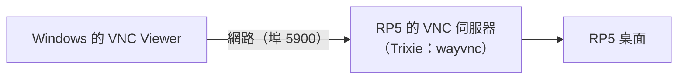
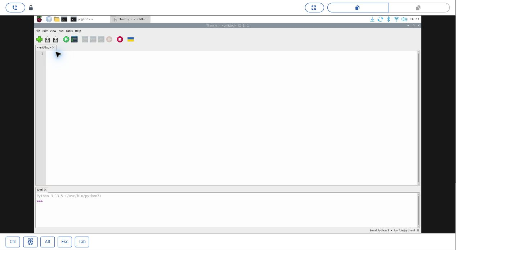
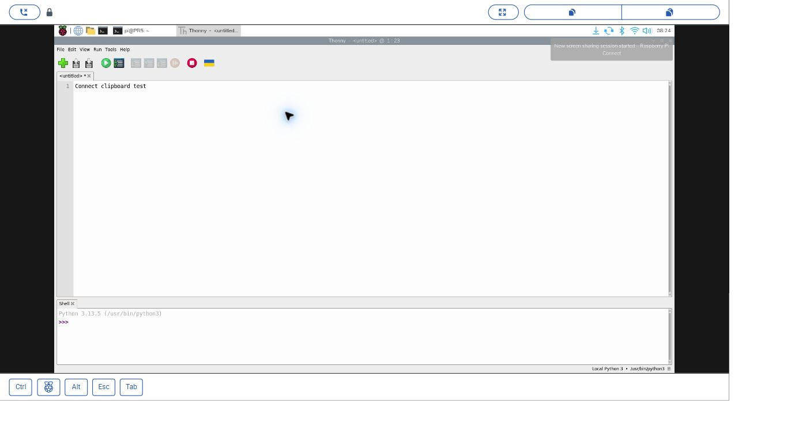
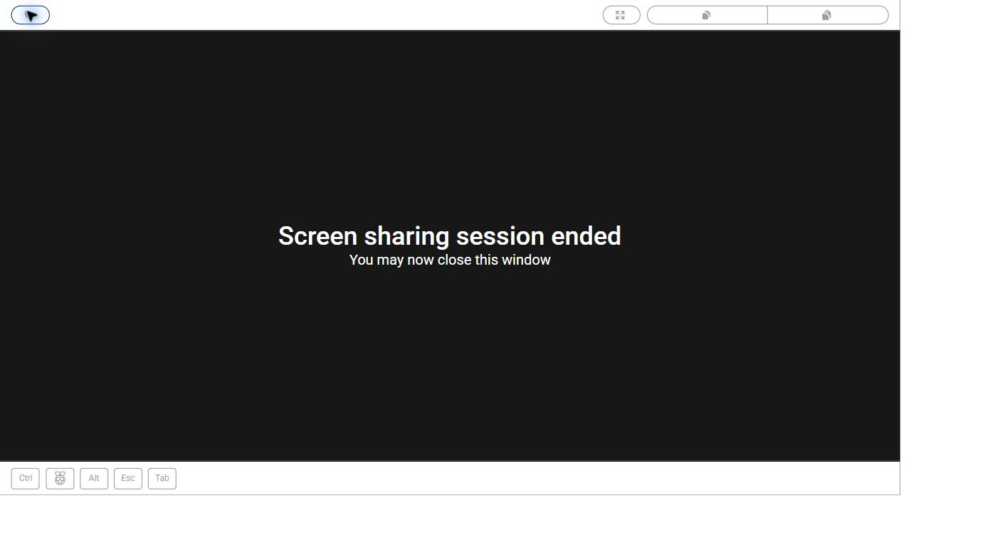

# 第 10 課｜Raspberry Pi 5 安裝與設定 VNC Viewer

[原始文章](https://liusming.pixnet.net/blog/posts/14222855754) · 教學編排修訂：2026-11-12（編修前版本存於[歷史紀錄](./歷史紀錄/第10課-全面盤點前-20261112.md)）

我們希望坐在電腦前，也能用滑鼠和鍵盤操作 RP5 的桌面。這一課要分清楚「誰在分享畫面」和「誰在觀看畫面」，然後在 RP5 打開 VNC 分享、在 Windows 安裝觀看程式，最後連上去。

第一次準備環境的同學，可以先讀[課前學習說明](./學習前先讀我.md)；操作遇到紅字時，我們用[排錯故事](./程式卡住時怎麼辦.md)一起找原因。

## 這一課要完成什麼

1. 在 RP5 打開 VNC 伺服器，並用一行指令確認它正在執行。
2. 查出 RP5 的 IP 位址。
3. 在 Windows 安裝 VNC Viewer（觀看程式），輸入 IP 與 RP5 的帳號密碼連上桌面。
4. 認識另一條不必知道 IP 的路線：Raspberry Pi Connect 的桌面分享。

## 先想一想：遠端桌面需要哪兩邊配合？

VNC 由兩個程式合作：

| 角色 | 在哪台電腦 | 做什麼 |
| --- | --- | --- |
| VNC 伺服器 | RP5 | 把 RP5 桌面的畫面送出去，接收滑鼠和鍵盤 |
| VNC Viewer（用戶端） | 你的 Windows 電腦 | 顯示收到的畫面，把你的操作送回 RP5 |



這張圖是教學示意，不是操作截圖。

**版本很重要：**Raspberry Pi OS 從 Bookworm 開始預設使用 Wayland 桌面，VNC 伺服器改為 **wayvnc**；更早的 X11 桌面用的是 RealVNC 的 `vncserver-x11-serviced`。網路上的舊教學若叫你啟動 `vncserver-x11-serviced`，在現在的 Trixie 桌面不適用。本課以目前的 Debian 13 Trixie 為主線。

## 第一步：在 RP5 打開 VNC（在 RP5 桌面操作）

**為什麼：**沒有伺服器，Viewer 就沒有東西可以看。

方法一（圖形介面）：

1. 點左上角選單，打開 **Control Centre（控制中心）**。
2. 切到 **介面（Interfaces）**分頁，把 **VNC** 開關打開。
3. 依畫面要求輸入你自己帳號的密碼。

方法二（終端機）：輸入 `sudo raspi-config`，選 **Interface Options → VNC → Yes**。

兩種方法做的是同一件事：啟用並啟動 `wayvnc` 服務。完成後在 RP5 終端機確認：

```bash
systemctl is-active wayvnc
systemctl is-enabled wayvnc
```

預期看到：

```text
active
enabled
```

`active` 表示伺服器正在執行；`enabled` 表示下次開機會自動啟動。如果看到 `inactive`，回到上面重新打開 VNC。

## 第二步：查出 RP5 的 IP 位址

在 RP5 終端機輸入：

```bash
hostname -I
```

第一個數字（例如 `192.168.1.78`）通常就是 RP5 在區網中的位址。每個網路分配的位址不同，**請用你自己看到的數字**；教室換網路後也可能改變。

## 第三步：在 Windows 安裝 VNC Viewer

觀看程式裝在 **Windows 電腦**，不是裝在 RP5。常見選擇：

- **RealVNC Viewer**：從 [RealVNC 官方下載頁](https://www.realvnc.com/en/connect/download/viewer/)下載 Windows 版安裝。
- **TigerVNC Viewer**：開放原始碼，從 [TigerVNC 官方網站](https://tigervnc.org/)取得 Windows 版。

只從官方網站下載，安裝時依畫面按下一步即可。學校電腦若不能安裝軟體，請改用第六節的 Raspberry Pi Connect。

## 第四步：連線

1. 打開 VNC Viewer，在位址欄輸入第二步查到的 IP（例如 `192.168.1.78`），按 Enter。預設埠號是 5900，通常不必另外輸入。
2. 第一次連線可能跳出「伺服器身分」或憑證提示，確認位址是你自己的 RP5 再接受。
3. 輸入 **RP5 的使用者名稱與密碼**（就是登入 RP5 的那一組，不是 Windows 帳號）。密碼由你自己輸入，不要寫進作業或聊天。
4. 看到 RP5 的桌面後，試著打開一個程式（例如 Thonny），確認滑鼠和鍵盤都能操作。

### 本次實測到哪裡（2026-11-12，既有 Trixie）

- RP5 端：`wayvnc` 0.10.2 為 `active`／`enabled`，正在監聽 `*:5900`；設定檔 `/etc/wayvnc/config` 為 `enable_auth=true`、`enable_pam=true`，代表必須用 RP5 帳號密碼登入。
- 從 Windows 對 `192.168.1.78:5900` 建立連線，伺服器回應 `RFB 003.008`，並只提供需要驗證的加密登入方式。Windows 端已安裝 TigerVNC 1.16.0 與 RealVNC Connect。
- **本次沒有輸入帳號密碼完成登入**：密碼只能由帳號持有人輸入。登入後的桌面畫面、首次連線的憑證提示截圖仍待帳號持有人補拍。
- 2026-11-11 晚間，教師曾在 RP5 開一個只供本機的臨時 wayvnc，經 SSH 通道用 Windows 的 TigerVNC 看到 RP5 桌面並操作 Thonny；那是教師測試工具，不是學生路線，但說明 TigerVNC 可以顯示 Trixie 的 Wayland 桌面。

## 第五步：連不上時怎麼辦

| 你看到什麼 | 可能原因 | 怎麼做 |
| --- | --- | --- |
| 連線逾時、拒絕連線 | 位址錯、不在同一網路、VNC 沒開 | 重查 `hostname -I`；確認兩台在同一網路；在 RP5 執行 `systemctl is-active wayvnc` |
| 帳號或密碼錯誤 | 用了 Windows 帳號 | 改用 RP5 的使用者名稱與密碼 |
| 連上後黑畫面 | RP5 沒有開到桌面，或改成文字模式開機 | 在 RP5 確認已進入桌面；`raspi-config` 的 Boot 選項要選 Desktop |
| 舊教學的指令 `vncserver-x11-serviced` 失敗 | 那是 X11 時代的伺服器 | Trixie 桌面請用 wayvnc（第一步） |

## 第六步：不用 IP 的路線——Raspberry Pi Connect 桌面分享（2026-11-10 實測）

如果電腦和 RP5 不在同一個網路，或你不知道 IP，可以用 Raspberry Pi 官方的 Connect 服務，在瀏覽器裡看 RP5 桌面。這條路線需要先用 Raspberry Pi ID 登入並連結裝置；登入與授權由帳號持有人完成。以下為既有 Trixie、Connect 2.14.0、Windows Chrome 的實際操作，不是新重灌系統。

1. 在電腦登入 [Connect](https://connect.raspberrypi.com/)，在 Devices 找到顯示 Online 的 RP5，選 **Connect via → Screen sharing**。入口選單可參考[第 06 課的實際截圖](./圖檔/lesson06-trixie-connect-menu-20261110.jpg)。
2. 桌面出現後即可操作。本次在遠端桌面開啟 Thonny：

   

   *圖：Connect 實際桌面分享畫面。*

3. **文字剪貼簿**：在電腦複製文字，按上方 **Paste to remote**，再點 RP5 的目標欄位按 Ctrl+V。本次把 `Connect clipboard test` 貼進 Thonny；反方向用 **Copy from remote** 讀回同樣文字。

   

   *圖：實際桌面分享的文字貼上結果；請勿使用私人資料作為練習。*

4. 點左上角 **Disconnect**，本次出現 `Screen sharing session ended`；點 **Reconnect** 後再次看到原有桌面。

   

   *圖：本次實際中斷後的畫面。*

Connect 桌面分享同樣需要 Wayland 桌面；它和 VNC 是兩條不同的路線，帳號、網路條件都不一樣。功能細節見 [Connect 官方文件](https://www.raspberrypi.com/documentation/services/connect.html)。

## 練習

1. 用自己的話說明 VNC 伺服器和 VNC Viewer 分別在哪台電腦執行。
2. SSH 能登入，為什麼不保證 VNC 一定能看到桌面？（提示：伺服器、桌面、埠號）
3. 比較 VNC 和 Connect：哪一個需要知道 IP？哪一個需要網際網路與 Raspberry Pi ID？
4. 要分享遠端桌面截圖前，先檢查有沒有帳號、位址或私人視窗。

## 與原文章的差異

- 主線改為 Trixie 的 wayvnc：新增在 RP5 開啟 VNC（Control Centre／raspi-config）、確認服務、查 IP、Windows 安裝 Viewer、連線與排錯表。
- 原文及本教材舊版以 X11 的 `vncserver-x11-serviced` 為例，該結果來自先前 Bookworm／X11 系統，移到教師備註。
- 保留 2026-11-10 Raspberry Pi Connect 桌面分享、剪貼簿與重連的實測截圖。
- 2026-11-12 只驗證伺服器與網路端（服務狀態、埠號、RFB 回應）；帳號密碼登入畫面待帳號持有人補拍。

<details>
<summary>給教師：版本與實測範圍</summary>

- 2026-11-12 全面盤點：原文主線只寫 `systemctl is-active vncserver-x11-serviced`（先前 Bookworm／X11 的 `active` 結果），沒有開啟 VNC 與安裝 Viewer 的步驟，判為嚴重。SSH 核對目前 Trixie：`wayvnc` 0.10.2-1+rpt1 active／enabled、監聽 `*:5900`，`realvnc-vnc-server` 7.13.1 已安裝但 `vncserver-x11-serviced` 為 inactive；`/etc/wayvnc/config` 含 `enable_auth=true`、`enable_pam=true`。Windows 以 socket 連 5900 得 `RFB 003.008`，安全類型清單為 19、129、5。Control Centre 的 rc-gui 外掛在繁中介面顯示「介面」分頁與 `VNC:` 開關（由 rpcc 0.18／rc-gui 2.22 的介面檔與翻譯檔核對，未截圖）。未輸入密碼、未完成 VNC 登入。
- 先前紀錄：舊系統的 VNC Viewer 曾由使用者登入看到桌面，且[第 08 課舊截圖](./圖檔/lesson08-qiv-screenshot.png)由該遠端桌面擷取；未保存登入設定截圖。
- [逐篇進度](./Thonny逐篇實測狀態.md) · [圖片與程式下載方式](./練習素材/素材下載與使用.md)

</details>
