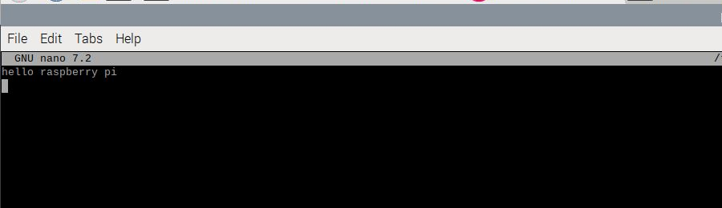
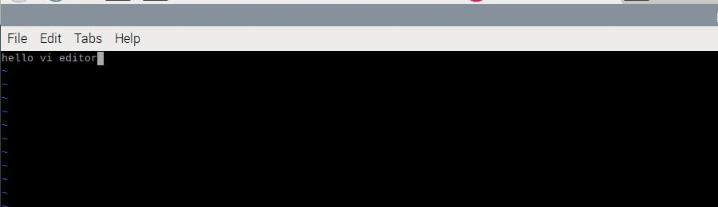
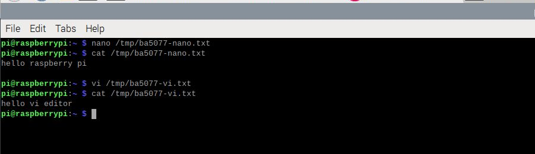

# 第 11 課｜Raspberry Pi 的 vi 與 nano 編輯器教學與比較

[原始文章](https://liusming.pixnet.net/blog/posts/14222855943) · 更新日期：2026-10-29

> 本篇為基礎系統或獨立工具教學；Python 課程改用 Thonny 的整體進度請見[逐篇狀態](./Thonny逐篇實測狀態.md) · [圖片與程式下載方式](./練習素材/素材下載與使用.md)。

## 學習目標

認識兩種終端機文字編輯器。nano 直接在畫面顯示常用快捷鍵；vi 有不同操作模式。兩者都可以編輯程式或設定檔，但儲存前應確認檔案路徑。

## 確認程式是否存在

```bash
command -v nano
command -v vi
```

本機實際輸出：

```text
/usr/bin/nano
/usr/bin/vi
```

2026-10-29 已另外在 RP5 桌面終端機實際操作 nano、vi，寫入練習檔後用 `cat` 讀回；結果見下文。

## 練習方向

在自己的練習資料夾建立文字檔，輸入一行文字、儲存、離開，再重新開啟確認。nano 的 `Ctrl+O` 用於寫入、`Ctrl+X` 用於離開；vi 的操作需注意目前是輸入模式或命令模式。不要直接拿系統設定檔當第一次練習材料。

## 背景與核心概念

### 為什麼需要文字編輯器？

程式與設定通常以文字檔保存。nano 以畫面提示快捷鍵；vi 類編輯器區分命令與輸入模式，初學時容易把命令和文字輸入混淆。路徑決定修改的是哪一份檔案。

### 思考、練習與後續應用

用自己的話比較 nano 和 vi 的編輯模式；在練習檔操作並重新開啟後，如何確認儲存成功？

建立、儲存、重新讀取是程式開發的基本流程；先用練習檔熟悉操作，再修改正式設定。

進一步閱讀：[相關官方文件](https://www.nano-editor.org/docs.php)。下方的程式與輸出以標明的本機實測範圍為準；沒有測過的部分不代表已完成。

## 概念流程圖


此圖用於說明文章的概念或完整目標流程，**不是操作截圖，也不代表每個步驟都已實測**；本機實測範圍請看文章中的標示。

## 文字檔、模式與保存

終端機編輯器操作的是文字檔。開啟一個尚不存在的檔名時，通常需要在儲存後才會有實際檔案；儲存前應確認目前所在目錄及完整路徑。nano 在畫面顯示快捷鍵提示；vi 類編輯器則需要區分命令模式和插入模式。

| 比較項目 | nano | vi 類編輯器 |
| --- | --- | --- |
| 初學觀察 | 可查看畫面底部的快捷鍵提示 | 先注意目前模式 |
| 常見操作 | `Ctrl+O` 寫入，依提示確認檔名；`Ctrl+X` 離開 | 在命令模式輸入 `i` 進入插入；按 `Esc` 回命令模式，`:wq` 儲存離開 |
| 本輪狀態 | 已實測輸入、保存與讀回一行 | 已實測插入、保存與讀回一行 |

請只用自己的練習檔，勿直接修改系統設定。不同 vi 實作或設定可能略有不同；如果畫面顯示與教材不一致，以軟體提示與文件為準。本次驗證一行文字的基本流程；尚未逐一測試原文所有編輯命令。

## RP5 實機操作：nano 和 vi 的寫入與讀回

以下是 **RP5 圖形桌面的終端機操作**，屬於系統基礎工具練習；後續 Python 課程仍以 Thonny 為主。本次只使用新建的 `/tmp/ba5077-nano.txt` 與 `/tmp/ba5077-vi.txt`；`/tmp` 可能被系統清除，重要作品請放在自己的文件資料夾。練習前應選擇沒有同名檔案的位置，避免覆蓋現有資料。

### nano

1. 在終端機輸入 `nano /tmp/ba5077-nano.txt` 並按 Enter，開啟空白練習檔；實作時若檔名已存在，先改成自己的新檔名。
2. 輸入 `hello raspberry pi`，再按 Enter。
3. 按 **Ctrl+O**，在提示檔名時按 Enter 確認寫入，再按 **Ctrl+X** 離開。
4. 執行 `cat /tmp/ba5077-nano.txt` 查看保存結果，路徑需與自己第 1 步選的檔案相同。



### vi

1. 在終端機輸入 `vi /tmp/ba5077-vi.txt` 並按 Enter；若檔名已存在，改成自己的新檔名。
2. 按 `i` 進入插入模式，輸入 `hello vi editor`。
3. 按 **Esc** 回到命令模式，輸入 `:wq` 並按 Enter，儲存並離開。
4. 執行 `cat /tmp/ba5077-vi.txt` 查看已保存內容。



兩次實際讀回的終端機輸出：

```text
$ cat /tmp/ba5077-nano.txt
hello raspberry pi

$ cat /tmp/ba5077-vi.txt
hello vi editor
```



三張圖均是本次實際操作畫面的局部裁切。`cat` 讀回相同文字證明本次檔案已寫入，但本次未逐一驗證搜尋、撤銷等其他進階命令； vi 與 nano 的操作介面與設定在其他系統可能不同。

### 練習

先在紙上寫出「開啟、輸入、儲存、離開、重新開啟確認」五個步驟；之後在練習目錄操作，記錄是否有成功重新讀到同樣的文字。

## 與原文章的差異

- 加入本機程式位置的實際輸出。
- 新增 nano 與 vi 實際輸入、儲存、離開和文字讀回的範例與截圖。
- 新增初學者背景、概念、思考練習及後續應用，實測範圍仍以本文標示為準。
- 加入教學流程示意；圖中的完整目標流程不代表已逐步實測。
- 新增模式比較、保存流程與練習；其他進階操作仍待逐一驗證。
