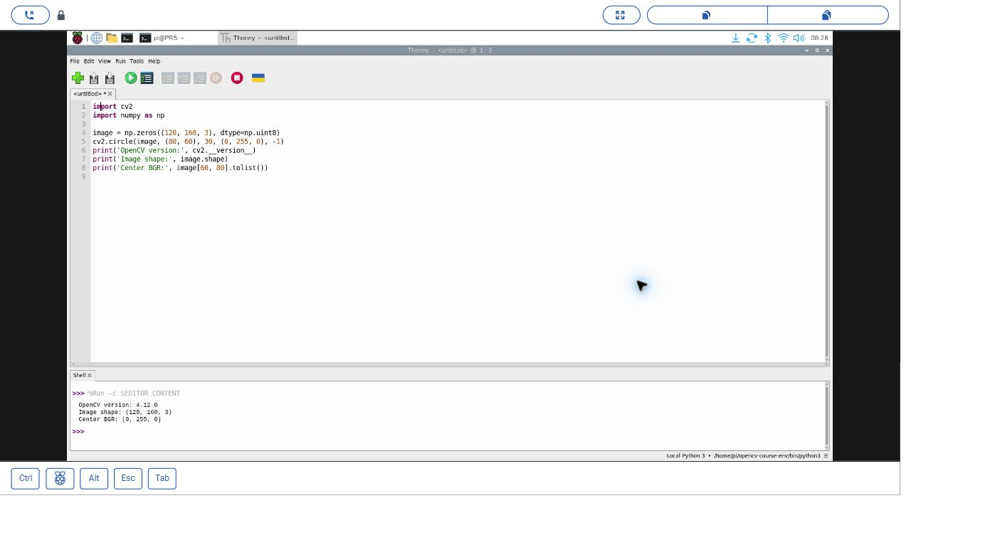

# 第 12 課｜使用 Thonny IDE 與 OpenCV 進行 Python 開發

[原始文章](https://liusming.pixnet.net/blog/posts/14222870088) · 教學編排修訂：2026-11-11

你可能已經看過老師按一下按鈕，螢幕就出現結果。這一課，我們從最小的一行程式開始，認識「寫下來、保存、執行、看回應」這個過程，再把它用在圖片上。

## 第一步：先讓 Python 向你打招呼

在 **RP5 桌面**開啟 Thonny。先看上方白色編輯區和下方 Shell：上方是我們寫給電腦的內容，下方是電腦的回應。

在上方輸入：

```python
print('你好，Raspberry Pi！')
```

點 File → Save as，在自己的練習資料夾存成 `hello_pi.py`。再按綠色 Run，下方應出現同一句問候。這是本課新增的入門練習，還沒有使用 OpenCV；可先自己操作並比較預期結果。

**如果沒有回應：**看看程式是否已保存，再確認引號左右成對，英文括號有沒有漏掉。也可以點紅色 Stop/Restart backend 後再試一次。先讓這一小步成功，我們再加入新的工具。

## 第二步：程式是誰在執行？

Thonny 像一本可以書寫的筆記本，Python 則是讀懂並執行內容的人。右下角顯示 Python 的位置。同一台 RP5 可以有好幾個 Python 環境，就像不同的工具箱；把 OpenCV 裝進其中一個，不表示每個環境都有它。

在新檔輸入並執行：

```python
import sys
print(sys.executable)
```

把看到的路徑寫在筆記裡。它是稍後找套件的重要線索，不需要與老師的帳號路徑完全相同。

## 第三步：先準備畫圖工具，再回到這裡

如果這是你第一次使用 OpenCV，先到[第 14 課](./第%2014%20課｜在%20Raspberry%20Pi%205%20安裝%20OpenCV.md)，跟著建立環境並畫出綠色圓形。完成後，再回來繼續。已完成的同學可沿用同一環境，不必再裝一次。

這樣安排是因為本課先認識 Thonny，第 14 課再把安裝一步一步展開；不用在還沒準備好工具時，先承擔一個找不到 `cv2` 的錯誤。

## 第四步：用數字描述一張圖

下載[本課圖片陣列範例](./範例程式/第12課-Thonny測試.py)，在 Thonny 用 File → Open 開啟；也可以把下面程式貼進新檔並保存。確認右下角是第 14 課的環境，再按 Run。

```python
import cv2
import numpy as np

image = np.zeros((120, 160, 3), dtype=np.uint8)
cv2.circle(image, (80, 60), 30, (0, 255, 0), -1)
print('OpenCV version:', cv2.__version__)
print('Image shape:', image.shape)
print('Center BGR:', image[60, 80].tolist())
```

這段程式會在記憶體裡建立一張圖，然後把尺寸與圓心顏色寫在 Shell。它沒有開圖片視窗，所以只看到文字是正常的。

既有 Trixie 的實測結果是：

```text
OpenCV version: 4.12.0
Image shape: (120, 160, 3)
Center BGR: [0, 255, 0]
```



`120` 是高、`160` 是寬，`3` 是三個顏色通道。OpenCV 用藍、綠、紅的順序記錄顏色，圓心 `[0, 255, 0]` 就表示綠色。

**停下來說一說：**如果我們把畫布寬度改成 200，哪一行輸出應該改變？先猜，再只修改那個數字，執行後檢查。

## 如果這一步卡住了

遇到 `No module named cv2`，先回到右下角選回第 14 課的環境；它不表示你的程式檔需要改名。遇到套件安裝紅字，可和老師一起讀[程式卡住時怎麼辦](./程式卡住時怎麼辦.md)。

學完後，你應能指出編輯區、Shell 和 Python 環境的位置，也能說明「保存程式」與「執行程式」的不同。這是後續每一個影像實驗都會用到的基本功。

## 給教師的版本與實測備註

OpenCV 陣列練習沿用 2026-11-10 既有 Trixie 的 Thonny 證據；本次新增的一行問候與教學編排未在 RP5 重新操作。舊系統與新環境的原始輸出、截圖保留在[編修前完整紀錄](./歷史紀錄/第12課-編修前-20261111.md)。本次文字修訂不代表全新系統驗收。
