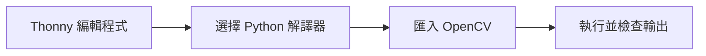
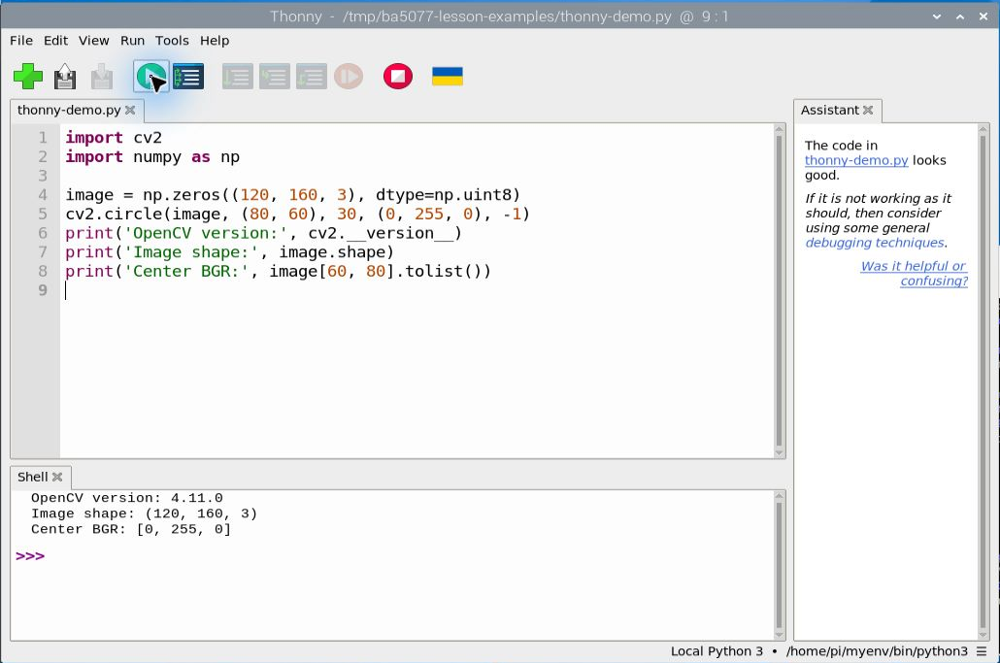

# 第 12 課｜使用 Thonny IDE 與 OpenCV 進行 Python 開發

[原始文章](https://liusming.pixnet.net/blog/posts/14222870088) · 更新日期：2026-10-29

> Thonny 重測進行中：請先看本篇標示「Thonny 實測」的段落；其他既有輸出依原測試方式標示，完整情境仍待重測。[逐篇進度](./Thonny逐篇實測狀態.md) · [圖片與程式下載方式](./練習素材/素材下載與使用.md)

## 學習目標

認識 Thonny 與 Python 的 OpenCV 模組，並先檢查本機程式是否存在。Thonny 的 Python 解譯器可能與終端機使用的解譯器不同；安裝模組後找不到時，先核對執行環境。

## 舊紀錄：終端機查詢程式與版本

```bash
command -v thonny
python3 -c "import cv2; print('OpenCV:', cv2.__version__)"
```

本機實際輸出：

```text
/usr/bin/thonny
OpenCV: 4.10.0-dev
```

此結果證明終端機的系統 Python 可以匯入 OpenCV。下方另有使用 Thonny 所選解譯器的實測。

## 後續練習

在 RP5 桌面啟動 Thonny，確認所選 Python 解譯器，建立自己的練習程式並檢查輸出。需要顯示圖片時，還要確認圖形桌面可用；經 SSH 執行不一定能開啟視窗。

Bookworm 不建議直接將 pip 套件裝入系統 Python，也不應同時安裝互相覆蓋的 OpenCV 變體；虛擬環境及實測紀錄見[安裝操作與實測紀錄](../安裝操作與實測紀錄.md)。

## 背景與核心概念

### 開發環境與 Python 模組是什麼？

IDE 把編輯、執行與除錯工具整合到一個介面；Python 解譯器讀取並執行程式。OpenCV 是可供 Python 匯入的程式庫，安裝位置和 IDE 選用的解譯器需要對得上。

### 思考、練習與後續應用

如果終端機能匯入 cv2 而 Thonny 不行，你會先比較什麼？說明「程式存在」和「IDE 可以使用該模組」的差別。

理解執行環境能避免專案間的套件衝突，也有助把課堂實驗搬到其他機器。

進一步閱讀：[相關官方文件](https://thonny.org/)。下方的程式與輸出以標明的本機實測範圍為準；沒有測過的部分不代表已完成。

## 概念流程圖



此圖用於說明文章的概念或完整目標流程，**不是操作截圖，也不代表每個步驟都已實測**；本機實測範圍請看文章中的標示。

## 學生入門：編輯器、解譯器、程式庫

Thonny 是整合開發環境（IDE），提供編輯與執行介面；Python 解譯器執行程式；OpenCV 則提供影像處理功能。這三者是不同角色。若 Thonny 選擇的解譯器與終端機不同，即使終端機可以 `import cv2`，Thonny 也可能找不到它。

### 本機檢查能證明什麼？

本課上方查到 `/usr/bin/thonny` 和 `OpenCV: 4.10.0-dev`，代表本輪系統找得到 Thonny，且終端機的 `python3` 可以匯入 OpenCV。這個終端機檢查本身不代表 Thonny 的解譯器也可用；下方透過圖形桌面的獨立測試補上這項驗證。

### 練習

1. 用自己的話分別解釋 IDE、Python 解譯器和 OpenCV 的角色。
2. 如果終端機成功而 IDE 報找不到 `cv2`，先比較什麼？
3. 使用自己的練習資料夾保存程式，記錄你實際選用的 Python 環境和錯誤訊息；不要為了解決問題隨意同時安裝多種 OpenCV 套件。

## 實機操作：在 Thonny 執行 OpenCV 程式

1. 開啟 RP5 桌面的 Thonny，選擇「File → Open」，開啟[本次範例程式](./範例程式/第12課-Thonny測試.py)。可先將檔案下載至自己的練習目錄。
2. 檢查右下角顯示的 Python 解譯器。這台 RP5 當時選用的是 `/home/pi/myenv/bin/python3`，不等同前述終端機的系統 Python；不同人的路徑可能不同。
3. 點選綠色執行按鈕，查看下方 Shell 的輸出。執行前先確認此解譯器能匯入 OpenCV 與 NumPy；若沒有套件，應在選定的獨立環境中處理。

```python
import cv2
import numpy as np

image = np.zeros((120, 160, 3), dtype=np.uint8)
cv2.circle(image, (80, 60), 30, (0, 255, 0), -1)
print('OpenCV version:', cv2.__version__)
print('Image shape:', image.shape)
print('Center BGR:', image[60, 80].tolist())
```

本次實際 Shell 輸出：

```text
OpenCV version: 4.11.0
Image shape: (120, 160, 3)
Center BGR: [0, 255, 0]
```



這是實際操作後裁切的 Thonny 截圖。上半部是程式、下半部是輸出；右下角顯示當時的解譯器。`(120, 160, 3)` 依序表示高、寬、三色通道；圓心的 `[0, 255, 0]` 表示 BGR 的綠色。此程式只驗證匯入和陣列運算，沒有顯示影像視窗。Thonny 的 OpenCV 4.11.0 與系統 Python 的 4.10.0-dev 不同，正好說明不同解譯器可能載入不同套件版本。

## Thonny 實測：新虛擬環境

另外依[環境與套件安裝指南](./Thonny環境與套件安裝.md)建立新環境，安裝後在 Thonny 重新執行同一個範例，Shell 實際輸出如下。這次使用新環境，所以版本與上面的 `myenv` 結果不同。

```text
OpenCV version: 4.10.0
Image shape: (120, 160, 3)
Center BGR: [0, 255, 0]
```


## 與原文章的差異

- 先檢查現有 Thonny 與 OpenCV，並區分終端機 Python 與 Thonny 解譯器。
- 原文同時安裝一般版及 headless OpenCV 的做法不作為新版建議。
- 新增 Thonny 圖形介面的執行、輸出與截圖；未重做 Thonny 安裝過程。
- 新增初學者背景、概念、思考練習及後續應用，實測範圍仍以本文標示為準。
- 加入教學流程示意；圖中的完整目標流程不代表已逐步實測。
- 增加開發工具分工與環境錯誤排查；本次 Thonny 例子未測影像視窗。
