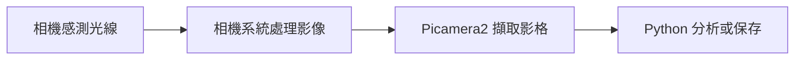
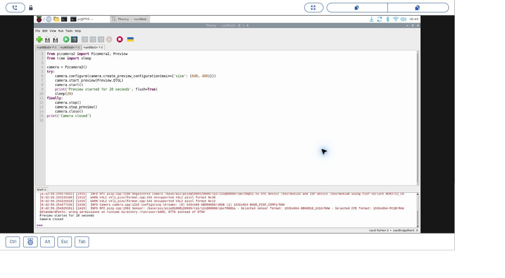

# 第 13 課｜Raspberry Pi 使用攝影機完整指南

[原始文章](https://liusming.pixnet.net/blog/posts/14222876433) · 更新日期：2026-10-29

> 本課已在 Thonny 實測：Picamera2 單張影格擷取；不含預覽或 USB 相機。完整原文情境及其他舊案例仍須依下文標示重測。[逐篇進度](./Thonny逐篇實測狀態.md) · [圖片與程式下載方式](./練習素材/素材下載與使用.md)

## 學習目標

認識 Picamera2 的建立、啟動、擷取與釋放流程。此示範只取得一張影格，不啟動無限錄影程序。

## 背景與原理

攝影機能把光線轉換成影像資料，供人觀看或讓程式分析。RP5 可搭配相機模組，透過相機軟體取得畫面；這台機器實際使用的是 IMX708 廣角相機。CSI 相機與 USB 攝影機的裝置介面可能不同，不能因某一種能用就假設另一種使用相同程式。

Picamera2 是 Python 使用 Raspberry Pi 相機的介面。先設定影格大小，再啟動相機並擷取資料，最後停止、釋放資源；如果另一個程式正佔用相機，新的程式可能無法啟動。[官方相機軟體文件](https://www.raspberrypi.com/documentation/accessories/camera-software.html)說明相機連接與相關工具。



這是概念圖，不是操作截圖。影格就是某一時刻的一張影像；連續取得多張影格則可形成影片。

## 事前準備

相機已連接，系統 Python 可以匯入 Picamera2。

請在自己的練習目錄操作。已存在的同名輸出檔可能被覆寫，先確認路徑；用不著將任何相機照片上傳公開儲存庫。

## 程式與執行

將下列程式存為 `第13課.py`。這是本次在 RP5 上執行的程式；完整檔案也在[範例程式](./範例程式/第13課.py)。

```python
from picamera2 import Picamera2

camera = Picamera2()
try:
    camera.configure(camera.create_still_configuration(main={"size": (320, 240), "format": "RGB888"}))
    camera.start()
    frame = camera.capture_array()
    print("camera", frame.shape, str(frame.dtype))
finally:
    camera.stop()
    camera.close()
```

在 Thonny 選 **File → Open** 開啟 `第13課.py`，確認右下角是包含所需套件的 Python 環境，再點綠色執行鈕。若程式會輸出檔案，先在新的練習目錄操作，避免覆寫。

## Thonny 實測輸出

```text
camera (240, 320, 3) uint8
```


本次選用既有環境 `/home/pi/myenv/bin/python3`。相機格式與影格尺寸已在 Thonny 重新測試；連續錄影及 USB 相機尚待測。 相機或影像相關套件的準備及可重現環境請參考[Thonny 環境指南](./Thonny環境與套件安裝.md)。

影格是高度 240、寬度 320 的三通道陣列；`uint8` 是每個通道的資料型別。這不代表圖形預覽或 USB 攝影機已測試。

## 練習與應用

1. 說明輸出 `(240, 320, 3)` 的高度、寬度與通道數；它與設定的 `(320, 240)` 為何順序不同？
2. 檢查目前是否有其他相機程式佔用裝置，然後再執行範例。
3. 延伸至第 18 課，將影格存成照片；再思考哪些拍攝內容不適合直接公開。

相機擷取可用在影像監測或產品檢測；要得到可信結果，還須驗證光線、拍攝位置、畫質、隱私和錯誤處理。

## 2026-11-10：既有 Trixie 的限時相機預覽

本次使用現有 Trixie、Thonny 的系統 Python `/usr/bin/python3`（3.13.5）及系統 Picamera2，使用已連接的 CSI 相機；這不是新重灌系統。已另外確認第 12 課的獨立 `opencv-course-env` 無法匯入 Picamera2，不能因為 OpenCV 可用就假設相機套件也在該環境。相機須可用且不能被其他程式佔用。

1. 在 RP5 的圖形桌面啟動 Thonny，開啟 **Tools → Options → Interpreter**，選擇包含 Picamera2 的解譯器；本次選系統 `/usr/bin/python3`。確認選擇後在 Shell 測 `from picamera2 import Picamera2`；若匯入失敗，先確認環境與套件，不要在系統 Python 隨意執行 pip。
2. 在新檔輸入下列程式或開啟[完整範例](./範例程式/第13課-限時相機預覽.py)，再按 F5 或綠色執行鈕。桌面支援 Qt 預覽時會出現畫面，約 20 秒後關閉；第一次觀看前請確認相機不會拍到不願公開的內容。

```python
from picamera2 import Picamera2, Preview
from time import sleep

camera = Picamera2()
try:
    camera.configure(camera.create_preview_configuration(main={'size': (640, 480)}))
    camera.start_preview(Preview.QTGL)
    camera.start()
    print('Preview started for 20 seconds', flush=True)
    sleep(20)
finally:
    camera.stop()
    camera.stop_preview()
    camera.close()
print('Camera closed')
```

本次 Thonny 顯示的程式輸出為：

```text
Preview started for 20 seconds
Camera closed
```

相機函式庫另外印出裝置資訊、V4L2 格式警告及 Qt 執行目錄權限警告；此次預覽視窗仍有顯示並自動關閉。第二次執行也顯示上述兩行並結束；結果依圖形環境和相機而異。`finally` 區塊會嘗試停止並釋放相機；若初始化中途失敗，清理呼叫仍可能產生錯誤，請保留完整錯誤訊息排查。



*圖：實際 Thonny 執行結果；相機預覽已結束。因本次預覽拍到含帳號資訊的螢幕，未公開預覽畫面；不含個資的預覽成果圖仍待補。* 這項測試未驗證錄影或 USB 攝影機。若沒有預覽，檢查是否在圖形桌面、相機是否被佔用、選對 Picamera2 環境及實際錯誤訊息；不要假設不同解譯器套件相同。

## 與原文章的差異

- 新增以 Thonny 操作的實測與截圖：Picamera2 單張影格擷取；不含預覽或 USB 相機。

- 原文以持續執行的 `libcamera-vid` 接著使用 `VideoCapture(0)`；本版採 Picamera2 單張擷取，避免阻塞並配合本機 CSI 相機。
- 上述文字輸出是本次實機紀錄，其他版本或環境可能不同。
- 新增既有 Trixie 的限時 Qt 預覽與重開測試；可公開的預覽畫面、錄影和 USB 相機仍待補。
