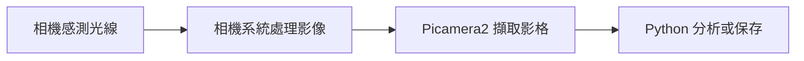

# 第 13 課｜Raspberry Pi 使用攝影機完整指南

[原始文章](https://liusming.pixnet.net/blog/posts/14222876433) · 更新日期：2026-10-29

> **Thonny 轉換待完成。** 本篇既有程式、安裝步驟與輸出仍須逐項改寫並在 Thonny 重新操作；現有終端機紀錄不代表已用 Thonny 測試。[逐篇進度](./Thonny逐篇實測狀態.md)

## 學習目標

認識 Picamera2 的建立、啟動、擷取與釋放流程。此示範只取得一張影格，不啟動無限錄影程序。

## 背景與原理

攝影機能把光線轉換成影像資料，供人觀看或讓程式分析。RP5 可搭配相機模組，透過相機軟體取得畫面；這台機器實際使用的是 IMX708 廣角相機。CSI 相機與 USB 攝影機的裝置介面可能不同，不能因某一種能用就假設另一種使用相同程式。

Picamera2 是 Python 使用 Raspberry Pi 相機的介面。先設定影格大小，再啟動相機並擷取資料，最後停止、釋放資源；如果另一個程式正佔用相機，新的程式可能無法啟動。[官方相機軟體文件](https://www.raspberrypi.com/documentation/accessories/camera-software.html)說明相機連接與相關工具。



這是概念圖，不是操作截圖。影格就是某一時刻的一張影像；連續取得多張影格則可形成影片。

## 事前準備

相機已連接，系統 Python 可以匯入 Picamera2。

請在自己的練習目錄操作。已存在的同名輸出檔可能被覆寫，先確認路徑；用不著將任何相機照片上傳公開儲存庫。

## 程式與執行

將下列程式存為 `第13課.py`。這是本次在 RP5 上執行的程式；完整檔案也在[範例程式](./範例程式/第13課.py)。

```python
from picamera2 import Picamera2

camera = Picamera2()
try:
    camera.configure(camera.create_still_configuration(main={"size": (320, 240), "format": "RGB888"}))
    camera.start()
    frame = camera.capture_array()
    print("camera", frame.shape, str(frame.dtype))
finally:
    camera.stop()
    camera.close()
```

在該檔案所在的目錄執行 `python3 第13課.py`。

## 本機實際輸出

```text
camera (240, 320, 3) uint8
```

影格是高度 240、寬度 320 的三通道陣列；`uint8` 是每個通道的資料型別。這不代表圖形預覽或 USB 攝影機已測試。

## 練習與應用

1. 說明輸出 `(240, 320, 3)` 的高度、寬度與通道數；它與設定的 `(320, 240)` 為何順序不同？
2. 檢查目前是否有其他相機程式佔用裝置，然後再執行範例。
3. 延伸至第 18 課，將影格存成照片；再思考哪些拍攝內容不適合直接公開。

相機擷取可用在影像監測或產品檢測；要得到可信結果，還須驗證光線、拍攝位置、畫質、隱私和錯誤處理。

## 與原文章的差異

- 原文以持續執行的 `libcamera-vid` 接著使用 `VideoCapture(0)`；本版採 Picamera2 單張擷取，避免阻塞並配合本機 CSI 相機。
- 上述文字輸出是本次實機紀錄，其他版本或環境可能不同。
- 尚未補拍操作畫面；圖檔（若有）是程式產生的結果，不冒充螢幕截圖。
