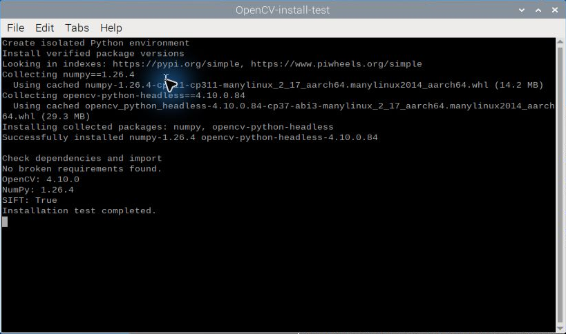
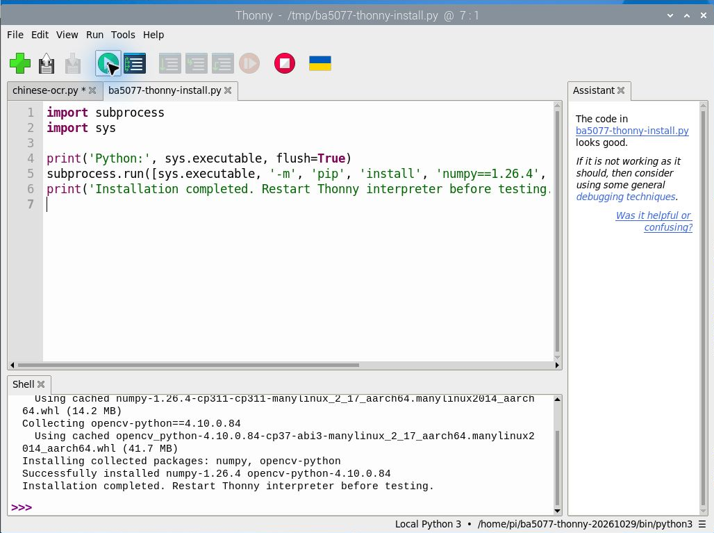
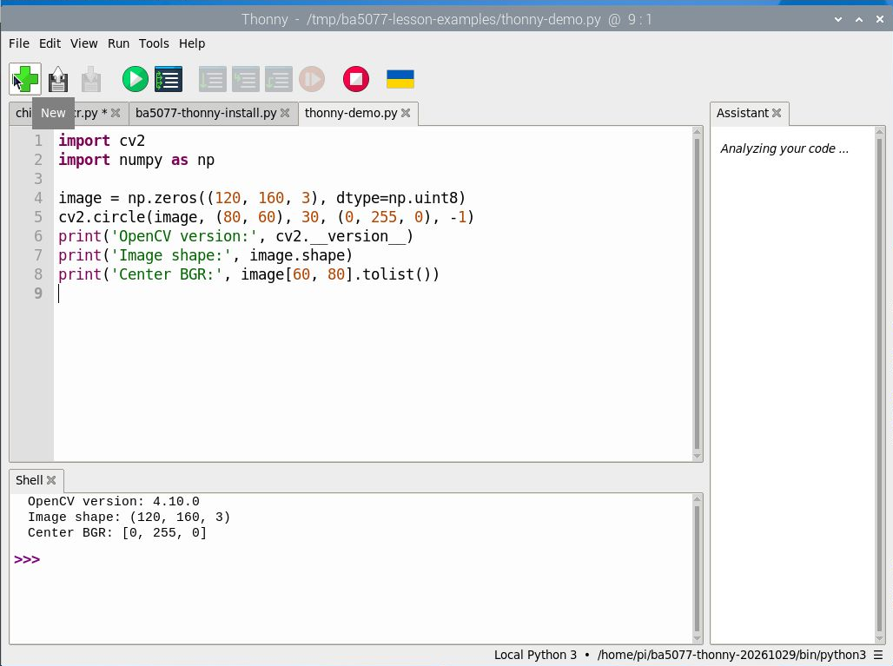
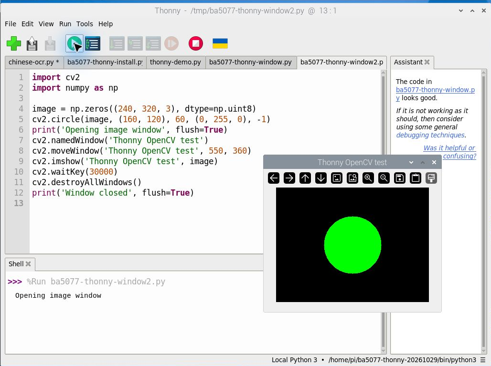

# 第 14 課｜在 Raspberry Pi 5 安裝 OpenCV

[原始文章](https://liusming.pixnet.net/blog/posts/14222877021) · 更新日期：2026-10-29

> Thonny 重測進行中：請先看本篇標示「Thonny 實測」的段落；其他既有輸出依原測試方式標示，完整情境仍待重測。[逐篇進度](./Thonny逐篇實測狀態.md) · [圖片與程式下載方式](./練習素材/素材下載與使用.md)

## 學習目標

確認目前 Python 執行環境載入的 OpenCV 版本與實際模組位置。

## 事前準備

使用 RP5 已存在的系統 Python 與 OpenCV。

請在自己的練習目錄操作。已存在的同名輸出檔可能被覆寫，先確認路徑；用不著將任何相機照片上傳公開儲存庫。

## 程式與執行

將下列程式存為 `第14課.py`。這是本次在 RP5 上執行的程式；完整檔案也在[範例程式](./範例程式/第14課.py)。

```python
import cv2
print("opencv", cv2.__version__)
print("path", cv2.__file__)
```

先前此段由終端機的系統 Python 執行；Thonny 的新環境範例及實測請看下方。

## 本機實際輸出

```text
opencv 4.10.0-dev
path /usr/lib/python3/dist-packages/cv2/__init__.py
```

路徑顯示此 Python 實際載入的套件；不同系統會不同。此機套件管理器的版本紀錄與 Python 匯入版本不同，不可只憑其中一個數字判斷。

## 背景與核心概念

### 為什麼要安裝 OpenCV？

OpenCV 提供讀取影像、色彩轉換、輪廓與模型推論等函式。Python 的 `import cv2` 是載入模組；程式庫版本、CPU 架構及安裝環境都可能影響可用功能。

### 思考、練習與後續應用

解釋「版本顯示成功」和「所有 OpenCV 擴充功能都能使用」的差別；比較系統 Python 與虛擬環境。

先確認依賴與磁碟空間，再選擇合適版本；未來更新時應重測實際需要的功能。

進一步閱讀：[相關官方文件](https://docs.opencv.org/4.x/d6/d00/tutorial_py_root.html)。下方的程式與輸出以標明的本機實測範圍為準；沒有測過的部分不代表已完成。

## 概念流程圖


此圖用於說明文章的概念或完整目標流程，**不是操作截圖，也不代表每個步驟都已實測**；本機實測範圍請看文章中的標示。

## 舊紀錄：終端機獨立環境安裝 OpenCV

以下保留先前終端機實測供比較；學生請優先使用下方 Thonny 實測。

上方測試的是系統已存在的 OpenCV。為了練習安裝，本次另在 `/tmp/ba5077-opencv-clean-20261029` 建立新的 Python 虛擬環境，安裝無 GUI 的 `opencv-python-headless`；沒有變更系統 Python 的 OpenCV。下列安裝需要網路及可用磁碟空間。`/tmp` 可能在重新開機後清除，因此適合短暫練習，不適合保存重要作業。

在 RP5 上，先確認下列練習目錄不存在；如果已存在，請選另一個新路徑，並同步調整後續命令。執行時使用自己的練習目錄，不要直接覆寫既有環境：

```bash
python3 -m venv /tmp/ba5077-opencv-clean-20261029
/tmp/ba5077-opencv-clean-20261029/bin/python -m pip install 'numpy<2' opencv-python-headless==4.10.0.84
```

本機安裝輸出節錄：

```text
Collecting numpy<2
  Using cached numpy-1.26.4-cp311-cp311-manylinux_2_17_aarch64.manylinux2014_aarch64.whl (14.2 MB)
Collecting opencv-python-headless==4.10.0.84
  Using cached opencv_python_headless-4.10.0.84-cp37-abi3-manylinux_2_17_aarch64.manylinux2014_aarch64.whl (29.3 MB)
Installing collected packages: numpy, opencv-python-headless
Successfully installed numpy-1.26.4 opencv-python-headless-4.10.0.84
```

`Using cached` 表示這次從本機快取取得套件；其他學生初次執行時可能看到下載進度，版本解析結果也可能不同。

### 實測：檢查相依與功能

```bash
/tmp/ba5077-opencv-clean-20261029/bin/python -m pip check
/tmp/ba5077-opencv-clean-20261029/bin/python -c 'import cv2,numpy; print("OpenCV:",cv2.__version__); print("NumPy:",numpy.__version__); print("SIFT available:",hasattr(cv2,"SIFT_create")); print("bgsegm available:",hasattr(cv2,"bgsegm"))'
```

本機實際輸出：

```text
No broken requirements found.
OpenCV: 4.10.0
NumPy: 1.26.4
SIFT available: True
bgsegm available: False
```

`pip check` 只檢查套件宣告的依賴是否滿足；`SIFT available: True` 表示此環境能找到該名稱，不等於所有實際圖片都已測試。`bgsegm available: False` 表示這個環境不能直接執行需要 `cv2.bgsegm` 的第 27 課 MOG 範例；第 27 課使用的是本機另一個有該模組的 OpenCV。

`headless` 套件不包含 GUI 功能，不能假設 `imshow` 能在這個環境開啟視窗；也不能假設不含系統套件的乾淨虛擬環境可以匯入系統 Picamera2。需要桌面、相機或額外模組時，必須針對所選環境另行安裝與實測。不要在同一環境同時安裝多個共享 `cv2` 名稱的 OpenCV 變體，參考[OpenCV Python 套件說明](https://pypi.org/project/opencv-python-headless/)及 [Python 虛擬環境文件](https://docs.python.org/3/library/venv.html)。

### 學生練習

比較系統 Python 的 `4.10.0-dev` 與這個獨立環境的 `4.10.0`；解釋為什麼兩個 Python 會載入不同版本。再說明 `bgsegm` 為何要在使用第 27 課之前單獨檢查。此測試未驗證 GUI，也未從原文的完整編譯流程重新編譯 OpenCV。

## 舊紀錄：終端機安裝畫面（不是 Thonny）

為確認安裝可在隔離環境重現，本次在 RP5 新建 `/tmp/ba5077-install-screen-test`，執行以下[完整測試腳本](./範例程式/第14課-隔離安裝.sh)。這個路徑僅供本次示範，`/tmp` 可能在重新開機後清除；學生應自行選擇新的空目錄，先確認不會覆寫既有環境。腳本最後的 90 秒等待只為保留截圖時間，不是安裝所需步驟。

```bash
#!/bin/bash
set -euo pipefail
printf 'Create isolated Python environment\n'
python3 -m venv /tmp/ba5077-install-screen-test
source /tmp/ba5077-install-screen-test/bin/activate
printf 'Install verified package versions\n'
python -m pip install --disable-pip-version-check --progress-bar off 'numpy==1.26.4' 'opencv-python-headless==4.10.0.84'
printf '\nCheck dependencies and import\n'
python -m pip check
python -c "import cv2,numpy; print('OpenCV:',cv2.__version__); print('NumPy:',numpy.__version__); print('SIFT:',hasattr(cv2,'SIFT_create'))"
printf 'Installation test completed.\n'
sleep 90
```

這次實際輸出節錄：

```text
Using cached numpy-1.26.4-...
Using cached opencv_python_headless-4.10.0.84-...
Successfully installed numpy-1.26.4 opencv-python-headless-4.10.0.84
No broken requirements found.
OpenCV: 4.10.0
NumPy: 1.26.4
SIFT: True
Installation test completed.
```



此圖由 RP5 遠端桌面擷取，裁切後保留安裝終端機；這次 pip 使用既有快取，因此不是重新從網路完整下載的證據。`pip check` 只檢查已宣告的相依關係，`SIFT: True` 只確認介面存在。此獨立環境是 headless 版本，不包含圖形視窗支援；第 19、20 課的 GUI 截圖是以另一個具 GTK3 支援的系統 OpenCV 完成，不可混為一談。Picamera2 在此隔離環境與原文完整編譯流程仍未測。

## Thonny 實測：建立環境、安裝與開啟視窗

請先依[Thonny 環境與套件安裝](./Thonny環境與套件安裝.md)建立獨立環境並確認右下角為該環境。此次透過 Thonny 執行[安裝程式](./範例程式/第14課-Thonny安裝套件.py)，使用選定的解譯器安裝 `numpy==1.26.4` 與 `opencv-python==4.10.0.84`。不要把不同 OpenCV 變體同時裝進同一環境。

本機 Shell 實際輸出節錄：

```text
Installing collected packages: numpy, opencv-python
Successfully installed numpy-1.26.4 opencv-python-4.10.0.84
Installation completed. Restart Thonny interpreter before testing.
```



接著在 Thonny 開啟[第 12 課的測試程式](./範例程式/第12課-Thonny測試.py)，按綠色執行鈕：

```text
OpenCV version: 4.10.0
Image shape: (120, 160, 3)
Center BGR: [0, 255, 0]
```



再開啟[影像視窗測試](./範例程式/第14課-Thonny視窗測試.py)，按執行：畫面顯示綠色圓形，約 30 秒或在圖片視窗按鍵後結束；Shell 先後顯示 `Opening image window` 和 `Window closed`。



此環境尚未驗證 Picamera2、bgsegm 等擴充模組，也不是所有後續課程通用的環境；不同課程須依相依需求另行測試。

## 與原文章的差異

- 新增 Thonny 建立環境、程式安裝套件和開啟影像視窗的操作與截圖；套件管理器問題及替代操作見共用指南。
- 原文包含多種安裝方式；本版先驗證既有安裝，避免同時安裝多個 OpenCV 變體。若缺少套件，另參考共用安裝紀錄。
- 上述文字輸出是本次實機紀錄，其他版本或環境可能不同。
- 新增隔離環境中實際安裝與驗證的終端機截圖。
- 新增初學者背景、概念、思考練習及後續應用，實測範圍仍以本文標示為準。
- 加入教學流程示意；圖中的完整目標流程不代表已逐步實測。
- 新增獨立環境實際安裝 headless OpenCV、依賴檢查及 SIFT／bgsegm 存在檢查；未宣稱測試 GUI 或原文完整編譯流程。
