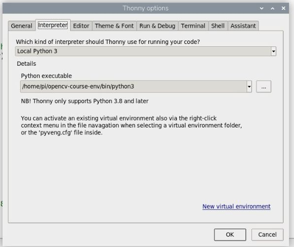
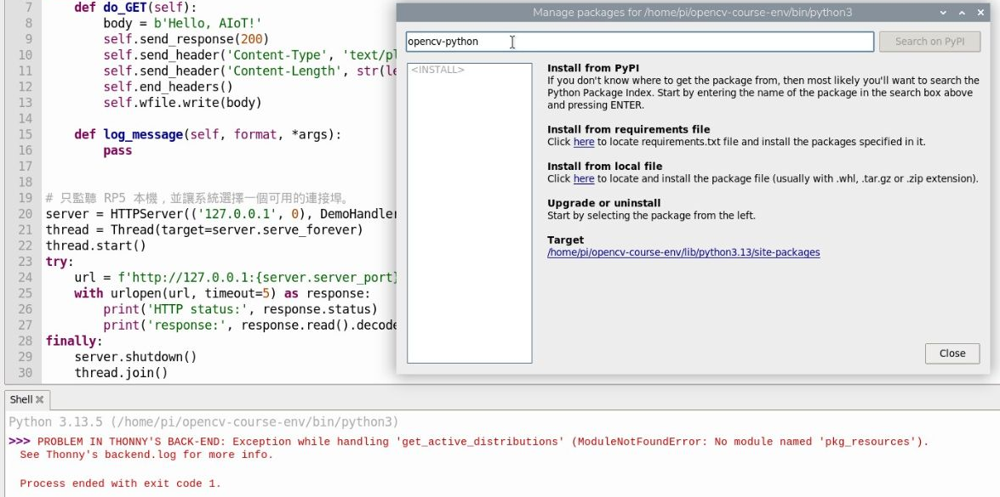
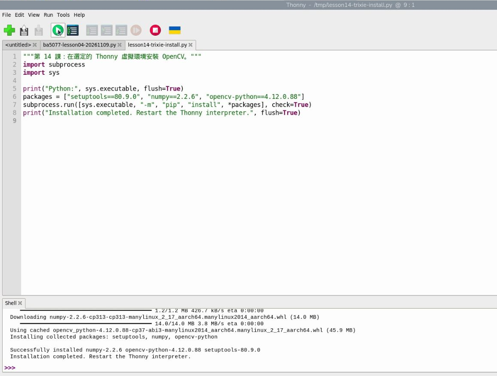
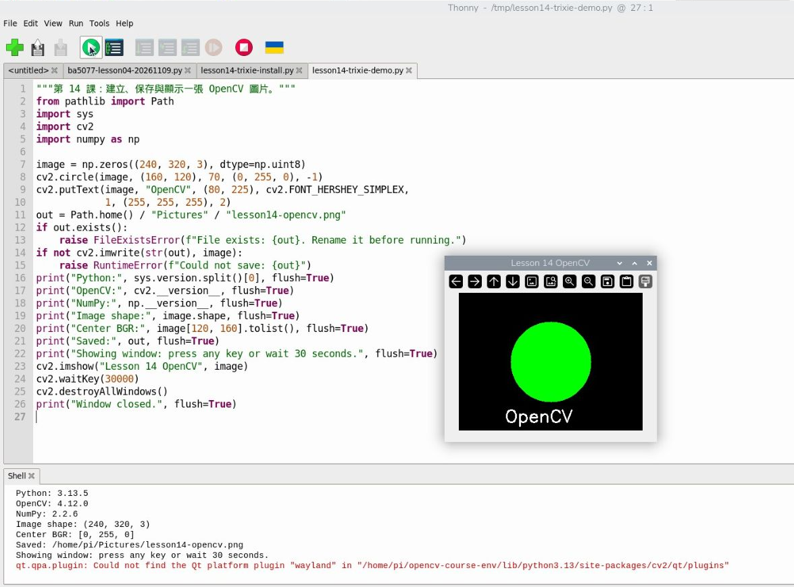

# 第 14 課｜在 Raspberry Pi 5 安裝 OpenCV

[原始文章](https://liusming.pixnet.net/blog/posts/14222877021) · 教學編排修訂：2026-11-11

這一課，我們要讓 RP5 畫出一個綠色圓形。你會先準備 Python 的工具箱，再讓程式畫圖、保存圖片，最後親眼看見結果。即使還不熟悉「套件」和「虛擬環境」，也可以從下面第一步開始。

這條學習路線適用於 **RP5 的 Trixie 桌面與 Python 3.13**，沿用已有的實機證據。先前 Bookworm／Python 3.11 的內容放在文末延伸閱讀；如果你的系統不同，先請老師一起確認，不要混用兩套版本。

## 準備：我們今天需要什麼？

你需要已開機的 RP5 桌面、網路和 Thonny。這一課不需要相機，也不用另找照片，因為圖片會由程式自己產生。若你是先讀第 12 課來到這裡，完成後再回去做它的 OpenCV 練習即可。

先在 RP5 桌面開啟 Thonny。上方的大區域是寫程式的地方，下方 Shell 會顯示程式的回應；右下角則告訴你現在選用哪一個 Python。

## 步驟 1：用 Thonny 建立獨立環境

我們先準備一個只放本課工具的資料夾，稱為「虛擬環境」。它就像獨立工具箱，能減少不同專題的工具互相影響。

1. 在 Thonny 點 **Tools → Options → Interpreter**（工具 → 選項 → 直譯器）。
2. 找到 **New virtual environment**，點選後閱讀提示，再按 OK。
3. 到 Home 建立一個新的空資料夾，例如 `opencv-course-env`。如果已有同名資料夾，換一個名字，保留原有作品。進入新空資料夾後按 OK，等待建立完成。
4. 看看 **Python executable**：最後應是新資料夾中的 `bin/python3`。按 OK 回到主畫面，右下角也應顯示同一個環境。



圖中的帳號叫 `pi`；你的帳號可能不同。重點不是照抄整條路徑，而是確認它位於你剛建立的資料夾。

**先停一下：**如果右下角仍是系統 Python，先回到直譯器設定選回新環境。我們確認工具箱選對了，再往裡面放工具。

## 步驟 2：安裝 OpenCV

OpenCV 是幫助 Python 處理圖片的工具；NumPy 用來保存和運算圖片中的數值。套件名稱是 `opencv-python`，程式中卻寫 `import cv2`，看到不同名字先不用擔心。

有些 Thonny 版本的 **Manage packages** 會出現下面這個錯誤。若你已經遇到它，可以從這一節繼續，不需要重新安裝系統。



`No module named 'pkg_resources'` 是套件管理流程缺少舊介面的訊息。本課用一個小程式接續安裝：它會使用你選好的 Python，請 pip 放入教材測過的版本。你不必在套件搜尋欄輸入這段程式，也不用另外搜尋名為 `pkg_resources` 的套件。

1. 若錯誤視窗還開著，先關閉它，再按紅色 **Stop/Restart backend**，讓 Python 重新開始。
2. 點 File → New，在上方空白編輯區貼入下列程式，存成 `install_opencv.py`。也可以下載[同一份安裝程式](./範例程式/第14課-Trixie-Thonny安裝.py)。
3. 確認右下角仍是本課環境，再按綠色 **Run**。等待安裝完成，先不要執行其他程式。

```python
"""第 14 課：在選定的 Thonny 虛擬環境安裝 OpenCV。"""
import subprocess
import sys

print("Python:", sys.executable, flush=True)
packages = ["setuptools==80.9.0", "numpy==2.2.6", "opencv-python==4.12.0.88"]
subprocess.run([sys.executable, "-m", "pip", "install", *packages], check=True)
print("Installation completed. Restart the Thonny interpreter.", flush=True)
```

Shell 會先印出 `Python:`。它應指向你剛才的工具箱；這也讓我們知道套件要裝到哪裡。完成時，原有實測出現：

```text
Successfully installed numpy-2.2.6 opencv-python-4.12.0.88 setuptools-80.9.0
Installation completed. Restart the Thonny interpreter.
```



`Using cached` 是使用先前下載的檔案，第一次安裝可能看到下載進度。下載需要時間；**只有看到完成訊息，我們才進入下一步。** 如果出現紅色 ERROR，先閱讀後面的「卡住時一起找原因」。

4. 再按一次紅色 Stop/Restart backend。這一步讓 Python 在重新開始後讀取剛裝好的工具。

為什麼程式指定版本？較新的工具可能更換舊介面。[setuptools 官方紀錄](https://setuptools.pypa.io/en/stable/history.html#v82-0-0)說明 82.0.0 移除了 `pkg_resources`；本課保留 80.9.0 配合當時的 Thonny。固定版本是為了重現已測流程，不能推論未來只要升級全部套件就能解決問題。

## 步驟 3：畫圖、存檔、開啟視窗

現在工具已準備好，我們來畫第一張圖。下面的程式先建立黑色畫布，再畫一個綠色圓形，最後把它保存到 Pictures。

1. 在 Thonny 開新檔，貼入下列程式，存成 `draw_circle.py`，或開啟[繪圖範例](./範例程式/第14課-Trixie-OpenCV測試.py)。
2. 看一眼右下角，確認仍是同一個環境，再按綠色 Run。
3. 圖片視窗出現後，先觀察畫面，再點一下該視窗並按任意鍵。也可以等 30 秒讓它自行關閉。

```python
"""第 14 課：建立、保存與顯示一張 OpenCV 圖片。"""
from pathlib import Path
import sys
import cv2
import numpy as np

image = np.zeros((240, 320, 3), dtype=np.uint8)
cv2.circle(image, (160, 120), 70, (0, 255, 0), -1)
cv2.putText(image, "OpenCV", (80, 225), cv2.FONT_HERSHEY_SIMPLEX,
            1, (255, 255, 255), 2)
out = Path.home() / "Pictures" / "lesson14-opencv.png"
if out.exists():
    raise FileExistsError(f"File exists: {out}. Rename it before running.")
if not cv2.imwrite(str(out), image):
    raise RuntimeError(f"Could not save: {out}")
print("Python:", sys.version.split()[0], flush=True)
print("OpenCV:", cv2.__version__, flush=True)
print("NumPy:", np.__version__, flush=True)
print("Image shape:", image.shape, flush=True)
print("Center BGR:", image[120, 160].tolist(), flush=True)
print("Saved:", out, flush=True)
print("Showing window: press any key or wait 30 seconds.", flush=True)
cv2.imshow("Lesson 14 OpenCV", image)
cv2.waitKey(30000)
cv2.destroyAllWindows()
print("Window closed.", flush=True)
```



**你看到什麼？**應有黑色背景、綠色圓形與白色 OpenCV 文字。Shell 會顯示下面這些重要結果：

```text
OpenCV: 4.12.0
NumPy: 2.2.6
Image shape: (240, 320, 3)
Center BGR: [0, 255, 0]
Window closed.
```

`(240, 320, 3)` 表示圖片高 240、寬 320，每個位置有三個顏色數值。OpenCV 的順序是藍、綠、紅，所以圓心的 `[0, 255, 0]` 正好表示綠色。

## 步驟 4：關掉視窗後，圖片還在嗎？

在 RP5 的檔案管理員開啟 Home → Pictures，找到 `lesson14-opencv.png`，雙擊打開。程式視窗關閉後，這個檔案仍然保留著。


這裡有兩個不同動作：`imshow` 讓我們現在看見圖片，`imwrite` 把圖片保存下來。試著用自己的話說明：如果只顯示、不存檔，關閉程式後會少了什麼？

## 卡住時，我們一起找原因

如果安裝或執行沒有得到預期結果，先選最接近你看到的情況：

| 你看到的情況 | 我們接著做什麼 |
| --- | --- |
| 找不到 `pkg_resources` | 回到步驟 2：關閉套件管理視窗，在上方編輯區執行本課安裝程式，完成後重啟。 |
| 找不到 `install` 套件 | pip 把指令的一部分當成套件名稱。套件欄位只填名稱；本課請直接執行完整安裝程式。 |
| `No module named cv2` | 比對右下角環境與安裝程式的 `Python:`；選回同一環境，重啟再試。 |
| `No matching distribution` 後面是 NumPy 或 OpenCV | 先看 Python 版本與前面的網路訊息；不要直接當成相同問題。和老師依[排錯故事](./程式卡住時怎麼辦.md)核對。 |
| `FileExistsError` | 先前作品還在。保留它，將原圖片改名，或修改輸出檔名後再做一次。 |
| 有 Wayland 訊息，但圓形已出現 | 原實測也有此提示。先確認能否正常關閉；若沒有視窗或程式中止，保存完整錯誤，請老師協助檢查桌面。 |

如果仍不確定，把[環境觀察小程式](./範例程式/看看目前的Python環境.py)的輸出和完整紅字交給老師。我們先找出問題發生在哪一步，再選擇處理方式。一般套件問題不用先重灌。

## 試著改一點，看看有什麼不同

先找到 `cv2.circle` 中的 `(0, 255, 0)`，把它改成 `(255, 0, 0)`；再把輸出檔名改成另一個新名稱，避免覆蓋作品。執行前猜一猜：圓形會變成什麼顏色？執行後，看看猜測是否一致。

接著只改半徑 `70`，比較圓形大小。一次改一項，比較容易發現「哪個數字控制哪個效果」。到這裡，你已經完成建立環境、安裝工具、執行程式、觀察與保存作品的學習循環，可以回到第 12 課或繼續一般影像處理練習。

## 給教師的版本與實測備註

本課沿用既有 RP5 Trixie／Python 3.13.5 的安裝、繪圖、存檔與視窗證據；2026-11-11 重寫教學順序，未新增實機測試。套件管理器修復後的搜尋操作、全新系統與相機環境尚未由這項實驗驗證；相機課需另準備 Picamera2 環境。程式和截圖保持原證據。

[編修前完整紀錄](./歷史紀錄/第14課-編修前-20261111.md) · [Bookworm 歷史紀錄](./歷史紀錄/第14課-Bookworm-20261029.md) · [各課實測狀態](./Thonny逐篇實測狀態.md)
