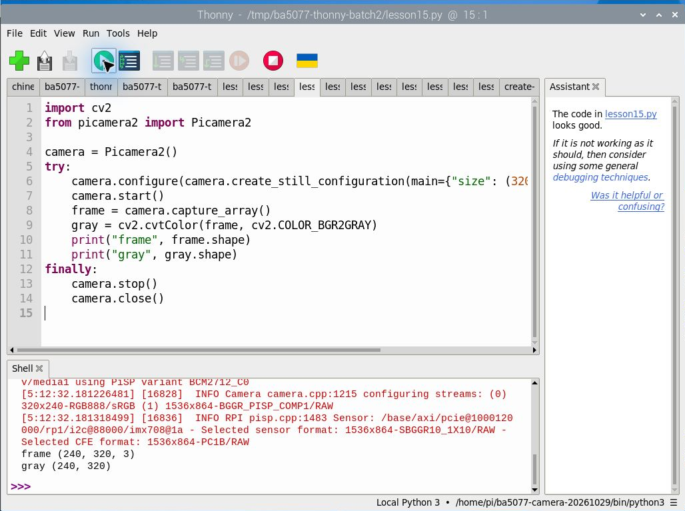

# 第 15 課｜在 Raspberry Pi 5 使用 Libcamera、Picamera2 與 OpenCV

[原始文章](https://liusming.pixnet.net/blog/posts/14222875794) · 教學編排修訂：2026-11-11

拍照時，我們看見的是一幅畫面；Python 收到的，卻是一組組數字。這一課先讀取一張彩色影格，看看它有多大，再把它轉成只有亮度的灰階資料。

## 先想一想：相機和圖片工具各做什麼？

Picamera2 幫我們向相機取得畫面，OpenCV 幫我們處理取得的畫面。它們像接力的兩個人：一個把照片交進來，另一個改變照片的表示方式。`libcamera` 是底層的相機工具，這一課先不需要直接呼叫它。

彩色圖片通常每個位置有三個顏色數值，灰階則只留一個亮度值。轉成灰階後，形狀可能仍清楚，但紅色和綠色等顏色資訊會消失。

## 第一步：先讓相機與 Python 互相看得見

先完成[第 07 課](./第%2007%20課｜連接%20Raspberry%20Pi%205%20相機模組.md)的接線與相機確認。如果這台 RP5 已接好相機，不需要為這一課重新拆接。

一般繪圖環境不一定有相機工具。我們一起到[環境指南](./Thonny環境與套件安裝.md#選擇今天的學習環境)，選擇可以讀取系統 Picamera2 的環境。Trixie 的建立方式在該頁「既有 Trixie：同時使用 Picamera2 與 OpenCV 擴充功能」；先前 Bookworm 路線保留供老師比較。

完成後，在 Thonny 的 Tools → Options → Interpreter 選擇該環境，回主畫面看右下角路徑。請同學說出：今天拿的是一般繪圖工具箱，還是同時能讀相機的工具箱？

## 第二步：讀一張畫面，先觀察尺寸

把[本課程式](./範例程式/第15課.py)下載到自己的練習資料夾，用 RP5 的 Thonny 開啟。關閉其他正在使用相機的程式，再按綠色 Run。

```python
import cv2
from picamera2 import Picamera2

camera = Picamera2()
try:
    camera.configure(camera.create_still_configuration(main={"size": (320, 240), "format": "RGB888"}))
    camera.start()
    frame = camera.capture_array()
    gray = cv2.cvtColor(frame, cv2.COLOR_BGR2GRAY)
    print("frame", frame.shape)
    print("gray", gray.shape)
finally:
    camera.stop()
    camera.close()
```

這次先不開圖片視窗。我們讓程式報告畫面的尺寸，檢查相機和轉換流程是否接起來了。先前 Bookworm 在 Thonny 的輸出是：

```text
frame (240, 320, 3)
gray (240, 320)
```



`frame` 是彩色畫面，`gray` 是灰階結果。設定的寬是 320、高是 240，Python 印出形狀時卻先寫高再寫寬；所以看見 `(240, 320)` 是正常的。彩色多出的 `3` 表示三個通道，灰階沒有這一項。

## 第三步：沿著程式找出取像與轉換

先找到 `capture_array()`：這一行向相機取得資料。再找到 `cvtColor()`：這一行把資料轉成灰階。最後的 `print` 沒有畫圖，只是在 Shell 印出尺寸。

`finally` 裡的 `stop` 和 `close` 用來結束並釋放相機。這讓下一個相機練習有機會重新使用它。若出錯，請保留最早的錯誤訊息；後面的清理動作也可能出現其他訊息。

這個小實驗檢查的是取像及陣列尺寸。不同相機格式要核對顏色通道，這份輸出本身還不能判斷灰階亮度是否正確；之後用已知顏色圖做比較，會比只看尺寸更完整。

## 如果沒有看到這兩行

- 找不到 `picamera2` 或 `libcamera` 時，先確認右下角是相機環境，再由老師確認系統相機工具；不是只在繪圖環境再裝一次 OpenCV。
- 相機忙碌時，先結束上一個相機程式，等它釋放，再重試。
- 若連系統都列不出相機，回第 07 課和老師核對接線；重新接線前先斷電。

可和老師一起讀[排錯故事](./程式卡住時怎麼辦.md)，用完整訊息判斷發生在哪一步。

## 換一個尺寸，再猜一次

把 `(320, 240)` 改為 `(640, 480)`。執行前，先寫下你預期 `frame` 和 `gray` 的形狀；執行後比較哪一部分多了、哪一部分保持不變。這是新增的延伸練習，請以自己實際得到的輸出作記錄。

想親眼比較彩色與灰階，可以接著讀[第 17 課](./第%2017%20課｜使用%20OpenCV%20讀取灰階圖檔.md)；想把照片留下來，可以讀第 18 課。

## 給教師的版本與實測備註

本課相機輸出與截圖沿用 Bookworm／Python 3.11 的既有證據；Trixie 相關環境建立另有紀錄，不表示本課已在 Trixie 重新實測。2026-11-11 這次是教材編排修訂。[編修前完整紀錄](./歷史紀錄/第15課-編修前-20261111.md)保留原細節。
