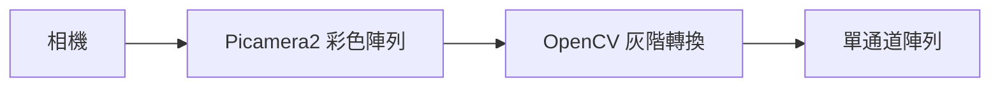
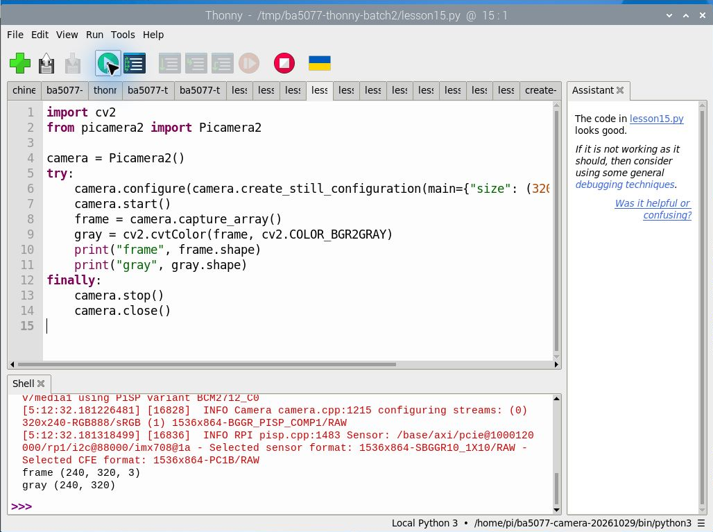

# 第 15 課｜在 Raspberry Pi 5 使用 Libcamera、Picamera2 與 OpenCV

[原始文章](https://liusming.pixnet.net/blog/posts/14222875794) · 更新日期：2026-10-29

> 本課已在 Thonny 實測：Picamera2 單張影格及 OpenCV 灰階轉換。完整原文情境及其他舊案例仍須依下文標示重測。[逐篇進度](./Thonny逐篇實測狀態.md) · [圖片與程式下載方式](./練習素材/素材下載與使用.md)

## 學習目標

用 Picamera2 擷取彩色影格，再用 OpenCV 轉成灰階陣列。

## 背景與原理

相機先取得彩色影格，影像處理程式再依需要轉換或分析。Picamera2 負責擷取，OpenCV 提供影像轉換與分析工具；兩者處理的是同一張影像的不同階段。灰階只有亮度層次，資料量較彩色影像少，也常作為邊緣或輪廓處理的輸入，但會失去顏色資訊。

本機範例輸入尺寸為寬 320、高 240；Python 的影像陣列通常以 `(高, 寬, 通道數)` 顯示。注意相機格式和顏色通道的排列需以使用環境驗證；不能只依 `RGB888` 名稱猜測每個陣列通道在所有環境中的順序。本例只驗證陣列尺寸和轉換可以執行，尚未量測灰階亮度正確性。



上圖是概念示意，並非操作畫面。[Raspberry Pi 官方相機文件](https://www.raspberrypi.com/documentation/accessories/camera-software.html)可供延伸閱讀。

## 事前準備

相機與 Picamera2、OpenCV 已可使用。

請在自己的練習目錄操作。已存在的同名輸出檔可能被覆寫，先確認路徑；用不著將任何相機照片上傳公開儲存庫。

## 程式與執行

將下列程式存為 `第15課.py`。這是本次在 RP5 上執行的程式；完整檔案也在[範例程式](./範例程式/第15課.py)。

```python
import cv2
from picamera2 import Picamera2

camera = Picamera2()
try:
    camera.configure(camera.create_still_configuration(main={"size": (320, 240), "format": "RGB888"}))
    camera.start()
    frame = camera.capture_array()
    gray = cv2.cvtColor(frame, cv2.COLOR_BGR2GRAY)
    print("frame", frame.shape)
    print("gray", gray.shape)
finally:
    camera.stop()
    camera.close()
```

在 Thonny 選 **File → Open** 開啟 `第15課.py`，確認右下角是包含所需套件的 Python 環境，再點綠色執行鈕。若程式會輸出檔案，先在新的練習目錄操作，避免覆寫。

## Thonny 實測輸出

```text
frame (240, 320, 3)
gray (240, 320)
```



本次選用新相機環境 `/home/pi/ba5077-camera-20261029/bin/python3`。已在新建立的相機虛擬環境重新測試；色彩通道及灰階亮度正確性仍待驗證。 相機或影像相關套件的準備及可重現環境請參考[Thonny 環境指南](./Thonny環境與套件安裝.md)。

彩色影格有三個通道，灰階結果有單一通道。相機格式與 OpenCV 的色彩順序需要依格式確認；本例未驗證 GUI 預覽。

## 學生練習與應用

1. 從輸出指出高度、寬度及通道數；為什麼灰階沒有第三個維度？
2. 想像在彩色圖中區分紅色和綠色物件，轉成灰階可能失去什麼資訊？
3. 接續第 17 課，觀察保存的灰階圖片，再到第 28 課比較彩色遮罩。

灰階可用於文件預處理與邊緣偵測；若工作依賴顏色，應保留彩色影像或選擇適合的色彩空間。

## 與原文章的差異

- 新增以 Thonny 操作的實測與截圖：Picamera2 單張影格及 OpenCV 灰階轉換。

- 由舊 `libcamera-*` 安裝流程改為已存在的 Picamera2 與本機可執行範例；沒有執行原文的桌面預覽。
- 上述文字輸出是本次實機紀錄，其他版本或環境可能不同。
- 新增上方基本程式在 Thonny 執行的操作截圖；其他情境以各段落標示為準。
