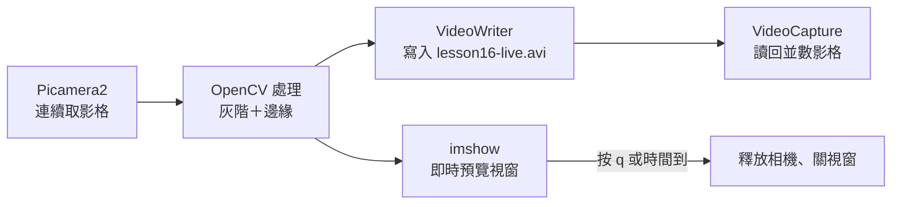
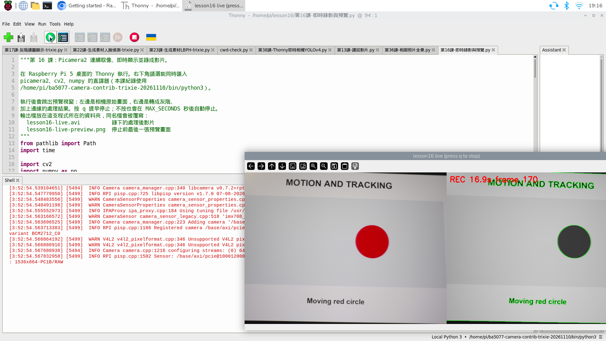
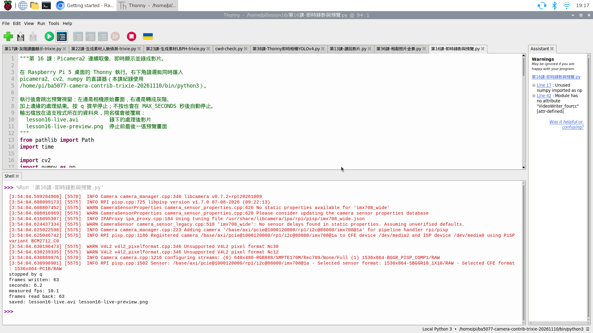
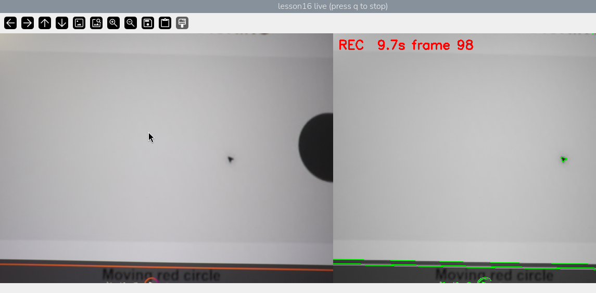
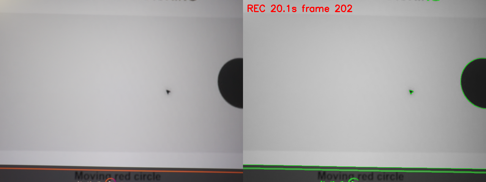
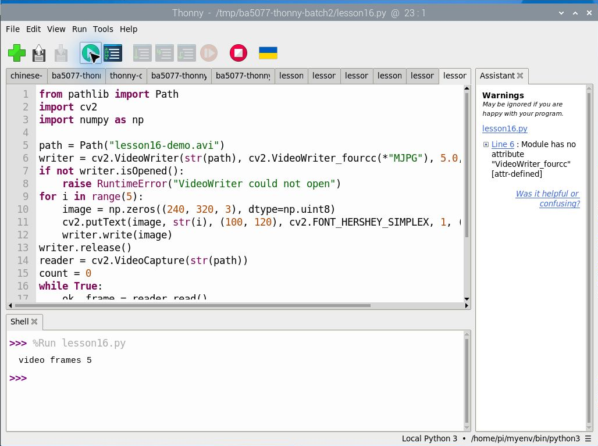
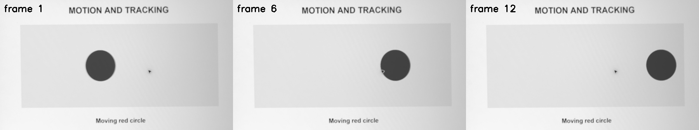

# 第 16 課｜Python 結合 OpenCV 與 Picamera2：影片錄製與即時影像處理

[原始文章](https://liusming.pixnet.net/blog/posts/14222876415) · 教學編排修訂：2026-11-11（編修前版本存於[歷史紀錄](./歷史紀錄/第16課-編修前-20261111.md)）

上一課我們請相機交出**一張**畫面。可是監視器、行車記錄器或產線檢查，需要的是一張接一張、不停進來的畫面。這一課我們讓 RP5 的相機連續工作：畫面一進來就處理、一邊顯示給你看、一邊存成影片檔，最後再把影片讀回來，確認真的存好了。

第一次準備環境的同學，可以先讀[課前學習說明](./學習前先讀我.md)；操作遇到紅字時，我們用[排錯故事](./程式卡住時怎麼辦.md)一起找原因。

## 這一課要完成什麼

1. 說出「影片就是按時間排好的一串影格」，並分辨**相機實際每秒給幾張**與**影片檔標示的播放速度**。
2. 在 RP5 的 Thonny 執行一支程式：開相機、跳出即時預覽視窗、把處理後的畫面錄成 `lesson16-live.avi`，按 `q` 或時間到就停止。
3. 看懂 Shell 印出的四個數字：寫入幾張、花了幾秒、實際每秒幾張、讀回幾張，並判斷錄影是否成功。

## 先想一想：一邊看、一邊處理、一邊存，為什麼要排順序？

每張影格都要走過同一條路：**取像 → 處理 → 寫進影片 → 顯示**。這四件事都要花時間。如果處理太慢，下一張畫面就要等，實際每秒張數會變少，錄出來的影片播放起來就會「快轉」或卡頓。所以這一課的程式會自己量時間，印出實際每秒張數；我們不憑感覺說「應該有 10 張」。



這張流程圖是教學示意，不是操作截圖。

幾個名詞先在這裡認識：

- **影格（frame）**：影片中的一張畫面。程式裡的 `frame` 變數就是一張影格的數字陣列。
- **FPS（每秒影格數）**：一秒內有幾張影格。這一課會遇到兩種 FPS：要求相機給的速度，以及程式實際量到的速度。
- **編碼器（fourcc）**：把影格壓縮成影片檔的方式。這一課用 `MJPG`，它在 RP5 的 OpenCV 中可直接使用，副檔名是 `.avi`。

## 第一步：準備場景、環境與練習資料夾

**為什麼先做這一步：**相機要拍到東西、Python 要能同時找到相機工具和 OpenCV，程式才跑得起來。

1. **相機與場景（在 RP5 旁邊）。**先完成[第 07 課](./第%2007%20課｜連接%20Raspberry%20Pi%205%20相機模組.md)的接線與[第 15 課](./第%2015%20課｜在%20Raspberry%20Pi%205%20使用%20Libcamera、Picamera2%20與%20OpenCV.md)的單張取像。已經能拍照的 RP5 不需要重新拆接。讓相機固定對著一個不含個人資料的畫面，例如另一台螢幕上開啟的[相機測試畫面](./練習素材/RP5相機測試.html)（選「移動追蹤」會有會動的圓形），或桌上一個簡單物品。錄影會存下鏡頭看到的一切，**不要對著有帳號、訊息或他人臉孔的畫面**。
2. **Thonny 環境（在 RP5 桌面）。**依[環境指南](./Thonny環境與套件安裝.md#選擇今天的學習環境)中「既有 Trixie：同時使用 Picamera2 與 OpenCV 擴充功能」一節，選擇能讀取系統 Picamera2、又裝有 OpenCV 的環境。到 Thonny 的 **Tools → Options → Interpreter** 選好後，回主畫面看右下角路徑。本課紀錄使用的是 `/home/pi/ba5077-camera-contrib-trixie-20261110/bin/python3`；你的路徑名稱可能不同，重點是這個環境能 `import picamera2` 和 `import cv2`。
3. **練習資料夾。**在 RP5 的檔案管理員於家目錄建立新資料夾，例如 `/home/pi/lesson16`。把[本課主程式](./範例程式/第16課-即時錄影與預覽.py)下載放進去。程式會把影片和截圖存在**程式所在的同一個資料夾**；資料夾內若已有同名檔，會被覆寫。
4. **關掉其他用相機的程式。**同一時間只能有一支程式使用相機。若 Thonny 的其他分頁、終端機或預覽程式正在用相機，先停止它（Thonny 可按紅色 Stop）。

## 第二步：讀程式，先找出四個關鍵動作

完整程式如下，和可下載的[範例程式](./範例程式/第16課-即時錄影與預覽.py)相同：

```python
from pathlib import Path
import time

import cv2
import numpy as np
from picamera2 import Picamera2

MAX_SECONDS = 20      # 最長錄影秒數；想錄久一點就改這個數字
FPS = 10              # 要求相機每秒給 10 張，也當作影片的播放速度
SIZE = (640, 480)     # 寬, 高

folder = Path(__file__).resolve().parent
video_path = folder / "lesson16-live.avi"
preview_path = folder / "lesson16-live-preview.png"

camera = Picamera2()
writer = None
written = 0
last_view = None
start = time.monotonic()
try:
    config = camera.create_video_configuration(
        main={"size": SIZE, "format": "RGB888"},
        controls={"FrameRate": FPS},
    )
    camera.configure(config)
    camera.start()
    time.sleep(1)  # 讓曝光與白平衡先穩定

    writer = cv2.VideoWriter(str(video_path), cv2.VideoWriter_fourcc(*"MJPG"), FPS, SIZE)
    if not writer.isOpened():
        raise RuntimeError("無法建立 MJPG 影片，請檢查資料夾權限與磁碟空間")

    start = time.monotonic()
    while True:
        frame = camera.capture_array()          # 等到下一張影格才回來
        gray = cv2.cvtColor(frame, cv2.COLOR_BGR2GRAY)
        edges = cv2.Canny(gray, 60, 150)
        processed = cv2.cvtColor(gray, cv2.COLOR_GRAY2BGR)
        processed[edges > 0] = (0, 255, 0)      # 邊緣畫成綠色

        elapsed = time.monotonic() - start
        cv2.putText(processed, f"REC {elapsed:4.1f}s frame {written + 1}", (10, 30),
                    cv2.FONT_HERSHEY_SIMPLEX, 0.8, (0, 0, 255), 2)
        writer.write(processed)
        written += 1

        last_view = cv2.hconcat([frame, processed])
        cv2.imshow("lesson16 live (press q to stop)", last_view)
        key = cv2.waitKey(1) & 0xFF
        if key == ord("q"):
            print("stopped by q")
            break
        if elapsed >= MAX_SECONDS:
            print("stopped by time limit")
            break
finally:
    elapsed = time.monotonic() - start
    if writer is not None:
        writer.release()
    camera.stop()
    camera.close()
    cv2.destroyAllWindows()

if last_view is not None:
    cv2.imwrite(str(preview_path), last_view)

reader = cv2.VideoCapture(str(video_path))
read_count = 0
while True:
    ok, _ = reader.read()
    if not ok:
        break
    read_count += 1
reader.release()

print("frames written:", written)
print("seconds:", round(elapsed, 1))
print("measured fps:", round(written / elapsed, 1) if elapsed > 0 else 0)
print("frames read back:", read_count)
print("saved:", video_path.name, preview_path.name)
```

先不要急著執行，我們一起在程式中找到這四個地方：

| 動作 | 找哪一行 | 它在做什麼 |
| --- | --- | --- |
| 設定相機 | `create_video_configuration(... FrameRate ...)` | 用適合錄影的設定，畫面 640 × 480，請相機每秒給 10 張。 |
| 準備影片檔 | `cv2.VideoWriter(..., "MJPG", FPS, SIZE)` | 開一個空影片檔。這裡的 `FPS` 只是寫在檔案裡的**播放速度**，不會讓相機變快。尺寸必須和寫進去的影格一致。 |
| 迴圈 | `while True:` 到 `break` | 每圈取一張、處理、寫入、顯示。`capture_array()` 會等到下一張影格才回來，所以相機的速度決定了迴圈的節奏。 |
| 清理 | `finally:` 之後 | 不論正常結束或出錯，都關閉影片檔、釋放相機、關視窗，下一支程式才能再用相機。 |

`cv2.waitKey(1)` 有兩個工作：讓預覽視窗有機會更新，並檢查你是否按了鍵。少了它，視窗通常會一片灰白或沒有反應。

## 第三步：在 Thonny 執行，觀察視窗與 Shell

1. 在 RP5 桌面的 Thonny 選 **File → Open**，開啟練習資料夾中的 `第16課-即時錄影與預覽.py`。
2. 確認右下角是第一步選好的環境，按綠色 **Run**。
3. 約 1 秒後會跳出標題為 `lesson16 live (press q to stop)` 的視窗。左半是相機原始畫面，右半是灰階加綠色邊緣的處理結果，左上角紅字 `REC` 後面的秒數和影格編號會一直增加。
4. 想提早停止時，先**點一下預覽視窗**讓它取得鍵盤焦點，再按 `q`。不按的話，20 秒後會自動停止。視窗關閉後，Shell 會印出結果。

Shell 中出現以 `[` 開頭、含 `INFO` 或 `WARN` 的紅色或灰色行，多半是相機程式庫的日誌，不一定是錯誤；真正的錯誤通常以 `Traceback` 開頭。

### 本次 RP5 實測結果（2026-11-11）

環境：Raspberry Pi 5 Model B、既有 Debian 13（Trixie）64 位元、核心 6.18.50+rpt-rpi-2712、Python 3.13.5、OpenCV 4.12.0、NumPy 2.2.4、IMX708 廣角相機；直譯器 `/home/pi/ba5077-camera-contrib-trixie-20261110/bin/python3`。

#### 在 Thonny 按 Run：讓它跑滿 20 秒

程式放在 `~/lesson16/第16課-即時錄影與預覽.py`，在 RP5 桌面的 Thonny 用 **File → Open** 開啟，右下角確認為上面的直譯器，按綠色 **Run**。相機對著另一個螢幕上播放的「RP5相機測試.html → 移動追蹤」畫面，所以這次預覽中的紅色圓形**會左右移動**。



*圖：RP5 桌面的完整操作截圖（2026-11-11）。上方是 Thonny 的程式，右下角狀態列可看到所選直譯器；預覽視窗左上角顯示錄到第 170 張、16.9 秒。相機拍的是螢幕上的生成動畫，不是實物。*

這次沒有按鍵，讓程式跑到時間上限，Shell 印出：

```text
stopped by time limit
frames written: 202
seconds: 20.1
measured fps: 10.1
frames read back: 202
saved: lesson16-live.avi lesson16-live-preview.png
```

#### 再跑一次：點預覽視窗後按 `q`

再按一次 **Run**，等預覽視窗出現約 6 秒後，**先點一下預覽視窗的標題列**，再按鍵盤的 `q`。視窗立刻關閉，Shell 第一行變成 `stopped by q`：

```text
stopped by q
frames written: 63
seconds: 6.2
measured fps: 10.1
frames read back: 63
saved: lesson16-live.avi lesson16-live-preview.png
```



*圖：按 `q` 停止後的 Thonny 操作截圖。Shell 最上面的 `%Run '第16課-即時錄影與預覽.py'` 就是按下 Run 時 Thonny 替你輸入的指令；紅色 `INFO`／`WARN` 是相機程式庫日誌，不是錯誤。第二次執行覆寫了第一次的 `lesson16-live.avi`。*

兩次的寫入張數與讀回張數都相同，速度都約每秒 10 張；按 `q` 只是讓錄影提早結束，影片照樣完整。

#### 先前的 SSH 桌面紀錄（同一天較早）

在補上 Thonny 操作前，曾以 SSH 在 RP5 桌面工作階段用同一個直譯器啟動程式（不是在 Thonny 按 Run），當時相機前是靜止的深色圓形：

```text
stopped by time limit
frames written: 202
seconds: 20.1
measured fps: 10.0
frames read back: 202
saved: lesson16-live.avi lesson16-live-preview.png
```



上圖是 RP5 桌面截圖，**只裁切出預覽視窗**，拍攝當下錄到第 98 張、9.7 秒。相機拍的是另一個實體螢幕上開啟的相機測試頁；畫面中的深色圓形在這 20 秒內**沒有移動**（測試頁當時未在播放動畫），所以本次證明的是「連續取像、即時顯示、錄影與讀回」，不是追蹤會動的物體。



這張是程式自動存下的 `lesson16-live-preview.png`，屬於程式輸出，不是操作截圖。錄下的 `lesson16-live.avi` 約 3.1 MB、640 × 480、標示 10 FPS、202 張；影片拍到的是測試頁畫面，未上傳到教材庫。

### 這些數字代表什麼

- `frames written: 202` 與 `frames read back: 202` 相同：寫進去的每一張都讀得回來，影片檔沒有壞。
- `seconds: 20.1`、`measured fps: 10.0`：在「灰階＋邊緣＋顯示＋寫檔」的負擔下，RP5 仍跟得上相機每秒 10 張的節奏。影片標示的播放速度也是 10，所以播放 202 張約 20 秒，和真實時間一致。
- 如果你量到的 `measured fps` 明顯低於 10，例如 6，表示處理跟不上；影片仍以 10 FPS 播放時就會比真實時間快。處理方法見下方排錯。

你的數字不一定和這裡相同：場景、光線、畫面大小及 RP5 同時在做的事都會影響速度。判斷成功的方法是：**有跳出會更新的視窗**、**寫入張數和讀回張數相同**、**影片檔可以在資料夾看到且大小不是 0**。

## 第四步：把影片播放出來確認

在 RP5 的檔案管理員打開練習資料夾，雙擊 `lesson16-live.avi`，用系統的影片播放器播放。程式最後那段 `VideoCapture` 迴圈已經自動讀過一次，若想自己看畫面，可在迴圈裡加上 `cv2.imshow` 與 `cv2.waitKey(100)`。你應該看到灰階畫面、綠色邊緣與不斷增加的 `REC` 秒數。本次沒有另外截取播放器畫面；能讀回 202 張是由程式驗證的。

## 遇到問題時

| 你看到的情況 | 可能原因 | 先試試看 |
| --- | --- | --- |
| `Camera __init__ sequence did not complete` 或 `Device or resource busy` | 相機正被另一支程式使用 | 停止 Thonny 其他分頁、終端機中的相機程式，必要時重新開 Thonny 再試。參考[排錯故事五](./程式卡住時怎麼辦.md#第五個故事昨天拍過照今天相機打不開)。 |
| `ModuleNotFoundError: No module named 'picamera2'` 或 `'cv2'` | 右下角的直譯器選錯 | 回第一步，改選能讀取系統 Picamera2 並裝有 OpenCV 的環境。 |
| `RuntimeError: 無法建立 MJPG 影片` | 資料夾不能寫入或磁碟滿了 | 確認程式放在自己家目錄下的資料夾；以 `df -h` 查空間。 |
| 沒有跳出視窗，出現 `could not connect to display` 或 `qt.qpa` 錯誤 | 程式不是在 RP5 桌面上執行，例如在純 SSH 終端機 | 請在 RP5 桌面（或 Raspberry Pi Connect 桌面分享）中的 Thonny 執行。 |
| 視窗出現但按 `q` 沒反應 | 鍵盤焦點在 Thonny 而不在預覽視窗 | 先點一下預覽視窗，再按 `q`；或等 20 秒自動停止。 |
| `measured fps` 遠低於 10 | 處理太重或畫面太大 | 先把 `SIZE` 改成 `(320, 240)` 再測；或拿掉 `Canny` 那兩行比較。 |
| 影片播放比真實時間快 | 實際張數少於標示的播放速度 | 把 `FPS` 改成接近你量到的 `measured fps` 再錄一次。 |

## 練習：一次只改一個地方

1. 把 `MAX_SECONDS` 改成 `10`，預測寫入張數大約多少，再執行驗證。
2. 把 `SIZE` 改成 `(320, 240)`，比較 `measured fps` 和影片檔大小的變化。
3. 刪掉邊緣那兩行（`edges = ...` 與 `processed[edges > 0] = ...`），只留灰階，看看速度是否改變。
4. 讓測試頁的圓形動起來，錄一段影片後，以[第 26 課](./第%2026%20課｜使用%20OpenCV%20進行背景差分與運動物體檢測.md)的方法比較第一張與最後一張的差異。

每次只改一項，並把改了什麼、Shell 的四個數字和你的觀察記下來；這樣才知道是哪一個改變造成結果不同。

## 補充一：不用相機，先用合成影格理解影片檔

如果相機還沒準備好，可以先用這支小程式確認 OpenCV 能寫、能讀影片。它自己畫 5 張寫著 0～4 的黑底圖，存成 `lesson16-demo.avi`，再讀回計數。完整檔案在[範例程式](./範例程式/第16課.py)。

```python
from pathlib import Path
import cv2
import numpy as np

path = Path("lesson16-demo.avi")
writer = cv2.VideoWriter(str(path), cv2.VideoWriter_fourcc(*"MJPG"), 5.0, (320, 240))
if not writer.isOpened():
    raise RuntimeError("VideoWriter could not open")
for i in range(5):
    image = np.zeros((240, 320, 3), dtype=np.uint8)
    cv2.putText(image, str(i), (100, 120), cv2.FONT_HERSHEY_SIMPLEX, 1, (255, 255, 255), 2)
    writer.write(image)
writer.release()
reader = cv2.VideoCapture(str(path))
count = 0
while True:
    ok, frame = reader.read()
    if not ok:
        break
    count += 1
reader.release()
print("video frames", count)
```

注意這支程式用的是相對路徑 `lesson16-demo.avi`，檔案會出現在 Thonny 當下的工作資料夾；通常就是程式所在資料夾。先前在 Thonny 以 `/home/pi/myenv/bin/python3` 執行的輸出：

```text
video frames 5
```



這是 Thonny 操作截圖；它只證明影片寫入與讀回，和相機無關。

## 補充二：較早的相機 12 影格紀錄（終端機執行）

2026-10-29 曾用 RP5 相機拍攝螢幕上移動的紅色圓形：連續取 12 張、透視校正到測試圖範圍、轉灰階、寫入 MJPG，再讀回 12 張。程式見[範例程式](./範例程式/第16課-相機影格與影片.py)，其中四個 `source` 座標只對應當次相機位置，換位置必須重新量測。當時以終端機 `python3` 執行，不是 Thonny：

```text
frames written: 12
frames read: 12
first video frame: (338, 600, 3)
saved: lesson16-camera.avi, lesson16-frames.png
```



由左到右是第 1、6、12 張，經透視校正、灰階並標示編號，屬程式結果圖。處理後的短片放在[練習素材](./練習素材/lesson16-camera.avi)，可供第 26、27 課練習；完整原始相機畫面未上傳。這段程式每張之間 `sleep(0.2)`，不能證明實際達到 5 FPS，也沒有即時視窗。

## 後續應用與提醒

連續取像加上即時處理，是後面背景差分（第 26、27 課）、顏色追蹤（第 28 課）、物件偵測（第 38、42 課）的共同骨架：把這一課迴圈裡「灰階＋邊緣」那幾行換成別的處理即可。錄影會長時間保存畫面，實際應用前要先想清楚拍到誰、存多久、誰能看。

延伸閱讀：[Raspberry Pi 官方相機軟體文件](https://www.raspberrypi.com/documentation/accessories/camera-software.html)、[OpenCV VideoWriter 說明](https://docs.opencv.org/4.x/dd/d9e/classcv_1_1VideoWriter.html)。

## 與原文章的差異

- 2026-11-11 全文重編為零基礎學生路徑，主線改為「相機連續取像＋即時預覽＋錄影＋讀回」，並新增[主程式](./範例程式/第16課-即時錄影與預覽.py)；原有合成影格與 12 影格相機紀錄改列補充。
- 新增實測：既有 Trixie 的 RP5 相機 640 × 480、20.1 秒 202 張、實測 10.0 FPS、即時視窗與讀回 202 張；附裁切後的桌面視窗截圖和程式輸出圖。場景是螢幕上的靜止圓形。
- 首次實測以 SSH 在 RP5 桌面工作階段啟動。同日稍晚補上 **Thonny 按 Run**：相機拍攝螢幕上的移動紅圓，跑滿 20 秒得 202 張（10.1 FPS），再以 `q` 停止得 63 張、6.2 秒，兩次讀回張數皆相同，附兩張完整桌面操作截圖。播放器開啟影片仍待補，不宣稱已完成學生從零驗收。
- 原文的錄影方式、聲音及長時間錄影未在本版驗證；本版不錄聲音。
- 上述文字輸出是本次實機紀錄，其他版本、場景或環境可能不同。

<details>
<summary>給教師：實測範圍與版本備註</summary>

> - 2026-11-11 主線實測：RP5 主機名稱 PR5，`/etc/rpi-issue` 為 Raspberry Pi reference 2026-10-06；程式位於 `/home/pi/ba5077-validation-20261111/lesson16-live/`，以 `XDG_RUNTIME_DIR=/run/user/1000 WAYLAND_DISPLAY=wayland-0 DISPLAY=:0` 從 SSH 啟動，桌面截圖以 `grim` 擷取後裁切。OpenCV GUI 後端為 Qt5。程式 SHA-256 `fdc4bb2e…1ce7`，影片 `cda437dc…25ab`。
> - 當時另有 Thonny 的第 38 課後端在執行但未占用相機；測試前以 `rpicam-still` 確認相機可用。
> - 2026-11-11 晚間 Thonny 補測：RP5 IP `192.168.1.78`；從 Windows 以 SSH 通道連到 RP5 上僅聽 127.0.0.1 的臨時 wayvnc（TigerVNC 檢視），在 RP5 桌面的 Thonny 4 開檔、改直譯器、按 Run 與在預覽視窗按 `q`；截圖以 `grim` 擷取整個 RP5 桌面（1920 × 1080），已檢查只含 Thonny、課程檔名與相機拍到的測試頁。相機前是 Windows 第二螢幕以 Chrome kiosk 全螢幕播放 `RP5相機測試.html` 的「移動追蹤」（生成動畫）。程式放在 `~/lesson16/`，影片未入庫。
> - 仍可補：播放器開啟影片的畫面。合成影格與 2026-10-29 終端機紀錄保持原狀，不重做。合成影格與 2026-10-29 終端機紀錄保持原狀，不重做。
> - [逐篇進度](./Thonny逐篇實測狀態.md) · [圖片與程式下載方式](./練習素材/素材下載與使用.md)

</details>
