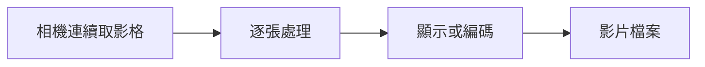

# 第 16 課｜Python 結合 OpenCV 與 Picamera2：影片錄製與即時影像處理

[原始文章](https://liusming.pixnet.net/blog/posts/14222876415) · 更新日期：2026-10-29

## 學習目標

先以合成影格建立短影片，再讀回並計算影格數，以驗證影片寫入和讀取。

## 事前準備

系統 OpenCV 的 MJPG 編碼器可用；程式在目前目錄產生 `lesson16-demo.avi`。

請在自己的練習目錄操作。已存在的同名輸出檔可能被覆寫，先確認路徑；用不著將任何相機照片上傳公開儲存庫。

## 程式與執行

將下列程式存為 `第16課.py`。這是本次在 RP5 上執行的程式；完整檔案也在[範例程式](./範例程式/第16課.py)。

```python
from pathlib import Path
import cv2
import numpy as np

path = Path("lesson16-demo.avi")
writer = cv2.VideoWriter(str(path), cv2.VideoWriter_fourcc(*"MJPG"), 5.0, (320, 240))
if not writer.isOpened():
    raise RuntimeError("VideoWriter could not open")
for i in range(5):
    image = np.zeros((240, 320, 3), dtype=np.uint8)
    cv2.putText(image, str(i), (100, 120), cv2.FONT_HERSHEY_SIMPLEX, 1, (255, 255, 255), 2)
    writer.write(image)
writer.release()
reader = cv2.VideoCapture(str(path))
count = 0
while True:
    ok, frame = reader.read()
    if not ok:
        break
    count += 1
reader.release()
print("video frames", count)
```

在該檔案所在的目錄執行 `python3 第16課.py`。

## 本機實際輸出

```text
video frames 5
```

本機成功讀回 5 個影格；不同機器若 `VideoWriter` 無法開啟，需檢查編碼器。此測試使用合成影格，不代表相機即時錄影或聲音已測試。

## 背景與核心概念

### 影片與單張照片有什麼關係？

影片可視為按時間排列的影格；每秒影格數影響流暢度與資料量。影像處理程序需考量取像、計算、顯示與寫檔的速度，若處理太慢可能丟影格或增加延遲。

### 思考、練習與後續應用

如果每秒只能處理五張影格，這和每秒拍攝三十張會有什麼差異？檢查目前文章的實測範圍，哪些功能尚未完成？

影片分析可用於運動偵測，但應評估實測速度、錄影容量和拍攝對象的隱私。

進一步閱讀：[相關官方文件](https://www.raspberrypi.com/documentation/accessories/camera-software.html)。下方的程式與輸出以標明的本機實測範圍為準；沒有測過的部分不代表已完成。

## 概念流程圖



此圖用於說明文章的概念或完整目標流程，**不是操作截圖，也不代表每個步驟都已實測**；本機實測範圍請看文章中的標示。

## 與原文章的差異

- 原文示範相機即時錄影；本版先用可重現的合成影格測試影片流程，未聲稱已驗證即時錄影。
- 上述文字輸出是本次實機紀錄，其他版本或環境可能不同。
- 尚未補拍操作畫面；圖檔（若有）是程式產生的結果，不冒充螢幕截圖。
- 新增初學者背景、概念、思考練習及後續應用，實測範圍仍以本文標示為準。
- 加入教學流程示意；圖中的完整目標流程不代表已逐步實測。
