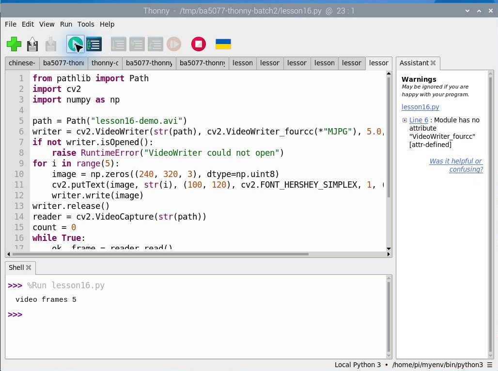
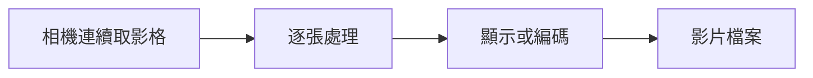
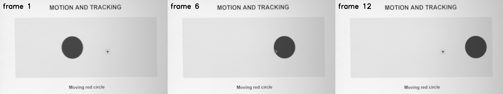

# 第 16 課｜Python 結合 OpenCV 與 Picamera2：影片錄製與即時影像處理

[原始文章](https://liusming.pixnet.net/blog/posts/14222876415) · 更新日期：2026-10-29

> 本課已在 Thonny 實測：五張合成影格寫入及讀回影片。完整原文情境及其他舊案例仍須依下文標示重測。[逐篇進度](./Thonny逐篇實測狀態.md) · [圖片與程式下載方式](./練習素材/素材下載與使用.md)

## 學習目標

先以合成影格建立短影片，再讀回並計算影格數，以驗證影片寫入和讀取。

## 事前準備

系統 OpenCV 的 MJPG 編碼器可用；程式在目前目錄產生 `lesson16-demo.avi`。

請在自己的練習目錄操作。已存在的同名輸出檔可能被覆寫，先確認路徑；用不著將任何相機照片上傳公開儲存庫。

## 程式與執行

將下列程式存為 `第16課.py`。這是本次在 RP5 上執行的程式；完整檔案也在[範例程式](./範例程式/第16課.py)。

```python
from pathlib import Path
import cv2
import numpy as np

path = Path("lesson16-demo.avi")
writer = cv2.VideoWriter(str(path), cv2.VideoWriter_fourcc(*"MJPG"), 5.0, (320, 240))
if not writer.isOpened():
    raise RuntimeError("VideoWriter could not open")
for i in range(5):
    image = np.zeros((240, 320, 3), dtype=np.uint8)
    cv2.putText(image, str(i), (100, 120), cv2.FONT_HERSHEY_SIMPLEX, 1, (255, 255, 255), 2)
    writer.write(image)
writer.release()
reader = cv2.VideoCapture(str(path))
count = 0
while True:
    ok, frame = reader.read()
    if not ok:
        break
    count += 1
reader.release()
print("video frames", count)
```

在 Thonny 選 **File → Open** 開啟 `第16課.py`，確認右下角是包含所需套件的 Python 環境，再點綠色執行鈕。若程式會輸出檔案，先在新的練習目錄操作，避免覆寫。

## Thonny 實測輸出

```text
video frames 5
```



本次選用既有環境 `/home/pi/myenv/bin/python3`。本次 Thonny 程式以合成影格測試，不等於相機即時錄影；後面的相機影片案例仍待 Thonny 重測。 相機或影像相關套件的準備及可重現環境請參考[Thonny 環境指南](./Thonny環境與套件安裝.md)。

本機成功讀回 5 個影格；不同機器若 `VideoWriter` 無法開啟，需檢查編碼器。此測試使用合成影格，不代表相機即時錄影或聲音已測試。

## 背景與核心概念

### 影片與單張照片有什麼關係？

影片可視為按時間排列的影格；每秒影格數影響流暢度與資料量。影像處理程序需考量取像、計算、顯示與寫檔的速度，若處理太慢可能丟影格或增加延遲。

### 思考、練習與後續應用

如果每秒只能處理五張影格，這和每秒拍攝三十張會有什麼差異？檢查目前文章的實測範圍，哪些功能尚未完成？

影片分析可用於運動偵測，但應評估實測速度、錄影容量和拍攝對象的隱私。

進一步閱讀：[相關官方文件](https://www.raspberrypi.com/documentation/accessories/camera-software.html)。下方的程式與輸出以標明的本機實測範圍為準；沒有測過的部分不代表已完成。

## 概念流程圖



此圖用於說明文章的概念或完整目標流程，**不是操作截圖，也不代表每個步驟都已實測**；本機實測範圍請看文章中的標示。

## 舊實測紀錄：相機影格轉灰階並寫入短影片（待 Thonny 重測）

這個實驗使用 RP5 相機拍攝螢幕上移動的紅色圓形。程式連續取得 12 張影格，裁切與透視校正測試圖後轉成灰階，寫入 MJPG 影片，再重新讀取影片檢查影格數。這是有限張數的拍攝與寫檔測試，**不是已驗證的長時間錄影、同步音訊或即時預覽**。

### 事前準備

1. 下載[相機測試畫面](./練習素材/RP5相機測試.html)，在電腦螢幕選「移動追蹤」，並讓 RP5 相機對準該畫面。相機應固定，且不能同時被其他程式占用。
2. 確認系統 Python 能使用 Picamera2、OpenCV、NumPy 及 MJPG 編碼器。在自己的空練習目錄放入[範例程式](./範例程式/第16課-相機影格與影片.py)。程式會建立 `lesson16-camera.avi` 與 `lesson16-frames.png`；先確認不會覆蓋已有檔案。
3. `source` 四個座標只對應本次 1920 × 1080 的相機位置。更換相機、畫面大小或位置後，須重新量測測試圖的四角；公開圖片前也要確認是否仍含周圍環境。

```python
import time
import cv2
import numpy as np
from picamera2 import Picamera2

# 本次相機位置的測試圖四角；不同位置或尺寸須重新量測。
source = np.float32([[755, 270], [1385, 65], [1484, 412], [856, 604]])
target = np.float32([[0, 0], [599, 0], [599, 337], [0, 337]])
matrix = cv2.getPerspectiveTransform(source, target)
camera = Picamera2()
writer = None
panels = []
written = 0
try:
    camera.configure(camera.create_still_configuration(main={'size': (1920, 1080), 'format': 'RGB888'}))
    camera.start()
    time.sleep(1)
    writer = cv2.VideoWriter('lesson16-camera.avi', cv2.VideoWriter_fourcc(*'MJPG'), 5, (600, 338))
    if not writer.isOpened():
        raise RuntimeError('無法建立 MJPG 影片')
    for index in range(12):
        frame = camera.capture_array()
        board = cv2.warpPerspective(frame, matrix, (600, 338))
        gray = cv2.cvtColor(board, cv2.COLOR_BGR2GRAY)
        processed = cv2.cvtColor(gray, cv2.COLOR_GRAY2BGR)
        cv2.putText(processed, f'frame {index+1}', (10, 30), cv2.FONT_HERSHEY_SIMPLEX, 0.8, (0, 0, 0), 2)
        writer.write(processed)
        written += 1
        if index in (0, 5, 11):
            panels.append(processed)
        time.sleep(0.2)
finally:
    if writer is not None:
        writer.release()
    camera.stop()
    camera.close()

video = cv2.VideoCapture('lesson16-camera.avi')
read_count = 0
first_shape = None
try:
    while True:
        ok, image = video.read()
        if not ok:
            break
        if first_shape is None:
            first_shape = image.shape
        read_count += 1
finally:
    video.release()
if not cv2.imwrite('lesson16-frames.png', cv2.hconcat(panels)):
    raise RuntimeError('無法儲存結果圖')
print('frames written:', written)
print('frames read:', read_count)
print('first video frame:', first_shape)
print('saved: lesson16-camera.avi, lesson16-frames.png')
```

```bash
python3 第16課-相機影格與影片.py
```

### RP5 實際輸出

```text
frames written: 12
frames read: 12
first video frame: (338, 600, 3)
saved: lesson16-camera.avi, lesson16-frames.png
```



圖由左到右為本次擷取的第 1、6、12 張影格，經透視校正、灰階轉換並標示影格編號。這是程式結果圖，不是操作截圖。[下載本次處理後的短影片](./練習素材/lesson16-camera.avi)可練習第 26、27 課；完整原始相機畫面未上傳。

### 如何理解與繼續實驗

`VideoWriter` 設定的 5 是影片播放的標稱每秒影格數；程式每次拍攝與處理還需要時間，`sleep(0.2)` 不能證明相機或整條流程實際達到 5 FPS。`frames read: 12` 證明本次重新讀到 12 張影格，不代表畫面一定適用其他編碼器或播放器。

請比較三張影格中的圓形位置；再調整拍攝張數或等待時間，記錄檔案大小和輸出。若影片無法建立，檢查編碼器、磁碟空間、輸出路徑與寫入權限；若相機無法啟動，先檢查是否被其他程式占用。不要把測試照片或影片中不應公開的內容上傳。

## 與原文章的差異

- 新增以 Thonny 操作的實測與截圖：五張合成影格寫入及讀回影片。

- 原文示範相機即時錄影；本版先用可重現的合成影格測試影片流程，未聲稱已驗證即時錄影。
- 上述文字輸出是本次實機紀錄，其他版本或環境可能不同。
- 新增上方基本程式在 Thonny 執行的操作截圖；其他情境以各段落標示為準。
- 新增初學者背景、概念、思考練習及後續應用，實測範圍仍以本文標示為準。
- 加入教學流程示意；圖中的完整目標流程不代表已逐步實測。
- 新增 RP5 相機實拍 12 張影格、寫入 MJPG 並重新讀取的測試；尚未驗證長時間錄影和即時預覽。
