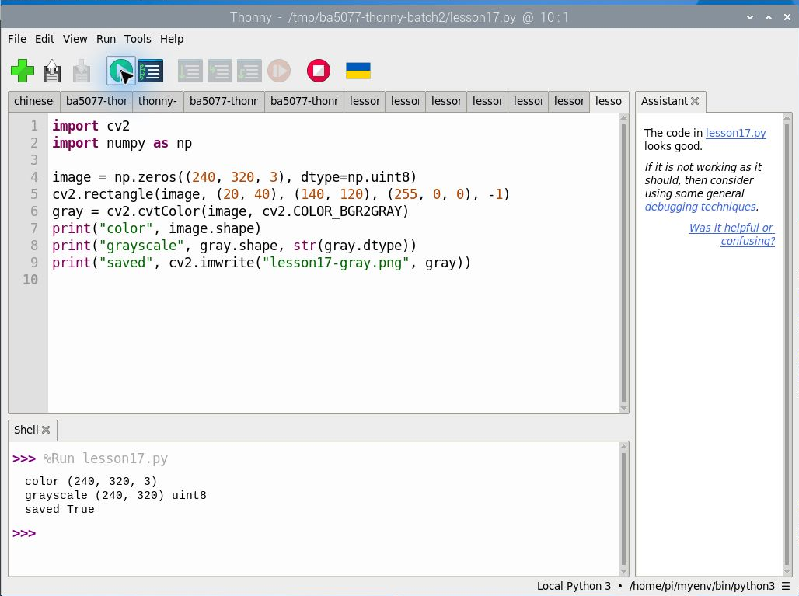
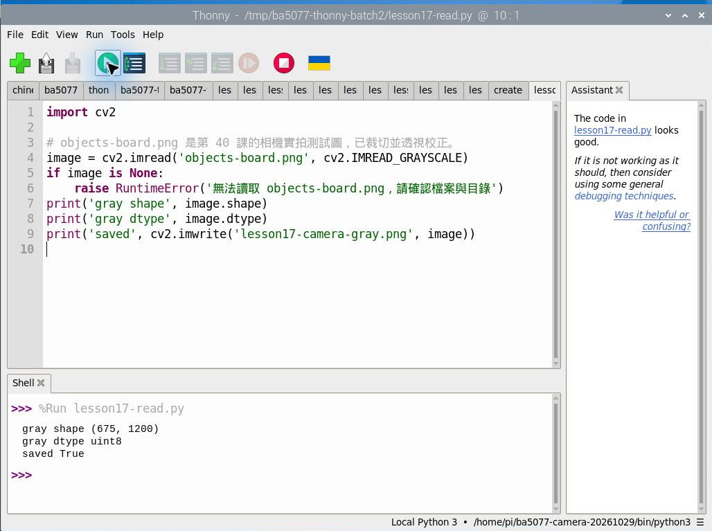
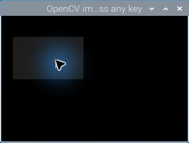

# 第 17 課｜使用 OpenCV 讀取灰階圖檔

[原始文章](https://liusming.pixnet.net/blog/posts/14222886366) · 更新日期：2026-10-29

> 本課已在 Thonny 實測：合成彩色圖轉灰階並存檔。完整原文情境及其他舊案例仍須依下文標示重測。[逐篇進度](./Thonny逐篇實測狀態.md) · [圖片與程式下載方式](./練習素材/素材下載與使用.md)

## 學習目標

建立合成彩色圖像，轉成灰階並儲存，以觀察彩色與灰階陣列的差異。

## 事前準備

系統 OpenCV 與 NumPy 已可匯入；程式在目前目錄寫入 `lesson17-gray.png`。

請在自己的練習目錄操作。已存在的同名輸出檔可能被覆寫，先確認路徑；用不著將任何相機照片上傳公開儲存庫。

## 程式與執行

將下列程式存為 `第17課.py`。這是本次在 RP5 上執行的程式；完整檔案也在[範例程式](./範例程式/第17課.py)。

```python
import cv2
import numpy as np

image = np.zeros((240, 320, 3), dtype=np.uint8)
cv2.rectangle(image, (20, 40), (140, 120), (255, 0, 0), -1)
gray = cv2.cvtColor(image, cv2.COLOR_BGR2GRAY)
print("color", image.shape)
print("grayscale", gray.shape, str(gray.dtype))
print("saved", cv2.imwrite("lesson17-gray.png", gray))
```

在 Thonny 選 **File → Open** 開啟 `第17課.py`，確認右下角是包含所需套件的 Python 環境，再點綠色執行鈕。若程式會輸出檔案，先在新的練習目錄操作，避免覆寫。

## Thonny 實測輸出

```text
color (240, 320, 3)
grayscale (240, 320) uint8
saved True
```



本次選用既有環境 `/home/pi/myenv/bin/python3`。本次基本範例先產生合成圖；下方另以 Thonny 讀取先前的相機實拍素材。圖形視窗顯示仍待重測。 相機或影像相關套件的準備及可重現環境請參考[Thonny 環境指南](./Thonny環境與套件安裝.md)。

`saved True` 表示 OpenCV 成功寫入圖片。灰階圖片只有一個通道；若寫入失敗，檢查目前資料夾權限。

本次 RP5 程式實際產生的圖檔：


## 背景與核心概念

### 為什麼要讀取灰階圖片？

灰階影像以單一通道表示亮度，適合某些邊緣或形狀處理；彩色資訊會在轉換中消失。影像陣列的索引通常先是列（高度），再是欄（寬度）。

### 思考、練習與後續應用

比較彩色影像與灰階影像的通道數；解釋灰階可能讓哪些原本顏色不同的區域變得難以區分。

灰階可用於文件或輪廓的前處理；如果任務依賴顏色區分，應保留彩色資料。

進一步閱讀：[相關官方文件](https://docs.opencv.org/4.x/d6/d00/tutorial_py_root.html)。下方的程式與輸出以標明的本機實測範圍為準；沒有測過的部分不代表已完成。

## Thonny 進階實測：把相機實拍圖片讀成灰階

上面的初步範例建立合成圖片並轉換灰階；原文主題則是**讀取圖片檔**。本次另使用第 40 課由 RP5 拍攝螢幕測試素材、裁切並校正的[實拍影像](./圖檔/objects-board.png)。請下載該圖，存為 `objects-board.png`，放在下列[範例程式](./範例程式/第17課-讀取實拍灰階.py)的練習目錄。

```python
import cv2

# objects-board.png 是第 40 課的相機實拍測試圖，已裁切並透視校正。
image = cv2.imread('objects-board.png', cv2.IMREAD_GRAYSCALE)
if image is None:
    raise RuntimeError('無法讀取 objects-board.png，請確認檔案與目錄')
print('gray shape', image.shape)
print('gray dtype', image.dtype)
print('saved', cv2.imwrite('lesson17-camera-gray.png', image))
```

在 Thonny 選擇 **File → Open** 開啟 `第17課-讀取實拍灰階.py`，確認素材和程式位於同一個練習目錄，再按綠色執行按鈕。

本次 RP5 實際輸出：

```text
gray shape (675, 1200)
gray dtype uint8
saved True
```


`cv2.IMREAD_GRAYSCALE` 在讀檔時取得單通道影像。圖中的物件原本由 AI 生成，先顯示於螢幕，再由 RP5 相機拍攝，最後裁切、校正和讀成灰階；它不是實拍真實水果，也不是操作截圖。`image is None` 用來檢查讀檔失敗，避免後續處理空資料。

### 練習

比較[彩色輸入](./圖檔/objects-board.png)與灰階輸出，說明哪些顏色資訊消失。將圖片檔名改成不存在的名稱，觀察程式如何提示，再改回正確名稱。



## 舊實驗紀錄（終端機；待 Thonny 重測）：在桌面顯示合成灰階圖

先用本文範例產生 `lesson17-gray.png`，把[圖形視窗程式](./範例程式/OpenCV-圖形視窗.py)放在同一練習目錄，在 RP5 桌面執行：

```bash
python3 OpenCV-圖形視窗.py lesson17-gray.png
```

```python
import sys
import cv2

if len(sys.argv) != 2:
    raise SystemExit('用法：python3 OpenCV-圖形視窗.py 圖片檔名')
image = cv2.imread(sys.argv[1], cv2.IMREAD_UNCHANGED)
if image is None:
    raise SystemExit('無法讀取圖片，請檢查路徑')
print('image shape:', image.shape, flush=True)
cv2.imshow('OpenCV image - press any key', image)
print('window opened; press any key or wait 60 seconds', flush=True)
cv2.waitKey(60000)
cv2.destroyAllWindows()
print('window closed', flush=True)
```

本次使用 RP5 系統 OpenCV 實際輸出節錄：

```text
image shape: (240, 320)
window opened; press any key or wait 60 seconds
window closed
```



這是遠端桌面擷取並裁切的操作截圖；圖中的灰色矩形是合成資料，滑鼠游標也出現在視窗中。顯示灰階圖需要圖形桌面與支援 GUI 的 OpenCV；本次沒有測試原文外部圖片。視窗程式在取得按鍵或等待 60 秒後結束。

## 與原文章的差異

- 新增以 Thonny 操作的實測與截圖：合成彩色圖轉灰階並存檔。

- 原文讀取外部 `demo.jpeg`；本版使用合成圖像，不依賴未提供的圖片。
- 上述文字輸出是本次實機紀錄，其他版本或環境可能不同。
- 新增合成灰階圖在 OpenCV 視窗中顯示的操作截圖。
- 新增初學者背景、概念、思考練習及後續應用，實測範圍仍以本文標示為準。
- 新增使用 `cv2.imread(..., cv2.IMREAD_GRAYSCALE)` 讀取 RP5 實拍後校正影像的實測；本版另以合成圖片驗證圖形視窗；原文圖片未測。
