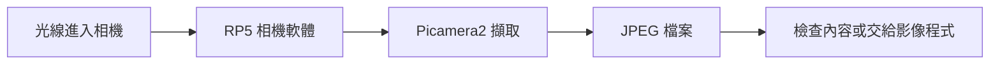

# 第 18 課｜使用 Picamera2 拍攝照片並保存至本地

[原始文章](https://liusming.pixnet.net/blog/posts/14222886372) · 更新日期：2026-10-29

> **Thonny 轉換待完成。** 本篇既有程式、安裝步驟與輸出仍須逐項改寫並在 Thonny 重新操作；現有終端機紀錄不代表已用 Thonny 測試。[逐篇進度](./Thonny逐篇實測狀態.md)

## 學習目標

使用 Picamera2 拍攝並儲存一張照片，並確認檔案建立。

## 背景：為什麼要把相機影像存成檔案？

自動化系統常先拍一張照片，之後再檢查、比對或讓模型推論。若只在畫面上看預覽，關閉程式後就不一定保有影像。將照片存為檔案，能讓你反覆分析同一份輸入，並記錄每次實驗的條件。

本課先學會拍照與保存；第 29 課會用拍下的測試圖練習輪廓偵測。你需要已完成相機連接、知道如何進入終端機，以及能執行簡單 Python 程式。

## 原理：相機、解析度與檔案

相機感測器接收光線，系統將訊號處理為影像。解析度的 1920 × 1080 表示影像寬度與高度的像素數，不直接代表照片一定清楚；鏡頭、對焦、光線與拍攝距離都會影響結果。

Picamera2 透過相機軟體取得影像。程式依序建立相機物件、設定輸出尺寸、啟動、拍照保存、停止並釋放相機。`try`／`finally` 用來確保出錯時仍嘗試停止與釋放；如果相機已被其他程式使用，本程式可能無法啟動。[Raspberry Pi 官方相機軟體文件](https://www.raspberrypi.com/documentation/accessories/camera-software.html)有硬體與軟體操作資訊。



上圖是資料流程示意，並非操作畫面截圖。

## 事前準備

相機已連接；程式會在目前目錄寫入 `lesson18-photo.jpg`，請先確認不會覆蓋自己的檔案。

請在自己的練習目錄操作。已存在的同名輸出檔可能被覆寫，先確認路徑；用不著將任何相機照片上傳公開儲存庫。

## 程式與執行

將下列程式存為 `第18課.py`。這是本次在 RP5 上執行的程式；完整檔案也在[範例程式](./範例程式/第18課.py)。

```python
from pathlib import Path
from picamera2 import Picamera2

path = Path("lesson18-photo.jpg")
camera = Picamera2()
try:
    camera.configure(camera.create_still_configuration(main={"size": (1920, 1080)}))
    camera.start()
    camera.capture_file(str(path))
    print("photo saved:", path.exists())
finally:
    camera.stop()
    camera.close()
```

在該檔案所在的目錄執行 `python3 第18課.py`。

## 本機實際輸出

```text
photo saved: True
```

本機實測檔案成功建立。原始測試照片包含相機現場影像，因此未放到公開 repo；使用者應自行檢查拍攝內容及分享對象。

## RP5 實拍結果

本次將相機對準螢幕，執行上面的 1920 × 1080 拍照程式後，另用[第 29 課的範例](./第%2029%20課｜使用%20OpenCV%20進行輪廓檢測與繪製.md)截取測試區域並做透視校正，得到下圖。圖形是在螢幕上顯示的測試素材，照片由 RP5 實際拍攝；**下圖不是原始整張 JPEG，也不是安裝截圖**。原始照片包含周圍環境，沒有放進公開儲存庫。

可下載[相機測試畫面](./練習素材/RP5相機測試.html)後在電腦瀏覽器開啟，選「形狀與輪廓」，再將相機對準螢幕。這個離線頁面可以調整圖案大小；相機位置改變後，需要重新設定第 29 課範例的裁切座標。


## 程式怎麼運作？

1. `Path(...)` 指定輸出檔名；這是相對路徑，因此檔案會放在執行程式時的目前目錄。
2. `create_still_configuration` 設定照片輸出尺寸；`camera.start()` 開始使用相機。
3. `capture_file` 寫入 JPEG；`path.exists()` 檢查該路徑是否存在。若檔案原本就存在，`True` 本身不能證明一定是新拍到的照片；請先使用空的練習目錄或確認同名檔案。
4. `finally` 不論拍照成功與否都執行停止和關閉，避免相機資源持續被占用。

## 練習與後續應用

1. 在空的練習目錄執行程式，確認照片檔案存在，並用圖片檢視器觀察拍攝範圍。
2. 說明 1920 × 1080 的兩個數字代表什麼。更高解析度是否一定代表更好的辨識結果？請從光線與對焦解釋。
3. 改變拍攝目標或光線，再比較結果。拍到他人、工作畫面或個人資料時，請先取得適當授權再分享。

這個流程可以擴充為拍攝設備狀態、記錄實驗結果，或把影像交給 OpenCV / AI 模型。實際應用需要考慮儲存容量、拍攝頻率、照片品質與資料保存期限。

## 與原文章的差異

- 明確加入檔案存在檢查；不將可能包含私人環境的照片公開。
- 上述文字輸出是本次實機紀錄，其他版本或環境可能不同。
- 尚未補拍操作畫面；圖檔（若有）是程式產生的結果，不冒充螢幕截圖。
- 將拍照解析度調整為本次實測的 1920 × 1080，並補上實拍後裁切及校正的結果圖；圖中不包含原始照片的周圍環境。
