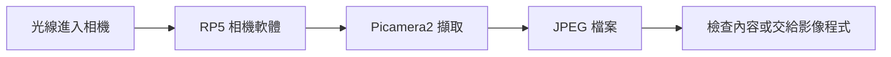
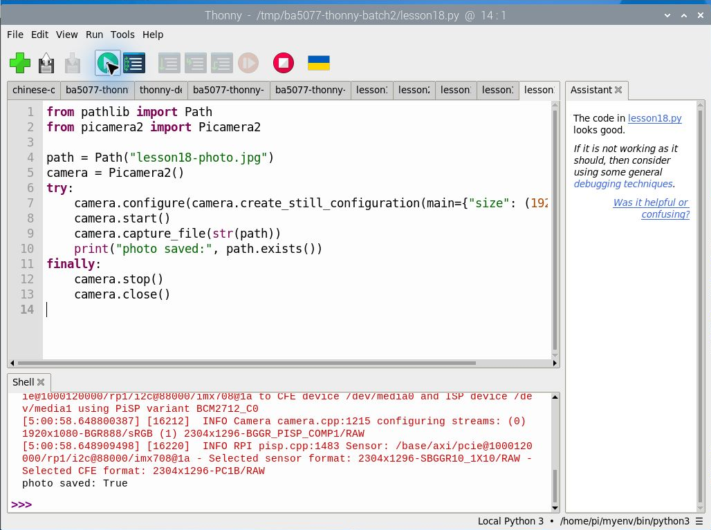
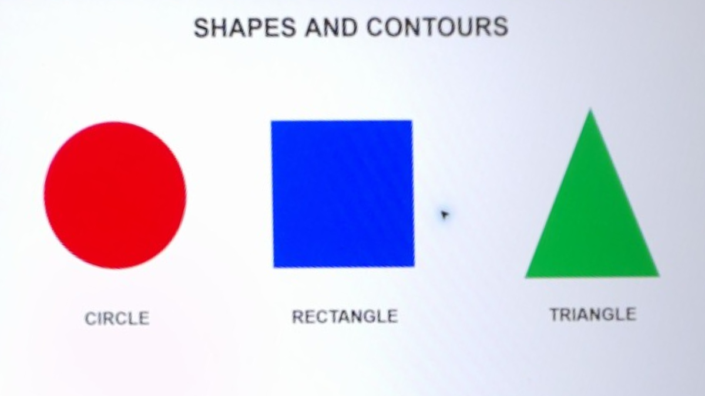

# 第 18 課｜使用 Picamera2 拍攝照片並保存至本地

[原始文章](https://liusming.pixnet.net/blog/posts/14222886372) · 更新日期：2026-10-29

預覽關掉後，剛才看到的畫面就消失了。這一課讓相機留下照片，然後一起到資料夾裡找到它。

第一次準備環境的同學，可以先讀[課前學習說明](./學習前先讀我.md)；操作遇到紅字時，我們用[排錯故事](./程式卡住時怎麼辦.md)一起找原因。

## 學習目標

使用 Picamera2 拍攝並儲存一張照片，並確認檔案建立。

## 背景：為什麼要把相機影像存成檔案？

自動化系統常先拍一張照片，之後再檢查、比對或讓模型推論。若只在畫面上看預覽，關閉程式後就不一定保有影像。將照片存為檔案，能讓你反覆分析同一份輸入，並記錄每次實驗的條件。

本課先學會拍照與保存；第 29 課會用拍下的測試圖練習輪廓偵測。你需要已完成相機連接、能進入 Thonny，以及能執行簡單 Python 程式。

## 原理：相機、解析度與檔案

相機感測器接收光線，系統將訊號處理為影像。解析度的 1920 × 1080 表示影像寬度與高度的像素數，不直接代表照片一定清楚；鏡頭、對焦、光線與拍攝距離都會影響結果。

Picamera2 透過相機軟體取得影像。程式依序建立相機物件、設定輸出尺寸、啟動、拍照保存、停止並釋放相機。`try`／`finally` 用來確保出錯時仍嘗試停止與釋放；如果相機已被其他程式使用，本程式可能無法啟動。[Raspberry Pi 官方相機軟體文件](https://www.raspberrypi.com/documentation/accessories/camera-software.html)有硬體與軟體操作資訊。



上圖是資料流程示意，並非操作畫面截圖。

## 事前準備

先確認第 07 課的相機已連接，並在 **RP5 桌面上的 Thonny** 操作。相機接在 RP5 上，因此 Windows 電腦上的 Python 不能直接使用這台 RP5 的相機。請先關閉其他相機預覽或錄影程式；一次只能由相容的相機程式使用相機。

在 Thonny 選擇有 Picamera2 的 Python，而不是只確認有 OpenCV。可先參考[相機工具箱與環境選擇](./Thonny環境與套件安裝.md#既有-trixie同時使用-picamera2-與-opencv-擴充功能2026-11-10)；該指南的環境是既有 Trixie 實例，不代表每一台機器都已準備完成。若出現 `No module named 'picamera2'`，先檢查右下角解譯器和環境指南，不要把套件裝進另一個 Python 後以為已修好。

在 RP5 建立新的空練習資料夾，把[範例程式](./範例程式/第18課.py)存入其中。這個範例使用相對路徑，照片寫入執行時的**目前工作目錄**。本次 RP5 的 Thonny 按 Run 會切到程式所在資料夾；不要只依賴按 Run 前在 Shell 輸入的 `os.chdir()`，因為執行時工作目錄可能改變。先確認練習資料夾和目前工作目錄都沒有要保留的 `lesson18-photo.jpg`，因為同名檔案可能被覆寫。

拍照程式結束後，在下方 Shell 輸入 `import os; print(os.getcwd())`，查看目前位置，再到顯示的資料夾找照片。不同 Thonny 設定可能有不同結果；若不確定，請先用空資料夾並和老師確認。

## 程式與執行

將下列程式存為 `第18課.py`。這是本次在 RP5 上執行的程式；完整檔案也在[範例程式](./範例程式/第18課.py)。

```python
from pathlib import Path
from picamera2 import Picamera2

path = Path("lesson18-photo.jpg")
camera = Picamera2()
try:
    camera.configure(camera.create_still_configuration(main={"size": (1920, 1080)}))
    camera.start()
    camera.capture_file(str(path))
    print("photo saved:", path.exists())
finally:
    camera.stop()
    camera.close()
```

在 Thonny 選 **File → Open** 開啟 `第18課.py`，確認右下角是包含所需套件的 Python 環境，再點綠色執行鈕。若程式會輸出檔案，先在新的練習目錄操作，避免覆寫。

這個簡短範例不會開啟預覽視窗；看到 Shell 的回應後，依上面的 `os.getcwd()` 指令確認工作目錄，再到該處找 `lesson18-photo.jpg`，用圖片檢視器開啟。若只有看到 `True`，還要實際打開圖片確認內容，因為它本身只表示該路徑存在檔案。

如果相機無法啟動，先確認相機連線與其他程式是否占用，再參考[第 13 課](./第%2013%20課｜Raspberry%20Pi%20使用攝影機完整指南.md)。如果找不到照片，先重查 Shell 中的 `os.getcwd()`、檔名與是否已按 Run；不要假設照片一定和程式在同一個資料夾。拍到周圍環境或個人資料時，公開之前先檢查並妥善處理。

## Thonny 實測輸出

```text
photo saved: True
```



本次選用既有環境 `/home/pi/myenv/bin/python3`。本次在新的練習目錄拍攝，確認檔案成功建立；現場照片包含周圍環境，因此不公開原圖。 相機或影像相關套件的準備及可重現環境請參考[Thonny 環境指南](./Thonny環境與套件安裝.md)。

本機實測檔案成功建立。原始測試照片包含相機現場影像，因此未放到公開 repo；使用者應自行檢查拍攝內容及分享對象。

## RP5 實拍結果

本次將相機對準螢幕，執行上面的 1920 × 1080 拍照程式後，另用[第 29 課的範例](./第%2029%20課｜使用%20OpenCV%20進行輪廓檢測與繪製.md)截取測試區域並做透視校正，得到下圖。圖形是在螢幕上顯示的測試素材，照片由 RP5 實際拍攝；**下圖不是原始整張 JPEG，也不是安裝截圖**。原始照片包含周圍環境，沒有放進公開儲存庫。

可下載[相機測試畫面](./練習素材/RP5相機測試.html)後在電腦瀏覽器開啟，選「形狀與輪廓」，再將相機對準螢幕。這個離線頁面可以調整圖案大小；相機位置改變後，需要重新設定第 29 課範例的裁切座標。



## 程式怎麼運作？

1. `Path(...)` 指定輸出檔名；這是相對路徑，因此檔案會放在執行程式時的目前目錄。
2. `create_still_configuration` 設定照片輸出尺寸；`camera.start()` 開始使用相機。
3. `capture_file` 寫入 JPEG；`path.exists()` 檢查該路徑是否存在。若檔案原本就存在，`True` 本身不能證明一定是新拍到的照片；請先使用空的練習目錄或確認同名檔案。
4. `finally` 不論拍照成功與否都執行停止和關閉，避免相機資源持續被占用。

## 練習與後續應用

1. 在空的練習目錄執行程式，確認照片檔案存在，並用圖片檢視器觀察拍攝範圍。
2. 說明 1920 × 1080 的兩個數字代表什麼。更高解析度是否一定代表更好的辨識結果？請從光線與對焦解釋。
3. 改變拍攝目標或光線，再比較結果。拍到他人、工作畫面或個人資料時，請先取得適當授權再分享。

這個流程可以擴充為拍攝設備狀態、記錄實驗結果，或把影像交給 OpenCV / AI 模型。實際應用需要考慮儲存容量、拍攝頻率、照片品質與資料保存期限。

## 與原文章的差異

- 新增以 Thonny 操作的實測與截圖：Picamera2 拍攝並保存一張 JPEG。

- 明確加入檔案存在檢查；不將可能包含私人環境的照片公開。
- 上述文字輸出是本次實機紀錄，其他版本或環境可能不同。
- 新增上方基本程式在 Thonny 執行的操作截圖；其他情境以各段落標示為準。
- 將拍照解析度調整為本次實測的 1920 × 1080，並補上實拍後裁切及校正的結果圖；圖中不包含原始照片的周圍環境。

<details>
<summary>給教師：原有實測範圍與版本備註</summary>

> 本課已在 Thonny 實測：Picamera2 拍攝並保存一張 JPEG。完整原文情境及其他舊案例仍須依下文標示重測。[逐篇進度](./Thonny逐篇實測狀態.md) · [圖片與程式下載方式](./練習素材/素材下載與使用.md)

> 2026-11-11 補寫學生的相機環境、工作目錄、找檔及排錯步驟，沿用原有拍照程式與證據。本次在既有 Trixie Thonny 用獨立的工作目錄觀察程式驗證：Shell 先切換至 `/tmp`，按 Run 執行位於另一資料夾的測試程式後，程式印出其所在資料夾；這不是重新拍照或全新環境驗收。

</details>
