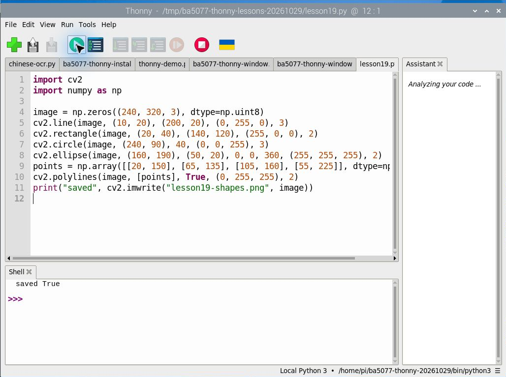
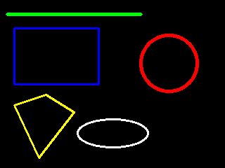
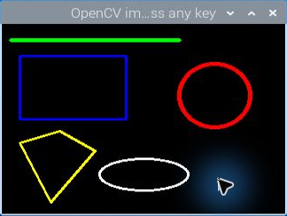

# 第 19 課｜使用 OpenCV 繪製直線、圓形、橢圓與多邊形

[原始文章](https://liusming.pixnet.net/blog/posts/14222886411) · 更新日期：2026-10-29

> 本課基本繪圖程式已在 Thonny 重新執行；結果視窗的原完整流程仍待 Thonny 重測。[逐篇進度](./Thonny逐篇實測狀態.md)

## 學習目標

在合成畫布上繪製線條、矩形、圓形、橢圓與多邊形，並存成圖片。

## 事前準備

依[Thonny 環境指南](./Thonny環境與套件安裝.md)準備 OpenCV 與 NumPy，確認 Thonny 選擇安裝了這些套件的環境；程式會寫入 `lesson19-shapes.png`。

請在自己的練習目錄操作。已存在的同名輸出檔可能被覆寫，先確認路徑；用不著將任何相機照片上傳公開儲存庫。

## 程式與執行

將下列程式存為 `第19課.py`。這是本次在 RP5 上執行的程式；完整檔案也在[範例程式](./範例程式/第19課.py)。

```python
import cv2
import numpy as np

image = np.zeros((240, 320, 3), dtype=np.uint8)
cv2.line(image, (10, 20), (200, 20), (0, 255, 0), 3)
cv2.rectangle(image, (20, 40), (140, 120), (255, 0, 0), 2)
cv2.circle(image, (240, 90), 40, (0, 0, 255), 3)
cv2.ellipse(image, (160, 190), (50, 20), 0, 0, 360, (255, 255, 255), 2)
points = np.array([[20, 150], [65, 135], [105, 160], [55, 225]], dtype=np.int32)
cv2.polylines(image, [points], True, (0, 255, 255), 2)
print("saved", cv2.imwrite("lesson19-shapes.png", image))
```

在 Thonny 選擇 **File → Open** 開啟 `第19課.py`，確認右下角為準備好的環境，再點綠色執行按鈕。程式會在工作目錄寫入圖片；先確認不會覆寫自己的檔案。

## Thonny 實測輸出

```text
saved True
```

圖片可用來比較不同圖形的座標、顏色與線寬；OpenCV 的顏色參數一般使用 BGR 順序。



本次 Thonny 使用 OpenCV 4.10.0 在 RP5 產生的圖檔：



## 背景與核心概念

### 程式如何在影像上畫圖？

OpenCV 將圖片視為像素陣列，繪製函式會改變指定位置的像素。通常左上角是原點，x 向右、y 向下；顏色常以 BGR 順序指定。

### 思考、練習與後續應用

說出線條起點、終點、顏色和粗細分別影響什麼；畫在影像外的位置會有什麼問題？

繪圖可用來標示偵測框和測量結果，但標註不代表模型判斷一定正確。

進一步閱讀：[相關官方文件](https://docs.opencv.org/4.x/d6/d00/tutorial_py_root.html)。下方的程式與輸出以標明的本機實測範圍為準；沒有測過的部分不代表已完成。

## 逐步看懂繪圖座標與參數

畫布的陣列形狀是 `(240, 320, 3)`，表示高 240、寬 320、三個色彩通道；左上角為 `(0, 0)`，x 向右增加、y 向下增加。`line` 使用起點和終點；`rectangle` 使用兩個角；`circle` 使用圓心和半徑；`ellipse` 還需要長短半軸及角度。

`points` 是依序排列的多邊形頂點。`polylines` 的 `True` 代表連回起點，形成封閉輪廓。OpenCV 常用 BGR 色彩順序，本次 `(0, 255, 255)` 是黃色；線寬 2 表示以兩像素左右的粗細畫線。修改後請重新觀察圖形，畫面超出邊界可能被裁切。

### 練習

修改多邊形的一個頂點並保存新圖；比較修改前後的形狀。再嘗試將 `True` 改為 `False`，觀察起點與終點是否連接。這些變化請學生自行操作並記錄。

## 先前測試：RP5 圖形桌面顯示結果

先前以終端機和系統 OpenCV 開啟同一類結果圖，保留視窗截圖作為歷史紀錄；**這張圖不是 Thonny 執行截圖**。使用 Thonny 開啟本課圖片的完整操作仍待重測。可先在[第 14 課](./Thonny環境與套件安裝.md)練習經 Thonny 開啟基本 OpenCV 視窗。



## 與原文章的差異

- 新增在 Thonny 所選獨立環境執行繪圖並保存結果的截圖和輸出。

- 本版以合成畫布存檔；Thonny 繪圖已測，原文完整視窗操作尚待用 Thonny 重測。
- 上述文字輸出是本次實機紀錄，其他版本或環境可能不同。
- 新增實際 OpenCV 圖形視窗的操作截圖；先前結果圖仍是程式存檔。
- 新增初學者背景、概念、思考練習及後續應用，實測範圍仍以本文標示為準。
- 重新執行後新增多邊形，讓實作涵蓋原文標題中的各種圖形。
