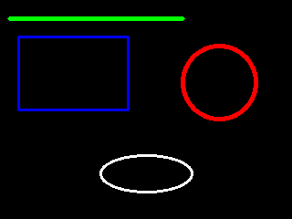

# 第 19 課｜使用 OpenCV 繪製直線、圓形、橢圓與多邊形

[原始文章](https://liusming.pixnet.net/blog/posts/14222886411) · 更新日期：2026-10-29

## 學習目標

在合成畫布上繪製線條、矩形、圓形與橢圓，並存成圖片。

## 事前準備

系統 OpenCV 與 NumPy 已可匯入；程式會寫入 `lesson19-shapes.png`。

請在自己的練習目錄操作。已存在的同名輸出檔可能被覆寫，先確認路徑；用不著將任何相機照片上傳公開儲存庫。

## 程式與執行

將下列程式存為 `第19課.py`。這是本次在 RP5 上執行的程式；完整檔案也在[範例程式](./範例程式/第19課.py)。

```python
import cv2
import numpy as np

image = np.zeros((240, 320, 3), dtype=np.uint8)
cv2.line(image, (10, 20), (200, 20), (0, 255, 0), 3)
cv2.rectangle(image, (20, 40), (140, 120), (255, 0, 0), 2)
cv2.circle(image, (240, 90), 40, (0, 0, 255), 3)
cv2.ellipse(image, (160, 190), (50, 20), 0, 0, 360, (255, 255, 255), 2)
print("saved", cv2.imwrite("lesson19-shapes.png", image))
```

在該檔案所在的目錄執行 `python3 第19課.py`。

## 本機實際輸出

```text
saved True
```

圖片可用來比較不同圖形的座標、顏色與線寬；OpenCV 的顏色參數一般使用 BGR 順序。

本次 RP5 程式實際產生的圖檔：



## 與原文章的差異

- 本版以無需桌面的存檔方式展示結果；本機實測圖片如下，原文圖形視窗操作尚未測試。
- 上述文字輸出是本次實機紀錄，其他版本或環境可能不同。
- 尚未補拍操作畫面；圖檔（若有）是程式產生的結果，不冒充螢幕截圖。
