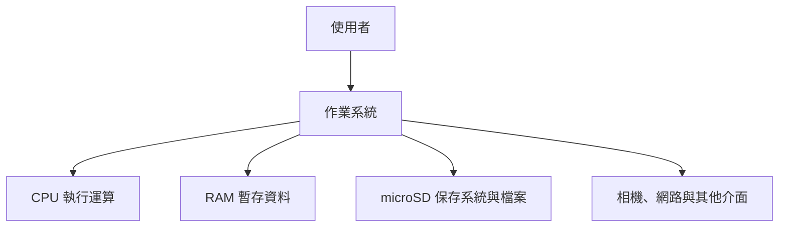

# 第 2 課｜認識 Raspberry Pi 與 Raspberry Pi OS

[原始文章](https://liusming.pixnet.net/blog/posts/14222880459) · 更新日期：2026-10-29

## 學習目標

認識 Raspberry Pi 單板電腦和 Raspberry Pi OS，並能在自己的機器上確認型號、架構、核心數及 Python 版本。Raspberry Pi OS 是針對 Raspberry Pi 調整的 Linux 系統；本次機器使用的版本以 Debian 12 Bookworm 為基礎。

## 需要準備什麼

已啟動的 Raspberry Pi、終端機，以及可登入的帳號。可以在 RP5 接的螢幕操作，也可以使用已建立的 SSH 連線。

## 背景：一張小板子為什麼是一台電腦？

RP5 把處理器、記憶體及多種連接介面集中在一張板上，因此稱為單板電腦。加上電源與作業系統後，可以直接接螢幕、鍵盤和滑鼠，也能透過網路遠端操作。Raspberry Pi 是一系列產品：例如 Pico 是微控制器系列，開發方式與可執行 Linux 桌面的 RP5 不同。[官方入門指南](https://www.raspberrypi.com/documentation/computers/getting-started.html)介紹設備和啟動方式。

## 核心概念：CPU、RAM、儲存與作業系統

| 元件 | 做什麼 | 簡單比喻 |
| --- | --- | --- |
| CPU | 執行程式指令與計算 | 工作的人 |
| RAM 記憶體 | 暫存使用中的程式和資料 | 桌面上的工作空間 |
| microSD 儲存 | 保存系統、程式及檔案 | 放資料的櫃子 |
| 作業系統 | 管理硬體、檔案、程式和使用者操作 | 協調工作的管理者 |



這是概念圖，不是電路圖。Raspberry Pi OS 基於 Debian，系統版本會更新；[官方 Raspberry Pi OS 文件](https://www.raspberrypi.com/documentation/computers/os.html)介紹桌面版與 Lite 等類型。

## 實作：查詢硬體與系統

在終端機執行：

```bash
printf 'model: '; tr -d '\000' < /proc/device-tree/model
printf '\narchitecture: '; uname -m
printf 'cores: '; getconf _NPROCESSORS_ONLN
python3 --version
```

本次實際輸出：

```text
model: Raspberry Pi 5 Model B Rev 1.0
architecture: aarch64
cores: 4
Python 3.11.2
```

`aarch64` 表示目前執行的是 64 位元 ARM 環境。四個核心和 Python 版本不代表所有軟體都自動相容：仍須檢查作業系統版本與 ARM64 套件。

記憶體可用 `free -h` 查看；這台機器的總記憶體曾顯示約 7.9 GiB，對應 8 GB 機型。可用量隨當時執行的程式而變。

### 本次記憶體實測

```bash
free -h
```

```text
               total        used        free      shared  buff/cache   available
Mem:           7.9Gi       677Mi       3.0Gi        57Mi       4.4Gi       7.2Gi
Swap:          2.0Gi          0B       2.0Gi
```

`available` 是估計可供程式使用的記憶體，會隨工作負載改變。`buff/cache` 包含系統用來加快讀取的快取；`Swap` 是利用儲存裝置的交換空間，不是另一條實體 RAM。

### 本次系統與儲存裝置實測

```bash
cat /etc/os-release | head -1
lsblk -o NAME,SIZE,TYPE,MOUNTPOINTS
```

```text
PRETTY_NAME="Debian GNU/Linux 12 (bookworm)"
NAME         SIZE TYPE MOUNTPOINTS
mmcblk0     29.7G disk
├─mmcblk0p1  512M part /boot/firmware
└─mmcblk0p2 29.2G part /
```

29.7G 是這次的儲存裝置容量，不是 RAM。`/` 是主要系統檔案所在的掛載位置；還有多少可用空間需要另用 `df -h` 查詢。

## 檢查與排除

- 如果找不到 `/proc/device-tree/model`，先確認是否真的在 Raspberry Pi 上執行，而不是在 Windows PowerShell。
- `Python 3.11.2` 是本機結果；其他系統版本可能顯示不同數字。
- 系統可用記憶體略低於標示容量屬常見情況；記憶體不是 microSD 儲存容量。

## 學生練習與後續應用

1. 寫出你自己機器的型號、架構、CPU 核心數、RAM 總量及儲存容量。
2. 關閉部分程式後再看一次 `free -h`：哪些數字可能變動？為什麼？
3. 如果模型需要較多記憶體、照片需要保存到檔案，分別會用到表格中的哪種資源？

了解資源有助選擇相機解析度及 AI 模型。即使資源足夠，仍須實測模型速度與結果，不能只憑規格判斷產品可用。

## 再深入：為什麼同一塊板子能做不同工作？

硬體提供計算、記憶、輸入和輸出的能力，程式描述要執行的步驟；作業系統則協助多個程式共同使用這些資源。例如，相機程式請求一張影格後，可以把資料交給 OpenCV 處理，再由另一個程式將結果存成檔案。

CPU 核心數是能力的一個指標，不等於所有程式都會自動同時使用四個核心。RAM 主要保存執行中的資料，microSD 則保存檔案；下載模型時也要查看儲存空間。這三種數值都無法單獨保證 AI 模型可以達到即時速度。

### 檢查自己的答案

1. 如果先關機再開機，存在 microSD 的檔案通常仍在；一般 RAM 中沒有保存的工作內容則不會繼續保留。
2. 看到 `aarch64`，可以知道執行環境為 64 位元 ARM；仍要查套件是否支援此系統和 Python 版本。
3. `free -h` 的各欄數字會變化，因為系統和其他程式持續使用與釋放記憶體；可用空間不能只看 `free` 一欄。

### 課堂任務

在自己的 RP5 記錄上述三組命令的輸出，圈出「型號」「核心數」「記憶體」「儲存裝置」；再用兩句話解釋 RAM 和 microSD 的分工。實際執行時的數值與本教材可以不同，不需要改成一致。

## 與原文章的差異

- 補上這台 RP5 的實際命令與輸出；原文的機型與作業系統介紹仍適用作背景知識。
- 將硬體架構與軟體相容性分開說明，避免把 ARM64 視為所有套件均可安裝。
- 尚未補拍本課畫面。
- 新增初學者元件解說、概念圖、記憶體及儲存裝置實測與練習題；概念圖不是截圖。
- 補充 CPU、記憶體、儲存和作業系統協同工作的說明及自我檢查。
