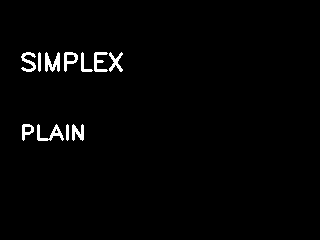

# 第 20 課｜使用 OpenCV 測試不同字體樣式

[原始文章](https://liusming.pixnet.net/blog/posts/14222886399) · 更新日期：2026-10-29

## 學習目標

使用 OpenCV 的 Hershey 字型在合成畫布上寫出兩種英文字體。

## 事前準備

系統 OpenCV 與 NumPy 已可匯入；程式會寫入 `lesson20-fonts.png`。

請在自己的練習目錄操作。已存在的同名輸出檔可能被覆寫，先確認路徑；用不著將任何相機照片上傳公開儲存庫。

## 程式與執行

將下列程式存為 `第20課.py`。這是本次在 RP5 上執行的程式；完整檔案也在[範例程式](./範例程式/第20課.py)。

```python
import cv2
import numpy as np

image = np.zeros((240, 320, 3), dtype=np.uint8)
cv2.putText(image, "SIMPLEX", (20, 70), cv2.FONT_HERSHEY_SIMPLEX, 0.8, (255, 255, 255), 2)
cv2.putText(image, "PLAIN", (20, 140), cv2.FONT_HERSHEY_PLAIN, 1.5, (255, 255, 255), 2)
print("saved", cv2.imwrite("lesson20-fonts.png", image))
```

在該檔案所在的目錄執行 `python3 第20課.py`。

## 本機實際輸出

```text
saved True
```

兩行英文採不同字型與尺寸。Hershey 字型不應假設可直接顯示繁體中文；中文可另外選用支援中文字型的繪圖工具。

本次 RP5 程式實際產生的圖檔：



## 與原文章的差異

- 本版改用儲存圖片以便無桌面驗證，保留字體比較的教學目的；不把繁體中文字顯示視為已驗證。
- 上述文字輸出是本次實機紀錄，其他版本或環境可能不同。
- 尚未補拍操作畫面；圖檔（若有）是程式產生的結果，不冒充螢幕截圖。
