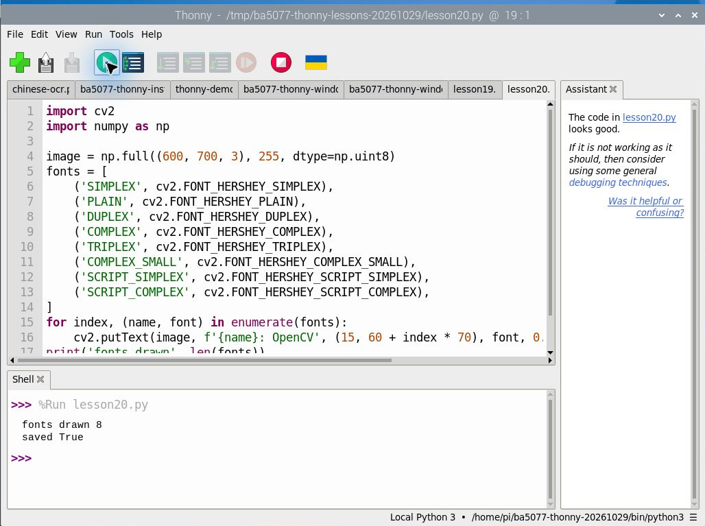
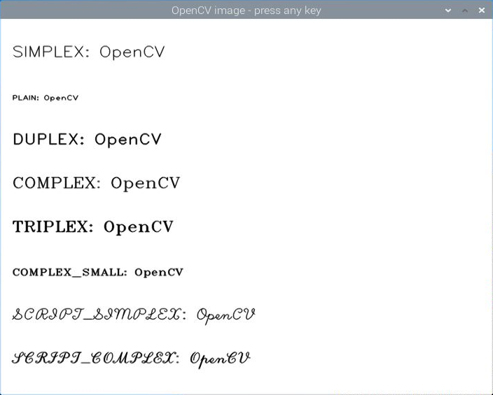

# 第 20 課｜使用 OpenCV 測試不同字體樣式

[原始文章](https://liusming.pixnet.net/blog/posts/14222886399) · 更新日期：2026-10-29

> 本課基本繪圖程式已在 Thonny 重新執行；結果視窗的原完整流程仍待 Thonny 重測。[逐篇進度](./Thonny逐篇實測狀態.md) · [圖片與程式下載方式](./練習素材/素材下載與使用.md)

## 學習目標

使用 OpenCV 的八種 Hershey 字型在合成畫布上寫出英文字體。

## 事前準備

依[Thonny 環境指南](./Thonny環境與套件安裝.md)準備 OpenCV 與 NumPy，確認 Thonny 選擇安裝了這些套件的環境；程式會寫入 `lesson20-fonts.png`。

請在自己的練習目錄操作。已存在的同名輸出檔可能被覆寫，先確認路徑；用不著將任何相機照片上傳公開儲存庫。

## 程式與執行

將下列程式存為 `第20課.py`。這是本次在 RP5 上執行的程式；完整檔案也在[範例程式](./範例程式/第20課.py)。

```python
import cv2
import numpy as np

image = np.full((600, 700, 3), 255, dtype=np.uint8)
fonts = [
    ('SIMPLEX', cv2.FONT_HERSHEY_SIMPLEX),
    ('PLAIN', cv2.FONT_HERSHEY_PLAIN),
    ('DUPLEX', cv2.FONT_HERSHEY_DUPLEX),
    ('COMPLEX', cv2.FONT_HERSHEY_COMPLEX),
    ('TRIPLEX', cv2.FONT_HERSHEY_TRIPLEX),
    ('COMPLEX_SMALL', cv2.FONT_HERSHEY_COMPLEX_SMALL),
    ('SCRIPT_SIMPLEX', cv2.FONT_HERSHEY_SCRIPT_SIMPLEX),
    ('SCRIPT_COMPLEX', cv2.FONT_HERSHEY_SCRIPT_COMPLEX),
]
for index, (name, font) in enumerate(fonts):
    cv2.putText(image, f'{name}: OpenCV', (15, 60 + index * 70), font, 0.8, (0, 0, 0), 1, cv2.LINE_AA)
print('fonts drawn', len(fonts))
print('saved', cv2.imwrite('lesson20-fonts.png', image))
```

在 Thonny 選擇 **File → Open** 開啟 `第20課.py`，確認右下角為準備好的環境，再點綠色執行按鈕。程式會在工作目錄寫入圖片；先確認不會覆寫自己的檔案。

## Thonny 實測輸出

```text
fonts drawn 8
saved True
```

八行英文採不同字型；所有文字使用同一組縮放與線寬，但字型本身尺寸仍可能不同。Hershey 字型不應假設可直接顯示繁體中文；中文可另外選用支援中文字型的繪圖工具。



本次 Thonny 使用 OpenCV 4.10.0 在 RP5 產生的圖檔：


## 背景與核心概念

### 程式產生的文字如何放進圖片？

影像上的字是被繪製到像素裡，不再是一般可編輯的文件文字。字體、大小、基準點、顏色及背景對比影響可讀性；OpenCV 內建字體的字元支援範圍需自行確認。

### 思考、練習與後續應用

比較不同字體大小和背景對比；說明圖片上的文字與可供搜尋複製的文字資料有何不同。

視覺標註可呈現類別與信心分數；介面設計仍要考慮遮擋、可讀性與語言支援。

進一步閱讀：[相關官方文件](https://docs.opencv.org/4.x/d6/d00/tutorial_py_root.html)。下方的程式與輸出以標明的本機實測範圍為準；沒有測過的部分不代表已完成。

## 逐步理解字體範例

`fonts` 將每個顯示名稱與 OpenCV 字型常數配對；`enumerate` 同時提供序號與內容，程式用 `60 + index * 70` 為每行設定不同的 y 座標。`putText` 的座標是文字基準線位置，縮放、線寬和抗鋸齒參數會影響外觀。

此例使用 OpenCV 內建 Hershey 字體展示英文，並不代表已支援繁體中文字形。圖片中的文字是像素；與可編輯、可搜尋的文件文字不同。

### 練習

挑選兩種字體，比較相同縮放參數下的實際大小；將線寬由 1 改為 2，觀察可讀性與遮擋。若要繪製中文，請另外選用支援字型的工具並先測試，本次未驗證中文繪製。

## 先前測試：RP5 圖形桌面顯示結果

先前以終端機和系統 OpenCV 開啟同一類結果圖，保留視窗截圖作為歷史紀錄；**這張圖不是 Thonny 執行截圖**。使用 Thonny 開啟本課圖片的完整操作仍待重測。可先在[第 14 課](./Thonny環境與套件安裝.md)練習經 Thonny 開啟基本 OpenCV 視窗。



## 與原文章的差異

- 新增在 Thonny 所選獨立環境執行繪圖並保存結果的截圖和輸出。

- 本版先儲存圖片以便無桌面驗證，後續也補測圖形視窗；繁體中文字顯示未驗證。
- 上述文字輸出是本次實機紀錄，其他版本或環境可能不同。
- 新增實際 OpenCV 圖形視窗的操作截圖；先前結果圖仍是程式存檔。
- 新增初學者背景、概念、思考練習及後續應用，實測範圍仍以本文標示為準。
- 依原文擴充為八種 Hershey 字型，更新程式及本機實際產生的圖片與輸出。
