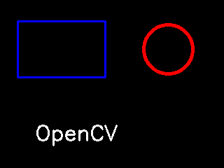

# 第 21 課｜使用 OpenCV 繪製基本圖形與文字

[原始文章](https://liusming.pixnet.net/blog/posts/14222886387) · 更新日期：2026-10-29

## 學習目標

結合矩形、圓形與文字，完成一張 OpenCV 合成圖。

## 事前準備

系統 OpenCV 與 NumPy 已可匯入；程式會寫入 `lesson21-drawing.png`。

請在自己的練習目錄操作。已存在的同名輸出檔可能被覆寫，先確認路徑；用不著將任何相機照片上傳公開儲存庫。

## 程式與執行

將下列程式存為 `第21課.py`。這是本次在 RP5 上執行的程式；完整檔案也在[範例程式](./範例程式/第21課.py)。

```python
import cv2
import numpy as np

image = np.zeros((240, 320, 3), dtype=np.uint8)
cv2.rectangle(image, (25, 30), (150, 110), (255, 0, 0), 2)
cv2.circle(image, (240, 70), 35, (0, 0, 255), 3)
cv2.putText(image, "OpenCV", (50, 200), cv2.FONT_HERSHEY_SIMPLEX, 1, (255, 255, 255), 2)
print("saved", cv2.imwrite("lesson21-drawing.png", image))
```

在該檔案所在的目錄執行 `python3 第21課.py`。

## 本機實際輸出

```text
saved True
```

檢查生成的圖片是否包含圖形和文字；圖片可自行以圖形檢視器開啟。這是程式產生的結果，不是安裝畫面截圖。

本次 RP5 程式實際產生的圖檔：



## 背景與核心概念

### 如何把圖形與文字組合成可讀的結果？

畫圖、畫框與寫文字都是修改影像像素的操作；繪製先後順序會影響遮蓋。座標、顏色、線寬及文字位置共同決定學生是否能看懂結果。

### 思考、練習與後續應用

先畫圖再畫字，與先畫字再畫圖可能有何不同？將文字放在背景較深與較淺處，觀察對比。

結果可用於物件追蹤與模型輸出展示，但應同時提供數值和文字，避免只依顏色傳遞資訊。

進一步閱讀：[相關官方文件](https://docs.opencv.org/4.x/d6/d00/tutorial_py_root.html)。下方的程式與輸出以標明的本機實測範圍為準；沒有測過的部分不代表已完成。

## 與原文章的差異

- 原文以圖形視窗顯示；本版改為可在 SSH 下保存的圖檔，並附上這台 RP5 實際產生的結果。
- 上述文字輸出是本次實機紀錄，其他版本或環境可能不同。
- 尚未補拍操作畫面；圖檔（若有）是程式產生的結果，不冒充螢幕截圖。
- 新增初學者背景、概念、思考練習及後續應用，實測範圍仍以本文標示為準。
