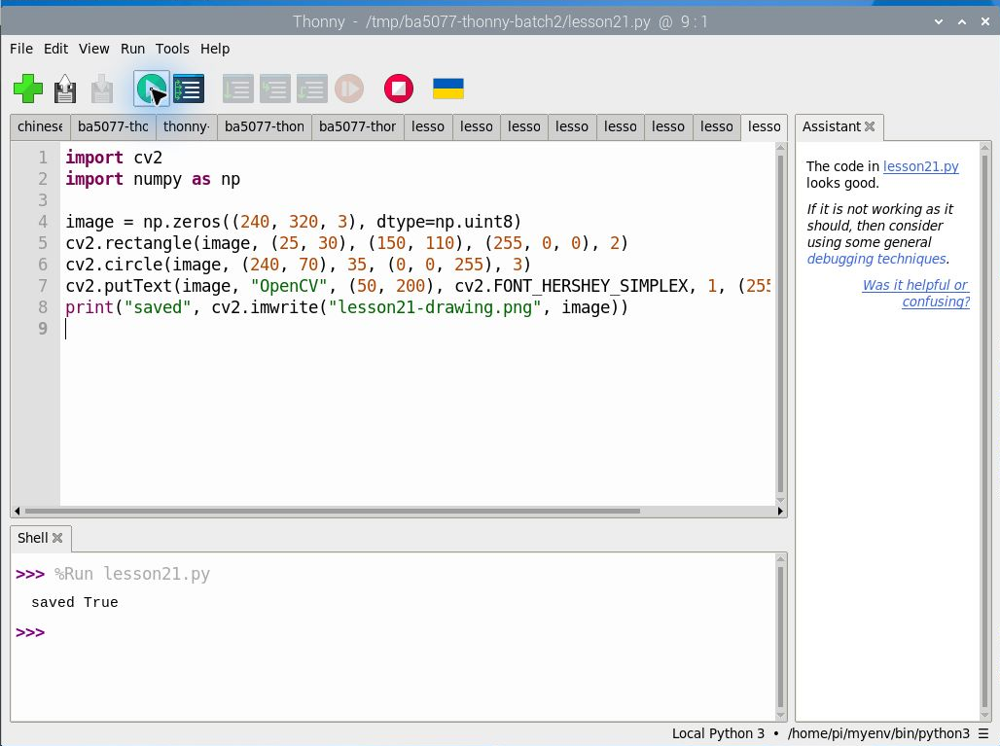
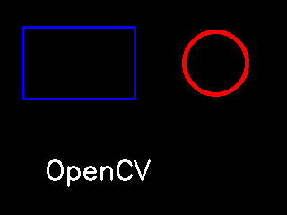
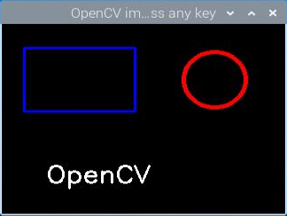
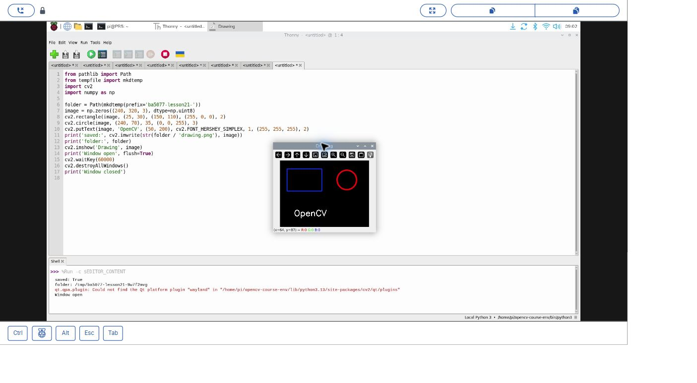
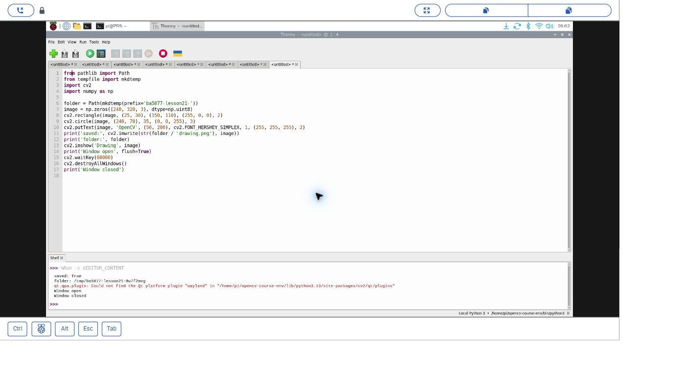

# 第 21 課｜使用 OpenCV 繪製基本圖形與文字

[原始文章](https://liusming.pixnet.net/blog/posts/14222886387) · 更新日期：2026-10-29

> 本課已在 Thonny 實測：合成畫布上繪製圖形及文字，並存檔。完整原文情境及其他舊案例仍須依下文標示重測。[逐篇進度](./Thonny逐篇實測狀態.md) · [圖片與程式下載方式](./練習素材/素材下載與使用.md)

## 學習目標

結合矩形、圓形與文字，完成一張 OpenCV 合成圖。

## 事前準備

系統 OpenCV 與 NumPy 已可匯入；程式會寫入 `lesson21-drawing.png`。

請在自己的練習目錄操作。已存在的同名輸出檔可能被覆寫，先確認路徑；用不著將任何相機照片上傳公開儲存庫。

## 程式與執行

將下列程式存為 `第21課.py`。這是本次在 RP5 上執行的程式；完整檔案也在[範例程式](./範例程式/第21課.py)。

```python
import cv2
import numpy as np

image = np.zeros((240, 320, 3), dtype=np.uint8)
cv2.rectangle(image, (25, 30), (150, 110), (255, 0, 0), 2)
cv2.circle(image, (240, 70), 35, (0, 0, 255), 3)
cv2.putText(image, "OpenCV", (50, 200), cv2.FONT_HERSHEY_SIMPLEX, 1, (255, 255, 255), 2)
print("saved", cv2.imwrite("lesson21-drawing.png", image))
```

在 Thonny 選 **File → Open** 開啟 `第21課.py`，確認右下角是包含所需套件的 Python 環境，再點綠色執行鈕。若程式會輸出檔案，先在新的練習目錄操作，避免覆寫。

## Thonny 實測輸出

```text
saved True
```



本次選用既有環境 `/home/pi/myenv/bin/python3`。基本繪圖與存檔已在 Thonny 重測；該舊環境的圖形視窗當時待 Thonny 重測；現有 Trixie 的新測試見下方。 相機或影像相關套件的準備及可重現環境請參考[Thonny 環境指南](./Thonny環境與套件安裝.md)。

檢查生成的圖片是否包含圖形和文字；圖片可自行以圖形檢視器開啟。這是程式產生的結果，不是安裝畫面截圖。

本次 RP5 程式實際產生的圖檔：



## 背景與核心概念

### 如何把圖形與文字組合成可讀的結果？

畫圖、畫框與寫文字都是修改影像像素的操作；繪製先後順序會影響遮蓋。座標、顏色、線寬及文字位置共同決定學生是否能看懂結果。

### 思考、練習與後續應用

先畫圖再畫字，與先畫字再畫圖可能有何不同？將文字放在背景較深與較淺處，觀察對比。

結果可用於物件追蹤與模型輸出展示，但應同時提供數值和文字，避免只依顏色傳遞資訊。

進一步閱讀：[相關官方文件](https://docs.opencv.org/4.x/d6/d00/tutorial_py_root.html)。下方的程式與輸出以標明的本機實測範圍為準；沒有測過的部分不代表已完成。

## 舊實驗紀錄（終端機；待 Thonny 重測）：顯示圖形與文字

完成本課程式後，將[圖形視窗程式](./範例程式/OpenCV-圖形視窗.py)和 `lesson21-drawing.png` 放在同一目錄，在 RP5 圖形桌面執行：

```bash
python3 OpenCV-圖形視窗.py lesson21-drawing.png
```

```python
import sys
import cv2

if len(sys.argv) != 2:
    raise SystemExit('用法：python3 OpenCV-圖形視窗.py 圖片檔名')
image = cv2.imread(sys.argv[1], cv2.IMREAD_UNCHANGED)
if image is None:
    raise SystemExit('無法讀取圖片，請檢查路徑')
print('image shape:', image.shape, flush=True)
cv2.imshow('OpenCV image - press any key', image)
print('window opened; press any key or wait 60 seconds', flush=True)
cv2.waitKey(60000)
cv2.destroyAllWindows()
print('window closed', flush=True)
```

本次實測輸出節錄：

```text
image shape: (240, 320, 3)
window opened; press any key or wait 60 seconds
window closed
```



這是 RP5 圖形桌面的實際視窗截圖，經裁切保留視窗。需要有圖形顯示與支援 GUI 的 OpenCV；純 SSH 或 headless 安裝環境不一定能顯示。

## 2026-11-10：既有 Trixie 的 Thonny 圖形與文字視窗

本次在既有 Trixie 的 Thonny 使用 `/home/pi/opencv-course-env/bin/python3`（Python 3.13.5、OpenCV 4.12.0），執行[完整範例](./範例程式/第21課-圖形文字與視窗-trixie.py)。這不是全新系統實測。程式每次建立新的暫存資料夾，以免覆寫同名檔案；若要保留作品，請從 Shell 顯示的資料夾複製，因 `/tmp` 可能被系統清理。

在 Thonny 選擇包含 OpenCV 與 NumPy 的解譯器，輸入或開啟程式後按 F5。確認視窗有藍色矩形、紅色圓和白色 `OpenCV` 文字；點選視窗並按任意鍵關閉，或等候 60 秒。

```python
from pathlib import Path
from tempfile import mkdtemp
import cv2
import numpy as np

folder = Path(mkdtemp(prefix='ba5077-lesson21-'))
image = np.zeros((240, 320, 3), dtype=np.uint8)
cv2.rectangle(image, (25, 30), (150, 110), (255, 0, 0), 2)
cv2.circle(image, (240, 70), 35, (0, 0, 255), 3)
cv2.putText(image, 'OpenCV', (50, 200), cv2.FONT_HERSHEY_SIMPLEX, 1, (255, 255, 255), 2)
print('saved:', cv2.imwrite(str(folder / 'drawing.png'), image))
print('folder:', folder)
cv2.imshow('Drawing', image)
print('Window open', flush=True)
cv2.waitKey(60000)
cv2.destroyAllWindows()
print('Window closed')
```

本次 Shell 輸出節錄如下，暫存目錄名稱每次不同：

```text
saved: True
folder: /tmp/ba5077-lesson21-9w7f2mvg
Window open
Window closed
```

Shell 另顯示 Qt 找不到 `wayland` 平台外掛的訊息；本次視窗仍正常出現並可關閉。另用檔案工具確認 PNG 為 320×240 像素。若 `saved` 為 `False` 或視窗沒有出現，分別檢查寫入路徑、圖形桌面、所選 OpenCV 環境及完整錯誤。



*圖：RP5 Thonny 與實際 OpenCV 視窗；視窗經拖曳移位以免遮住程式。圖形與文字為程式生成。*



*圖：按鍵關閉後的實際輸出。*

## 與原文章的差異

- 新增以 Thonny 操作的實測與截圖：合成畫布上繪製圖形及文字，並存檔。

- 原文以圖形視窗顯示；本版先前保存終端機視窗紀錄，另在既有 Trixie 以 Thonny 補測存檔及視窗並附截圖。
- 上述文字輸出是本次實機紀錄，其他版本或環境可能不同。
- 新增 RP5 圖形視窗操作截圖，並區分原有程式結果圖。
- 新增初學者背景、概念、思考練習及後續應用，實測範圍仍以本文標示為準。
