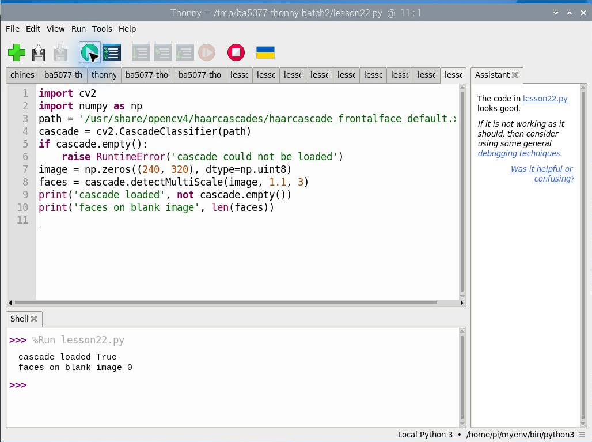
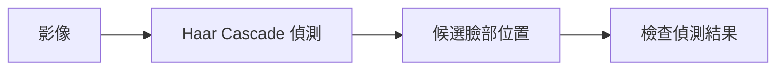
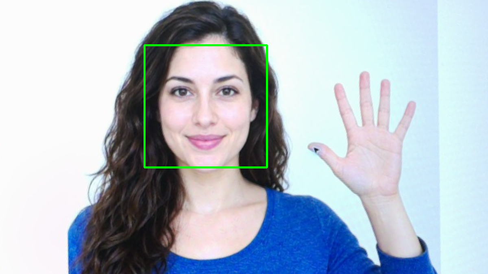
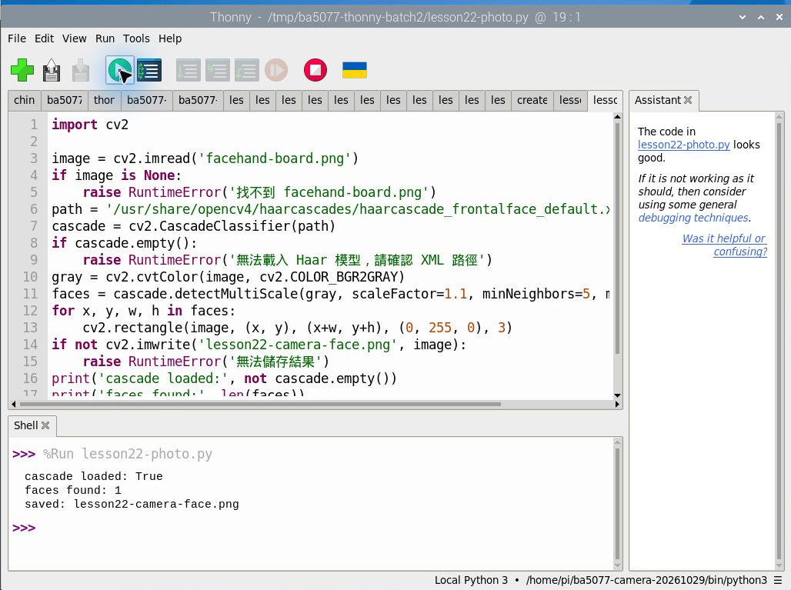
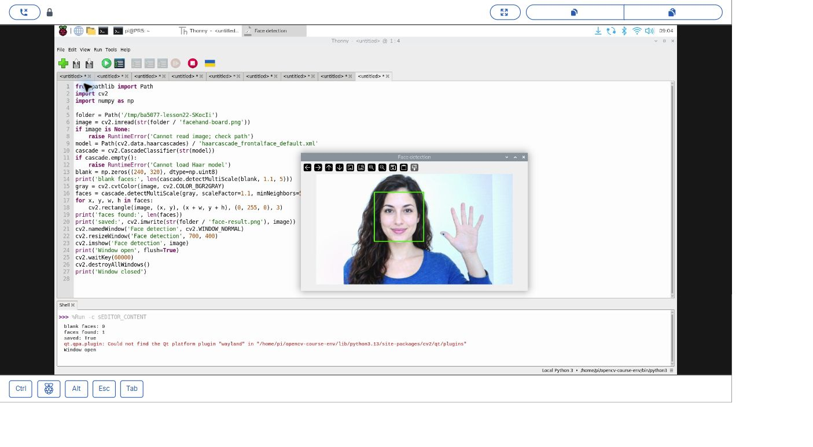
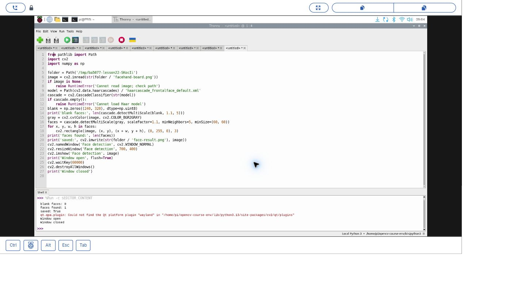

# 第 22 課｜使用 OpenCV 進行臉部檢測

[原始文章](https://liusming.pixnet.net/blog/posts/14222886426) · 更新日期：2026-10-29

人臉偵測先回答「臉可能在哪裡」。我們先比較沒有臉的圖片和練習素材，看看方框出現的位置是否合理。

第一次準備環境的同學，可以先讀[課前學習說明](./學習前先讀我.md)；操作遇到紅字時，我們用[排錯故事](./程式卡住時怎麼辦.md)一起找原因。

如果你使用 Trixie，我們先從[這一套系統的練習](#2026-11-10既有-trixie-的-thonny-haar-偵測)開始；前後的舊版例子可留到比較時閱讀。

## 學習目標

載入 Haar Cascade 並檢查能否對圖像執行臉部偵測。

## 事前準備

需要 OpenCV 及本機 Haar XML，程式以全黑圖像測試。


## 程式與執行

將下列程式存為 `第22課.py`，或使用[已測試的範例程式](./範例程式/第22課.py)。

```python
import cv2
import numpy as np
path = '/usr/share/opencv4/haarcascades/haarcascade_frontalface_default.xml'
cascade = cv2.CascadeClassifier(path)
if cascade.empty():
    raise RuntimeError('cascade could not be loaded')
image = np.zeros((240, 320), dtype=np.uint8)
faces = cascade.detectMultiScale(image, 1.1, 3)
print('cascade loaded', not cascade.empty())
print('faces on blank image', len(faces))
```

在 Thonny 選 **File → Open** 開啟 `第22課.py`，確認右下角是包含所需套件的 Python 環境，再點綠色執行鈕。若程式會輸出檔案，先在新的練習目錄操作，避免覆寫。

## Thonny 實測輸出

```text
cascade loaded True
faces on blank image 0
```



本次選用既有環境 `/home/pi/myenv/bin/python3`。空白圖結果為零，不能證明真人偵測品質；下方另以 Thonny 重測相機拍攝的生成圖片。 相機或影像相關套件的準備及可重現環境請參考[Thonny 環境指南](./Thonny環境與套件安裝.md)。

沒有臉的黑圖輸出 0 個臉部是測試預期；這不能證明真人偵測率。XML 路徑若不存在，須找出相容的模型檔。

## 背景與核心概念

### 臉部偵測和臉部辨識有何不同？

臉部偵測回答影像中可能有沒有臉、在哪裡；辨識則試圖判斷是哪個人。Haar Cascade 使用訓練好的特徵與級聯分類器，輸出會受到角度、光線和遮擋影響。

### 思考、練習與後續應用

解釋空白圖得到零張臉代表什麼、不能代表什麼；為何偵測到臉不等於知道身分？

應用可能涉及敏感生物特徵資料；任何真實資料使用都需確認授權、保存方式與公平性。

延伸閱讀：[官方文件](https://docs.opencv.org/4.x/db/d28/tutorial_cascade_classifier.html)。

## 概念流程圖




## Thonny 進階實測：相機拍攝 AI 生成的人臉與手部素材

### 準備與操作

本次素材是 AI 生成的虛構人物，先顯示在螢幕上，RP5 相機再拍攝；拍攝後另以程式裁切及透視校正。這不是實拍真人，也不是安裝操作截圖。完整拍攝與校正方法見[相機實拍與校正流程](./練習素材/相機實拍與校正流程.md)。

需要已選用可讀取 OpenCV 的 Thonny 環境，以及可讀取的 Haar 模型 XML。 可將[本次校正影像](./圖檔/facehand-board.png)下載為 `facehand-board.png`，與[範例程式](./範例程式/第22課-相機人臉偵測.py)放在 RP5 的同一練習目錄，先確認輸出檔不會覆蓋現有資料。

```python
import cv2

image = cv2.imread('facehand-board.png')
if image is None:
    raise RuntimeError('找不到 facehand-board.png')
path = '/usr/share/opencv4/haarcascades/haarcascade_frontalface_default.xml'
cascade = cv2.CascadeClassifier(path)
if cascade.empty():
    raise RuntimeError('無法載入 Haar 模型，請確認 XML 路徑')
gray = cv2.cvtColor(image, cv2.COLOR_BGR2GRAY)
faces = cascade.detectMultiScale(gray, scaleFactor=1.1, minNeighbors=5, minSize=(60, 60))
for x, y, w, h in faces:
    cv2.rectangle(image, (x, y), (x+w, y+h), (0, 255, 0), 3)
if not cv2.imwrite('lesson22-camera-face.png', image):
    raise RuntimeError('無法儲存結果')
print('cascade loaded:', not cascade.empty())
print('faces found:', len(faces))
print('saved: lesson22-camera-face.png')
```

在 Thonny 開啟 `第22課-相機人臉偵測.py`，確認素材放在同一練習目錄，按綠色執行按鈕。

### 本次 RP5 實際輸出與結果

```text
cascade loaded: True
faces found: 1
saved: lesson22-camera-face.png
```



綠框由 Haar Cascade 程式畫出。這次找到一個候選人臉，只能說明這張素材的結果，不能證明真人或其他角度的表現。 原始相機全景含螢幕外環境，沒有公開。

### 讀懂原理與結果

本程式使用本機現有的 Haar XML 路徑；不同系統應找出模型路徑。Haar 使用灰階像素及尺度與鄰近候選框參數；調整 `scaleFactor`、`minNeighbors` 和最小尺寸可能改變輸出。臉部偵測回答位置，並不回答身分。

學生練習：先預測把測試圖縮小或轉動後可能發生什麼，再自行測試並記錄結果。如果找不到圖或模型，確認目前目錄、路徑及 Python 環境；如果找到零個目標，還應檢查畫面是否清楚。實際拍攝他人時須先取得適當授權，避免將私人照片上傳。



本次在新相機環境再次讀取既有的生成素材照片，偵測到一個人臉；這並非真人測試或即時攝影機測試。

## 2026-11-10：既有 Trixie 的 Thonny Haar 偵測

本次以既有 Trixie 的 Thonny 選用 `/home/pi/opencv-course-env/bin/python3`（Python 3.13.5、OpenCV 4.12.0），使用先前[相機拍攝並校正的 AI 生成素材](./圖檔/facehand-board.png)。素材是虛構人物，並非真人測試；原始全景未公開。這不是全新系統測試。

1. 將素材下載為 `facehand-board.png`，放入自己的空練習資料夾；[本次範例](./範例程式/第22課-生成素材人臉偵測-trixie.py)現在會從程式所在資料夾讀圖，請把程式與圖片放在一起。輸出的 `face-result.png` 若已存在會被覆寫，先確認位置。
2. 在 Thonny 選擇含 OpenCV 和 NumPy 的解譯器，輸入或開啟以下程式並按 F5。這次用 `cv2.data.haarcascades` 找到所選 OpenCV 所附 XML；不同安裝若沒有此目錄或模型，需使用可取得的相容 XML 並檢查 `cascade.empty()`。
3. 確認黑圖及生成素材的候選數量，查看綠框；點選視窗按任意鍵關閉，未按鍵則等候 60 秒。

```python
from pathlib import Path
import cv2
import numpy as np

folder = Path(__file__).resolve().parent
image = cv2.imread(str(folder / 'facehand-board.png'))
if image is None:
    raise RuntimeError('Cannot read image; check path')
model = Path(cv2.data.haarcascades) / 'haarcascade_frontalface_default.xml'
cascade = cv2.CascadeClassifier(str(model))
if cascade.empty():
    raise RuntimeError('Cannot load Haar model')
blank = np.zeros((240, 320), dtype=np.uint8)
print('blank faces:', len(cascade.detectMultiScale(blank, 1.1, 5)))
gray = cv2.cvtColor(image, cv2.COLOR_BGR2GRAY)
faces = cascade.detectMultiScale(gray, scaleFactor=1.1, minNeighbors=5, minSize=(60, 60))
for x, y, w, h in faces:
    cv2.rectangle(image, (x, y), (x + w, y + h), (0, 255, 0), 3)
print('faces found:', len(faces))
print('saved:', cv2.imwrite(str(folder / 'face-result.png'), image))
cv2.namedWindow('Face detection', cv2.WINDOW_NORMAL)
cv2.resizeWindow('Face detection', 700, 400)
cv2.imshow('Face detection', image)
print('Window open', flush=True)
cv2.waitKey(60000)
cv2.destroyAllWindows()
print('Window closed')
```

本次實際輸出節錄：

```text
blank faces: 0
faces found: 1
saved: True
Window open
Window closed
```



*圖：RP5 Thonny 及 OpenCV 實際視窗；原素材是相機拍攝顯示器上的生成圖，綠框是本次偵測輸出。*



*圖：按鍵關閉後的實際輸出。* 另以檔案工具確認輸出 PNG 為 1200×675 像素。Shell 出現 Qt 找不到 `wayland` 平台外掛的訊息，但本次視窗正常顯示並關閉。辨識數量隨素材、參數及版本可能改變；黑圖為零和單張生成臉為一，不能證明真人、不同光線或即時相機的偵測品質。真人與即時情境仍待測。

## 與原文章的差異

- 新增以 Thonny 操作的實測與截圖：載入 Haar 偵測器並檢查空白圖。

- 原文使用外部圖片與相對路徑的 XML；本版使用本機已驗證的絕對路徑與合成圖。
- 以上是本機實際合成資料輸出；不同版本可能產生不同數值。
- 已保留先前及既有 Trixie 的 Thonny 操作截圖；真人即時畫面尚未實測。
- 新增初學者背景、概念、思考練習及後續應用，實測範圍仍以本文標示為準。
- 加入教學流程示意；圖中的完整目標流程不代表已逐步實測。
- 本輪新增相機拍攝 AI 生成臉部素材後的 Haar 偵測；原文的真人相機即時視窗尚未完整測試。

<details>
<summary>給教師：原有實測範圍與版本備註</summary>

> 本課已在 Thonny 實測：載入 Haar 偵測器並檢查空白圖。完整原文情境及其他舊案例仍須依下文標示重測。[逐篇進度](./Thonny逐篇實測狀態.md) · [圖片與程式下載方式](./練習素材/素材下載與使用.md)

</details>

## 給教師：本次路徑修正

2026-11-11 將下載範例的圖片位置由老師當時的 `/tmp` 資料夾改為程式所在資料夾。學生將圖片與程式放在一起即可找到輸入；原始實測輸出及截圖保留。這項路徑調整尚未在 RP5 重新執行。
