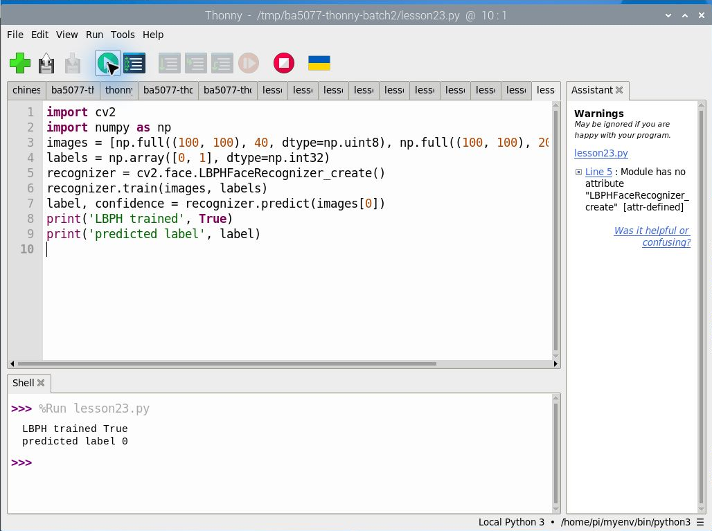
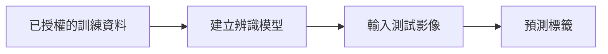

# 第 23 課｜使用 Picamera2 和 OpenCV 進行臉部識別

[原始文章](https://liusming.pixnet.net/blog/posts/14222876475) · 更新日期：2026-10-29

> 本課已在 Thonny 實測：使用合成灰階矩陣訓練及預測 LBPH。完整原文情境及其他舊案例仍須依下文標示重測。[逐篇進度](./Thonny逐篇實測狀態.md) · [圖片與程式下載方式](./練習素材/素材下載與使用.md)

## 學習目標

了解 LBPH 臉部辨識器的訓練與預測流程。

## 事前準備

需要支援 `cv2.face` 的 OpenCV；本例使用兩張均勻合成圖。

本教學程式使用合成資料，沒有把私人相機影像上傳公開 repo；請在自己的練習目錄操作。

## 程式與執行

將下列程式存為 `第23課.py`，或使用[已測試的範例程式](./範例程式/第23課.py)。

```python
import cv2
import numpy as np
images = [np.full((100, 100), 40, dtype=np.uint8), np.full((100, 100), 200, dtype=np.uint8)]
labels = np.array([0, 1], dtype=np.int32)
recognizer = cv2.face.LBPHFaceRecognizer_create()
recognizer.train(images, labels)
label, confidence = recognizer.predict(images[0])
print('LBPH trained', True)
print('predicted label', label)
```

在 Thonny 選 **File → Open** 開啟 `第23課.py`，確認右下角是包含所需套件的 Python 環境，再點綠色執行鈕。若程式會輸出檔案，先在新的練習目錄操作，避免覆寫。

## Thonny 實測輸出

```text
LBPH trained True
predicted label 0
```



本次選用既有環境 `/home/pi/myenv/bin/python3`。這是合成矩陣的流程測試，並非真人或即時臉部辨識。Thonny 助理對 OpenCV 動態介面可能顯示靜態分析警告；實際 Shell 仍成功執行。 相機或影像相關套件的準備及可重現環境請參考[Thonny 環境指南](./Thonny環境與套件安裝.md)。

此測試只驗證 API 可以訓練並辨識訓練資料，不是真人臉部辨識，也沒有評估準確率或隱私資料。

## 背景與核心概念

### 人臉辨識的輸入、標籤與限制

LBPH 利用局部紋理特徵建立模型，再以已知標籤進行預測。訓練資料與測試資料若相同，只能檢查程式流程，不能估計對陌生照片的辨識準確度。

### 思考、練習與後續應用

區分訓練影像與未見過的測試影像；為何合成均勻圖片的測試不能說明真人人臉辨識效果？

身分判斷可能影響個人權益；真實資料需取得授權，並評估誤判、偏差與資料保護。

進一步閱讀：[相關官方文件](https://docs.opencv.org/4.x/da/d60/tutorial_face_main.html)。下方的程式與輸出以標明的本機實測範圍為準；沒有測過的部分不代表已完成。

## 概念流程圖



此圖用於說明文章的概念或完整目標流程，**不是操作截圖，也不代表每個步驟都已實測**；本機實測範圍請看文章中的標示。

## 與原文章的差異

- 新增以 Thonny 操作的實測與截圖：使用合成灰階矩陣訓練及預測 LBPH。

- 原文使用人臉資料集與相機；本版先以合成資料驗證流程，不把合成結果當成真人辨識成果。
- 以上是本機實際合成資料輸出；不同版本可能產生不同數值。
- 尚未保存操作畫面截圖。
- 新增初學者背景、概念、思考練習及後續應用，實測範圍仍以本文標示為準。
- 加入教學流程示意；圖中的完整目標流程不代表已逐步實測。
