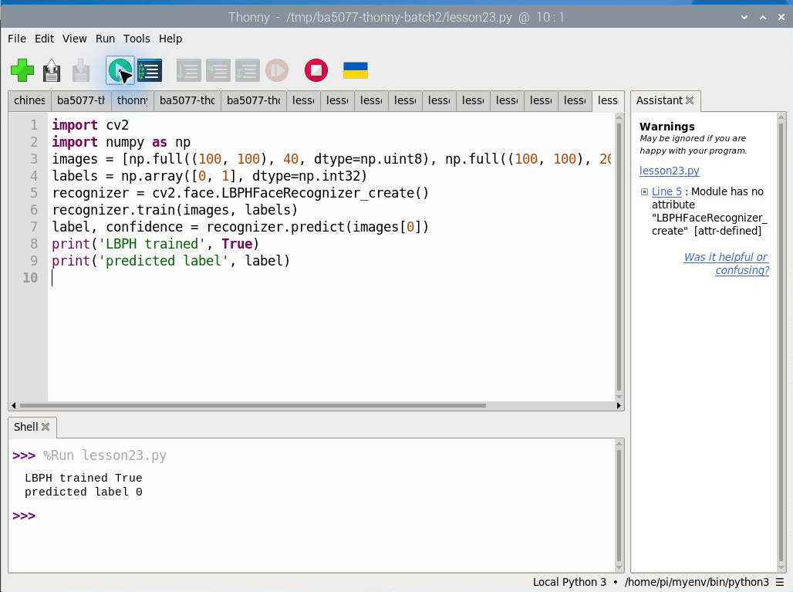
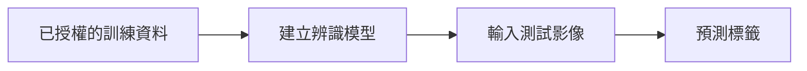
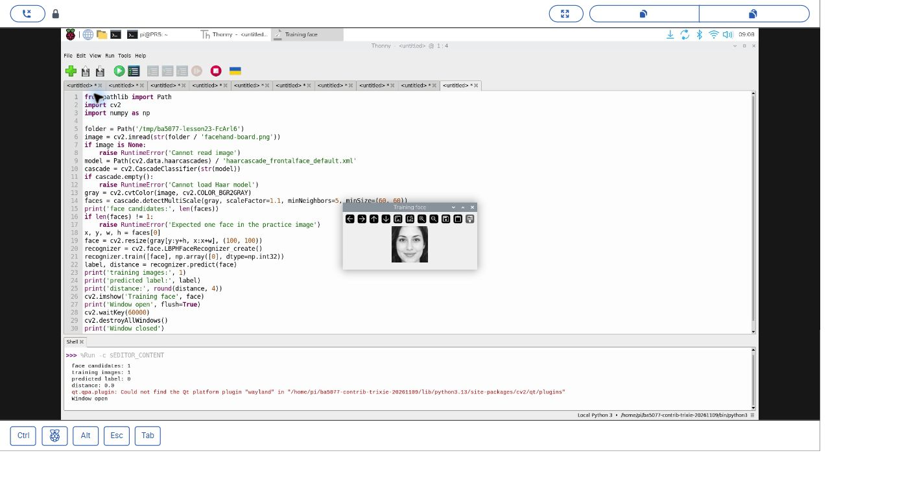
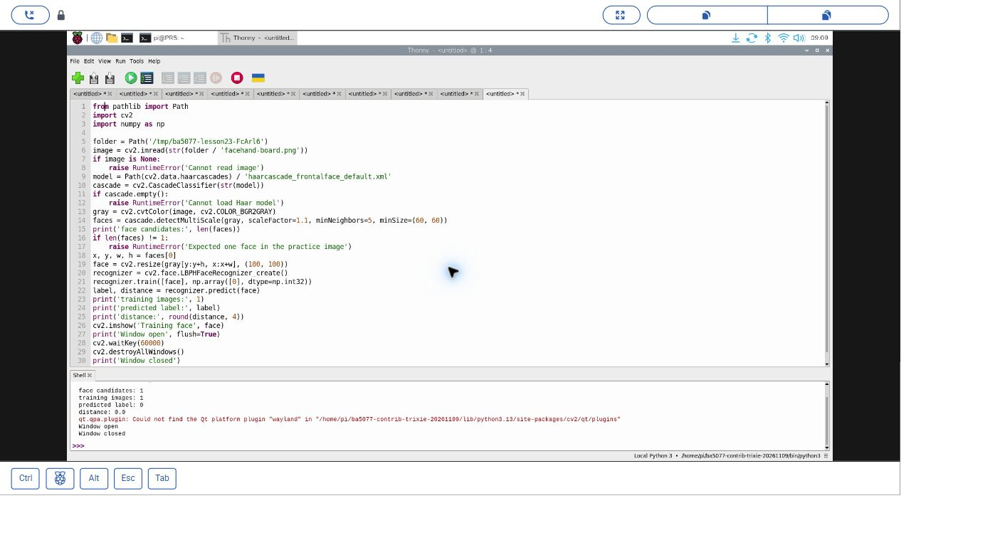

# 第 23 課｜使用 Picamera2 和 OpenCV 進行臉部識別

[原始文章](https://liusming.pixnet.net/blog/posts/14222876475) · 更新日期：2026-10-29

找到臉的位置後，還能不能分出不同人？我們先用練習圖理解訓練與預測，再討論為什麼換一張照片才是真正的考驗。

第一次準備環境的同學，可以先讀[課前學習說明](./學習前先讀我.md)；操作遇到紅字時，我們用[排錯故事](./程式卡住時怎麼辦.md)一起找原因。

如果你使用 Trixie，我們先從[這一套系統的練習](#2026-11-10既有-trixie-的生成素材-lbph-流程)開始；前後的舊版例子可留到比較時閱讀。

## 學習目標

了解 LBPH 臉部辨識器的訓練與預測流程。

## 事前準備

需要支援 `cv2.face` 的 OpenCV；本例使用兩張均勻合成圖。


## 程式與執行

將下列程式存為 `第23課.py`，或使用[已測試的範例程式](./範例程式/第23課.py)。

```python
import cv2
import numpy as np
images = [np.full((100, 100), 40, dtype=np.uint8), np.full((100, 100), 200, dtype=np.uint8)]
labels = np.array([0, 1], dtype=np.int32)
recognizer = cv2.face.LBPHFaceRecognizer_create()
recognizer.train(images, labels)
label, confidence = recognizer.predict(images[0])
print('LBPH trained', True)
print('predicted label', label)
```

在 Thonny 選 **File → Open** 開啟 `第23課.py`，確認右下角是包含所需套件的 Python 環境，再點綠色執行鈕。若程式會輸出檔案，先在新的練習目錄操作，避免覆寫。

## Thonny 實測輸出

```text
LBPH trained True
predicted label 0
```



本次選用既有環境 `/home/pi/myenv/bin/python3`。這是合成矩陣的流程測試，並非真人或即時臉部辨識。Thonny 助理對 OpenCV 動態介面可能顯示靜態分析警告；實際 Shell 仍成功執行。 相機或影像相關套件的準備及可重現環境請參考[Thonny 環境指南](./Thonny環境與套件安裝.md)。

此測試只驗證 API 可以訓練並辨識訓練資料，不是真人臉部辨識，也沒有評估準確率或隱私資料。

## 背景與核心概念

### 人臉辨識的輸入、標籤與限制

LBPH 利用局部紋理特徵建立模型，再以已知標籤進行預測。訓練資料與測試資料若相同，只能檢查程式流程，不能估計對陌生照片的辨識準確度。

### 思考、練習與後續應用

區分訓練影像與未見過的測試影像；為何合成均勻圖片的測試不能說明真人人臉辨識效果？

身分判斷可能影響個人權益；真實資料需取得授權，並評估誤判、偏差與資料保護。

延伸閱讀：[官方文件](https://docs.opencv.org/4.x/da/d60/tutorial_face_main.html)。

## 概念流程圖




## 2026-11-10：既有 Trixie 的生成素材 LBPH 流程

本次使用現有 Trixie、Thonny 選用 `/home/pi/ba5077-contrib-trixie-20261109/bin/python3`、Python 3.13.5 和 OpenCV 4.12.0。此獨立環境支援 `cv2.face`（安裝的是 `opencv-contrib-python`，建立方式見 [Thonny 環境指南：第 25～27 課擴充環境](./Thonny環境與套件安裝.md#第-2527-課在-thonny-建立-opencv-擴充環境)）；第 14 課的一般 OpenCV 環境不應假設具有相同擴充功能。此環境已存在，本次沒有驗證全新系統安裝。

教材素材為[生成的人臉與手部圖片](./圖檔/facehand-board.png)：先將生成圖顯示於螢幕，再由 RP5 相機拍攝、裁切並校正，不是真人影像。下列流程先以 Haar 偵測這張圖的人臉，再用該區域訓練 LBPH，最後以**同一張區域**預測。這只用於驗證程式路徑，不是獨立測試、真人識別或準確率評估；只訓練一個標籤也不能證明能辨別陌生人。

1. 建立自己的空練習資料夾，下載上述素材並命名為 `facehand-board.png`。
2. 在 Thonny 的 **Tools → Options → Interpreter** 選擇支援 `cv2.face` 的獨立環境。開啟[本次範例](./範例程式/第23課-生成素材LBPH-trixie.py)，將程式與圖片放在同一個自己的練習資料夾；目前程式使用它所在的資料夾。此程式會從所選 OpenCV 的 `cv2.data.haarcascades` 找模型，若沒有該資料或模型，應確認安裝並使用可取得的相容 XML。
3. 按 F5，確認只找到一個候選臉及預測結果，視窗顯示訓練用灰階臉部；點視窗並按任意鍵結束，未按鍵則等候 60 秒。

```python
from pathlib import Path
import cv2
import numpy as np

folder = Path(__file__).resolve().parent
image = cv2.imread(str(folder / 'facehand-board.png'))
if image is None:
    raise RuntimeError('Cannot read image')
model = Path(cv2.data.haarcascades) / 'haarcascade_frontalface_default.xml'
cascade = cv2.CascadeClassifier(str(model))
if cascade.empty():
    raise RuntimeError('Cannot load Haar model')
gray = cv2.cvtColor(image, cv2.COLOR_BGR2GRAY)
faces = cascade.detectMultiScale(gray, scaleFactor=1.1, minNeighbors=5, minSize=(60, 60))
print('face candidates:', len(faces))
if len(faces) != 1:
    raise RuntimeError('Expected one face in the practice image')
x, y, w, h = faces[0]
face = cv2.resize(gray[y:y+h, x:x+w], (100, 100))
recognizer = cv2.face.LBPHFaceRecognizer_create()
recognizer.train([face], np.array([0], dtype=np.int32))
label, distance = recognizer.predict(face)
print('training images:', 1)
print('predicted label:', label)
print('distance:', round(distance, 4))
cv2.imshow('Training face', face)
print('Window open', flush=True)
cv2.waitKey(60000)
cv2.destroyAllWindows()
print('Window closed')
```

本次 Shell 實際輸出節錄：

```text
face candidates: 1
training images: 1
predicted label: 0
distance: 0.0
Window open
Window closed
```



*圖：本次 Thonny 實際執行與裁切後的生成素材臉部。*



*圖：按鍵關閉後的實際輸出。* `distance` 是模型的距離值，不是正確率或百分比；本次訓練與預測是同一張圖，結果不能推廣。Shell 出現 Qt 找不到 `wayland` 平台外掛的訊息，本次視窗仍正常顯示並關閉；其他環境需依完整錯誤排查。若候選數不是一，程式會停止而不訓練。真人資料、未見影像、辨識效果、Picamera2 即時流程及全新系統安裝仍待驗證。

## 與原文章的差異

- 新增以 Thonny 操作的實測與截圖：使用合成灰階矩陣訓練及預測 LBPH。

- 原文使用人臉資料集與相機；本版先以合成資料驗證流程，不把合成結果當成真人辨識成果。
- 以上是本機實際合成資料輸出；不同版本可能產生不同數值。
- 已保留舊合成矩陣與現有 Trixie 生成素材的 Thonny 操作截圖；真人和即時相機流程尚未驗證。
- 新增初學者背景、概念、思考練習及後續應用，實測範圍仍以本文標示為準。
- 加入教學流程示意；圖中的完整目標流程不代表已逐步實測。

<details>
<summary>給教師：原有實測範圍與版本備註</summary>

> 本課已在 Thonny 實測：使用合成灰階矩陣訓練及預測 LBPH。完整原文情境及其他舊案例仍須依下文標示重測。[逐篇進度](./Thonny逐篇實測狀態.md) · [圖片與程式下載方式](./練習素材/素材下載與使用.md)

</details>

## 給教師：本次路徑修正

2026-11-11 將下載範例的圖片位置由老師當時的 `/tmp` 資料夾改為程式所在資料夾。學生將圖片與程式放在一起即可找到輸入；原始實測輸出及截圖保留。修正後已在 RP5 既有 Trixie 的 Thonny 重跑並按鍵關閉視窗；新操作截圖未保存，詳見[本輪驗證](./2026-11-11路徑修正驗證紀錄.md)。
