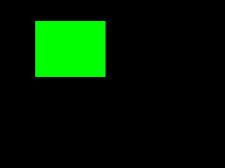

# 第 24 課｜OpenCV 即時影像處理與特定區域（ROI）處理

[原始文章](https://liusming.pixnet.net/blog/posts/14222876481) · 更新日期：2026-10-29

## 學習目標

認識以 NumPy 切片取得影像中指定區域（ROI）。

## 事前準備

需要 NumPy；本例建立 240 × 320 的合成彩色影像。

本教學程式使用合成資料，沒有把私人相機影像上傳公開 repo；請在自己的練習目錄操作。

## 程式與執行

將下列程式存為 `第24課.py`，或使用[已測試的範例程式](./範例程式/第24課.py)。

```python
import numpy as np
import cv2
image = np.zeros((240, 320, 3), dtype=np.uint8)
roi = image[30:110, 50:150]
roi[:] = (0, 255, 0)
if not cv2.imwrite('lesson24-roi.png', image):
    raise RuntimeError('image save failed')
print('image', image.shape)
print('ROI', roi.shape)
```

在該檔案所在目錄執行 `python3 第24課.py`。

## 本機實際輸出

```text
image (240, 320, 3)
ROI (80, 100, 3)
```

陣列索引先列高度範圍，再列寬度範圍；ROI 的高與寬分別為 80 與 100。

## RP5 實際產生的結果圖



綠色區域是程式設定的 ROI。 圖片由本課程式在 RP5 執行時儲存，是程式輸出，不是操作畫面截圖。

## 背景與核心概念

### 為什麼只處理影像中的一部分？

ROI 是感興趣區域，例如相機畫面中輸送帶的位置。NumPy 影像切片依先列後欄的順序；座標使用 y 範圍再使用 x 範圍，範圍上界不包含在切片內。

### 思考、練習與後續應用

若切片高度為 80、寬度為 100，通道數為 3，陣列形狀應如何表示？相機移動後 ROI 可能發生什麼問題？

ROI 可減少處理範圍及背景干擾，但固定 ROI 也可能漏掉移動到範圍外的物件。

進一步閱讀：[相關官方文件](https://docs.opencv.org/4.x/d6/d00/tutorial_py_root.html)。下方的程式與輸出以標明的本機實測範圍為準；沒有測過的部分不代表已完成。

## 與原文章的差異

- 原文使用相機即時畫面；本版先以合成陣列驗證座標與尺寸，未驗證即時視窗。
- 以上是本機實際合成資料輸出；不同版本可能產生不同數值。
- 尚未保存操作畫面截圖。
- 新增初學者背景、概念、思考練習及後續應用，實測範圍仍以本文標示為準。
