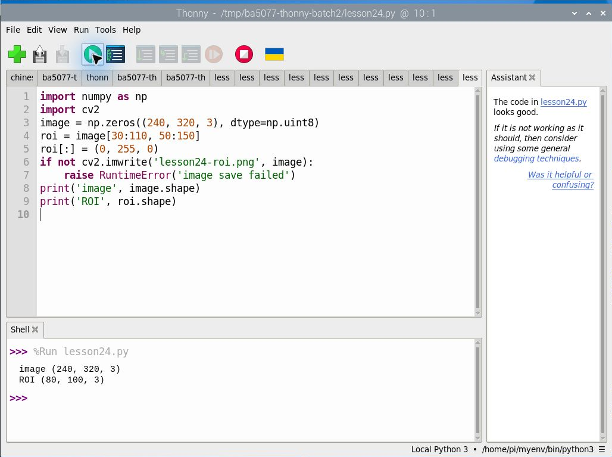
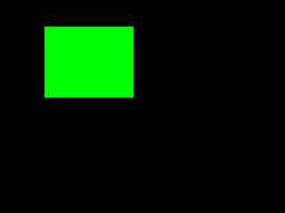
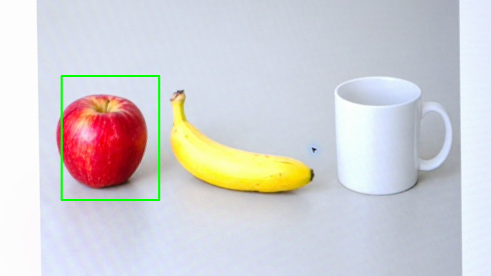
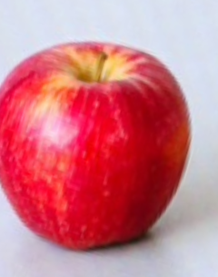
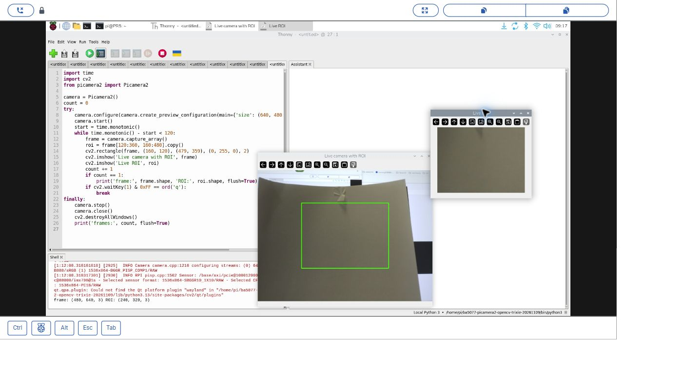
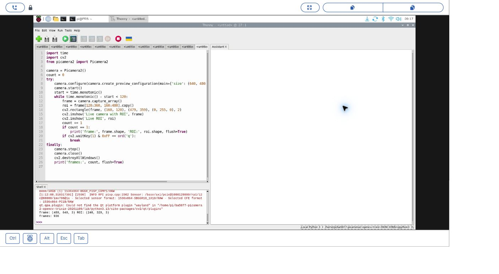

# 第 24 課｜OpenCV 即時影像處理與特定區域（ROI）處理

[原始文章](https://liusming.pixnet.net/blog/posts/14222876481) · 更新日期：2026-10-29

> 本課已在既有 Trixie 的 Thonny 實測即時相機固定 ROI；合成影像與先前照片案例仍保留下文。全新系統安裝驗證尚待完成。[逐篇進度](./Thonny逐篇實測狀態.md) · [圖片與程式下載方式](./練習素材/素材下載與使用.md)

## 學習目標

認識以 NumPy 切片取得影像中指定區域（ROI）。

## 事前準備

需要 NumPy；本例建立 240 × 320 的合成彩色影像。

本教學程式使用合成資料，沒有把私人相機影像上傳公開 repo；請在自己的練習目錄操作。

## 程式與執行

將下列程式存為 `第24課.py`，或使用[已測試的範例程式](./範例程式/第24課.py)。

```python
import numpy as np
import cv2
image = np.zeros((240, 320, 3), dtype=np.uint8)
roi = image[30:110, 50:150]
roi[:] = (0, 255, 0)
if not cv2.imwrite('lesson24-roi.png', image):
    raise RuntimeError('image save failed')
print('image', image.shape)
print('ROI', roi.shape)
```

在 Thonny 選 **File → Open** 開啟 `第24課.py`，確認右下角是包含所需套件的 Python 環境，再點綠色執行鈕。若程式會輸出檔案，先在新的練習目錄操作，避免覆寫。

## Thonny 實測輸出

```text
image (240, 320, 3)
ROI (80, 100, 3)
```



本次選用當時既有環境 `/home/pi/myenv/bin/python3`，這是合成圖 ROI；2026-11-10 的既有 Trixie 相機即時測試與環境另見下文。 相機或影像相關套件的準備及可重現環境請參考[Thonny 環境指南](./Thonny環境與套件安裝.md)。

陣列索引先列高度範圍，再列寬度範圍；ROI 的高與寬分別為 80 與 100。

## RP5 實際產生的結果圖



綠色區域是程式設定的 ROI。 圖片由本課程式在 RP5 執行時儲存，是程式輸出，不是操作畫面截圖。

## 背景與核心概念

### 為什麼只處理影像中的一部分？

ROI 是感興趣區域，例如相機畫面中輸送帶的位置。NumPy 影像切片依先列後欄的順序；座標使用 y 範圍再使用 x 範圍，範圍上界不包含在切片內。

### 思考、練習與後續應用

若切片高度為 80、寬度為 100，通道數為 3，陣列形狀應如何表示？相機移動後 ROI 可能發生什麼問題？

ROI 可減少處理範圍及背景干擾，但固定 ROI 也可能漏掉移動到範圍外的物件。

進一步閱讀：[相關官方文件](https://docs.opencv.org/4.x/d6/d00/tutorial_py_root.html)。下方的程式與輸出以標明的本機實測範圍為準；沒有測過的部分不代表已完成。

## 舊實驗紀錄（終端機；待 Thonny 重測）：裁切相機照片中的 ROI

下載[相機拍攝的生成物件圖](./圖檔/objects-board.png)及[程式](./範例程式/第24課-相機ROI.py)到同一練習目錄，執行 `python3 第24課-相機ROI.py`。圖片是相機拍攝螢幕上的 AI 生成物件，並非真實水果照片。

```python
import cv2

image = cv2.imread('objects-board.png')
if image is None:
    raise RuntimeError('找不到 objects-board.png')
# 固定座標只適用本次 1200 x 675 圖片，換圖時需重新選取。
x1, y1, x2, y2 = 150, 185, 390, 490
roi = image[y1:y2, x1:x2].copy()
if roi.size == 0:
    raise RuntimeError('ROI 為空，請檢查座標')
marked = image.copy()
cv2.rectangle(marked, (x1, y1), (x2-1, y2-1), (0, 255, 0), 3)
if not cv2.imwrite('lesson24-camera-roi.png', roi) or not cv2.imwrite('lesson24-camera-marked.png', marked):
    raise RuntimeError('圖片儲存失敗')
print('image shape:', image.shape)
print('ROI shape:', roi.shape)
print('saved: lesson24-camera-roi.png, lesson24-camera-marked.png')
```

RP5 實際輸出：

```text
image shape: (675, 1200, 3)
ROI shape: (305, 240, 3)
saved: lesson24-camera-roi.png, lesson24-camera-marked.png
```





兩張圖是程式產生結果，不是操作截圖。因切片不包含右側與下方界線，高為 490−185＝305、寬為 390−150＝240。仔細觀察可看到蘋果左邊緣有一小部分落在綠框外，這顯示固定座標可能裁掉目標。`copy()` 讓後續修改 ROI 不會直接改動原圖。相機位置與畫面改變後應重新設定座標；本次未測即時選取或長時間連續處理。

## 既有 Trixie：Thonny 即時相機 ROI（2026-11-10）

**準備**：CSI 相機已接妥且未被其他程式占用，畫面對準白紙等不含個資的物品。RP5 運行既有 Raspberry Pi OS／Debian 13 Trixie，Python 3.13.5、OpenCV 4.12.0、Picamera2 0.3.38。本次使用既有 `/home/pi/ba5077-picamera2-opencv-trixie-20261109/bin/python3`；這是已安裝套件的環境，並非新重灌驗證。不同電腦的路徑可不同，請參考 [Thonny 環境指南](./Thonny環境與套件安裝.md)。

1. 在 Thonny 選 **Run → Configure interpreter**，選擇同時可匯入 `cv2` 和 `picamera2` 的解譯器。若出現 `No module named 'picamera2'`，先檢查所選環境；本次原本選的 contrib 環境就缺少它，切換後成功。
2. 下載並開啟 [即時 ROI 完整程式](./範例程式/第24課-Thonny即時ROI.py)，或在新檔案貼上下列程式，按 F5。兩個視窗分別顯示含綠框的原始即時畫面與裁切結果。
3. 點一下任一影像視窗再按 **q** 結束；程式也會在 120 秒後停止。結束時釋放相機，避免佔用下一次操作。

```python
import time
import cv2
from picamera2 import Picamera2

camera = Picamera2()
count = 0
try:
    camera.configure(camera.create_preview_configuration(main={'size': (640, 480), 'format': 'RGB888'}))
    camera.start()
    start = time.monotonic()
    while time.monotonic() - start < 120:
        frame = camera.capture_array()
        roi = frame[120:360, 160:480].copy()
        cv2.rectangle(frame, (160, 120), (479, 359), (0, 255, 0), 2)
        cv2.imshow('Live camera with ROI', frame)
        cv2.imshow('Live ROI', roi)
        count += 1
        if count == 1:
            print('frame:', frame.shape, 'ROI:', roi.shape, flush=True)
        if cv2.waitKey(1) & 0xFF == ord('q'):
            break
finally:
    camera.stop()
    camera.close()
    cv2.destroyAllWindows()
    print('frames:', count, flush=True)
```

本次 Thonny Shell 的實際輸出（影格數隨時間與設備不同）：

```text
frame: (480, 640, 3) ROI: (240, 320, 3)
frames: 936
```

當時 Shell 另顯示 Qt 找不到 `wayland` 平台外掛的訊息，但兩個視窗仍有顯示，按 q 後正常關閉。若看不到視窗，請先確認桌面工作階段和環境支援 OpenCV 圖形視窗；相機被佔用時先關閉其他相機程式。固定 ROI 是 `frame[120:360, 160:480]`：先列 y，再列 x，上界不含；移動鏡頭或改解析度時須重新選定，框外內容不在裁切結果內。





圖為相機對準實體白紙的操作截圖。練習：把 ROI 改成左上角 160 × 120，先預測陣列形狀，再執行核對；觀察白紙移出框外後 ROI 的變化。本次驗證固定位置及有限時間預覽，未測滑鼠互動選區或全新系統。

## 與原文章的差異

- 新增以 Thonny 操作的實測與截圖：合成影像切片 ROI 並存檔。

- 原文使用相機即時畫面；本版另測合成陣列、單張照片及既有 Trixie 的固定位置即時 ROI；互動選區與全新系統待驗。
- 以上是本機實際合成資料輸出；不同版本可能產生不同數值。
- 已保存即時相機視窗及 Shell 操作截圖，與上方照片處理結果圖區分。
- 新增初學者背景、概念、思考練習及後續應用，實測範圍仍以本文標示為準。
