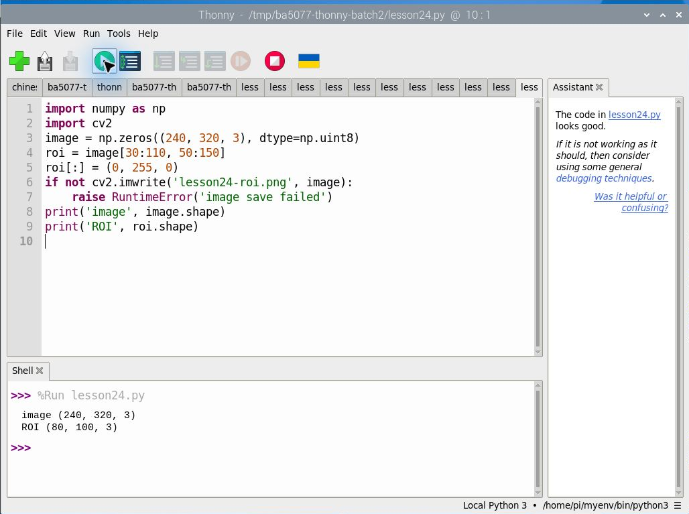
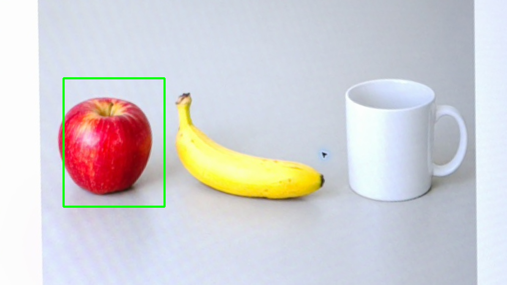
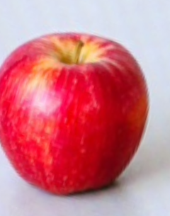

# 第 24 課｜OpenCV 即時影像處理與特定區域（ROI）處理

[原始文章](https://liusming.pixnet.net/blog/posts/14222876481) · 更新日期：2026-10-29

> 本課已在 Thonny 實測：合成影像切片 ROI 並存檔。完整原文情境及其他舊案例仍須依下文標示重測。[逐篇進度](./Thonny逐篇實測狀態.md) · [圖片與程式下載方式](./練習素材/素材下載與使用.md)

## 學習目標

認識以 NumPy 切片取得影像中指定區域（ROI）。

## 事前準備

需要 NumPy；本例建立 240 × 320 的合成彩色影像。

本教學程式使用合成資料，沒有把私人相機影像上傳公開 repo；請在自己的練習目錄操作。

## 程式與執行

將下列程式存為 `第24課.py`，或使用[已測試的範例程式](./範例程式/第24課.py)。

```python
import numpy as np
import cv2
image = np.zeros((240, 320, 3), dtype=np.uint8)
roi = image[30:110, 50:150]
roi[:] = (0, 255, 0)
if not cv2.imwrite('lesson24-roi.png', image):
    raise RuntimeError('image save failed')
print('image', image.shape)
print('ROI', roi.shape)
```

在 Thonny 選 **File → Open** 開啟 `第24課.py`，確認右下角是包含所需套件的 Python 環境，再點綠色執行鈕。若程式會輸出檔案，先在新的練習目錄操作，避免覆寫。

## Thonny 實測輸出

```text
image (240, 320, 3)
ROI (80, 100, 3)
```



本次選用既有環境 `/home/pi/myenv/bin/python3`。這次是合成圖 ROI；後面的相機實拍 ROI 為先前終端機測試，仍待在 Thonny 重測。 相機或影像相關套件的準備及可重現環境請參考[Thonny 環境指南](./Thonny環境與套件安裝.md)。

陣列索引先列高度範圍，再列寬度範圍；ROI 的高與寬分別為 80 與 100。

## RP5 實際產生的結果圖


綠色區域是程式設定的 ROI。 圖片由本課程式在 RP5 執行時儲存，是程式輸出，不是操作畫面截圖。

## 背景與核心概念

### 為什麼只處理影像中的一部分？

ROI 是感興趣區域，例如相機畫面中輸送帶的位置。NumPy 影像切片依先列後欄的順序；座標使用 y 範圍再使用 x 範圍，範圍上界不包含在切片內。

### 思考、練習與後續應用

若切片高度為 80、寬度為 100，通道數為 3，陣列形狀應如何表示？相機移動後 ROI 可能發生什麼問題？

ROI 可減少處理範圍及背景干擾，但固定 ROI 也可能漏掉移動到範圍外的物件。

進一步閱讀：[相關官方文件](https://docs.opencv.org/4.x/d6/d00/tutorial_py_root.html)。下方的程式與輸出以標明的本機實測範圍為準；沒有測過的部分不代表已完成。

## 舊實驗紀錄（終端機；待 Thonny 重測）：裁切相機照片中的 ROI

下載[相機拍攝的生成物件圖](./圖檔/objects-board.png)及[程式](./範例程式/第24課-相機ROI.py)到同一練習目錄，執行 `python3 第24課-相機ROI.py`。圖片是相機拍攝螢幕上的 AI 生成物件，並非真實水果照片。

```python
import cv2

image = cv2.imread('objects-board.png')
if image is None:
    raise RuntimeError('找不到 objects-board.png')
# 固定座標只適用本次 1200 x 675 圖片，換圖時需重新選取。
x1, y1, x2, y2 = 150, 185, 390, 490
roi = image[y1:y2, x1:x2].copy()
if roi.size == 0:
    raise RuntimeError('ROI 為空，請檢查座標')
marked = image.copy()
cv2.rectangle(marked, (x1, y1), (x2-1, y2-1), (0, 255, 0), 3)
if not cv2.imwrite('lesson24-camera-roi.png', roi) or not cv2.imwrite('lesson24-camera-marked.png', marked):
    raise RuntimeError('圖片儲存失敗')
print('image shape:', image.shape)
print('ROI shape:', roi.shape)
print('saved: lesson24-camera-roi.png, lesson24-camera-marked.png')
```

RP5 實際輸出：

```text
image shape: (675, 1200, 3)
ROI shape: (305, 240, 3)
saved: lesson24-camera-roi.png, lesson24-camera-marked.png
```





兩張圖是程式產生結果，不是操作截圖。因切片不包含右側與下方界線，高為 490−185＝305、寬為 390−150＝240。仔細觀察可看到蘋果左邊緣有一小部分落在綠框外，這顯示固定座標可能裁掉目標。`copy()` 讓後續修改 ROI 不會直接改動原圖。相機位置與畫面改變後應重新設定座標；本次未測即時選取或長時間連續處理。

## 與原文章的差異

- 新增以 Thonny 操作的實測與截圖：合成影像切片 ROI 並存檔。

- 原文使用相機即時畫面；本版測合成陣列及單張相機照片的固定 ROI，未驗證即時視窗。
- 以上是本機實際合成資料輸出；不同版本可能產生不同數值。
- 尚未保存操作畫面截圖。
- 新增初學者背景、概念、思考練習及後續應用，實測範圍仍以本文標示為準。
