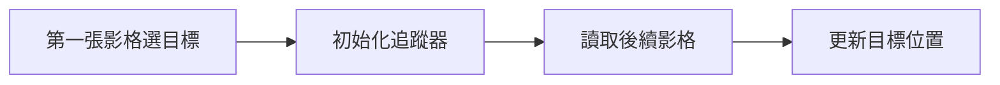

# 第 25 課｜使用 OpenCV 進行目標追蹤

[原始文章](https://liusming.pixnet.net/blog/posts/14222886486) · 更新日期：2026-10-29

## 學習目標

建立 CSRT 追蹤器並驗證基本更新流程。

## 事前準備

需要提供 CSRT 的 OpenCV；本例使用固定隨機種子的合成影格。

本教學程式使用合成資料，沒有把私人相機影像上傳公開 repo；請在自己的練習目錄操作。

## 程式與執行

將下列程式存為 `第25課.py`，或使用[已測試的範例程式](./範例程式/第25課.py)。

```python
import cv2
import numpy as np
rng = np.random.default_rng(42)
frame = np.zeros((200, 300, 3), dtype=np.uint8)
frame[60:120, 80:140] = rng.integers(0, 256, (60, 60, 3), dtype=np.uint8)
tracker = cv2.TrackerCSRT_create()
tracker.init(frame, (80, 60, 60, 60))
success, box = tracker.update(frame.copy())
print('tracker created', True)
print('same frame update', success)
```

在該檔案所在目錄執行 `python3 第25課.py`。

## 本機實際輸出

```text
tracker created True
same frame update True
```

相同影格更新成功只證明基本 API 可使用；不等於移動場景、遮擋與影片結尾均已測試。

## 背景與核心概念

### 目標追蹤與偵測有什麼差別？

偵測在一張影格找出目標位置；追蹤嘗試在後續影格持續更新同一目標的位置。CSRT 是一種追蹤器，起始位置和後續影格的變化會影響結果。

### 思考、練習與後續應用

相同影格更新成功能證明什麼？遇到遮擋、目標離開畫面或兩個相似物件時還需要測試什麼？

追蹤可用於觀察移動零件或互動介面，真實應用需要計算延遲與追蹤失敗後的恢復方式。

進一步閱讀：[相關官方文件](https://docs.opencv.org/4.x/d2/da2/classcv_1_1TrackerCSRT.html)。下方的程式與輸出以標明的本機實測範圍為準；沒有測過的部分不代表已完成。

## 概念流程圖



此圖用於說明文章的概念或完整目標流程，**不是操作截圖，也不代表每個步驟都已實測**；本機實測範圍請看文章中的標示。

## 與原文章的差異

- 原文由使用者在影片上選 ROI；本版使用固定 ROI 和同一張合成影格，不需要 GUI。
- 以上是本機實際合成資料輸出；不同版本可能產生不同數值。
- 尚未保存操作畫面截圖。
- 新增初學者背景、概念、思考練習及後續應用，實測範圍仍以本文標示為準。
- 加入教學流程示意；圖中的完整目標流程不代表已逐步實測。
