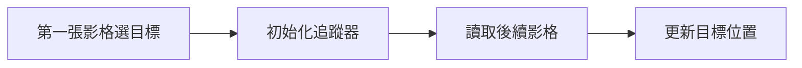
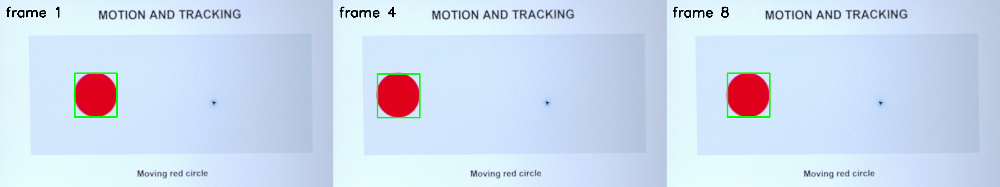

# 第 25 課｜使用 OpenCV 進行目標追蹤

[原始文章](https://liusming.pixnet.net/blog/posts/14222886486) · 更新日期：2026-10-29

> **Thonny 轉換待完成。** 本篇既有程式、安裝步驟與輸出仍須逐項改寫並在 Thonny 重新操作；現有終端機紀錄不代表已用 Thonny 測試。[逐篇進度](./Thonny逐篇實測狀態.md) · [圖片與程式下載方式](./練習素材/素材下載與使用.md)

## 學習目標

建立 CSRT 追蹤器並驗證基本更新流程。

## 事前準備

需要提供 CSRT 的 OpenCV；本例使用固定隨機種子的合成影格。

本教學程式使用合成資料，沒有把私人相機影像上傳公開 repo；請在自己的練習目錄操作。

## 程式與執行

將下列程式存為 `第25課.py`，或使用[已測試的範例程式](./範例程式/第25課.py)。

```python
import cv2
import numpy as np
rng = np.random.default_rng(42)
frame = np.zeros((200, 300, 3), dtype=np.uint8)
frame[60:120, 80:140] = rng.integers(0, 256, (60, 60, 3), dtype=np.uint8)
tracker = cv2.TrackerCSRT_create()
tracker.init(frame, (80, 60, 60, 60))
success, box = tracker.update(frame.copy())
print('tracker created', True)
print('same frame update', success)
```

在該檔案所在目錄執行 `python3 第25課.py`。

## 本機實際輸出

```text
tracker created True
same frame update True
```

相同影格更新成功只證明基本 API 可使用；不等於移動場景、遮擋與影片結尾均已測試。

## 背景與核心概念

### 目標追蹤與偵測有什麼差別？

偵測在一張影格找出目標位置；追蹤嘗試在後續影格持續更新同一目標的位置。CSRT 是一種追蹤器，起始位置和後續影格的變化會影響結果。

### 思考、練習與後續應用

相同影格更新成功能證明什麼？遇到遮擋、目標離開畫面或兩個相似物件時還需要測試什麼？

追蹤可用於觀察移動零件或互動介面，真實應用需要計算延遲與追蹤失敗後的恢復方式。

進一步閱讀：[相關官方文件](https://docs.opencv.org/4.x/d2/da2/classcv_1_1TrackerCSRT.html)。下方的程式與輸出以標明的本機實測範圍為準；沒有測過的部分不代表已完成。

## 概念流程圖



此圖用於說明文章的概念或完整目標流程，**不是操作截圖，也不代表每個步驟都已實測**；本機實測範圍請看文章中的標示。

## 進階實測：相機拍攝螢幕上的移動目標

### 準備與操作

1. 下載[相機測試畫面](./練習素材/RP5相機測試.html)和同目錄的圖片素材，在電腦上開啟測試頁，選「移動追蹤」，讓紅色圓形移動；將 RP5 相機對準螢幕並固定。
2. 在 RP5 使用已驗證的 Picamera2、OpenCV 和 NumPy。確認沒有其他程式使用相機；程式只取得有限張影格，結束後會釋放相機。
3. 將[範例程式](./範例程式/第25課-相機CSRT.py)存到自己的練習目錄。程式中的四個 `source` 座標只適用本次相機位置與 1920 × 1080 的照片。請先查看自己的拍攝畫面並重新量測測試圖的左上、右上、右下、左下座標；錯誤座標會造成偵測失敗，或把不希望公開的周圍環境留在圖中。

```python
import time
import cv2
import numpy as np
from picamera2 import Picamera2

# 以本次相機的 1920×1080 照片量測螢幕四角；不同位置須重新設定。
source = np.float32([[755, 270], [1385, 65], [1484, 412], [856, 604]])
target = np.float32([[0, 0], [599, 0], [599, 337], [0, 337]])
matrix = cv2.getPerspectiveTransform(source, target)
camera = Picamera2()
results, panels = [], []
try:
    camera.configure(camera.create_still_configuration(main={'size': (1920, 1080), 'format': 'RGB888'}))
    camera.start()
    time.sleep(1)
    tracker = cv2.TrackerCSRT_create()
    for index in range(8):
        frame = camera.capture_array()
        board = cv2.warpPerspective(frame, matrix, (600, 338))
        if index == 0:
            hsv = cv2.cvtColor(board, cv2.COLOR_BGR2HSV)
            mask = cv2.inRange(hsv, (0, 130, 100), (10, 255, 255)) | cv2.inRange(hsv, (170, 130, 100), (179, 255, 255))
            contours, _ = cv2.findContours(mask, cv2.RETR_EXTERNAL, cv2.CHAIN_APPROX_SIMPLE)
            candidates = [c for c in contours if cv2.contourArea(c) > 300]
            if not candidates:
                raise RuntimeError('第一張影格找不到紅色目標')
            box = cv2.boundingRect(max(candidates, key=cv2.contourArea))
            tracker.init(board, box)
            success = True
        else:
            success, box = tracker.update(board)
        results.append(bool(success))
        if success:
            x, y, w, h = (int(v) for v in box)
            cv2.rectangle(board, (x, y), (x+w, y+h), (0, 255, 0), 2)
        cv2.putText(board, f'frame {index+1}', (10, 30), cv2.FONT_HERSHEY_SIMPLEX, 0.8, (0, 0, 0), 2)
        if index in (0, 3, 7):
            panels.append(board)
        time.sleep(0.2)
finally:
    camera.stop()
    camera.close()

if not cv2.imwrite('lesson25-csrt.png', cv2.hconcat(panels)):
    raise RuntimeError('無法儲存結果圖')
print('frames captured:', len(results))
print('initial target found:', results[0])
print('update results:', results[1:])
print('saved: lesson25-csrt.png')
```

在 RP5 的練習目錄執行：

```bash
python3 第25課-相機CSRT.py
```

### 本次實際輸出

```text
frames captured: 8
initial target found: True
update results: [True, True, True, True, True, True, True]
saved: lesson25-csrt.png
```



圖片由本機相機拍攝螢幕上的動畫後，裁切並透視校正，程式再標示目標；畫面中的框線是本次實測輸出，並非操作截圖。照片不顯示原始鏡頭所拍到的螢幕外環境。

### 理解與實驗

第一張影格使用紅色遮罩選出初始方框，後面七張由 CSRT 更新。上方 `True` 表示追蹤器回報更新成功，仍須從圖上或標註資料檢查框是否對準；本例未計算追蹤準確率。

上述成果只是固定相機、螢幕上單一紅色圓形、有限張影格的測試。移動速度、光線、相機位置、目標遮擋或其他紅色物品都可能影響結果；不要把此次成功次數當作一般場景的準確率。

練習：先預測目標移到畫面邊緣或被遮住時的結果，再自行測試並記錄成功與失敗。若測不到，檢查測試頁是否正在動畫、相機是否被占用、四角座標和目標顏色是否正確。

## 與原文章的差異

- 原文由使用者在影片上選 ROI；合成例使用固定 ROI 和同一影格，新增的相機實測以顏色自動決定第一張影格的 ROI。
- 以上是本機實際合成資料輸出；不同版本可能產生不同數值。
- 尚未保存操作畫面截圖。
- 新增初學者背景、概念、思考練習及後續應用，實測範圍仍以本文標示為準。
- 加入教學流程示意；圖中的完整目標流程不代表已逐步實測。
- 新增 RP5 相機拍攝八張影格的 CSRT 追蹤實測；本次沒有測試人工框選、長時間影片或遮擋。
