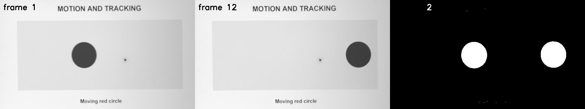

# 第 26 課｜使用 OpenCV 進行背景差分與運動物體檢測

[原始文章](https://liusming.pixnet.net/blog/posts/14222886516) · 更新日期：2026-10-29

> **Thonny 轉換待完成。** 本篇既有程式、安裝步驟與輸出仍須逐項改寫並在 Thonny 重新操作；現有終端機紀錄不代表已用 Thonny 測試。[逐篇進度](./Thonny逐篇實測狀態.md)

## 學習目標

用影像差分與閾值找出變動像素。

## 事前準備

需要 OpenCV 與 NumPy；本例在黑色背景建立 20 × 20 的白色區域。

本教學程式使用合成資料，沒有把私人相機影像上傳公開 repo；請在自己的練習目錄操作。

## 程式與執行

將下列程式存為 `第26課.py`，或使用[已測試的範例程式](./範例程式/第26課.py)。

```python
import cv2
import numpy as np
background = np.zeros((100, 100), dtype=np.uint8)
current = background.copy()
current[20:40, 30:50] = 255
diff = cv2.absdiff(background, current)
_, mask = cv2.threshold(diff, 30, 255, cv2.THRESH_BINARY)
if not cv2.imwrite('lesson26-difference.png', np.hstack((background, current, mask))):
    raise RuntimeError('image save failed')
print('changed pixels', cv2.countNonZero(mask))
```

在該檔案所在目錄執行 `python3 第26課.py`。

## 本機實際輸出

```text
changed pixels 400
```

20 × 20 等於 400，輸出顯示這些像素被標記；真實場景還需處理光線、雜訊與相機移動。

## RP5 實際產生的結果圖


由左至右為背景、目前影格與差分遮罩。 圖片由本課程式在 RP5 執行時儲存，是程式輸出，不是操作畫面截圖。

## 背景與核心概念

### 如何從兩張畫面看出變化？

背景差分先比較基準影格與目前影格，再用閾值把差異轉成遮罩。影像的亮度變動也會形成差異，因此偵測到變化不一定代表有物體移動。

### 思考、練習與後續應用

若白色方塊是 20 × 20 像素，遮罩白色像素可能是多少？改變光線或移動相機會對差分造成什麼影響？

背景差分適用固定鏡頭的入門偵測，部署時需測試陰影、光線、抖動與誤報。

進一步閱讀：[相關官方文件](https://docs.opencv.org/4.x/d1/dc5/tutorial_background_subtraction.html)。下方的程式與輸出以標明的本機實測範圍為準；沒有測過的部分不代表已完成。

## 進階實測：處理 RP5 相機拍攝的短影片

### 實驗材料與步驟

1. 先依[第 16 課](./第%2016%20課｜Python%20結合%20OpenCV%20與%20Picamera2：影片錄製與即時影像處理.md)拍攝螢幕動畫，或下載[本次處理後的短影片](./練習素材/lesson16-camera.avi)，存為練習目錄中的 `lesson16-camera.avi`。本次使用的影片是 12 張經裁切、透視校正及灰階處理的 RP5 相機影格。
2. 將[本課範例程式](./範例程式/第26課-影片影格差分.py)放到相同目錄；執行前確認輸出檔不會覆蓋你的資料。第 27 課的 MOG 需要 OpenCV 提供 `cv2.bgsegm` 模組。

```python
import cv2

video = cv2.VideoCapture('lesson16-camera.avi')
frames = []
try:
    while True:
        ok, frame = video.read()
        if not ok:
            break
        frames.append(frame)
finally:
    video.release()
if len(frames) < 2:
    raise RuntimeError('影片必須至少包含兩張影格，請先完成第 16 課')
first = cv2.cvtColor(frames[0], cv2.COLOR_BGR2GRAY)
last = cv2.cvtColor(frames[-1], cv2.COLOR_BGR2GRAY)
diff = cv2.absdiff(first, last)
_, mask = cv2.threshold(diff, 25, 255, cv2.THRESH_BINARY)
panels = cv2.hconcat([frames[0], frames[-1], cv2.cvtColor(mask, cv2.COLOR_GRAY2BGR)])
if not cv2.imwrite('lesson26-camera-diff.png', panels):
    raise RuntimeError('無法儲存結果圖')
print('frames read:', len(frames))
print('first and last changed pixels:', cv2.countNonZero(mask))
print('saved: lesson26-camera-diff.png')
```

```bash
python3 第26課-影片影格差分.py
```

### 本次 RP5 實際輸出

```text
frames read: 12
first and last changed pixels: 10359
saved: lesson26-camera-diff.png
```



左圖是影片第一張影格，中圖是最後一張，右圖白色代表兩張灰階圖亮度差超過門檻的位置。可以看到圓形的原位置和新位置都出現白色，因為兩處像素都發生變化；左上角影格編號不同也造成白色文字，因此不能把每個白點都當成物體。 此圖是相機影片經程式處理的結果，不是操作截圖；原始相機全景沒有上傳。

### 學生練習與限制

找出圖中除了圓形以外被標成白色的區域，說明它為什麼可能改變。嘗試使用不同閾值或更多影格，記錄遮罩的變化；不要根據這段短影片就宣稱已完成真實場景或長時間的準確率評估。

## 與原文章的差異

- 原文使用影片或相機；本版的初步範例採可重現的合成影格，另增加相機短影片測試，沒有把測試結果視為實際監測效果。
- 以上是本機實際合成資料輸出；不同版本可能產生不同數值。
- 尚未保存操作畫面截圖。
- 新增初學者背景、概念、思考練習及後續應用，實測範圍仍以本文標示為準。
- 原文使用影片或相機；本版先做固定合成影格測試，新增由 RP5 相機實拍的短影片首末影格差分。
