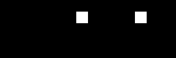

# 第 26 課｜使用 OpenCV 進行背景差分與運動物體檢測

[原始文章](https://liusming.pixnet.net/blog/posts/14222886516) · 更新日期：2026-10-29

## 學習目標

用影像差分與閾值找出變動像素。

## 事前準備

需要 OpenCV 與 NumPy；本例在黑色背景建立 20 × 20 的白色區域。

本教學程式使用合成資料，沒有把私人相機影像上傳公開 repo；請在自己的練習目錄操作。

## 程式與執行

將下列程式存為 `第26課.py`，或使用[已測試的範例程式](./範例程式/第26課.py)。

```python
import cv2
import numpy as np
background = np.zeros((100, 100), dtype=np.uint8)
current = background.copy()
current[20:40, 30:50] = 255
diff = cv2.absdiff(background, current)
_, mask = cv2.threshold(diff, 30, 255, cv2.THRESH_BINARY)
if not cv2.imwrite('lesson26-difference.png', np.hstack((background, current, mask))):
    raise RuntimeError('image save failed')
print('changed pixels', cv2.countNonZero(mask))
```

在該檔案所在目錄執行 `python3 第26課.py`。

## 本機實際輸出

```text
changed pixels 400
```

20 × 20 等於 400，輸出顯示這些像素被標記；真實場景還需處理光線、雜訊與相機移動。

## RP5 實際產生的結果圖



由左至右為背景、目前影格與差分遮罩。 圖片由本課程式在 RP5 執行時儲存，是程式輸出，不是操作畫面截圖。

## 背景與核心概念

### 如何從兩張畫面看出變化？

背景差分先比較基準影格與目前影格，再用閾值把差異轉成遮罩。影像的亮度變動也會形成差異，因此偵測到變化不一定代表有物體移動。

### 思考、練習與後續應用

若白色方塊是 20 × 20 像素，遮罩白色像素可能是多少？改變光線或移動相機會對差分造成什麼影響？

背景差分適用固定鏡頭的入門偵測，部署時需測試陰影、光線、抖動與誤報。

進一步閱讀：[相關官方文件](https://docs.opencv.org/4.x/d1/dc5/tutorial_background_subtraction.html)。下方的程式與輸出以標明的本機實測範圍為準；沒有測過的部分不代表已完成。

## 與原文章的差異

- 原文使用影片或相機；本版採可重現的合成影格，沒有把合成結果視為實際監測效果。
- 以上是本機實際合成資料輸出；不同版本可能產生不同數值。
- 尚未保存操作畫面截圖。
- 新增初學者背景、概念、思考練習及後續應用，實測範圍仍以本文標示為準。
