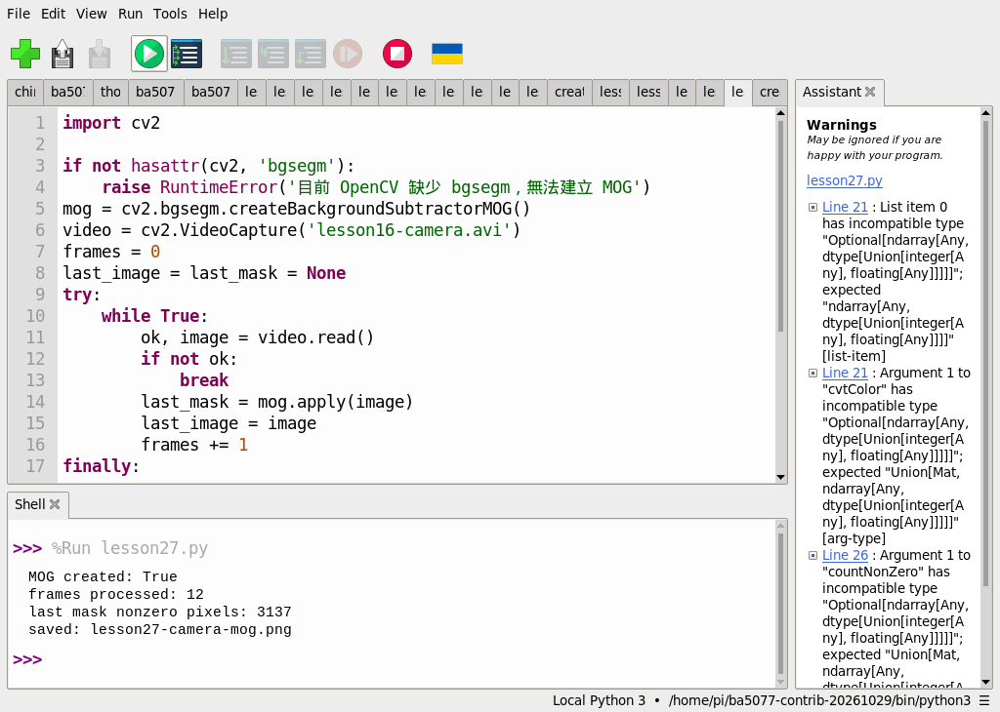

# 第 27 課｜使用背景減法與 MOG 進行運動物體檢測

[原始文章](https://liusming.pixnet.net/blog/posts/14222886498) · 更新日期：2026-10-29

> 本課已在 Thonny 實測處理相機短影片的 MOG 背景模型；其他既有情境仍依下文標示待重測。[逐篇進度](./Thonny逐篇實測狀態.md) · [圖片與程式下載方式](./練習素材/素材下載與使用.md)

## 學習目標

認識背景模型並確認本機 GMG 物件可以處理影格。

## 事前準備

本機 OpenCV 需包含 `cv2.bgsegm` 擴充模組。

本教學程式使用合成資料，沒有把私人相機影像上傳公開 repo；請在自己的練習目錄操作。


### 用 Thonny 準備套件與教材檔案

1. 先依[擴充環境安裝步驟](./Thonny環境與套件安裝.md#第-2527-課在-thonny-建立-opencv-擴充環境)，在 Thonny 建立並選擇獨立環境；本次使用 Python 3.11、NumPy 1.26.4、opencv-contrib-python 4.11.0.86。
2. 在 RP5 瀏覽器開啟本儲存庫，按 **Code → Download ZIP** 並解壓；詳細步驟見[素材下載與使用說明](./練習素材/素材下載與使用.md)。下載教材不等於安裝套件。
3. 從解壓後的 `教材/範例程式` 把 `第27課-影片MOG.py`，以及 `教材/練習素材` 的 `lesson16-camera.avi` 複製到**同一個新的練習資料夾**，影片檔名保持不變。此影片是 RP5 相機拍攝螢幕動畫後經處理的 12 張影格，不是生成的操作截圖。
4. 用 Thonny 開啟該程式，按綠色執行鈕。結果會寫入目前程式的練習資料夾；再次執行可能覆寫同名結果。若找不到影片，先確認影片名稱及程式和影片的位置。

## 程式與執行

將下列程式存為 `第27課.py`，或使用[先前以終端機測試的範例程式](./範例程式/第27課.py)。

```python
import cv2
import numpy as np
subtractor = cv2.bgsegm.createBackgroundSubtractorGMG()
frame = np.zeros((40, 40, 3), dtype=np.uint8)
mask = subtractor.apply(frame)
if not cv2.imwrite('lesson27-gmg-mask.png', mask):
    raise RuntimeError('image save failed')
print('GMG created', True)
print('mask shape', mask.shape)
```

在 Thonny 選 **File → Open** 開啟練習資料夾中的 `第27課.py`，確認右下角解譯器後點綠色執行鈕。

## 先前終端機實測輸出（合成影格；Thonny 尚待重測）

```text
GMG created True
mask shape (40, 40)
```

輸出遮罩尺寸與輸入相同；第一張影格不能代表背景模型已完成學習。

## RP5 實際產生的結果圖


這是第一張影格產生的遮罩；背景模型尚未完成學習，不能作為移動物體偵測成果。 圖片由本課程式在 RP5 執行時儲存，是程式輸出，不是操作畫面截圖。

## 背景與核心概念

### 背景模型為何需要時間？

背景減法不是只比較一張固定底圖；演算法可從多張影格建立或更新背景模型，再推測哪些像素屬於前景。MOG 系列與 GMG 是不同方法，參數和結果不能直接視為相同。

### 從固定差分到會更新的背景

第 26 課拿兩張影格直接比較；本課 MOG 則隨影格建立背景模型，嘗試把常出現的像素狀態視為背景。模型可適應部分漸變，但剛開始需要學習；新物體停留很久後也可能逐漸被當成背景。背景、前景與物體的意義並非永遠相同。

程式對 12 張影格依序呼叫 `apply`，最後統計遮罩的非零像素。3137 是**這次素材、參數與版本**下最後一張遮罩的計數，不是物體數量，也不是準確率。GMG 與 MOG 是不同演算法，不要用本課先前 GMG 合成測試替代 MOG 結論。延伸應用可以比較白天、夜間與陰影，並設計標記資料來評估誤報。

### 思考、練習與後續應用

第一張影格的遮罩為何不足以評估動態偵測？請指出本篇範例建立的是哪一種背景模型，是否等同原文的 MOG。

適合進一步研究固定相機場景，但需要連續影格、適應時間與多種光線的實測。

進一步閱讀：[相關官方文件](https://docs.opencv.org/4.x/d1/dc5/tutorial_background_subtraction.html)。下方的程式與輸出以標明的本機實測範圍為準；沒有測過的部分不代表已完成。

## 進階實測：處理 RP5 相機拍攝的短影片

### 實驗材料與步驟

1. 先依[第 16 課](./第%2016%20課｜Python%20結合%20OpenCV%20與%20Picamera2：影片錄製與即時影像處理.md)拍攝螢幕動畫，或下載[本次處理後的短影片](./練習素材/lesson16-camera.avi)，存為練習目錄中的 `lesson16-camera.avi`。本次使用的影片是 12 張經裁切、透視校正及灰階處理的 RP5 相機影格。
2. 將[本課範例程式](./範例程式/第27課-影片MOG.py)放到相同目錄；執行前確認輸出檔不會覆蓋你的資料。第 27 課的 MOG 需要 OpenCV 提供 `cv2.bgsegm` 模組。

```python
import cv2

if not hasattr(cv2, 'bgsegm'):
    raise RuntimeError('目前 OpenCV 缺少 bgsegm，無法建立 MOG')
mog = cv2.bgsegm.createBackgroundSubtractorMOG()
video = cv2.VideoCapture('lesson16-camera.avi')
frames = 0
last_image = last_mask = None
try:
    while True:
        ok, image = video.read()
        if not ok:
            break
        last_mask = mog.apply(image)
        last_image = image
        frames += 1
finally:
    video.release()
if frames == 0:
    raise RuntimeError('影片沒有可讀取的影格，請先完成第 16 課')
panels = cv2.hconcat([last_image, cv2.cvtColor(last_mask, cv2.COLOR_GRAY2BGR)])
if not cv2.imwrite('lesson27-camera-mog.png', panels):
    raise RuntimeError('無法儲存結果圖')
print('MOG created:', True)
print('frames processed:', frames)
print('last mask nonzero pixels:', cv2.countNonZero(last_mask))
print('saved: lesson27-camera-mog.png')
```

在 Thonny 選 **File → Open** 開啟同一練習資料夾中的程式，檢查右下角解譯器，再按綠色執行鈕。

### 本次 Thonny 在 RP5 的實際輸出

```text
MOG created: True
frames processed: 12
last mask nonzero pixels: 3137
saved: lesson27-camera-mog.png
```



截圖中的 `lesson27.py` 是儲存庫範例程式的測試副本，內容相同；右下角為本次獨立擴充環境。


左圖是影片最後一張，右圖是 MOG 最後輸出的前景遮罩。圓形部分呈白色新月狀，影格標號改變也被偵測；遮罩並不等同完整物體輪廓。12 張影格不足以評估模型長時間學習效果。 此圖是相機影片經程式處理的結果，不是操作截圖；原始相機全景沒有上傳。

### 學生練習與限制

找出圖中除了圓形以外被標成白色的區域，說明它為什麼可能改變。嘗試使用不同閾值或更多影格，記錄遮罩的變化；不要根據這段短影片就宣稱已完成真實場景或長時間的準確率評估。

## 與原文章的差異

- 本次改用 Thonny 與隔離的 OpenCV 擴充環境；逐項可重現範圍以上方截圖與文字為準。

- 原文以相機持續更新背景；初步 GMG 範例只處理單張圖，新增 MOG 短影片測試，尚未驗證長時間動態偵測。
- 以上是本機實際合成資料輸出；不同版本可能產生不同數值。
- 新增本次 Thonny 實際操作截圖；其餘情境仍按段落標示測試範圍。
- 新增初學者背景、概念、思考練習及後續應用，實測範圍仍以本文標示為準。
- 原文使用 MOG；原合成測試使用 GMG，新增的影片測試實際使用 MOG。兩種演算法不同，結果不能直接視為相同。
