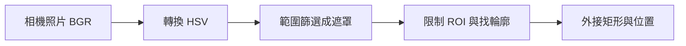
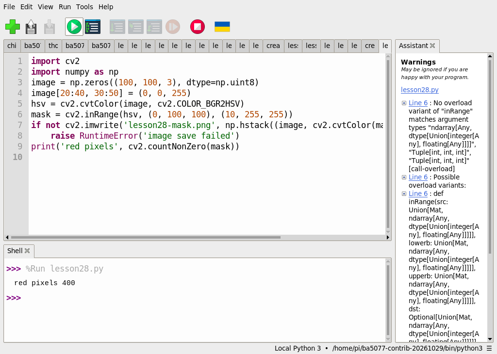
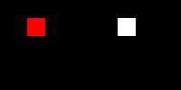
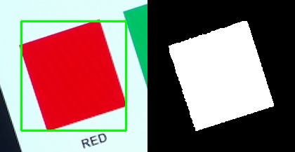
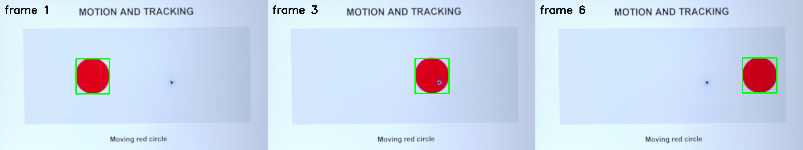

# 第 28 課｜使用 Picamera2 和 OpenCV 實現顏色檢測與物體追蹤

[原始文章](https://liusming.pixnet.net/blog/posts/14222886522) · 更新日期：2026-10-29

> 已在 Thonny 實測：合成紅色區塊與 HSV 遮罩；相機及即時追蹤情境待 Thonny 重測。[逐篇進度](./Thonny逐篇實測狀態.md) · [圖片與程式下載方式](./練習素材/素材下載與使用.md)

## 背景：為什麼用顏色找物體？

想像一條小型輸送帶上有紅色零件，RP5 的相機每次拍下一張畫面；程式需要找出紅色零件的位置，才有機會計數、追蹤或觸發後續動作。這個方法適合顏色對比明顯、照明較穩定的簡單場景。紅色膠帶、反光或背景物也可能被誤認，所以顏色相同不代表物體相同。

本課建議先學完相機拍照、Python 陣列與 OpenCV 基礎。完成後，你應能解釋 HSV、遮罩與 ROI，並利用一張實拍照片找到紅色區域；延伸挑戰則是比較連續影格的中心位置。

## 原理：像素、HSV 與遮罩

一張彩色影像可以想成由許多小格子「像素」組成，每格有顏色數值。OpenCV 讀取一般彩色圖片後通常以 BGR 三個通道存放。轉為 HSV 後，H 表示色相、S 表示飽和度、V 表示亮度；在 OpenCV 的一般 8 位元表示中，H 為 0–179，S 與 V 為 0–255。

`cv2.inRange` 會檢查每個像素是否落在設定範圍：符合者在遮罩中為白色，不符合者為黑色。紅色色相位於色相環的接合處，因此實拍範例合併低端和高端兩段；這些閾值不是所有相機與光源的通用答案。[OpenCV 官方 HSV 與 inRange 教學](https://docs.opencv.org/4.x/da/d97/tutorial_threshold_inRange.html) 可進一步參考。

ROI 是感興趣區域：只在指定位置找目標，可排除畫面其他地方的紅色物品，但目標離開 ROI 時也會被忽略。找到連通區域後，外接矩形 `(x, y, w, h)` 可以計算中心 `(x + w/2, y + h/2)`。只計算一張影像的位置稱為偵測；要稱為追蹤，還需要在連續影格中持續關聯位置，並處理遮擋與目標消失。



此圖是概念流程圖，不是程式執行畫面。


### Thonny 環境與下載準備

依[Thonny 環境指南](./Thonny環境與套件安裝.md#第-2527-課在-thonny-建立-opencv-擴充環境)建立並選取獨立環境。本次處理影像使用 Python 3.11、NumPy 1.26.4 和 opencv-contrib-python 4.11.0.86；相機拍照則需另選能使用 Picamera2 的環境。先從 [GitHub 教材](https://github.com/Samuel-ncu/BA5077-RP5-compatibility) 的 **Code → Download ZIP** 下載並解壓，複製所需檔案到新的練習資料夾；詳細步驟見[素材指南](./練習素材/素材下載與使用.md)。此次 ZIP 下載和解壓步驟尚未在 RP5 瀏覽器重測。

下載[第 28 課入門程式](./範例程式/第28課.py)到練習資料夾；合成範例不需要下載圖片。開啟 Thonny，選 **File → Open** 開啟程式，確認右下角是上面的影像處理環境，按綠色執行鈕。程式會寫入 `lesson28-mask.png`，再次執行可能覆寫同名檔。

## 學習目標

利用 HSV 閾值建立顏色遮罩。

## 事前準備

需要 OpenCV 與 NumPy；合成圖中含 20 × 20 紅色區塊。

本教學程式使用合成資料，沒有把私人相機影像上傳公開 repo；請在自己的練習目錄操作。

## 程式與執行

將下列程式存為 `第28課.py`，或使用[已測試的範例程式](./範例程式/第28課.py)。

```python
import cv2
import numpy as np
image = np.zeros((100, 100, 3), dtype=np.uint8)
image[20:40, 30:50] = (0, 0, 255)
hsv = cv2.cvtColor(image, cv2.COLOR_BGR2HSV)
mask = cv2.inRange(hsv, (0, 100, 100), (10, 255, 255))
if not cv2.imwrite('lesson28-mask.png', np.hstack((image, cv2.cvtColor(mask, cv2.COLOR_GRAY2BGR)))):
    raise RuntimeError('image save failed')
print('red pixels', cv2.countNonZero(mask))
```

在 Thonny 開啟 `第28課.py`，確認解譯器，按綠色執行鈕。

## 本次 Thonny 實測輸出

```text
red pixels 400
```



截圖中的 `lesson28.py` 為 `第28課.py` 的測試副本，內容相同。

此例僅使用紅色 HSV 的一段範圍；真實場景需要根據相機與照明調整，紅色也可能跨越色相邊界。

## RP5 實際產生的結果圖



左側為合成紅色區塊，右側為 HSV 遮罩。 圖片由本課程式在 RP5 執行時儲存，是程式輸出，不是操作畫面截圖。

## 先前終端機實測（Thonny 相機情境待重測）：RP5 相機拍攝螢幕色塊

2026-10-29 使用本機 IMX708 廣角相機拍攝螢幕上的紅、綠、藍、黃色塊。以下是**單張照片**的紅色偵測，不是即時追蹤。照片中包含螢幕外的紅色物品，所以此例先限制偵測區域（ROI）。本次只公開裁切後的紅色目標與遮罩，未公開完整相機照片。

要重現測試素材，可下載[相機測試畫面](./練習素材/RP5相機測試.html)，在電腦瀏覽器開啟並選「色彩偵測」，再用 RP5 相機拍攝；實際尺寸與視角不同時需要調整 ROI 與閾值。

先參考[第 18 課](./第%2018%20課｜使用%20Picamera2%20拍攝照片並保存至本地.md)以 Thonny 拍攝，將照片放在練習資料夾並命名 `lesson28-camera.jpg`；拍攝前確認相機未被其他程式占用。此替代流程尚未在本課重測。

將下列程式存為 `第28課-相機照片偵測.py`，也可使用[範例程式](./範例程式/第28課-相機照片偵測.py)。程式中的 ROI 僅對應這次 1920 × 1080 的拍攝位置；相機或螢幕移動後，請重新設定座標及 HSV 閾值。

```python
import cv2
import numpy as np

# 先使用 rpicam-still 拍攝 lesson28-camera.jpg，再依實際畫面調整 ROI。
image = cv2.imread('lesson28-camera.jpg')
if image is None:
    raise RuntimeError('找不到 lesson28-camera.jpg')
hsv = cv2.cvtColor(image, cv2.COLOR_BGR2HSV)
mask = cv2.inRange(hsv, (0, 130, 100), (10, 255, 255)) | cv2.inRange(hsv, (170, 130, 100), (179, 255, 255))
# 本次相機為 1920×1080；這個 ROI 是此次拍攝螢幕的範圍。
mask[:200, :] = 0
mask[600:, :] = 0
mask[:, :700] = 0
mask[:, 1500:] = 0
contours, _ = cv2.findContours(mask, cv2.RETR_EXTERNAL, cv2.CHAIN_APPROX_SIMPLE)
contours = [c for c in contours if cv2.contourArea(c) >= 1000]
if not contours:
    raise RuntimeError('沒有找到夠大的紅色區域；請調整 ROI 與 HSV 範圍')
contour = max(contours, key=cv2.contourArea)
x, y, w, h = cv2.boundingRect(contour)
margin = 30
x0, y0 = max(0, x - margin), max(0, y - margin)
x1, y1 = min(image.shape[1], x + w + margin), min(image.shape[0], y + h + margin)
sample = image[y0:y1, x0:x1].copy()
cv2.rectangle(sample, (x-x0, y-y0), (x-x0+w-1, y-y0+h-1), (0, 255, 0), 2)
panel = np.hstack((sample, cv2.cvtColor(mask[y0:y1, x0:x1], cv2.COLOR_GRAY2BGR)))
if not cv2.imwrite('lesson28-camera-mask.png', panel):
    raise RuntimeError('無法儲存結果圖片')
print('input camera image:', image.shape)
print('large red regions:', len(contours))
print('largest red box (x, y, w, h):', x, y, w, h)
print('largest red contour area:', round(cv2.contourArea(contour), 1))
print('result: lesson28-camera-mask.png')
```

在 Thonny 開啟同一練習資料夾中的程式並按綠色執行鈕；本段照片處理尚待 Thonny 重測。

本次在 RP5 上的實際輸出如下；座標和面積會隨拍攝位置、曝光與光線改變：

```text
input camera image: (1080, 1920, 3)
large red regions: 1
largest red box (x, y, w, h): 784 283 150 157
largest red contour area: 14982.0
result: lesson28-camera-mask.png
```



左圖是相機照片中目標周圍的裁切圖，綠框為偵測範圍；右圖是對應的二值遮罩。畫面經裁切以去除螢幕外的環境，紅色目標仍是相機實拍。

## 讀懂實作與常見問題

1. 第一個範例的 `np.zeros` 建立全黑影像，再把一個 20 × 20 區域設成 BGR 紅色。400 個白色遮罩像素就是 20 × 20 的結果。
2. 實拍範例的 `cv2.imread` 讀入照片；`cvtColor` 轉換色彩空間；兩次 `inRange` 用位元 OR 合併紅色色相兩端。
3. 四行 `mask[...] = 0` 去除 ROI 以外的遮罩；`findContours` 找外部輪廓；`contourArea` 過濾小雜點。這裡的面積為輪廓幾何面積，不是必然等於白色像素數。
4. 如果找不到紅色，檢查照片是否確實拍到色塊、相機是否移動、ROI 是否仍包含目標、曝光和 HSV 範圍是否合適。目標被框錯時，先觀察遮罩，再檢查是否有其他紅色物件。

## 練習與延伸

1. 說明為什麼紅色常要使用兩段 H 範圍；再說明增加 S 的下限會如何影響低飽和度像素。
2. 用不同 ROI 各執行一次，記錄框的位置及是否漏掉目標。**不要把私人環境照片上傳到公開作業。**
3. 進階：連續取兩張影格，記錄紅色框中心的變化。這只是追蹤的起點，若要追蹤多個相同顏色目標，還需要建立目標關聯及處理遮擋。

應用可以是產線顏色分揀、實驗室標記追蹤或展示模型輸入前的影像分割。實際部署需要考慮光線變化、誤判、相機畫面與隱私，以及失敗時的處理方式。

## 先前終端機實測（待 Thonny 重測）：相機拍攝螢幕上的移動目標

### 準備與操作

1. 下載[相機測試畫面](./練習素材/RP5相機測試.html)和同目錄的圖片素材，在電腦上開啟測試頁，選「移動追蹤」，讓紅色圓形移動；將 RP5 相機對準螢幕並固定。
2. 在 RP5 使用已驗證的 Picamera2、OpenCV 和 NumPy。確認沒有其他程式使用相機；程式只取得有限張影格，結束後會釋放相機。
3. 將[範例程式](./範例程式/第28課-相機移動色塊.py)存到自己的練習目錄。程式中的四個 `source` 座標只適用本次相機位置與 1920 × 1080 的照片。請先查看自己的拍攝畫面並重新量測測試圖的左上、右上、右下、左下座標；錯誤座標會造成偵測失敗，或把不希望公開的周圍環境留在圖中。

```python
import time
import cv2
import numpy as np
from picamera2 import Picamera2

# 此座標對應本次 1920×1080 相機畫面中的螢幕；移動設備後須重新量測。
source = np.float32([[755, 270], [1385, 65], [1484, 412], [856, 604]])
target = np.float32([[0, 0], [599, 0], [599, 337], [0, 337]])
matrix = cv2.getPerspectiveTransform(source, target)
camera = Picamera2()
panels, centers = [], []
try:
    camera.configure(camera.create_still_configuration(main={'size': (1920, 1080), 'format': 'RGB888'}))
    camera.start()
    time.sleep(1)
    for index in range(6):
        frame = camera.capture_array()
        board = cv2.warpPerspective(frame, matrix, (600, 338))
        hsv = cv2.cvtColor(board, cv2.COLOR_BGR2HSV)
        mask = cv2.inRange(hsv, (0, 130, 100), (10, 255, 255))
        mask |= cv2.inRange(hsv, (170, 130, 100), (179, 255, 255))
        contours, _ = cv2.findContours(mask, cv2.RETR_EXTERNAL, cv2.CHAIN_APPROX_SIMPLE)
        candidates = [c for c in contours if cv2.contourArea(c) > 300]
        if candidates:
            x, y, w, h = cv2.boundingRect(max(candidates, key=cv2.contourArea))
            centers.append((x + w // 2, y + h // 2))
            cv2.rectangle(board, (x, y), (x+w, y+h), (0, 255, 0), 2)
        else:
            centers.append(None)
        cv2.putText(board, f'frame {index+1}', (10, 30), cv2.FONT_HERSHEY_SIMPLEX, 0.8, (0, 0, 0), 2)
        if index in (0, 2, 5):
            panels.append(board)
        time.sleep(0.5)
finally:
    camera.stop()
    camera.close()

if not cv2.imwrite('lesson28-motion.png', cv2.hconcat(panels)):
    raise RuntimeError('無法儲存結果圖')
print('frames captured:', len(centers))
print('red detections:', sum(point is not None for point in centers))
print('centers (x, y):', centers)
print('saved: lesson28-motion.png')
```

在 Thonny 開啟程式並按綠色執行鈕；本段相機連續取像尚待 Thonny 重測。

### 本次實際輸出

```text
frames captured: 6
red detections: 6
centers (x, y): [(207, 171), (286, 171), (368, 170), (439, 170), (487, 169), (502, 169)]
saved: lesson28-motion.png
```



圖片由本機相機拍攝螢幕上的動畫後，裁切並透視校正，程式再標示目標；畫面中的框線是本次實測輸出，並非操作截圖。照片不顯示原始鏡頭所拍到的螢幕外環境。

### 理解與實驗

程式對六張影格各自產生 HSV 紅色遮罩、找出最大輪廓並計算外接框中心；這是逐幀偵測同一顏色的簡單位置紀錄，沒有多目標身分關聯。圖由左至右顯示第 1、3、6 張；座標是校正後 600 × 338 影像內的像素位置。

上述成果只是固定相機、螢幕上單一紅色圓形、有限張影格的測試。移動速度、光線、相機位置、目標遮擋或其他紅色物品都可能影響結果；不要把此次成功次數當作一般場景的準確率。

練習：先預測目標移到畫面邊緣或被遮住時的結果，再自行測試並記錄成功與失敗。若測不到，檢查測試頁是否正在動畫、相機是否被占用、四角座標和目標顏色是否正確。

## 與原文章的差異

- 本次增加 Thonny 影像處理實測與操作截圖；尚未完成的相機流程以文中註記為準。

- 原文以相機追蹤顏色；本版包含合成圖、單張實拍及六張連續影格的有限測試，尚未驗證持續即時顯示與多目標追蹤。
- 以上是本機實際合成資料輸出；不同版本可能產生不同數值。
- 新增合成紅色遮罩在 Thonny 操作的截圖；相機情境的操作截圖待補。
- 追加 RP5 實拍螢幕色塊的單張照片偵測；尚未完成原文的即時追蹤。
- 新增六張相機影格的連續色彩偵測；未測試長時間即時視窗、多目標或穩定幀率。
