# 第 28 課｜使用 Picamera2 和 OpenCV 實現顏色檢測與物體追蹤

[原始文章](https://liusming.pixnet.net/blog/posts/14222886522) · 教學編排修訂：2026-11-11（編修前版本存於[歷史紀錄](./歷史紀錄/第28課-Thonny補測前-20261111.md)）

假如桌上只有紅色的東西是我們要找的，電腦能不能「看顏色」就把它找出來，還能跟著它移動？這一課我們讓 RP5 的相機連續拍攝，每一張畫面都把紅色挑出來、框起來、算出中心，畫面上就會出現一個跟著紅色物體跑的綠框。

第一次準備環境的同學，可以先讀[課前學習說明](./學習前先讀我.md)；操作遇到紅字時，我們用[排錯故事](./程式卡住時怎麼辦.md)一起找原因。這一課沿用[第 16 課](./第%2016%20課｜Python%20結合%20OpenCV%20與%20Picamera2：影片錄製與即時影像處理.md)「連續取像＋即時預覽」的骨架，建議先完成第 16 課。

## 這一課要完成什麼

1. 說出為什麼找顏色要先把 BGR 轉成 **HSV**，以及紅色為什麼要用**兩段**範圍。
2. 在 RP5 的 Thonny 執行一支程式：開相機、即時把紅色變成白色的「遮罩」、框出最大的紅色區塊並標出中心，按 `q` 或時間到就停止。
3. 看懂 Shell 印出的影格數、偵測次數和中心座標，判斷追蹤是否成功。

## 先想一想：電腦怎麼「看」顏色？

想像一條輸送帶上有紅色零件，相機每次拍下一張畫面，程式要找出紅色零件在哪裡，才能計數或觸發機械手臂。這個方法適合顏色對比明顯、照明穩定的簡單場景；紅色膠帶、反光或背景裡的紅色東西也會被找到，所以「顏色相同」不代表「同一個物體」。

幾個名詞先在這裡認識：

- **像素與 BGR**：一張彩色影像由許多小格子（像素）組成，每格有藍、綠、紅三個數值。OpenCV 的順序是 B、G、R。
- **HSV**：把顏色改用「色相 H（哪一種顏色）、飽和度 S（多鮮豔）、亮度 V（多亮）」來描述。在 OpenCV 中 H 是 0～179，S 和 V 是 0～255。光線變暗時 BGR 三個數字全都會變，但 H 大致不變，所以用 H 挑顏色比較穩。
- **紅色的兩段範圍**：色相是一個環，紅色剛好在 0 和 179 的接縫兩側，所以要挑 0～10 和 170～179 兩段再合併。
- **遮罩（mask）**：一張黑白圖。`cv2.inRange` 檢查每個像素，落在範圍內就變白色（255），否則黑色（0）。
- **輪廓與外接矩形**：把遮罩裡相連的白色區塊找出來（輪廓），再用一個剛好包住它的矩形 `(x, y, w, h)` 表示，中心就是 `(x + w/2, y + h/2)`。
- **偵測與追蹤**：只看一張畫面找位置叫「偵測」；在連續畫面中持續記錄同一個目標的位置變化，才叫「追蹤」。本課用最簡單的方式：每張都找最大的紅色區塊，並把最近的中心連成軌跡。

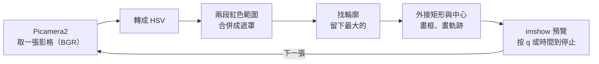

這張流程圖是教學示意，不是操作截圖。更多 HSV 與 `inRange` 的說明可參考 [OpenCV 官方教學](https://docs.opencv.org/4.x/da/d97/tutorial_threshold_inRange.html)。

## 第一步：準備場景、環境與練習資料夾

**為什麼先做這一步：**相機前要有會動的紅色目標，Python 要能同時找到相機工具和 OpenCV，程式才有東西可追。

1. **場景（在 RP5 旁邊）。**相機要先能拍照（[第 07 課](./第%2007%20課｜連接%20Raspberry%20Pi%205%20相機模組.md)、[第 15 課](./第%2015%20課｜在%20Raspberry%20Pi%205%20使用%20Libcamera、Picamera2%20與%20OpenCV.md)），已經能拍的 RP5 不需要重新拆接。在另一台電腦的螢幕上用瀏覽器開啟[相機測試畫面](./練習素材/RP5相機測試.html)，「畫面」選 **移動追蹤**，按 **全螢幕**，大小約 80%；畫面中會有一個左右來回移動的紅色圓形。把相機固定對準這個螢幕。也可以改用桌上一個紅色杯子，用手慢慢移動。**相機畫面裡不要有其他紅色東西，也不要拍到帳號、訊息或他人臉孔。**
2. **先確認相機看得到紅圓。**在 RP5 的終端機輸入下面這行，拍一張照片後用檔案管理員打開 `check.jpg` 看看：

   ```bash
   rpicam-still -n -t 500 --width 1280 --height 720 -o check.jpg
   ```

   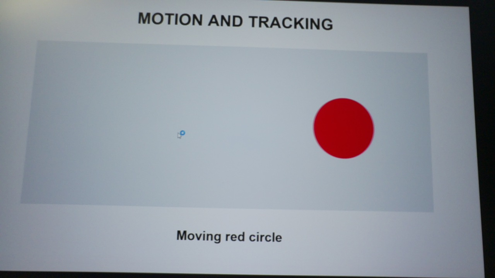

   *圖：本次以 `rpicam-still` 拍到的畫面（相機實拍螢幕上的生成動畫，不是實物）。只要紅圓完整出現在畫面中，就可以往下做；畫面略為傾斜沒關係，本課不做透視校正。*
3. **練習資料夾。**在 RP5 家目錄建立 `lesson28`，把[主程式](./範例程式/第28課-相機紅色追蹤.py)存成 `~/lesson28/第28課-相機紅色追蹤.py`。
4. **選直譯器。**這支程式同時需要 Picamera2、OpenCV 和 NumPy，和第 16 課相同。本次選用 `/home/pi/ba5077-camera-contrib-trixie-20261110/bin/python3`；建立方式見 [Thonny 環境指南](./Thonny環境與套件安裝.md)。在 Thonny 點右下角的直譯器名稱可以切換；清單中沒有時選 **Configure interpreter…**，按 **…** 挑選路徑。

## 第二步：讀程式，先找出四個關鍵動作

```python
from pathlib import Path
import time

import cv2
import numpy as np
from picamera2 import Picamera2

MAX_SECONDS = 20          # 最多執行幾秒
SIZE = (640, 480)         # 相機影像寬、高
MIN_AREA = 500            # 小於這個面積（像素）的紅色區塊當作雜訊

# 紅色在 HSV 的色相（H）橫跨 0 和 179 兩端，所以要用兩段範圍再合併
LOWER_RED_1, UPPER_RED_1 = (0, 120, 80), (10, 255, 255)
LOWER_RED_2, UPPER_RED_2 = (170, 120, 80), (179, 255, 255)

folder = Path(__file__).resolve().parent
result_path = folder / "lesson28-camera-track.png"

camera = Picamera2()
camera.configure(camera.create_preview_configuration(main={"size": SIZE, "format": "RGB888"}))
camera.start()
time.sleep(1)             # 讓相機先調好曝光

frames = 0
centers = []              # 每張偵測到的中心 (x, y)
trail = []                # 最近 30 個中心，用來畫移動軌跡
last_view = None
stopped_by = "time limit"
start = time.monotonic()
try:
    while time.monotonic() - start < MAX_SECONDS:
        frame = camera.capture_array()          # 這個設定下的陣列是 OpenCV 用的 BGR 順序
        frames += 1
        hsv = cv2.cvtColor(frame, cv2.COLOR_BGR2HSV)
        mask = cv2.inRange(hsv, LOWER_RED_1, UPPER_RED_1) | cv2.inRange(hsv, LOWER_RED_2, UPPER_RED_2)
        mask = cv2.morphologyEx(mask, cv2.MORPH_OPEN, np.ones((5, 5), np.uint8))

        contours, _ = cv2.findContours(mask, cv2.RETR_EXTERNAL, cv2.CHAIN_APPROX_SIMPLE)
        big = [c for c in contours if cv2.contourArea(c) > MIN_AREA]
        if big:
            x, y, w, h = cv2.boundingRect(max(big, key=cv2.contourArea))
            center = (x + w // 2, y + h // 2)
            centers.append(center)
            trail = (trail + [center])[-30:]
            cv2.rectangle(frame, (x, y), (x + w, y + h), (0, 255, 0), 2)
            cv2.circle(frame, center, 5, (255, 0, 0), -1)
            cv2.putText(frame, f"center {center}", (x, max(20, y - 10)),
                        cv2.FONT_HERSHEY_SIMPLEX, 0.6, (0, 255, 0), 2)
        for a, b in zip(trail, trail[1:]):
            cv2.line(frame, a, b, (255, 0, 255), 2)
        cv2.putText(frame, f"frame {frames}", (10, 30), cv2.FONT_HERSHEY_SIMPLEX, 0.8, (0, 0, 255), 2)

        last_view = cv2.hconcat([frame, cv2.cvtColor(mask, cv2.COLOR_GRAY2BGR)])
        cv2.imshow("lesson28 red tracking (press q to stop)", last_view)
        if cv2.waitKey(1) & 0xFF == ord("q"):
            stopped_by = "q"
            break
finally:
    seconds = time.monotonic() - start
    camera.stop()
    camera.close()
    cv2.destroyAllWindows()

if last_view is not None:
    cv2.imwrite(str(result_path), last_view)
print("stopped by", stopped_by)
print("frames:", frames, "seconds:", round(seconds, 1), "fps:", round(frames / seconds, 1))
print("red detections:", len(centers))
if centers:
    xs = [c[0] for c in centers]
    print("first centers:", centers[:3])
    print("last centers:", centers[-3:])
    print("x range:", min(xs), "to", max(xs))
print("saved:", result_path.name)
```

先不要急著執行，我們在程式裡找到這四個地方：

| 動作 | 找哪一行 | 它在做什麼 |
| --- | --- | --- |
| 設定紅色範圍 | `LOWER_RED_1` 到 `UPPER_RED_2` | 兩段 H 範圍；S 至少 120、V 至少 80，太淡或太暗的紅色不算。 |
| 做遮罩 | 兩個 `cv2.inRange` 用 `\|` 合併 | 兩段遮罩用「或」合併，再用 `MORPH_OPEN` 擦掉零星的小白點。 |
| 找目標 | `findContours` → `MIN_AREA` → `max(...)` | 找出所有白色區塊，丟掉小於 500 像素的雜訊，留下最大的一塊當作目標。 |
| 顯示與停止 | `imshow`、`waitKey(1)`、`finally:` | 左邊是加框的相機畫面，右邊是遮罩；按 `q` 跳出迴圈；不論怎麼結束都會釋放相機、關視窗。 |

`capture_array()` 在這個設定下給的陣列已經是 OpenCV 習慣的 BGR 順序，所以可以直接 `COLOR_BGR2HSV`。如果你看到紅色被當成藍色，就是顏色順序弄反了（見下方排錯表）。

## 第三步：在 Thonny 執行，觀察視窗與 Shell

1. 在 RP5 桌面的 Thonny 選 **File → Open**，開啟 `~/lesson28/第28課-相機紅色追蹤.py`。
2. 確認右下角是第一步選好的直譯器，按綠色 **Run**。
3. 約 1 秒後會跳出標題為 `lesson28 red tracking (press q to stop)` 的視窗。紅圓移動時，綠框和藍色中心點會跟著它跑，後面拖著一小段紫色軌跡；框的上方會顯示中心座標。
4. 想提早停止時，先**點一下預覽視窗**再按 `q`；不按的話 20 秒後自動停止。停止後 Shell 會印出結果，練習資料夾會多一張 `lesson28-camera-track.png`（再次執行會覆寫）。

Shell 中以 `[` 開頭、含 `INFO` 或 `WARN` 的紅色行是相機程式庫的日誌，不一定是錯誤；真正的錯誤通常以 `Traceback` 開頭。

### 本次 RP5 實測結果（2026-11-11）

環境：Raspberry Pi 5 Model B、既有 Debian 13（Trixie）64 位元、Python 3.13.5、OpenCV 4.12.0、NumPy 2.2.4、IMX708 廣角相機；直譯器 `/home/pi/ba5077-camera-contrib-trixie-20261110/bin/python3`。相機對著另一個螢幕上全螢幕播放的測試頁「移動追蹤」。**這是相機拍攝螢幕上的生成動畫，不是實物。**

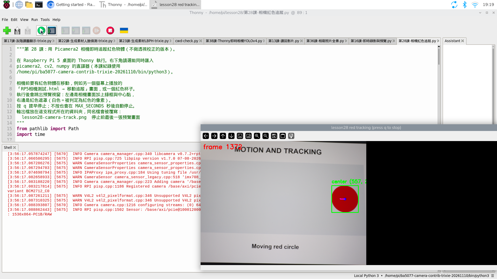

*圖：RP5 桌面的完整操作截圖。上方是 Thonny 的程式，右下角狀態列是所選直譯器；預覽視窗顯示第 1372 張，綠框跟著紅圓。因為視窗比螢幕寬，右半的遮罩只露出一部分。*

這次沒有按鍵，讓程式跑滿 20 秒，Shell 印出：

```text
stopped by time limit
frames: 1606 seconds: 20.0 fps: 80.2
red detections: 1606
first centers: [(407, 219), (428, 220), (430, 220)]
last centers: [(120, 212), (119, 212), (118, 212)]
x range: 40 to 558
saved: lesson28-camera-track.png
```

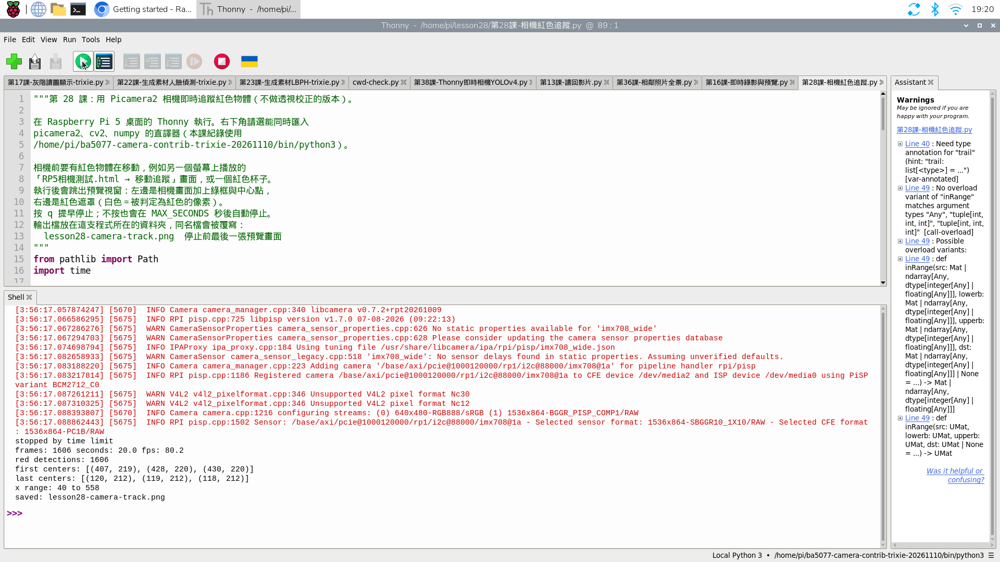

*圖：停止後的 Thonny 操作截圖。右側 Assistant 面板的型別提醒來自 Thonny 的靜態檢查，不影響執行。*

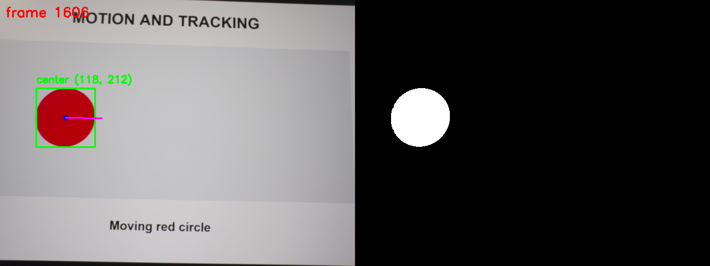

*圖：程式自動存下的 `lesson28-camera-track.png`，屬於程式輸出，不是操作截圖。*

### 這些數字代表什麼

- `frames: 1606` 和 `red detections: 1606` 相同：20 秒內每一張畫面都找到了紅色目標，沒有漏掉。
- `x range: 40 to 558`：中心的 x 座標在 640 像素寬的畫面中從 40 移到 558，代表紅圓幾乎從畫面左邊跑到右邊，而 y 一直在 212～220 附近，符合測試頁「左右來回」的動畫。第一筆約 407、最後一筆約 118，表示停止時紅圓正往左移。
- `fps: 80.2`：這支程式只做顏色判斷、不寫影片，所以每秒能處理約 80 張，比第 16 課（要寫影片）快很多。這個數字會隨畫面大小、RP5 同時在做的事改變。

你的數字不會和這裡完全相同：紅圓的位置、相機角度、光線都會影響座標。判斷成功的方法是：**預覽視窗中的綠框一直跟著紅色目標**、**偵測次數接近影格數**、**中心 x 座標會隨著移動而變化**。

## 遇到問題時

| 你看到的情況 | 可能原因 | 先試試看 |
| --- | --- | --- |
| `red detections: 0`，遮罩一片黑 | 相機沒拍到紅色、太暗，或 S／V 下限太高 | 先用 `rpicam-still` 確認畫面；把 `(0, 120, 80)` 的 120 改成 100 再試。 |
| 遮罩到處是白點，框亂跳 | 背景有其他紅色或偏紅的東西、範圍太寬 | 移走紅色雜物；把 S 下限調高；或把 `MIN_AREA` 改大。 |
| 紅色物體被當成藍色、找不到 | 顏色順序弄反（RGB 與 BGR） | 確認設定是 `"format": "RGB888"` 並用 `COLOR_BGR2HSV`；換了別的設定時要跟著改。 |
| `Device or resource busy` | 相機正被其他程式使用 | 停止其他相機程式（Thonny 按紅色 Stop），再執行。 |
| `ModuleNotFoundError: No module named 'picamera2'` 或 `'cv2'` | 直譯器選錯 | 回第一步改選同時有 Picamera2 和 OpenCV 的環境。 |
| 沒有跳出視窗，出現 `could not connect to display` 或 `qt.qpa` | 不是在 RP5 桌面執行 | 在 RP5 桌面（或 Raspberry Pi Connect 桌面分享）中的 Thonny 執行。 |
| 按 `q` 沒反應 | 鍵盤焦點在 Thonny | 先點一下預覽視窗，再按 `q`；或等 20 秒自動停止。 |

## 練習：一次只改一個地方

1. 把 `MAX_SECONDS` 改成 `10`，先預測影格數大約多少，再執行驗證。
2. 把 `MIN_AREA` 改成 `20000`（比紅圓還大），預測 `red detections` 會變成多少，再執行驗證；最後改回 500。
3. 在測試頁按 **暫停動畫**（或空白鍵）讓紅圓停住，再執行一次。這次 `x range` 會變成什麼樣子？為什麼？
4. 進階：測試頁改選 **色彩偵測**，把兩段紅色範圍改成綠色（H 約 40～80），讓程式改找綠色方塊。**不要把拍到私人環境的截圖上傳到公開作業。**

## 補充一：不用相機，先用合成圖理解遮罩

沒有相機時，可以先用程式自己畫一張圖來理解遮罩。下載[第 28 課入門程式](./範例程式/第28課.py)，在 Thonny 選裝有 OpenCV 的環境按 Run。程式畫一個 20 × 20 的紅色方塊，轉成 HSV 後挑出紅色，會寫入 `lesson28-mask.png`（再次執行會覆寫）。

```python
import cv2
import numpy as np
image = np.zeros((100, 100, 3), dtype=np.uint8)
image[20:40, 30:50] = (0, 0, 255)
hsv = cv2.cvtColor(image, cv2.COLOR_BGR2HSV)
mask = cv2.inRange(hsv, (0, 100, 100), (10, 255, 255))
if not cv2.imwrite('lesson28-mask.png', np.hstack((image, cv2.cvtColor(mask, cv2.COLOR_GRAY2BGR)))):
    raise RuntimeError('image save failed')
print('red pixels', cv2.countNonZero(mask))
```

先前在 Thonny 的實測輸出為 `red pixels 400`，正好是 20 × 20。

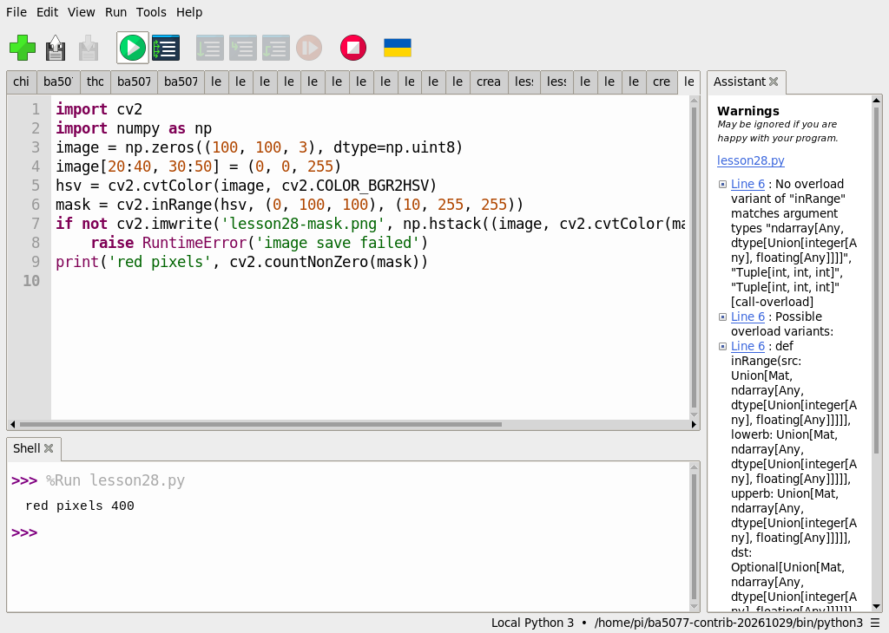

截圖中的 `lesson28.py` 為 `第28課.py` 的測試副本，內容相同（較早的 Python 3.11、opencv-contrib-python 4.11.0.86 環境）。

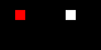

## 補充二：六張合成移動色塊（2026-11-10，Thonny 實測）

[完整程式](./範例程式/第28課-合成移動色塊.py)用程式畫出六張 320 × 180 的影格，紅方塊每張向右移 35 像素，逐張找最大紅色輪廓和中心，寫入 `lesson28-generated-motion.png`。這**不是相機影像**，只用來理解「中心座標隨影格變化」。在既有 Trixie、Python 3.13.5、OpenCV 4.12.0 的 Thonny 實測輸出：

```text
frames: 6
red detections: 6
centers: [(45, 80), (80, 80), (115, 80), (150, 80), (185, 80), (220, 80)]
saved: lesson28-generated-motion.png
```

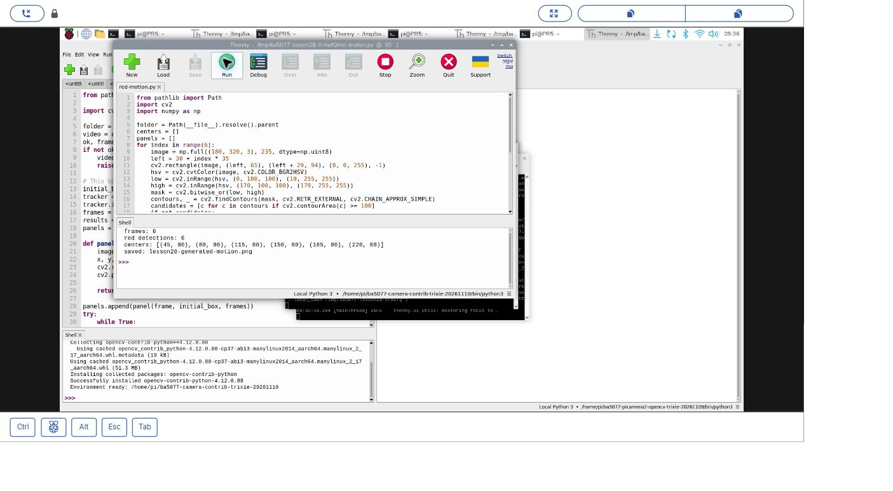

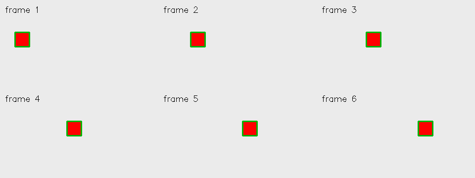

第一張是 Thonny 操作截圖；第二張是程式合成並標框的結果圖。

## 補充三：較早的相機照片與六影格紀錄（終端機執行）

以下兩項是 2026-10-29 以終端機執行的相機紀錄，保留作為對照，未在 Thonny 重做：

- **單張照片的紅色偵測**：用[第28課-相機照片偵測.py](./範例程式/第28課-相機照片偵測.py)處理相機拍攝螢幕上「色彩偵測」畫面的 1920 × 1080 照片；因照片包含螢幕外的紅色物品，程式先用固定的 ROI（感興趣區域）把其他地方的遮罩清掉。輸出 `large red regions: 1`、`largest red box (x, y, w, h): 784 283 150 157`、面積 14982.0。ROI 座標只適用當時的相機位置。

  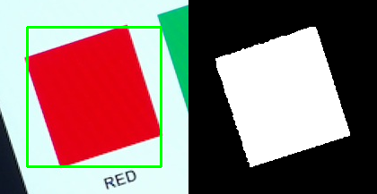

  左圖是相機照片中目標周圍的裁切圖，綠框為偵測範圍；右圖是對應的遮罩。
- **六張相機影格＋透視校正**：用[第28課-相機移動色塊.py](./範例程式/第28課-相機移動色塊.py)拍六張 1920 × 1080 影格，先以四個 `source` 角點把螢幕拉正成 600 × 338，再找紅色。中心依序為 `(207, 171)`、`(286, 171)`、`(368, 170)`、`(439, 170)`、`(487, 169)`、`(502, 169)`，六張都偵測到。四個角點**只適用當時的相機位置**，相機或螢幕一動就要重新量測，否則會偵測失敗或把周圍環境留在圖中；這也是本課主線改用不做校正版本的原因。

  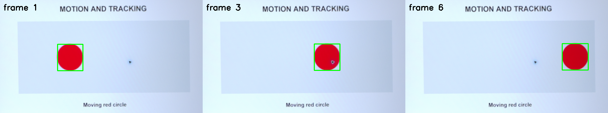

  圖片經裁切與透視校正，框線是程式輸出，不是操作截圖。

## 後續應用與提醒

顏色追蹤可以用在產線顏色分揀、實驗室標記追蹤，或作為物件偵測前的影像分割。它的限制也很明顯：光線一變、出現另一個同色物體、目標被遮住，框就可能跳走或消失。要同時追多個同色目標，需要把每一張的目標和上一張「配對」並處理遮擋；第 25 課的追蹤器和第 38 課以後的物件偵測，就是更進一步的做法。實際部署前也要想清楚相機拍到誰、畫面會不會被保存。

## 與原文章的差異

- 2026-11-11 全文重編為零基礎學生路徑，主線改為「Picamera2 連續取像＋HSV 紅色遮罩＋即時預覽與框選」，新增[主程式](./範例程式/第28課-相機紅色追蹤.py)；不做透視校正，免去重新量測四角座標。原有合成、單張照片與六影格相機紀錄改列補充，不重做。
- 新增實測：既有 Trixie 的 RP5 在 **Thonny 按 Run**，相機拍攝螢幕上的移動紅圓（生成動畫），640 × 480、20.0 秒 1606 影格、1606 次偵測、中心 x 40～558；附 `rpicam-still` 確認照、兩張完整桌面操作截圖與程式輸出圖。
- 本次未測：按 `q` 停止（程式寫法與第 16 課相同，第 16 課已實測）、實體紅色物品、多個同色目標、長時間執行。上述輸出為本次實機紀錄，其他場景或環境可能不同。

<details>
<summary>給教師：實測範圍與版本備註</summary>

> - 2026-11-11 晚間：RP5 IP `192.168.1.78`。相機對著 Windows 第二螢幕（1920 × 1080），以獨立設定檔的 Chrome kiosk 全螢幕開啟本機 HTTP 伺服器提供的 `RP5相機測試.html` 副本，載入時自動選「移動追蹤」、大小 80%（只為免去手動點選，畫面內容未改）。先以 `rpicam-still` 確認相機看得到紅圓。
> - Thonny 操作：從 Windows 以 SSH 通道連到 RP5 上僅聽 127.0.0.1 的臨時 wayvnc，以 TigerVNC 在 RP5 桌面的 Thonny 用 **File → Open** 開啟 `~/lesson28/第28課-相機紅色追蹤.py`、按 Run；截圖以 `grim` 擷取整個 RP5 桌面，已檢查只含 Thonny、課程檔名與相機拍到的測試頁。程式 SHA-256 `2068bedc…661a`。
> - 每秒約 80 張是迴圈處理速度，相機在 640 × 480 預覽設定下的影格率未另行鎖定；不要把它當成相機規格。
> - [逐篇進度](./Thonny逐篇實測狀態.md) · [圖片與程式下載方式](./練習素材/素材下載與使用.md)

</details>
