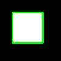

# 第 29 課｜使用 OpenCV 進行輪廓檢測與繪製

[原始文章](https://liusming.pixnet.net/blog/posts/14222886531) · 更新日期：2026-10-29

## 學習目標

用二值圖像尋找外部輪廓並計算面積。

## 事前準備

需要 OpenCV 與 NumPy；先建立一個合成白色矩形。

本教學程式使用合成資料，沒有把私人相機影像上傳公開 repo；請在自己的練習目錄操作。

## 程式與執行

將下列程式存為 `第29課.py`，或使用[已測試的範例程式](./範例程式/第29課.py)。

```python
import cv2
import numpy as np
image = np.zeros((100, 100), dtype=np.uint8)
cv2.rectangle(image, (20, 20), (70, 70), 255, -1)
contours, _ = cv2.findContours(image, cv2.RETR_EXTERNAL, cv2.CHAIN_APPROX_SIMPLE)
result = cv2.cvtColor(image, cv2.COLOR_GRAY2BGR)
cv2.drawContours(result, contours, -1, (0, 255, 0), 2)
if not cv2.imwrite('lesson29-contour.png', result):
    raise RuntimeError('image save failed')
print('contours', len(contours))
print('area', cv2.contourArea(contours[0]))
```

在該檔案所在目錄執行 `python3 第29課.py`。

## 本機實際輸出

```text
contours 1
area 2500.0
```

找到一條外輪廓。OpenCV 的幾何輪廓面積與直接計算白色像素數並非同一件事。

## RP5 實際產生的結果圖



合成矩形的外輪廓。 圖片由本課程式在 RP5 執行時儲存，是程式輸出，不是操作畫面截圖。

## 與原文章的差異

- 原文使用外部圖片；本版避免以 VideoCapture 讀取單張圖片，改採合成圖並驗證輪廓。
- 以上是本機實際合成資料輸出；不同版本可能產生不同數值。
- 尚未保存操作畫面截圖。
